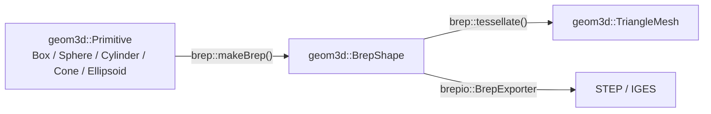

# brep —— 运行时 B-rep 运算

> **状态**：现行（两个接口与无后端分支已落地；OpenCASCADE 函数体待带后端的构建验证）
> **最后核对**：2026-11-03
> **范围**：`src/base/brep`：B-rep 的运行时运算（三角化、由基本体造实体，及将来的布尔）的归属与契约。
> 不含 `BrepShape` 的数据定义（见 `graphics-geometry.md` §3.5）、不含 STEP/IGES 读写（见 `meshio-brepio-design.md`）、不含包围盒与 OBB（见 `geometry-primitives.md`）。
> **权威来源**：`src/base/brep/sdk/vine/brep/Backend.hpp`、`src/base/brep/sdk/vine/brep/Tessellation.hpp`、`src/base/brep/sdk/vine/brep/Construction.hpp`、`tests/test_brep`。
> **待办**：`../backlog/brep.md`

## 1. 概要设计

### 1.1 问题与背景

B-rep 在仓库里原本只有两半：

- **数据**：`geometry` 的 `BrepShape`——持有后端形状的句柄，SDK 只前向声明 `TopoDS_Shape`，不引 OpenCASCADE 头、不链接。
- **文件**：`brepio` 的 STEP/IGES 读写——需要 OpenCASCADE，PRIVATE 链接，没找到后端就回答 `IoError::Unsupported`。

缺的是第三半：**运行时对实体本身做运算**（三角化给渲染、由基本体造实体、将来的布尔）。把它塞进任何一边都不成立：

- 放进 `geometry`：base 模块从此链接 OpenCASCADE，所有 geometry 消费者跟着付钱，且公共头出现后端词汇。
- 放进 `brepio`：那个模块是"读取保存"，而三角化与文件无关；它还会为了一个运算把 `Runtime`/`Crypto`/`IOBase` 的使用者拉进来。

### 1.2 目标

- 运行时 B-rep 运算有一个只依赖 `geometry` 的家。
- OpenCASCADE 只有**一个探测点**，两个需要它的模块各自 PRIVATE 链接。
- 没有后端时接口仍然存在且行为确定：`hasBackend()` 回答构建能力，两个运算各自返回空值。
- 由参数化基本体造实体与三角化同住 `brep`、共用同一条后端链接：一个基本体能变成可三角化、可导出的实体。

### 1.3 非目标

- 不做多后端与插件注册：今天只有 OpenCASCADE 一个后端（`G8`）。
- 不做 `Primitive` → 网格：那是纯数学、零依赖，归 `geometry`（已落地，见 `geometry-tessellation.md`），不归这里。
- 构造只覆盖 `geometry` 定义的五个基本体：不做由网格/线框造实体，也不做布尔与缝合；本期不实现任何 OpenCASCADE 函数体（`../backlog/brep.md`）。

### 1.4 一句话结论

**数据归 `geometry`，文件归 `brepio`，运算归 `brep`；后端只探测一次，且永远不进 `geometry` 的公共头。基本体造实体与三角化是同一种运算，共用一个模块、一条链接、一种失败表示。**

## 2. 设计要点

### 2.1 三个模块各管一段

| 模块 | 职责 | 依赖 | OpenCASCADE |
|---|---|---|---|
| `vn::Geometry` | 形状数据：`Shape` / `Mesh` / `Primitive` / `BrepShape`（纯句柄） | Math、Core | 不碰 |
| `vn::Brep` | 运行时运算：三角化、`makeBrep`，将来的布尔 | Geometry | 可选，PRIVATE |
| `vn::BrepIO` | 文件：STEP/IGES/BREP 的读写 | Runtime、Geometry、Crypto、IOBase | 可选，PRIVATE |

`Brep` 与 `BrepIO` 是兄弟，不互相依赖：一个管运算、一个管文件。满足 `G1`（职责一条边界）与 `G5`（预期变更留在模块内）。

**为什么是 `src/base`（G2、G5）**：判据是“最低够用的层”，不是“有没有第三方依赖”——`base` 里的 `crypto` 拉 wolfSSL、`iobase` 建 zlib、
`window` 用平台 API、`crash` 用 dbghelp，底座从来不是零依赖，它只是与框架无关。`brep` 的消费者在两侧：`brepio`（`loaders`）要
“基本体 → STEP”，`graphics`（`viz`）要“B-rep → 三角化 → 显示”，而 `src/CMakeLists.txt` 的配置顺序是
`base → loaders → viz → fw → robotics → plugins → apps`。放到 `loaders` 之上，`brepio` 就得向上依赖；放进 `loaders` 本身，
模块名把运算说成文件，还会拉进 `Runtime` / `Crypto` / `IOBase`。`base` 是唯一同时低于两个消费者、又已经装着它唯一依赖
`geometry` 的层。

`core` 在这张图的最底下（只链 `vn::Global`），放进去等于写一条 `core → geometry` 的回边（`G2`）；单独开一层（例如新开一个 `cad` 层）
今天只有一个成员（`G8`），等第二个 CAD 级模块出现再连同 `geometry` / `brep` / `brepio` 一起升级。另有一个机械理由：
`vn_add_library` 对模块目录是 `GLOB_RECURSE`，把 `brep` 嵌进 `geometry` 的目录会被 `geometry` 的源文件 glob 吞掉，
同层并列才各自是一个目标。

### 2.2 一个探测点、私有链接

`cmake/VineOpenCASCADE.cmake` 做唯一一次 `find_package(OpenCASCADE CONFIG QUIET)`，并给出 `vn_link_opencascade(target macro [BOOLEANS])`：定义该模块自己的 `VN_*_HAS_OCCT`、PRIVATE 链接需要的 OCCT 模块。两个模块都调它，`find_package` 结果被缓存、导入目标相同。

PRIVATE 是关键：`vn::Brep` 的消费者不会继承 OpenCASCADE（`G10` 关注真实成本）。

构造用的 `BRepPrimAPI_*` 在 `TKPrim`，纳入 helper 的基础模块表；`BOOLEANS`（`TKBO` / `TKBool`）仍只留给真正做布尔的代码。

### 2.3 失败是空值，能力是查询

运算不返回 `Result`：失败就是一个空句柄，而“为什么空”由 `hasBackend()` 回答——它是构建属性，不是每次调用的结果。两个先例同形：`brepio` 用空的 `supportedExtensions()` 区分“没后端”与“文件有问题”，`graphics::geometryFromShape()` 用一个空几何表示“转不出网格”。

不借用 `vn::io::Result` / `IoError`：那套词汇（`NotFound`、`PermissionDenied`、`IsADirectory`…）描述的是存储失败，与三角化无关；借用它还会让一个只做运算的模块为了错误类型链接 `IOBase`。也不新造错误枚举：今天只有两种失败，一种还是构建属性（`G4`、`G8`）。

### 2.4 没有后端时契约仍然成立

无后端时走 `#else` 分支：`hasBackend()` 回答 false、两个运算各自返回空值；有后端时各自的 `VN_BREP_HAS_OCCT` 分支做真正的构造与三角化。所有入口的名字与签名不随后端存在与否改变（`G9`）：调用方只写一条失败分支，`test_brep` 在没有 OpenCASCADE 的构建里也能编译、运行。

### 2.5 输出是 `TriangleMesh`，不带包围盒

三角化只回答"这个实体由哪些三角形组成"：顶点与索引在实体自身空间，`compute_normals` 时带法线。包围盒与 OBB 由调用方用已有的 `Aabb::compute()` / `Obb::computePca()` 从顶点量——不引入第二套包围盒算法（`G1`、`D4`）。

### 2.6 三角化不是 `BrepShape` 的成员

做成成员就必须把实现放进 `geometry`，等于让 base 模块链接 OpenCASCADE，并让 `BrepShape.hpp` 从"前向声明后端类型"退化成"依赖后端"。自由函数把后端留在 `brep`，`geometry` 继续零第三方（`G2`、`D1`）。

### 2.7 构造是第二件运算，按 `shapeType()` 分派

- **是什么**：`brep::makeBrep(const geom3d::Primitive&) → intrusive_ptr<BrepShape>`；公开入口只有一个，内部按 `shapeType()` 分派到逐类型的构造函数（`Box` / `Sphere` / `Cylinder` / `Cone` / `Ellipsoid`）。
- **为什么**：`G1`、`G2`、`G6` —— 与 `tessellate()` 同属"对实体做的运算"，同住一个模块、共用一条 PRIVATE 链接、共用一种失败表示；做成 `Primitive` 的虚函数或访问者会把后端词汇与实现拖进 `geometry`（`D5`，与 `D1` 同因）。
- **边界**：分派是闭集。新增第六个基本体要在这里加一个分支——这是 `G9` 的代价，换来 `geometry` 保持零第三方；分派表只有一处，不会散到每个消费方（`G7`）。

### 2.8 结果占据基本体的局部空间（尺寸映射表）

- **是什么**：造出的实体正好占据基本体描述的局部空间，与 C1 同一立场——不放置、不缩放、不做单位换算。
- **为什么**：`G4`、`G12` —— 给基本体什么尺寸，量出的实体就是什么尺寸；类型名与坐标约定必须能互相读出。
- **边界**：放置属于消费方（`graphics::Node` 的变换、装配体的位姿），`makeBrep` 不接受位姿参数（`D7`）。

| 基本体 | 局部空间 | 后端构造 | 精确性 |
|---|---|---|---|
| `Box(w,h,d)` | 原点居中，边长 w/h/d | `BRepPrimAPI_MakeBox`（角点取 `(-w/2,-h/2,-d/2)`） | 精确 |
| `Sphere(r)` | 原点居中 | `BRepPrimAPI_MakeSphere(r)` | 精确 |
| `Cylinder(r,h)` | 轴 = +Z，z ∈ [-h/2, +h/2] | `BRepPrimAPI_MakeCylinder`（轴点取 z = -h/2） | 精确 |
| `Cone(r,h)` | 轴 = +Z，底面 z = -h/2 半径 r，顶点 z = +h/2 | `BRepPrimAPI_MakeCone`（底半径 r、顶半径 0、轴点 z = -h/2） | 精确 |
| `Ellipsoid(rx,ry,rz)` | 原点居中、轴对齐 | 单位球 + 非均匀缩放（`BRepBuilderAPI_GTransform`，对角 `gp_GTrsf`） | 近似 |

### 2.9 椭球是近似，其余四个精确

- **是什么**：OpenCASCADE 没有三轴椭球基本体（其椭球面只是绕 Z 轴的旋转椭球，两个半轴相等），三轴椭球只能由非均匀缩放得到，面变成 B 样条。
- **为什么**：`G4`、`G10` —— 与其假装精确，不如把"唯一近似的那个"写进契约：边界与体积只在变换容差内与解析值相符。
- **边界**：近似只影响几何表示，不影响拓扑（仍是一个闭合实体）；`Box` / `Sphere` / `Cylinder` / `Cone` 造出的是精确实体，可以对它们做精确断言（`N4`）。

### 2.10 能力属于模块，只有一个查询

- **是什么**：`hasBackend()` 回答“这个构建有没有 B-rep 后端”，三角化与构造共用它，不再各有一个按操作命名的查询。
- **为什么**：`G1`、`G4`、`G6` —— 能力是模块的构建属性，不是某个运算的属性：两个运算由同一个宏、同一条私有链接决定，两个名字只会让调用方把同一个事实记两遍，还会诱使一个运算的调用方去问另一个运算（`D6`）。
- **边界**：失败仍是空句柄（2.3）；空句柄的原因分两级——构建级（没后端）问 `hasBackend()`，输入级（实体没形状 / 基本体无效 / 类型不在五个之内）问 `isValid()` 与 `shapeType()`。将来某个后端只支持其中一个运算时，才在这里拆成按运算的能力查询（`G8`）。

### 2.11 造出来的实体是独立身份

- **是什么**：每次调用返回一个新的 `BrepShape`：名字继承基本体的 `name()`，`revision()` 从 0 开始，后端形状由结果独占持有（复制结果共享句柄，句柄内部引用计数）。
- **为什么**：`G6`、`G11` —— 与加载器产出的实体同一套身份规则：名字来自来源，revision 由持有者在改动完成后公告（`graphics-geometry.md` §3.5）。
- **边界**：不做按基本体缓存或去重。同一基本体连造两次得到两个实体，改一个不影响另一个；缓存要付出失效与生命周期成本，而今天没有重复构造的消费方（`G8`）。

## 3. 功能点

| # | 功能 | 行为 | 状态 |
|---|---|---|---|
| F1 | 三角化 | `tessellate(shape, options) → TriangleMesh`（空 = 失败）：按面三角化，索引按面朝向绕序 | 接口已落地，后端为桩 |
| F2 | 由基本体造实体 | `makeBrep(primitive) → BrepShape`（空 = 失败）：供导出与布尔使用 | 接口已落地，后端为桩 |

### 3.1 F1 三角化

- **行为**：逐面输出三角形；`deflection` 是面到三角形的最大距离，`angle` 是同一曲面上相邻三角形法线的最大夹角；`compute_normals` 为真时每个顶点带一个法线。
- **约束**（C1）：结果在实体自身空间，不做任何放置、缩放、变换。
- **约束**（C2）：面缝处顶点不焊接——同一棱上两面各有一份顶点，因为法线不同；索引绕序按各面自己的朝向。
- **要求**（R1）：没有后端或实体没有形状 → 空网格；要区分两者时先问 `hasBackend()`。
- **验收**（T1）：`TessellationTest` 覆盖无后端构建下的“能力为假 + 返回空网格”。
- **注意**（N2）：`deflection` 与 `angle` 是**后端无关**的契约，不暴露 OpenCASCADE 的其余参数。

### 3.2 F2 由基本体造实体

- **行为**：`makeBrep(primitive)` 返回一个占据基本体局部空间的闭合实体（映射见 `2.8`）；`shapeType()` 不在五个之内、`isValid()` 为假、本构建没有后端，三者都返回空句柄。
- **约束**（C3）：结果与基本体占据同一块空间——不放置、不缩放、不做单位换算。
- **约束**（C4）：尺寸只做 `float → double` 提升；尺寸断言按相对容差比较（`P7`）。
- **要求**（R4）：任何输入都不抛异常：后端失败（`Standard_Failure` 等）与输入无效一样转成空句柄。
- **要求**（R6）：结果继承基本体的 `name()`，`revision()` 从 0 开始。
- **验收**（T5）：五个基本体逐个“造 → 三角化 → 包围盒等于解析尺寸”的往返；椭球按容差断言。
- **注意**（N3）：`BrepShape::hasVolume()` 恒为 false，基本体回答的“有体积”不会跟着过来。

## 4. 公开接口

| 头文件 | 内容 | 状态 |
|---|---|---|
| `src/base/brep/sdk/vine/brep/Backend.hpp` | `hasBackend()`：模块级的构建能力 | 已落地 |
| `src/base/brep/sdk/vine/brep/Tessellation.hpp` | `TessellationOptions{ deflection, angle, compute_normals }`、`tessellate()` | 已落地 |
| `src/base/brep/sdk/vine/brep/Construction.hpp` | `makeBrep(const geom3d::Primitive&)` | 已落地 |

完整契约在头文件注释里；本文件只记录归属与理由。

## 5. 约束、要求与不变量

- **C1**：结果在实体自身空间，无变换、无缩放。
- **C2**：面缝顶点不焊接；`compute_normals == false` 时只有位置与索引。
- **C3**：构造结果与基本体占据同一块局部空间；不放置、不缩放、不做单位换算（与 C1 同一立场）。
- **C4**：构造尺寸只做 `float → double` 的类型提升；尺寸断言按相对容差比较（`P7`）。
- **R1**：没有后端或形状为空 → 空网格；`hasBackend()` 报告构建能力。
- **R2**：接口在无后端构建下仍可编译、可链接、可测试。
- **R3**：后端依赖 PRIVATE 链接，消费者不继承。
- **R4**：构造不抛异常：没有后端、基本体无效、类型不在五个之内、后端失败，一律空句柄。
- **R5**：构造接口在无后端构建下仍可编译、可链接、可测试（与 R2 同形）。
- **R6**：构造结果继承基本体的 `name()`；`revision()` 从 0 开始，由持有者公告改动。
- **N1**：空网格不是“错误值”，而是一个没有产出的结果；不要用它代替 `hasBackend()`。
- **N2**：`deflection` 用模型单位，与模型尺度绑定。
- **N3**：`BrepShape::hasVolume()` 恒为 false，因此“基本体有体积”不等于“实体回答有体积”。
- **N4**：只有椭球是近似的（面为 B 样条，边界/体积在容差内相符）；其余四个基本体造出的实体是精确的。
- **N5**：`hasBackend()` 是模块级的构建事实：两个运算的空值都不代替它，它也不说明输入是否有效。

## 6. 注意事项与陷阱

- **P1**：`deflection` 是**绝对长度**，把毫米模型和米模型混用时同一个 0.1 意义完全不同；缩放模型后要按比例改。
- **P2**：面缝不焊接会让顶点数约为焊接后的 2–3 倍；需要焊接的消费者自己合并在同一位置、同一法线的顶点，不要指望后端替它做。
- **P3**：旧实现里的 `length_scale` 只缩放了位置变换的平移分量，几何根本没有被缩放；本模块不提供这个参数，缩放请对实体本身做。
- **P4**：空网格有两种原因（没有后端 / 输入没形状），别把“返回空”当唯一诊断；先问 `hasBackend()`，再查看实体是否 `isValid()`。
- **P5**：圆柱/圆锥的 Z 区间目前只是头文件里的一句“centered on the Z axis”，不是类型保证。会怎么错：消费方按“底面在 z = 0”的另一种约定解释，整个几何沿 Z 错开 h/2。怎么判：量出的包围盒在 Z 上不对称。怎么防：实现时把头文件这句补成显式区间（z ∈ [-h/2, +h/2]、锥底在 -h/2），并在往返用例里断言。
- **P6**：把“本机没有后端”写进用例（`EXPECT_FALSE(hasBackend())`）在带后端的构建里必然失败。会怎么错：装了 OpenCASCADE 的机器上整个测试可执行文件红。怎么判：CI 有无后端两种构建的结果不一致。怎么防：用例按能力分支，两个分支各断言自己的结果（T7）。
- **P7**：椭球与 float 尺寸都不能用精确相等断言。会怎么错：解析尺寸经 float 往返后与 double 有约 1e-7 的相对差，椭球另有缩放容差，`EXPECT_DOUBLE_EQ` 直接红。怎么判：差异在容差内但不在位级相等。怎么防：按相对容差比较。
- **P8**：`makeBrep` 不是缓存。会怎么错：调用方以为两次调用得到同一个实体的两个引用，改一个期待另一个跟着变。怎么判：两次调用拿到的 `TopoDS_Shape` 不是同一份。怎么防：需要复用的调用方自己持有返回的指针。

## 7. 已否决选项

- **D1**：`BrepShape::triangulate()` 成员函数 —— 会把 OpenCASCADE 拖进 `geometry`，base 模块与公共头都失守（`G2`、`G5`）。见 `../decisions/ADR-2026-11-03-brep-operations-module.md`。
- **D2**：放进 `brepio` —— 模块名说"文件"，而运算是运行时需求，还会为无关能力拉上 `Runtime`/`Crypto`。
- **D3**：插件化后端（`BrepBackend` 抽象 + 注册）—— 为单一后端建机制，`G8` 反对；等第二个后端出现再升级。
- **D4**：用 `Bnd_Box` / `Bnd_OBB` 产出包围盒 —— 我们已有精确的 `Aabb::compute` 与 `Obb::computePca`，不引入第二套算法。
- **D5**：`Primitive::toBrep()` 虚函数或访问者 —— 把后端实现与词汇拖进 `geometry` 的公共头（`G2`），与 D1 同因。
- **D6**：每个运算一个按名字的能力查询（`tessellationSupported()` / `makeBrepSupported()`）—— 同一个构建事实两个名字，调用方要记两遍，还会被诱导去问另一个运算（`G1`、`G4`）；能力属于模块，只有一个 `hasBackend()`。
- **D7**：放进 `core` —— `core` 只依赖 `vn::Global`，`brep → geometry` 在那里是一条回边（`G2`）。
- **D8**：放进 `loaders` / `viz` / `robotics`，或为它新开一层 —— 前三个都在依赖链上方，是消费者而不是归属（`G2`）；新层今天只有一个成员（`G8`）。
- **D7**：`makeBrep(primitive, placement)` 接受变换 —— 基本体没有变换通道，放置属于消费方；加进来等于给 `BrepShape` 引入 `geometry` 未定义的位置语义（`G4`、`G8`）。
- **D8**：构造后跑 `BRepCheck_Analyzer` —— 尺寸合法的基本体造不出坏实体，全拓扑校验的代价换不到信息（`G10`）。
- **D9**：每个基本体一个公开重载 —— 今天没有需要绕过 RTTI 的消费者，五个入口的文档与测试成本先不付（`G8`）；内部已按类型分开，将来加公开重载不改实现。

## 8. 测试与验收

| # | 判据 | 用例 |
|---|---|---|
| T1 | 无后端构建：能力查询为假，调用返回空网格 | `tests/test_brep/TessellationTest.cpp` |
| T2 | 后端落地后：盒体三角化为 12 个三角形、法线单位长度、顶点落在盒面上 | 待新增（见 backlog） |
| T3 | 后端落地后：没有后端的构建仍回答空网格且能力为假 | 待新增 |
| T4 | 无后端构建：`hasBackend()` 为假，`makeBrep()` 返回空句柄 | `tests/test_brep/ConstructionTest.cpp` |
| T5 | 五个基本体逐个“造 → 三角化 → 包围盒等于解析尺寸”（椭球按容差） | `tests/test_brep/ConstructionTest.cpp` |
| T6 | 无效尺寸、未知类型 → 空句柄；`name()` 被继承 | `tests/test_brep/ConstructionTest.cpp` |
| T7 | 三角化与构造用例都按能力分支，带后端/无后端的构建都通过（`P6`） | `tests/test_brep` |

## 9. 状态与演进

### 9.1 现状

模块、头文件契约、CMake 探测、OpenCASCADE 分支与无后端分支都已落地。**后端分支已在带 OpenCASCADE 8.0.0（vcpkg `x64-windows`）的构建里编译并验证**：`test_brep` 与 `test_brepio` 全部通过（含五个基本体的往返与包围盒、网格往返）。

由基本体造实体（F2）已落地（`2.7`–`2.11`、`3.2`），与三角化共用同一条探测与 PRIVATE 链接，两侧都已在同一台机器上跑通。

### 9.2 已知缺口

- 布尔/缝合：见 `../backlog/brep.md`，有触发条件。
- 渲染路径尚未接入：`graphics::geometryFromShape()` 仍只接受网格；三角化落地后再把"加载 B-rep → 三角化 → 显示"接起来。
- 部署：OCCT 的运行时 DLL 由 `vn_link_opencascade` 拷到构建输出目录（见 `cmake/VineOpenCASCADE.cmake`）；发布包的部署（与 `VineDeployQt.cmake` 同级）还没写。

## 10. 参考

- 代码：`cmake/VineOpenCASCADE.cmake`、`src/base/brep/`、`src/loaders/brepio/CMakeLists.txt`、`src/base/models/sdk/vine/models/BrepShape.hpp`。
- 设计：`graphics-geometry.md`（形状与网格的存储）、`meshio-brepio-design.md`（B-rep 文件读写）、`geometry-primitives.md`（包围盒与 OBB）。
- 决策：`../decisions/ADR-2026-11-03-brep-operations-module.md`。
- 测试：`tests/test_brep/TessellationTest.cpp`。
