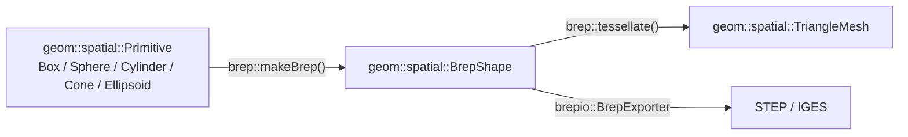

# brep - runtime B-rep operations

> **Status**: current (both interfaces, both branches and the OpenCASCADE bodies are in place; the backend branch is
> verified in a build with OpenCASCADE 8.0.0, see 9.1)
> **Last verified**: 2026-11-03
> **Scope**: `src/base/brep`: where the runtime operations on a B-rep live (tessellation, building a solid from a
> primitive, and booleans later) and what their contract is.
> Excludes the data definition of `BrepShape` (see `graphics-geometry.md` §3.5), STEP/IGES reading and writing (see
> `meshio-brepio-design.md`) and bounding boxes and OBBs (see `geometry-primitives.md`).
> **Sources**: `src/base/brep/sdk/vine/brep/Backend.hpp`, `src/base/brep/sdk/vine/brep/Tessellation.hpp`,
> `src/base/brep/sdk/vine/brep/Construction.hpp`, `tests/test_brep`.
> **Backlog**: `../backlog/brep.md`

## 1. Overview

### 1.1 Problem and background

A B-rep used to have only two halves in this repository:

- **Data**: `geometry`'s `BrepShape` holds a handle to the backend shape; the SDK only forward-declares `TopoDS_Shape`,
  it includes no OpenCASCADE header and links nothing.
- **Files**: `brepio`'s STEP/IGES reading and writing needs OpenCASCADE, links it PRIVATE and answers
  `IoError::Unsupported` when no backend is found.

What is missing is the third half: **runtime operations on the solid itself** (tessellating for rendering, building a
solid from a primitive, booleans later). Fitting it into either existing half does not hold up:

- Putting it in `geometry`: the base module would link OpenCASCADE from then on, every geometry consumer would pay for
  it, and backend vocabulary would appear in a public header.
- Putting it in `brepio`: that module is "read and save", while tessellation has nothing to do with files; it would also
  drag `Runtime`/`Crypto`/`IOBase` users in for the sake of one operation.

### 1.2 Goals

- Runtime B-rep operations have a home that depends on `geometry` alone.
- OpenCASCADE has exactly **one detection point**, and each of the two modules that needs it links it PRIVATE.
- Without the backend the interfaces still exist and behave deterministically: `hasBackend()` reports the build's
  capability and both operations return an empty value.
- Building a solid from a parametric primitive lives with tessellation in `brep` and shares the same backend link: one
  primitive becomes a solid that can be tessellated and exported.

### 1.3 Non-goals

- No multiple backends and no plugin registry: OpenCASCADE is the only backend today (`G8`).
- No `Primitive` → mesh conversion: that is pure mathematics with zero dependencies and belongs to `geometry` (see
  `geometry-tessellation.md`), not here.
- Construction covers only the five primitives `geometry` defines: no solid from a mesh or a wireframe, and no booleans
  or sewing (`../backlog/brep.md`).

### 1.4 Conclusion in one sentence

**Data belongs to `geometry`, files belong to `brepio`, operations belong to `brep`; the backend is detected once and
never enters a public header of `geometry`. Building a solid from a primitive and tessellating are the same kind of
operation, and they share one module, one link and one failure representation.**

## 2. Design Points

### 2.1 Each module owns one stretch

| Module | Responsibility | Depends on | OpenCASCADE |
|---|---|---|---|
| `vn::Geometry` | shape data: `Shape` / `Mesh` / `Primitive` / `BrepShape` (a bare handle) | Math, Core | untouched |
| `vn::Brep` | runtime operations: tessellation, `makeBrep`, booleans later | Geometry | optional, PRIVATE |
| `vn::BrepIO` | files: reading and writing STEP/IGES/BREP | Runtime, Geometry, Crypto, IOBase | optional, PRIVATE |

`Brep` and `BrepIO` are siblings and do not depend on each other: one owns operations, the other owns files. That
satisfies `G1` (one boundary per responsibility) and `G5` (an expected change stays inside the module).

**Why `src/base` (G2, G5)**: the criterion is "the lowest layer that suffices", not "is there a third-party
dependency" - `crypto` in `base` pulls in wolfSSL, `iobase` builds zlib, `window` uses platform APIs, `crash` uses
dbghelp; the base has never been dependency-free, it is merely framework-free. `brep`'s consumers sit on both sides:
`brepio` (`loaders`) wants "primitive → STEP", `graphics` (`viz`) wants "B-rep → tessellation → display", and the
configuration order in `src/CMakeLists.txt` is `base → loaders → viz → fw → robotics → plugins → apps`. Put above
`loaders`, `brepio` would have to depend upwards; put inside `loaders`, the module name would describe operations as
files and would still drag in `Runtime` / `Crypto` / `IOBase`. `base` is the only layer that is below both consumers and
already holds its only dependency, `geometry`.

`core` sits at the very bottom of that picture (it links `vn::Global` only), so putting `brep` there writes a
`core → geometry` back edge (`G2`); opening a separate layer (say a new `cad` layer) would have one member today
(`G8`), so that upgrade comes together with `geometry` / `brep` / `brepio` when a second CAD-level module appears. There
is also a mechanical reason: `vn_add_library` globs a module directory `GLOB_RECURSE`, so nesting `brep` inside
`geometry`'s directory would let `geometry`'s source glob swallow it; siblings at one level are one target each.

### 2.2 One detection point, a private link

`cmake/VineOpenCASCADE.cmake` performs the single `find_package(OpenCASCADE CONFIG QUIET)` and offers
`vn_link_opencascade(target macro [BOOLEANS])`: it defines that module's own `VN_*_HAS_OCCT` and links the required OCCT
modules PRIVATE. Both modules call it; the `find_package` result is cached and the imported targets are the same.

PRIVATE is the point: a consumer of `vn::Brep` does not inherit OpenCASCADE (`G10` cares about real cost).

The `BRepPrimAPI_*` classes used by construction live in `TKPrim`, which joins the helper's base module list;
`BOOLEANS` (`TKBO` / `TKBool`) stays reserved for code that actually does booleans.

### 2.3 Failure is an empty value, capability is a query

An operation does not return a `Result`: a failure is an empty handle, and "why empty" is answered by `hasBackend()` -
it is a build property, not the outcome of a call. Two precedents have the same shape: `brepio` distinguishes "no
backend" from "the file is broken" with an empty `supportedExtensions()`, and `graphics::geometryFromShape()` uses an
empty geometry for "cannot convert to a mesh".

It borrows neither `vn::io::Result` nor `IoError`: that vocabulary (`NotFound`, `PermissionDenied`, `IsADirectory` ...)
describes storage failures and has nothing to do with tessellation; borrowing it would also make an operations-only
module link `IOBase` for an error type. Nor does it invent an error enum: there are two failures today, and one of them
is a build property (`G4`, `G8`).

### 2.4 The contract holds without a backend

Without a backend the `#else` branch runs: `hasBackend()` answers false and both operations return an empty value; with
a backend, each `VN_BREP_HAS_OCCT` branch does the real construction and tessellation. The names and signatures of every
entry point do not change with the presence of the backend (`G9`): a caller writes one failure branch, and `test_brep`
compiles and runs in a build without OpenCASCADE too.

### 2.5 The output is a `TriangleMesh`, without a bounding box

Tessellation only answers "which triangles make up this solid": vertices and indices are in the solid's own space, with
normals when `compute_normals` is set. The bounding box and OBB are measured from the vertices by the caller with the
existing `Aabb::compute()` / `Obb::computePca()` - no second bounding-box algorithm is introduced (`G1`, `D4`).

### 2.6 Tessellation is not a member of `BrepShape`

Making it a member would put the implementation into `geometry`, which means letting the base module link OpenCASCADE
and letting `BrepShape.hpp` degrade from "forward-declares the backend type" to "depends on the backend". A free
function keeps the backend inside `brep` and `geometry` free of third parties (`G2`, `D1`).

### 2.7 Construction is the second operation, dispatched on `shapeType()`

- **What**: `brep::makeBrep(const geom::spatial::Primitive&) → intrusive_ptr<BrepShape>`; there is one public entry
  point, and internally it dispatches on `shapeType()` to the per-type constructor (`Box` / `Sphere` / `Cylinder` /
  `Cone` / `Ellipsoid`).
- **Why**: `G1`, `G2`, `G6` - it is the same kind of "operation on a solid" as `tessellate()`, so it lives in the same
  module, shares one PRIVATE link and one failure representation; making it a virtual function of `Primitive` or a
  visitor would drag backend vocabulary and implementation into `geometry` (`D5`, the same reason as `D1`).
- **Boundary**: the dispatch is a closed set. A sixth primitive adds one branch here - that is `G9`'s price, paid to
  keep `geometry` third-party-free; the dispatch table has one home and does not scatter into every consumer (`G7`).

### 2.8 The result occupies the primitive's local space (a size mapping table)

- **What**: the solid produced occupies exactly the local space the primitive describes, the same position as C1 - no
  placement, no scaling, no unit conversion.
- **Why**: `G4`, `G12` - a primitive given a size yields a solid of that size; the type name and the coordinate
  convention must be readable from each other.
- **Boundary**: placement belongs to the consumer (a `graphics::Node` transform, an assembly's pose), and `makeBrep`
  accepts no pose parameter (`D9`).

| Primitive | Local space | Backend construction | Exactness |
|---|---|---|---|
| `Box(w,h,d)` | centred on the origin, side lengths w/h/d | `BRepPrimAPI_MakeBox` (corner at `(-w/2,-h/2,-d/2)`) | exact |
| `Sphere(r)` | centred on the origin | `BRepPrimAPI_MakeSphere(r)` | exact |
| `Cylinder(r,h)` | axis = +Z, z ∈ [-h/2, +h/2] | `BRepPrimAPI_MakeCylinder` (axis point at z = -h/2) | exact |
| `Cone(r,h)` | axis = +Z, base at z = -h/2 with radius r, apex at z = +h/2 | `BRepPrimAPI_MakeCone` (base radius r, top radius 0, axis point at z = -h/2) | exact |
| `Ellipsoid(rx,ry,rz)` | centred on the origin, axis-aligned | a unit sphere + non-uniform scaling (`BRepBuilderAPI_GTransform`, a diagonal `gp_GTrsf`) | approximate |

### 2.9 The ellipsoid is approximate, the other four are exact

- **What**: OpenCASCADE has no three-axis ellipsoid primitive (its ellipsoid surface is only a surface of revolution
  about Z, with two equal semi-axes), so a three-axis ellipsoid can only come from non-uniform scaling and its faces
  become B-splines.
- **Why**: `G4`, `G10` - rather than pretend to be exact, write "the only approximate one" into the contract: its
  boundary and volume match the analytic values within the transform tolerance only.
- **Boundary**: the approximation affects the geometric representation, not the topology (it is still a closed solid);
  `Box` / `Sphere` / `Cylinder` / `Cone` produce exact solids, which can be asserted exactly (`N4`).

### 2.10 The capability belongs to the module; there is one query

- **What**: `hasBackend()` answers "does this build have a B-rep backend"; tessellation and construction share it
  instead of each having an operation-named query.
- **Why**: `G1`, `G4`, `G6` - the capability is a build property of the module, not of one operation: both operations
  are decided by the same macro and the same private link, two names would make the caller remember one fact twice and
  would tempt the caller of one operation into asking about the other (`D6`).
- **Boundary**: a failure is still an empty handle (2.3); the reason for an empty handle has two levels - the build
  level (no backend) asks `hasBackend()`, the input level (the shape has no solid / the primitive is invalid / the type
  is outside the five) asks `isValid()` and `shapeType()`. Only when a future backend supports one of the two
  operations but not the other does this split into per-operation capability queries (`G8`).

### 2.11 A constructed solid is an independent identity

- **What**: every call returns a new `BrepShape`: the name is inherited from the primitive's `name()`, `revision()`
  starts at 0, and the backend shape is owned exclusively by the result (a copy of the result shares the handle, whose
  own reference count does the rest).
- **Why**: `G6`, `G11` - the same identity rules as a loader-produced solid: the name comes from the source, and the
  revision is announced by the holder once the change is complete (`graphics-geometry.md` §3.5).
- **Boundary**: no per-primitive caching or deduplication. Building one primitive twice yields two solids, and changing
  one does not affect the other; caching costs invalidation and lifetime, and there is no consumer that builds the same
  primitive twice today (`G8`).

## 3. Features

| # | Feature | Behaviour | Status |
|---|---|---|---|
| F1 | Tessellation | `tessellate(shape, options) → TriangleMesh` (empty = failure): triangulates per face, indices wound by the face's own orientation | in place |
| F2 | Solid from a primitive | `makeBrep(primitive) → BrepShape` (empty = failure): for exporting and booleans | in place |

### 3.1 F1 Tessellation

- **Behaviour**: emits triangles face by face; `deflection` is the maximum distance from a face to its triangles,
  `angle` is the maximum angle between the normals of adjacent triangles on one surface; with `compute_normals` set,
  every vertex carries a normal.
- **Constraint** (C1): the result is in the solid's own space, with no placement, scaling or transform applied.
- **Constraint** (C2): vertices are not welded across a face seam - the two faces meeting on an edge each hold their
  own copy, because their normals differ; indices are wound by each face's own orientation.
- **Requirement** (R1): no backend, or a shape with no solid → an empty mesh; to tell the two apart, ask `hasBackend()`
  first.
- **Acceptance** (T1): `TessellationTest` covers "capability false + empty mesh" in a build without the backend.
- **Caveat** (N2): `deflection` and `angle` are **backend-independent** parts of the contract; the remaining
  OpenCASCADE parameters are not exposed.

### 3.2 F2 Solid from a primitive

- **Behaviour**: `makeBrep(primitive)` returns a closed solid occupying the primitive's local space (mapping in `2.8`);
  a `shapeType()` outside the five, a false `isValid()`, and a build without the backend all return an empty handle.
- **Constraint** (C3): the result occupies the same space as the primitive - no placement, no scaling, no unit
  conversion.
- **Constraint** (C4): sizes are only promoted `float → double`; size assertions compare within a relative tolerance
  (`P7`).
- **Requirement** (R4): no input throws: a backend failure (`Standard_Failure` and friends) turns into an empty handle
  just like an invalid input.
- **Requirement** (R6): the result inherits the primitive's `name()`, and `revision()` starts at 0.
- **Acceptance** (T5): for each of the five primitives, a "build → tessellate → the bounding box equals the analytic
  size" round trip; the ellipsoid is asserted within a tolerance.
- **Caveat** (N3): `BrepShape::hasVolume()` is always false; the primitive's "has volume" answer does not come along.

## 4. Public Interface

| Header | Content | Status |
|---|---|---|
| `src/base/brep/sdk/vine/brep/Backend.hpp` | `hasBackend()`: the module-level build capability | in place |
| `src/base/brep/sdk/vine/brep/Tessellation.hpp` | `TessellationOptions{ deflection, angle, compute_normals }`, `tessellate()` | in place |
| `src/base/brep/sdk/vine/brep/Construction.hpp` | `makeBrep(const geom::spatial::Primitive&)` | in place |

The complete contract is in the header comments; this page records ownership and the reasoning only.

## 5. Constraints, Requirements and Invariants

- **C1**: The result is in the solid's own space, with no transform and no scaling.
- **C2**: Vertices are not welded across a face seam; with `compute_normals == false` there are only positions and
  indices.
- **C3**: A construction result occupies the same local space as the primitive; no placement, no scaling, no unit
  conversion (the same position as C1).
- **C4**: Construction sizes are only promoted `float → double`; size assertions compare within a relative tolerance
  (`P7`).
- **R1**: No backend, or an empty shape → an empty mesh; `hasBackend()` reports the build's capability.
- **R2**: The interfaces still compile, link and are testable in a build without the backend.
- **R3**: The backend dependency is linked PRIVATE and is not inherited by consumers.
- **R4**: Construction throws nothing: no backend, an invalid primitive, a type outside the five and a backend failure
  all yield an empty handle.
- **R5**: The construction interfaces still compile, link and are testable in a build without the backend (the same
  shape as R2).
- **R6**: A construction result inherits the primitive's `name()`; `revision()` starts at 0 and the holder announces a
  change.
- **N1**: An empty mesh is not an "error value" but a result with no output; do not use it in place of
  `hasBackend()`.
- **N2**: `deflection` is in model units and is tied to the model's scale.
- **N3**: `BrepShape::hasVolume()` is always false, so "the primitive has volume" is not "the solid answers that it has
  volume".
- **N4**: Only the ellipsoid is approximate (B-spline faces; boundary/volume agree within a tolerance); the solids the
  other four primitives produce are exact.
- **N5**: `hasBackend()` is a module-level build fact: neither operation's empty value stands in for it, and it says
  nothing about whether the input is valid.

## 6. Caveats and Traps

- **P1**: `deflection` is an **absolute length**, so the same 0.1 means entirely different things in a millimetre model
  and a metre model; scaling a model means scaling it proportionally.
- **P2**: Not welding face seams makes the vertex count about 2-3 times the welded count; a consumer that needs welding
  merges the vertices at the same position with the same normal itself, and should not expect the backend to do it.
- **P3**: The `length_scale` of the old implementation only scaled the translation part of the placement transform - the
  geometry was never scaled at all; this module does not offer that parameter, so scale the solid itself.
- **P4**: An empty mesh has two causes (no backend / the input has no solid); do not treat "returns empty" as the only
  diagnostic - ask `hasBackend()` first, then check whether the solid `isValid()`.
- **P5**: The Z interval of the cylinder/cone is currently only a sentence in the header, "centered on the Z axis", not a
  type guarantee.
  How it fails: a consumer interprets it under the other convention, "the base is at z = 0", and the whole geometry is
  offset by h/2 along Z.
  How to detect it: the measured bounding box is asymmetric along Z.
  How to prevent it: make that header sentence an explicit interval when implementing (z ∈ [-h/2, +h/2], cone base at
  -h/2) and assert it in the round-trip case.
- **P6**: Writing "this machine has no backend" into a case (`EXPECT_FALSE(hasBackend())`) necessarily fails in a build
  that has one.
  How it fails: the whole test executable goes red on a machine with OpenCASCADE installed.
  How to detect it: CI disagrees between the two build flavours.
  How to prevent it: branch the cases on the capability and let each branch assert its own result (T7).
- **P7**: Neither the ellipsoid nor float sizes can be asserted by exact equality.
  How it fails: an analytic size has about a 1e-7 relative difference from a double after a float round trip, the
  ellipsoid carries a scaling tolerance on top, and `EXPECT_DOUBLE_EQ` goes red outright.
  How to detect it: the difference is within tolerance but not bit-equal.
  How to prevent it: compare within a relative tolerance.
- **P8**: `makeBrep` is not a cache.
  How it fails: the caller assumes two calls return two references to one solid and expects a change in one to show up
  in the other.
  How to detect it: the `TopoDS_Shape` from the two calls is not the same object.
  How to prevent it: a caller that needs reuse holds on to the returned pointer itself.

## 7. Rejected Options

- **D1**: A `BrepShape::triangulate()` member function - it would drag OpenCASCADE into `geometry` and lose both the base
  module and the public header (`G2`, `G5`). See `../decisions/ADR-2026-11-03-brep-operations-module.md`.
- **D2**: Putting it in `brepio` - the module name says "files", while the operation is a runtime need, and it would pull
  `Runtime`/`Crypto` in for an unrelated capability.
- **D3**: A pluggable backend (a `BrepBackend` abstraction plus registration) - building a mechanism for a single
  backend, which `G8` opposes; upgrade when a second backend appears.
- **D4**: Producing bounding boxes with `Bnd_Box` / `Bnd_OBB` - we already have the exact `Aabb::compute` and
  `Obb::computePca`, so no second algorithm is introduced.
- **D5**: A `Primitive::toBrep()` virtual function or a visitor - it drags backend implementation and vocabulary into a
  public header of `geometry` (`G2`), for the same reason as D1.
- **D6**: One name-based capability query per operation (`tessellationSupported()` / `makeBrepSupported()`) - one build
  fact under two names, which the caller has to remember twice and which tempts it into asking about the other operation
  (`G1`, `G4`); the capability belongs to the module and there is one `hasBackend()`.
- **D7**: Putting it in `core` - `core` depends on `vn::Global` only, and `brep → geometry` would be a back edge there
  (`G2`).
- **D8**: Putting it in `loaders` / `viz` / `robotics`, or opening a new layer for it - the first three sit above it in
  the dependency chain and are consumers, not a home (`G2`); a new layer would have one member today (`G8`).
- **D9**: `makeBrep(primitive, placement)` accepting a transform - a primitive has no transform channel, and placement
  belongs to the consumer; adding it would give `BrepShape` a placement semantics `geometry` does not define (`G4`,
  `G8`).
- **D10**: Running `BRepCheck_Analyzer` after construction - a primitive with legal dimensions cannot produce a bad
  solid, so the cost of a full topology check buys no information (`G10`).
- **D11**: One public overload per primitive - no consumer needs to bypass RTTI today, so the documentation and test cost
  of five entry points is not paid yet (`G8`); the implementation is already split by type, so adding a public overload
  later changes no implementation.

## 8. Tests and Acceptance

| # | Criterion | Case |
|---|---|---|
| T1 | build without the backend: the capability query is false and the call returns an empty mesh | `tests/test_brep/TessellationTest.cpp` |
| T2 | a box tessellates into 12 triangles, normals have unit length, the vertices lie on the box faces | not covered yet |
| T3 | a build without the backend answers an empty mesh and a false capability | `tests/test_brep/TessellationTest.cpp`, `tests/test_brep/ConstructionTest.cpp` |
| T4 | build without the backend: `hasBackend()` is false and `makeBrep()` returns an empty handle | `tests/test_brep/ConstructionTest.cpp` |
| T5 | for each of the five primitives, "build → tessellate → the bounding box equals the analytic size" (the ellipsoid within a tolerance) | `tests/test_brep/ConstructionTest.cpp` |
| T6 | an invalid size or an unknown type → an empty handle; `name()` is inherited | `tests/test_brep/ConstructionTest.cpp` |
| T7 | both the tessellation and the construction cases branch on the capability, so builds with and without the backend both pass (`P6`) | `tests/test_brep` |

## 9. Status and Evolution

### 9.1 Current state

The module, the header contracts, the CMake detection and both branches (with and without OpenCASCADE). **The backend
branch has been compiled and verified in a build with OpenCASCADE 8.0.0 (vcpkg `x64-windows`)**: `test_brep` and
`test_brepio` all pass, including the round trips and bounding boxes of the five primitives and the mesh round trip.

Building a solid from a primitive (F2) (`2.7`-`2.11`, `3.2`) shares that same detection and PRIVATE link with
tessellation; both sides were verified on one machine.

### 9.2 Known gaps

- Booleans/sewing: see `../backlog/brep.md`, which carries the trigger conditions.
- The rendering path is not connected yet: `graphics::geometryFromShape()` still accepts meshes only; once tessellation
  lands, "load a B-rep → tessellate → display" gets connected.
- Deployment: `vn_link_opencascade` copies OCCT's runtime DLLs into the build output directory (see
  `cmake/VineOpenCASCADE.cmake`); deploying a release package (alongside `VineDeployQt.cmake`) is not written yet.

## 10. References

- Code: `cmake/VineOpenCASCADE.cmake`, `src/base/brep/`, `src/loaders/brepio/CMakeLists.txt`,
  `src/base/models/sdk/vine/models/BrepShape.hpp`.
- Design: `graphics-geometry.md` (storing shapes and meshes), `meshio-brepio-design.md` (reading and writing B-rep
  files), `geometry-primitives.md` (bounding boxes and OBBs).
- Decision: `../decisions/ADR-2026-11-03-brep-operations-module.md`.
- Tests: `tests/test_brep/TessellationTest.cpp`.
