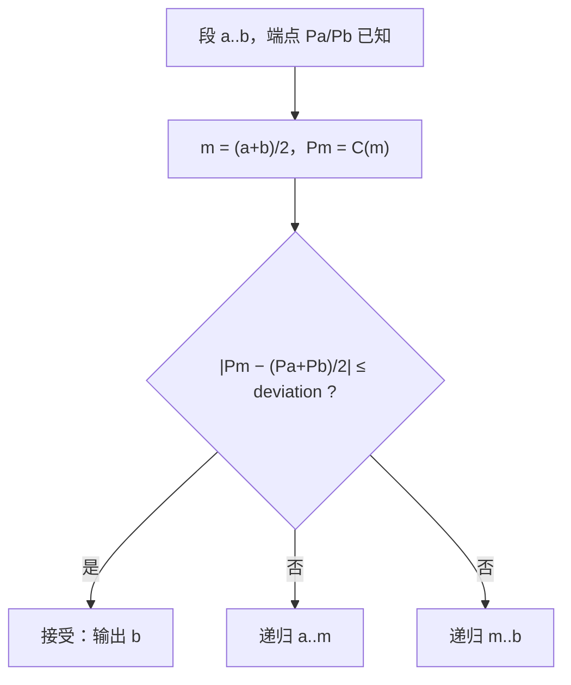

# geom 曲线离散化：三种取点规则与一个折线结果

> **状态**：现行
> **最后核对**：2026-11-10
> **范围**：把任意 `Curve<T>`（`geom::planar` 与 `geom::spatial` 两份契约）折线化为「点 + 参数」的三个族级入口、
> 每条规则的质量语义与代价、以及 2D / 3D 共用的数值内核。
> 不含曲线显示图元（`graphics` 侧还没有折线图元）、不含 B-rep 边的取点策略、不含曲面等参线、不含法向 / 切线 / 弧长数组。
> **权威来源**：`CurveSampling.hpp`（spatial 与 planar 各一份）、`CurveSubdivision.hpp`、
> `CurveSamplingTest.cpp`（两个测试目录各一份）
> **待办**：`../backlog/geometry.md` G12（保证最大偏离的版本）、G13（按间断点强制分段）

## 1. 概要设计

### 1.1 问题与背景

`Curve<T>` 是求值接口：调用方拿得到点、一阶 / 二阶导、参数域、闭合与周期、光滑度（`geometry-kinds.md` 2.7）。
族级算法已经覆盖「离这个点最近的是哪里」（`closestPointOnCurve()`）、「这段有多长」（`arcLength()`）、
「走这么长到哪个参数」（`parameterAtLength()`）与曲率，但**没有任何入口回答「把这条曲线变成一串点」**。

缺这一步的结果不是「少一个函数」，而是每个消费者自己写循环：显示端按参数均分开 N 段、路径规划按弧长均分、
碰撞预检按误差加点，三处各自决定「多密」，彼此不可比；同一个圆在三个地方得到三种折线。

OCCT 把同一件事做成五个类（`GCPnts_UniformAbscissa`、`GCPnts_QuasiUniformAbscissa`、`GCPnts_UniformDeflection`、
`GCPnts_QuasiUniformDeflection`、`GCPnts_TangentialDeflection`），每个类 4–6 个构造函数再乘 2D / 3D 两套 adaptor。
我们要的是同一组规则，但只有**三条规则、一个对象壳、一份内核**。

### 1.2 目标

- 三条取点规则，一条规则一个类：**参数等分**、**弧长等距**、**弦高偏离**。
- 一条曲线一个 `CurveSampler<T>`：`curve(c); compute();` 是主用法，配置一次可以对很多条曲线重复（一条线框有很多段）。
- 一个结果类型同时给出点与产生它的参数——参数不能从点反推（P2）。
- 只依赖 `evaluate()`（等分、偏离）或 `evaluate() + derivative()`（等距，经既有弧长内核），所以任何 `Curve<T>` 都成立。
- 2D 与 3D 一份内核，两个契约各一层薄壳，语义不可能漂移。
- 窗口规则与 `arcLength()` / `closestPointOnCurve()` 完全一致：无界曲线必须由调用方收窄。
- 折角（`C0` 间断点）不需要间断点表：偏离判据本身会发现它（2.6）。
- 结果与派生属性都挂在对象上：新增一个属性（逐段长度、实际偏离、切线）只需要加一个访问器，不改已有签名。

### 1.3 非目标

- 不做**保证**最大偏离的版本（每条弦扫描真实最大距离）：今天没有需要这条保证的消费者（`G8`），见 §7 `D2` 与 backlog `G12`。
- 不做按 knot / `C0` 间断点强制分段：需要给 `Curve<T>` 加间断点查询（扩契约、每个实现各答一遍），而偏离判据已经能发现折角，见 §7 `D3` 与 backlog `G13`。
- 不做角度 / 曲率自适应（OCCT `GCPnts_TangentialDeflection` 的角向偏离）：只有弦高，没有「切线转角不超过 θ」这一维（`G8`）。
- 不产出法向、切线、逐点弧长、包围盒：需要这些的调用方从 `evaluate()` / `derivative()` 自己取（`G8`，§7 `D7`）。
- 不做进度与取消的**后端**：只留一个钩子位（2.12），与 `vn::progress` / `ProgressHost` 的接线等第一个真的需要它的调用点（`G8`，backlog `G14`）。
- 不做 2D 图元：`graphics` 侧今天只有三角形图元，折线的消费者尚未出现。
- 不做曲面等参线：那是「曲面 → 曲线」的取线问题，不属于本族。

### 1.4 一句话结论

**三个 `CurveSampler<T>` 子类（`UniformParameterSampler` / `UniformLengthSampler` / `MaxDeflectionSampler`）共一个基类：`curve(c)` 与规则参数先设，`compute()` 无参运行，结果与派生属性都从对象上取；数值内核仍只有一份（`geom/detail`），等距复用既有弧长反解，偏离用「中点弦高估计 + 参数对半递归」。**

## 2. 设计要点

### 2.1 算法只有一份：内核是模板，壳是对象

- **是什么**：`detail::sampleByParameter()` / `sampleByLength()` / `subdivideByDeflection()` 仍是模板，只碰 `C::Point`、`C::value_type`、`evaluate()` / `derivative()`；三个子类只做「校验 → 解析窗口 → 调内核 → 装配结果」。
- **为什么**：`G5`、`G6`、`G2` —— 行为只有一份，2D / 3D 各一个壳，语义不可能漂移（`arcLength()` 的 2D / 3D 双胞胎同一条理由）；新增一条规则是一个新的子类，不改内核也不改基类（`G9`）。
- **代价（明确记账）**：基类成员是 `const Curve<T>*`，于是内核实例化在 `Curve<T>` 上，每个采样点经一次虚 `evaluate()`。这放弃了「具体类型的求值可内联」，而 `Curve.hpp` 的 `@warning` 正是为热路径保留这一点；采样不是逐帧路径，接受这笔代价（`G10`）。
- **边界**：`Curve<T>` 的签名不变；`geom/detail` 仍不得命名维度（`geometry-module.md` 2.5 第 4 条）。

### 2.2 一条规则一个类，名字说清「uniform 的是什么」

- **是什么**：`UniformParameterSampler<T>`（参数等分）、`UniformLengthSampler<T>`（弧长等距）、`MaxDeflectionSampler<T>`（弦高偏离），共一个基类 `CurveSampler<T>`。
- **为什么**：`G4`、`G1` —— 「等分」和「等距」最容易被混为一谈，差别就在「什么是均匀的」：参数还是弧长。类名里写出那个名词，调用方读一遍就知道自己拿到的是哪种疏密。
- **为什么不是一个 `mode` 字段 + 一个类**：那样会承载非法组合（`mode == Parameter` 却设了 `deviation`，或两者都为 0），错误从编译期推迟到运行期并需要在 `compute()` 里再校验一遍；三个子类各自只有它需要的参数，非法状态不存在（§7 `D1`）。
- **边界**：三个子类共享同一个基类与同一个结果类型，所以「换规则」只是换一个类；要运行时选择就用 `std::unique_ptr<CurveSampler<T>>`（§7 `D9` 里写明它的代价）。

### 2.3 一个结果类型：点 + 参数

- **是什么**：`CurvePolyline<T>{ std::vector<Point> points; std::vector<T> parameters; }`，两个数组等长、同序。
- **为什么**：`G1`、`G4`、`G10` —— 「点在哪儿」与「它在参数的哪儿」是同一个答案的两半；参数不可从点反推（P2），而点又是几乎所有消费者的直接输入。分两个入口算两遍、或让调用方自己 `evaluate` 一遍拿点，都是把同一件事做两次。两个并列数组而不是 `vector<pair<>>`：位置是连续给渲染 / 碰撞用的，交错存储会毁掉那次连续读。
- **边界**：`CurvePolyline` 在两个契约里各一份（`Point3` / `Point2`），与 `CurveProjection`、`CurveCurveDistance` 同一条既有做法（`G6`）；它不进 `detail`，因为 `detail` 不得命名维度（`geometry-module.md` 2.5 第 4 条）。**它由 sampler 拥有**：`polyline()` 返回 const 引用，不在每次读取时拷贝。

### 2.4 等距复用既有弧长内核，不新写积分

- **是什么**：`UniformLengthSampler<T>::computeImpl()` 先算窗口总长（`detail::arcLengthBetween()`），再逐个求解「从 `u_k` 起走 `step` 到哪个参数」（`detail::parameterReaching()`），每段一次局部反解。
- **为什么**：`G5`、`G6`、`G1` —— 「给定长度求参数」已经由 `parameterAtLength()` 回答，等距只是把同一个问题串起来；内核（自适应 Simpson + 带二分保护的 Newton）在 `geom/detail` 里已经存在，2D / 3D 共用，语义不可能漂移。
- **边界**：不从窗口起点重新积分整段（那会让代价变成 O(n²) 长度），而是从**上一个点**起量 `step`，因此每步是一段短积分；总代价 ≈ 点数 × 一次局部反解（`G10`）。

### 2.5 偏离用「中点弦高估计 + 参数对半递归」，并强制播种

- **是什么**：一段 `[a, b]`（两端点值已知）取参数中点 `m`，估计偏离 `s = |C(m) − (P(a) + P(b)) / 2|`；`s ≤ deviation` 就接受这一段，否则对半分两段递归。整个窗口先**强制切成 4 段**再开始判断。
- **为什么**：`G10`、`G11`、`G9` —— 每次判断只多一次 `evaluate()`（端点值来自父段），总代价 O(点数)；不需要二阶导、不需要距离函数、也不需要曲线类型信息，所以任何 `Curve<T>` 都能用，包括 `C0` 拼接的裁剪视图。OCCT 的便宜版（`GCPnts_QuasiUniformDeflection`）是同一骨架，§10 记了它的判据与二次校验。
- **为什么要播种**：只判一次中点会被 S 形曲线骗过——`C(u) = (u, sin 2πu)` 在 `[0, 1]` 上两端与中点共线，单段估计给出 0 偏离，于是整条曲线塌成一条直线。强制 4 段播种把「中点恰好落在弦上」的巧合压到需要曲线在 4 个子段上各自再次巧合，代价是固定 3 次额外 `evaluate()`。OCCT 用 `theNbmin` 播种 3 段（§10）。
- **代价**：`deviation` 是**估计值**上的上限，不是真实最大偏离的上限（P1）；保证版见 backlog `G12`。

### 2.6 折角不需要间断点表

- **是什么**：不提供「按 knot 或 `C0` 间断点强制分段」的开关；跨折角的那条弦本来就切掉一个深 `d` 的角，`d` 就是这个折线在这一步的真实偏离，判据会自己细分到 `d ≤ deviation`。
- **为什么**：`G1`、`G8` —— 要按间断点切就必须让 `Curve<T>` 回答「你的间断点在哪儿」，这是给一份契约加一项、给每个实现加一次实现，而消费者要的仍然只是点。OCCT 需要 `NbIntervals` 是为了在「解析 / 圆周 / 复合」之间选算法分支，不是为了让折角被切出来。
- **边界**：如果将来有消费者要求「折角必须是一个顶点」而不是「折角被逼近到容差内」，那是另一种保证，走 backlog `G13`。

### 2.7 上限按点数计，超了答失败而不是降精度

- **是什么**：两个自适应规则带 `max_points`（默认 100000）。等距在算出总长之后**先**判断 `floor(total / step) + 2 > max_points`；偏离在递归过程中判断。超限一律让 `compute()` 答 `false`，结果为空。
- **为什么**：`G4`、`G10` —— 名字承诺「偏差不超过 deviation」，静默输出一条更粗的折线就让名字说谎（§7 `D4`）；而「答空」是一个可诊断的答案，调用方要么放宽 `deviation`，要么放大 `max_points`。等距先判总长是因为那一步很便宜，判完就不做无用功。
- **边界**：等分的段数由调用方显式给出，没有自适应成分，因此不带 `max_points`——它已经是上限本身。

### 2.8 结果类型与壳在契约侧，内核在 `detail`

- **是什么**：`CurvePolyline<T>`、`CurveSampler<T>` 与三个子类住在 `spatial/` / `planar/`（各一份，`Point3` / `Point2`）；内核住在 `geom/detail/` 且不导出为 API。
- **为什么**：`G2`、`G5` —— 契约侧可以有维度，`detail` 不行；一份内核两个壳，语义不会漂移；`detail` 不承诺 ABI，所以内核签名随时可改而不动公共面。
- **边界**：内核不 include 任一个契约（`check_geom_layering.py` 第 3 条），只通过模板参数 `C` 拿到曲线。

### 2.9 窗口是 `range(first, last)`，不是必填的两个参数

- **是什么**：`range(T first, T last)` 是一个 setter；不调用表示用曲线自己的域。壳在 `compute()` 里解析一次得到 `[first, last]`，再交给内核。
- **为什么**：`G4`、`G6` —— 「缺省 = 曲线自己的域、必须有界且前向、无界曲线必须由调用方收窄」这条语义与 `arcLength()` / `closestPointOnCurve()` 完全一致，只是拼写按对象形态写成 setter；而「整条曲线」这个最常用的情形不需要写 `FirstParameter(), LastParameter()`（OCCT 的 `U1, U2` 是必填的两个实参，等于让调用方复述曲线自己的域）。
- **OCCT 的 `U1, U2` 没有消失，只是下沉一层**：OCCT 把它们放在构造函数上，同时构造函数还做 min/max 归一化与 `Resolution` 兜底；在我们的设计里，壳负责「该不该有区间、区间合不合法」（`C1`、`C3`），核只拿已解析的两端（`G1`：策略在壳、算法在核）。
- **边界**：反向区间不悄悄归一化，`compute()` 直接答 `false`（P7、§7 `D8`）。

### 2.10 先 set 再 compute：为什么不是「构造即算」

- **是什么**：`CurveSampler<T>` 默认可构造；`curve(c)`、`range(a, b)`、各子类的规则参数都是 setter，返回 `void`；`compute()` 无参、返回 `bool`；基类只留非虚的 `compute()`，子类实现受保护的虚 `computeImpl()`。
- **为什么**：`G3`、`G7` —— create → configure → run → read 是一条直线；同一条曲线、同一个窗口、同一组参数下，一条线框的几十段只需 `curve(c); compute();` 循环，配置只设一次。
- **为什么 setter 不返回自身**：`G4` —— 链式返回的结果类型随基类 / 子类而变，于是「哪个 setter 可以接在谁后面」成为一条隐式约定（先调基类那一个就接不上子类参数）；配置写成语句，任何顺序都成立。
- **为什么不构造即算**（OCCT 的 `Initialize` 在构造里跑）：构造期不能虚分派（要么纯虚崩溃、要么跑成基类版本），而且曲线与窗口是配置，只能被塞进构造参数，剩下的参数就无处安放（`G7`）。显式 `compute()` 消掉了两个问题。
- **边界**：`compute()` 可以重复调用（换曲线后重算），上一次的结果被覆盖（2.11）。

### 2.11 结果永不过期

- **是什么**：每个 setter 与每次失败的 `compute()` 都把结果清空并复位状态；`polyline()` 要么是「最近一次成功 compute 的曲线与窗口」，要么是空——从不是上一条曲线的点。
- **为什么**：`G4`、`G10` —— `curve(c2)` 之后还把 `c1` 的点交回去，是「看起来成功」的错答案，而且无法从结果本身发现；清空是可以判断的。
- **边界**：一次成功的 `compute()` 之后编辑曲线不会更新结果（结果在 compute 时刻冻结）；要新的就再 `compute()`（P8）。

### 2.12 进度与取消：钩子留在对象上，依赖不进 `geom`

- **是什么**：预留一个 `progress(callback)` setter（后期落地）；回调形如 `bool(T fraction)`（返回 `false` 表示请求停止）。
- **为什么**：`G7` —— 离散一条高次 B 样条可能很慢，进度必须能报；做成自由函数就要**每个**入口多一个回调参数，而实际上只有一处会用到；对象上只有一个位置。取消随同一条钩子进来（`vn::progress::ProgressIndicator::isCancelled()`）。
- **边界**：`geom` 今天只依赖 `vn::Math` 与 `vn::Core`（`geometry-module.md` 2.1）。落地时先试无依赖的回调；若要直接接 `vn::progress`，那是一条新的依赖边，必须在 `geometry-module.md` 里记账，而不是在头文件里悄悄 include。

## 3. 功能点

### 3.1 功能索引

| # | 功能 | 行为 | 状态 |
|---|---|---|---|
| F1 | 参数等分 | `UniformParameterSampler<T>`：`segments(int)`；`compute()` 后 `segments + 1` 个点，参数步长恒定 | 已落地（T1、T2、T5） |
| F2 | 弧长等距 | `UniformLengthSampler<T>`：`step(T)` + `tolerance(T)`；相邻点弧长为 `step`，末段是余量 | 已落地（T1、T2、T6） |
| F3 | 弦高偏离 | `MaxDeflectionSampler<T>`：`deviation(T)` + `maxPoints(int)`；自适应递归，中点估计 ≤ `deviation` | 已落地（T2、T3） |
| F4 | 对象壳与结果 | `curve()` / `range()` / `compute()` / `polyline()` / `pointCount()`；setter 与失败复位结果 | 已落地（T5、T8） |
| F5 | 不可用输入 | 未设曲线、无效曲线、非法参数、预算不足 → `compute()` 答 `false`，结果为空 | 已落地（T4） |
| F6 | 保证最大偏离的版本 | 每条弦扫描真实最大距离后再决定细分 | 未做（`G8`，backlog `G12`） |
| F7 | 按间断点强制分段 | 折角作为顶点保留 | 未做（`G8`，backlog `G13`） |
| F8 | 配置一次、多条曲线复用 | 同一 sampler 循环 `curve(c); compute();`（线框的每段一条曲线） | 已落地（T9） |
| F9 | 进度与取消钩子 | `progress(callback)`：`false` 表示请求停止 | 未做（`G8`，backlog `G14`） |

### 3.2 F1 参数等分

- **行为**：`parameters[k] = first + k · (last − first) / segments`，`points[k] = curve.evaluate(parameters[k])`。
- **约束**（C1、C2、C5）；**要求**（R1、R3）；**验收**（T1、T2、T5）。
- **注意**（P2）：参数等分不等于弧长等距——参数化不等速的曲线上，点会在一处挤在一起、在另一处拉开。

### 3.3 F2 弧长等距

- **行为**：先求窗口总长 `L`，再逐点反解 `arcLength(u_k → u_{k+1}) == step`；余量 ≤ `step` 的末段直接落到窗口终点。
- **约束**（C1、C2、C5）；**要求**（R1、R3）；**验收**（T1、T2、T6）。
- **注意**（P3）：最后一段通常短于 `step`，不要用 `pointCount()` 反推「总长 / step」来校验精度。

### 3.4 F3 弦高偏离

- **行为**：整窗口先切 4 段，每段按 2.5 的中点估计决定接受或对半分；点数超过 `maxPoints()` 时 `compute()` 答 `false` 而不是截断。
- **约束**（C1、C2、C3）；**要求**（R1、R3）；**验收**（T2、T3、T6）。
- **注意**（P1、P4）：`deviation` 是估计值上的上限；比已接受段更快的振荡会被别名。

### 3.5 F4 结果与不变式

- **行为**：`CurvePolyline` 的两个数组等长、同序，参数严格递增，首尾参数等于窗口端点（不调用 `range()` 时等于曲线自己的域端点）；它由 sampler 拥有，`polyline()` 返回引用。
- **约束**（C2、C6、C8）；**验收**（T5、T8）。
- **注意**（P5、P6、P8）。

### 3.6 F5 不可用输入

- **行为**：未设曲线、`curve.isValid()` 为假、窗口不是有限前向区间、`segments < 1`、`step` 非正或非有限、`deviation` 非正或非有限、`maxPoints < 2`：`compute()` 一律返回 `false`、结果为空、不抛异常。
- **要求**（R2）；**验收**（T4）。

## 4. 公开接口

| 头文件 | 内容 |
|---|---|
| `spatial/CurveSampling.hpp` | `CurvePolyline<T>`（`Point3`）、基类 `CurveSampler<T>` 与三个子类 |
| `planar/CurveSampling.hpp` | 同形（`Point2`），语义逐条相同 |
| `detail/CurveSubdivision.hpp` | 三个数值内核，非 API：只碰 `C::Point` 与 `C::value_type` |

**对象契约（两个契约同形）**

| 类型 | 成员 | 契约 |
|---|---|---|
| `CurveSampler<T>`（抽象） | `curve(const Curve<T>&)` | 只存引用，不延长曲线寿命（C7）；设定后结果清空（C8） |
| | `range(T first, T last)` | 不调用即用曲线自己的域；反向、零宽、非有限在 `compute()` 时被拒（C1） |
| | `compute()` | 无参；成功答 `true` 并缓存折线；失败答 `false` 且结果为空 |
| | `polyline()` / `pointCount()` | 最近一次成功 `compute()` 的结果；未设曲线、未计算或失败时为空 |
| `UniformParameterSampler<T>` | `segments(int)` | 段数，至少 1；结果是 `segments + 1` 个点 |
| `UniformLengthSampler<T>` | `step(T)` / `tolerance(T)` | 相邻弧长，必须为正；`tolerance` 是长度误差 |
| `MaxDeflectionSampler<T>` | `deviation(T)` / `maxPoints(int)` | 弦高估计上限，必须为正；点数预算至少 2 |

完整签名、参数语义与失败条件见头文件；窗口规则见 §5 `C1`。

## 5. 约束、要求与不变量

- **C1**：窗口规则与 `arcLength()` / `closestPointOnCurve()` 相同——区间必须有限且前向；无界曲线（直线、双曲线、抛物线）必须由调用方 `range()` 收窄，不收窄一律 `compute()` 答 `false` 而不是自选范围。
- **C2**：`points.size() == parameters.size()`；`parameters` 严格递增；`parameters.front()` 与 `parameters.back()` 等于解析后的窗口端点（等距模式下也是，末点不被反解改写）。
- **C3**：规则参数在 `compute()` 校验——`segments ≥ 1`、`step` 为正有限、`deviation` 为正有限、`maxPoints ≥ 2`；不合法的值答 `false`，不钳制、不替换成默认值。
- **C4**：`isValid()` 为假的曲线、以及没有设曲线的 sampler，`compute()` 一律答 `false`。
- **C5**：不依赖 OCCT、不依赖建模模块；头文件的 include 域只有 `vine/geom/` 与 `vine/math/`（`geometry-module.md` 2.5 第 5 条）。
- **C6**：sampler 不缓存超出「最近一次结果」的任何东西；内核无状态；同一曲线 + 同一配置两次 `compute()` 结果逐点相同。
- **C7**：`curve()` 存的是引用：**sampler 必须比曲线短命**，它不延长曲线寿命，也不持有所有权；想跨作用域保留结果，用 `polyline()` 的拷贝或把点搬走。
- **C8**：任何 setter（`curve` / `range` / 规则参数）与任何失败的 `compute()` 都清空结果并复位状态；`polyline()` 永不是上一条曲线或上一组参数的点。
- **R1**：只使用 `evaluate()`（F1、F3）与 `derivative()`（F2，经 `detail::arcLengthBetween()`），两者都经 `Curve<T>` 虚接口；不要求二阶导、不要求具体类型。
- **R2**：不抛异常；不可用输入让 `compute()` 答 `false`。
- **R3**：结果精度跟曲线走——`CurveSampler<float>` 产出 `CurvePolyline<float>`，两条继承树互不相干，没有隐式降精度。
- **N1**：F1 的点数是 `segments + 1`。
- **N2**：F2 相邻点弧长在 `tolerance` 内等于 `step`，末段弧长落在 `(0, step]`；窗口总长不超过 `step` 时结果只有两个端点。
- **N3**：F3 每条输出弦的**中点估计**（2.5 的 `s`）不超过 `deviation`；点数不超过 `maxPoints()`。
- **N4**：闭合曲线在整域窗口上首尾点重合，不静默去重——「段数 = 点数 − 1」比「没有重复点」更值钱。
- **N5**：`compute()` 成功时 `pointCount() == polyline().points.size() == polyline().parameters.size()`；失败或未运行时三者都是 0。

## 6. 注意事项与陷阱

### 6.1 P1 偏离只是采样点上的估计

- **会怎么错**：曲线的最大偏离出现在非参数中点的位置（S 形、高频起伏、参数化严重不均匀），输出折线的真实最大偏离可以是 `deviation` 的数倍。
- **怎么判**：把 `deviation` 减半后点数**不变**（或只按 2 的幂微增）却形状明显变差；或用密集采样算真实最大距离，发现远大于 `deviation`。
- **怎么防**：按曲线的起伏尺度给 `deviation`（例如包围盒对角线的 1‰）；需要严格保证时用 backlog `G12` 的版本。

### 6.2 P2 把参数当弧长

- **会怎么错**：拿 F1 的结果当等距折线用（例如按点间距算速度），在参数化不等速的曲线上得到明显不均匀的步长。
- **怎么判**：相邻点之间的 `|ΔP|` 差异随曲线参数化变化；换成 F2 后差异消失。
- **怎么防**：要弧长均匀就用 `UniformLengthSampler`；判断一个点对应哪个参数用 `polyline().parameters`，不要从点的序号推。

### 6.3 P3 等距的末段更短

- **会怎么错**：期望每条弦都等于 `step`，于是把末段判成缺陷；或用 `points.size()` 反推总长做精度校验。
- **怎么判**：末段弦长小于 `step` 而之前各段都在容差内。
- **怎么防**：读数按 `N2`：末段是余量；要「整段等分」用 `arcLength()` 求总长后除以段数，再交给 `UniformParameterSampler`（参数等分）或按该步长用 `UniformLengthSampler`。

### 6.4 P4 上限太小会整条失败

- **会怎么错**：`deviation` 给得过小，点数需求超过 `maxPoints()`，`compute()` 返回 `false`，调用方以为「没有结果」而不去查原因。
- **怎么判**：调大 `maxPoints()` 后成功；或按 `deviation` 与曲率半径估算 `π / (2·acos(1 − deviation / r))` 得到大致段数。
- **怎么防**：按几何尺度给 `deviation`；调用点在拿到 `false` 时要能分辨「输入不合法」与「预算不足」（P4 的估算用于区分）。

### 6.5 P5 闭合曲线的首尾重合点

- **会怎么错**：整域窗口上的闭合曲线，`points.front() == points.back()`，画线时多一条零长度线段，或碰撞检测里多一个退化胶囊。
- **怎么判**：`curve.isClosed()` 为真且窗口等于整域，且首尾点相同。
- **怎么防**：需要闭合折线的调用方自己判断首尾；结果不静默丢点（`N4`）。

### 6.6 P6 精度与容差的单位

- **会怎么错**：`float` 曲线上跑长弧长（模型单位很大或用弧度累积），`tolerance` 取 `EPS<float>()` 时反解停在一个「长度误差达标但点位置抖动」的参数上。
- **怎么判**：换 `double` 曲线或把 `tolerance` 放大十倍，点位置与段数发生可见变化。
- **怎么防**：`tolerance` 用模型单位表达（例如 1e-6 × 特征尺寸），不要用机器 epsilon。

### 6.7 P7 反向折线：窗口不能反过来写

- **会怎么错**：想要 `last → first` 方向的点，于是把 `range()` 写成 `(last, first)`。OCCT 会静默归一化（`CPnts_UniformDeflection::Initialize` 里 `if (U1 > U2) swap`；`GCPnts_UniformAbscissa` 用**负的 abscissa** 表示反向走），而我们按 `C1` 直接答 `false`，调用方容易误读成「这条曲线不能采样」。
- **怎么判**：`compute()` 返回 `false`，而看配置能发现 `range()` 的两个端点是反的。
- **怎么防**：折线顺序就是参数顺序。要反序就采样正向折线后把**两个数组一起** `std::reverse()`（只翻点不翻参数会破坏 `C2`），或用 `reversedParameter()` 把参数映射到镜像曲线上取点；不引入「负步长 / 反向区间」这两种拼写（§7 `D8`）。

### 6.8 P8 结果在 `compute()` 时刻冻结

- **会怎么错**：`compute()` 之后改了曲线的尺寸或控制点，再读 `polyline()`，以为拿到的是新曲线上的点（实际是旧的），而且点数与位置都“看起来合理”。
- **怎么判**：改完曲线不重新 `compute()` 就对比点；或同期对同一条曲线新建一个 sampler，两者结果不一致。
- **怎么防**：把「曲线改了就重新 `compute()`」当作调用方的责任（`2.11`）：sampler 不监听曲线，也不可能监听（`Curve<T>` 没有 revision）。

### 6.9 P9 sampler 活得比曲线长

- **会怎么错**：sampler 存成成员、曲线是临时对象（或先于 sampler 销毁），下一次 `compute()` 或派生属性读取时拿到悬垂引用（`C7`）。
- **怎么判**：Debug 下的迭代器调试 / ASAN 报 use-after-scope；或点的坐标是垃圾值。
- **怎么防**：sampler 当作局部对象用（一次配置 + 一次循环）；要跨作用域就存 `polyline()` 的拷贝，不存 sampler；不要把 sampler 放进长期缓存。

## 7. 已否决选项

| # | 选项 | 理由 |
|---|---|---|
| D1 | 一个 `CurveSampling{mode, segments, step, deviation}` 值类型配一个入口 | 承载非法组合，校验从编译期退到运行期（`G4`）；三个子类各自只有它需要的参数 |
| D2 | 默认就用「每条弦扫描真实最大距离」保证偏离 | 每次判断要若干次 `evaluate()` 与一次线段距离扫描，今天没有需要这条保证的消费者（`G8`）→ backlog `G12` |
| D3 | 按 knot / `C0` 间断点强制分段 | 要求 `Curve<T>` 增加间断点查询，扩契约且每个实现各写一遍；偏离判据已经能发现折角（`G1`、`G8`）→ backlog `G13` |
| D4 | 递归封顶后输出粗折线 | 名字承诺「最大偏离 ≤ `deviation`」，静默违反让名字说谎（`G4`）；答空是可诊断的 |
| D5 | 同时提供等距的「步长版」与「份数版」 | 份数版就是 `总长 / (N − 1)`，调用方用现成 `arcLength()` 一行得到，两种拼写是同一个事实（`G8`） |
| D6 | 每个规则 4–6 个构造重载 + 2D / 3D 两套 adaptor | 「一条规则一个类」采纳，否决的是构造重载矩阵：曲线与窗口从构造参数挪到 setter，配置只有一个地、构造只有一个（`G4`、`G7`） |
| D7 | 结果里带逐点弧长 / 法向 / 切线 | 没有消费者；需要时从 `derivative()` 取，或另起一个族级函数（`G8`） |
| D8 | OCCT 式「必填 `(U1, U2)` 两个参数」，以及「负步长 / 反向区间表示反向走」 | 窗口在对象上只有一个 `range()`，缺省即整条曲线；OCCT 的两个必填实参等于让调用方复述曲线自己的域。反向值被静默归一化会把一个笔误变成一个合法结果（`G4`、`G6`）。`U1, U2` 的实质留在内核签名里（2.9），反序由调用方翻转结果（P7） |
| D9 | 构造即算（OCCT 的 `Initialize` 在构造里跑） | 构造期不能虚分派（要么纯虚崩溃、要么跑成基类版本），而曲线与窗口是配置、只能塞进构造参数，剩下的参数无处安放（`G3`、`G7`）；显式 `compute()` 把两个问题一起消掉（2.10） |
| D10 | 自由函数 + 返回值：一条规则一个 `sampleCurve*()`，折线当返回值 | 派生属性无处可加（每加一个就要改签名或再算一遍）；线框循环里对每条曲线重复传窗口与参数；进度 / 取消只能给每个入口加参数污染签名（`G7`、`G4`）。内核与规则不变，所以这个否决可逆：要回自由函数只需换壳 |

## 8. 测试与验收

| # | 判据 | 用例 / 命令 |
|---|---|---|
| T1 | 直线：三种规则给出等距点，等分与等距在直线上结果一致（`segments` 与 `step` 互相换算后） | `tests/test_geom_spatial/CurveSamplingTest.cpp` <!-- drift-ok --> |
| T2 | 圆：等分给等角点；等距给等弧长点；偏离的每条弦真实弦高不超过 `deviation` | 同文件 |
| T3 | 样条：每条弦的中点估计不超过 `deviation`；把 `deviation` 减半后点数增加 | 同文件 |
| T4 | 不可用输入：未设曲线、无效曲线、无界曲线未 `range()`、四种非法规则参数 → `compute()` 答 `false` 且结果为空 | 同文件 |
| T5 | 不变式：两数组等长、参数严格递增、首尾参数等于窗口端点（包括 `range()` 之后）；`float` / `double` 两种精度都给同一形状 | 同文件 |
| T6 | 预算：`maxPoints()` 恰好不足时 `false`；足够时 `true`（不截断） | 同文件 |
| T7 | 平面侧同形：圆与直线上的结果与空间侧一致（同一内核），三个子类语义相同 | `tests/test_geom_planar/CurveSamplingTest.cpp` <!-- drift-ok --> |
| T8 | setter 复位：`curve(c2)` 之后未 `compute()` → `polyline()` 为空；失败的 `compute()` 也清空，`pointCount()` 为 0（`C8`、`N5`） | 同文件 |
| T9 | 复用：同一 sampler 连续跑两条不同曲线，第二次结果只属于第二条（点数与首点坐标按第二条） | 同文件 |

## 9. 状态与演进

### 9.1 当前状态

已落地，两个契约同形（`Point3` / `Point2`）：

- `src/base/geom/sdk/vine/geom/spatial/CurveSampling.hpp`、`src/base/geom/sdk/vine/geom/planar/CurveSampling.hpp` —— `CurvePolyline<T>` 与 `CurveSampler<T>` 基类 + 三个子类。
- `src/base/geom/sdk/vine/geom/detail/CurveSubdivision.hpp` —— `sampleByParameter()` / `sampleByLength()` / `subdivideByDeflection()`，`detail` 不导出。
- `tests/test_geom_spatial/CurveSamplingTest.cpp`（10 例）、`tests/test_geom_planar/CurveSamplingTest.cpp`（4 例），两个测试目标均通过。

### 9.2 已知缺口

- 偏离只保证「中点估计」（P1）→ backlog `G12`。
- 折角不作为顶点保留（2.6）→ backlog `G13`。
- 进度与取消只有一个预留位（2.12），后端未接 → backlog `G14`；落地时先决定是「无依赖回调」还是引一条 `geom` → `vn::progress` 的依赖边。
- 没有角向 / 曲率自适应规则（`G8`）→ 与 `G12` 同一触发条件，届时一起评估。

### 9.3 兼容性 / 迁移

纯增量：两个新头文件（每份契约一个）、一个结果类型、一个基类与三个子类（2D / 3D 各一套）；`Curve<T>` 与所有现有值类型签名不变。
落地时同步更新 `geometry-module.md` 2.1（`geom` 的依赖声明，若接进度）与 2.2（新增一棵算法对象树与头文件计数）、`.ai/README.md` 的索引，以及 backlog `G12` / `G13` / `G14` 的触发条件描述。

## 10. 参考

### 10.1 代码与现行设计

- `../decisions/ADR-2026-11-10-curve-sampling-is-an-object.md` —— 为什么是对象而不是三个自由函数，以及三条把代价关住的契约。

- `geometry-module.md` 2.2 / 2.5 —— 目录与命名空间对应、五条隔离门禁（含 `detail` 不得命名维度）。
- `geometry-curve-queries.md` 2.2 / 2.6 / C1 / P2 —— 窗口规则、弧长与反解的内核分工、局部数值解的代价写法。
- `geometry-tessellation.md` 2.2 —— 「质量是调用方给的显式参数」这一先例（`TessellationQuality`）。
- `CurveMeasure.hpp`（`arcLengthBetween()` / `parameterCovering()`）、`RootFinding.hpp`（`parameterReaching()`）、`Quadrature.hpp`（`adaptiveSimpson()`）、`CurveTraits.hpp`（`resolveCurveWindow()` / `resolveTolerance()`）。

### 10.2 外部资料

OCCT 8（本机 checkout `E:\opensrc\OCCT`）的五个离散化实现，路径相对 OCCT 树：

- `ModelingData/TKGeomBase/GCPnts/GCPnts_UniformAbscissa.hxx` —— 弧长等距，可给步长或点数；内部用 `GCPnts_AbscissaPoint` 逐步反解，失败时按 `aDelta -= aDelta / 10` 收缩重试。
- `ModelingData/TKGeomBase/GCPnts/GCPnts_QuasiUniformAbscissa.hxx` —— 按参数的近似等分（快，但不保证弧长）。
- `ModelingData/TKGeomBase/GCPnts/GCPnts_QuasiUniformDeflection.cxx` —— 参数中点弦高估计 + 对半递归，并有「相对弦中点偏距」的二次校验与 `theNbmin` 播种；本设计 2.5 的骨架与播种来自这里。
- `ModelingData/TKGeomBase/CPnts/CPnts_UniformDeflection.cxx` —— 保证式版本：用 `du = sqrt(8·defl·|C'| / |C'' × C'|)` 由曲率估步长，再按 `WithControl` 抽样校验；每次迭代至多 3 个点。这是 backlog `G12` 的参照。
- `ModelingData/TKGeomBase/GCPnts/GCPnts_TangentialDeflection.cxx` —— 角向 + 曲率双判据，用于网格化；本设计非目标（1.3）。
