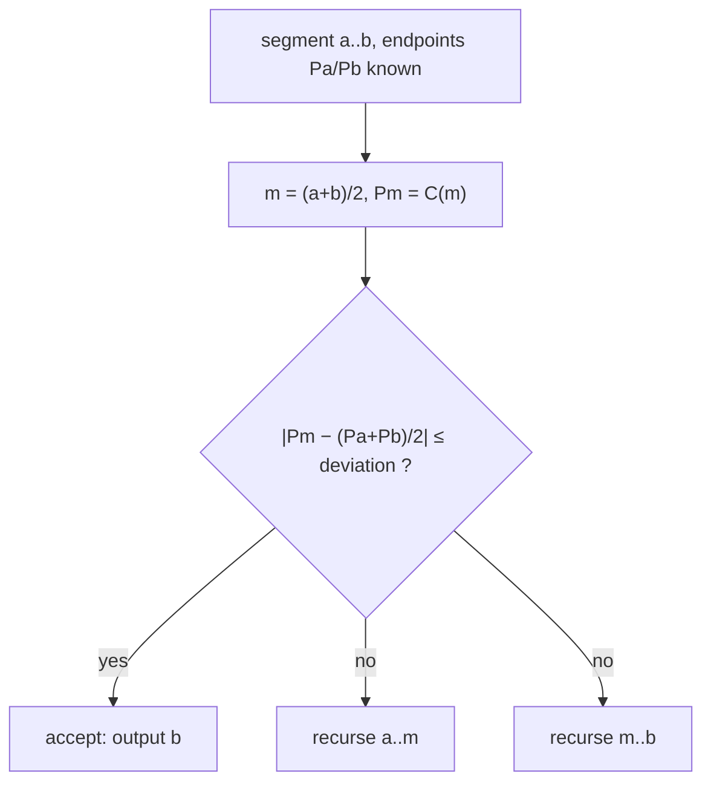

# geom curve discretization: three sampling rules and one polyline result

> **Status**: current
> **Last verified**: 2026-11-10
> **Scope**: the three family-level entries that turn any `Curve<T>` (both the `geom::planar` and the `geom::spatial` contract) into a polyline of "points + parameters",
> the quality semantics and the cost of each rule, and the numeric kernel shared by 2D / 3D.
> Not a curve display primitive (`graphics` has no polyline primitive yet), not a sampling strategy for B-rep edges, not surface isoparametric curves, not normal / tangent / arc-length arrays.
> **Sources**: `CurveSampling.hpp` (one copy in spatial and one in planar), `CurveSubdivision.hpp`,
> `CurveSamplingTest.cpp` (one copy in each of the two test directories)
> **Backlog**: `../backlog/geometry.md` G12 (the version that guarantees the maximum deviation), G13 (forcing a split at discontinuity points)

## 1. Overview

### 1.1 Problem and background

`Curve<T>` is an evaluation interface: the caller gets points, first / second derivatives, the parameter domain, closedness and periodicity, and smoothness (`geometry-kinds.md` 2.7).
The family algorithms already cover "where is the place nearest this point" (`closestPointOnCurve()`), "how long is this piece" (`arcLength()`),
"which parameter is this far along" (`parameterAtLength()`) and curvature, but **no entry answers "turn this curve into a string of points"**.

What that missing step costs is not "one function fewer" but a loop written by every consumer: the display side splits the parameter uniformly into N segments, path planning splits by arc length,
and the collision pre-check adds points by error, each of the three deciding "how dense" on its own and incomparable with the others; the same circle becomes three different polylines in three places.

OCCT makes the same thing into five classes (`GCPnts_UniformAbscissa`, `GCPnts_QuasiUniformAbscissa`, `GCPnts_UniformDeflection`,
`GCPnts_QuasiUniformDeflection`, `GCPnts_TangentialDeflection`), each with 4–6 constructors times two sets of 2D / 3D adaptors.
What we want is the same set of rules, but with only **three rules, one object shell and one kernel**.

### 1.2 Goals

- Three sampling rules, one class each: **uniform parameter**, **uniform arc length**, **chord-height deflection**.
- One `CurveSampler<T>` per curve: `curve(c); compute();` is the main use, and one configuration can be repeated over many curves (a wireframe has many segments).
- One result type giving both the points and the parameters that produced them - a parameter cannot be recovered from a point (P2).
- Depending only on `evaluate()` (uniform parameter, deflection) or `evaluate() + derivative()` (uniform length, through the existing arc-length kernel), so any `Curve<T>` works.
- One kernel for 2D and 3D, with a thin shell per contract, so the semantics cannot drift.
- The window rule identical to `arcLength()` / `closestPointOnCurve()`: an unbounded curve must be narrowed by the caller.
- A corner (a `C0` discontinuity) needs no discontinuity table: the deflection criterion finds it by itself (2.6).
- The result and the derived properties hang off the object: a new property (per-segment length, actual deviation, tangents) only needs one more accessor, not a changed signature.

### 1.3 Non-goals

- Not offering the version that **guarantees** the maximum deviation (scanning the true maximum distance on every chord): there is no consumer that needs that guarantee today (`G8`), see §7 `D2` and backlog `G12`.
- Not forcing a split at knots / `C0` discontinuities: that needs a discontinuity query on `Curve<T>` (a widened contract, answered by every implementation once), while the deflection criterion already finds corners, see §7 `D3` and backlog `G13`.
- Not doing angle / curvature adaptivity (OCCT `GCPnts_TangentialDeflection`'s angular deflection): there is chord height only, not the "the tangent turns by no more than θ" dimension (`G8`).
- Not producing normals, tangents, per-point arc length or a bounding box: a caller that needs these takes them from `evaluate()` / `derivative()` itself (`G8`, §7 `D7`).
- Not doing a progress and cancellation **backend**: only a hook slot is reserved (2.12), and the wiring to `vn::progress` / `ProgressHost` waits for the first call site that really needs it (`G8`, backlog `G14`).
- Not doing a 2D primitive: `graphics` has triangle primitives only today, and a polyline consumer has not appeared.
- Not doing surface isoparametric curves: that is the "surface → curve" extraction question, not this family.

### 1.4 One-paragraph conclusion

**Three `CurveSampler<T>` subclasses (`UniformParameterSampler` / `UniformLengthSampler` / `MaxDeflectionSampler`) share one base class: `curve(c)` and the rule parameters are set first, `compute()` runs with no arguments, and both the result and the derived properties are taken from the object; the numeric kernel is still a single copy (`geom/detail`), uniform length reuses the existing arc-length inversion, and deflection uses "midpoint chord-height estimate + parameter bisection recursion".**

## 2. Design Points

### 2.1 The algorithm exists once: templates in the kernel, objects in the shell

- **What it is**: `detail::sampleByParameter()` / `sampleByLength()` / `subdivideByDeflection()` are still templates touching only `C::Point`, `C::value_type`, `evaluate()` / `derivative()`; the three subclasses only do "validate → resolve the window → call the kernel → assemble the result".
- **Why**: `G5`, `G6`, `G2` - behaviour exists once, with one shell each for 2D / 3D, so the semantics cannot drift (the same reason as `arcLength()`'s 2D / 3D twins); a new rule is a new subclass that changes neither the kernel nor the base class (`G9`).
- **Cost (booked explicitly)**: the base class member is a `const Curve<T>*`, so the kernel instantiates on `Curve<T>` and every sample point goes through one virtual `evaluate()`. That gives up "the concrete type's evaluation can be inlined", which is exactly what `Curve.hpp`'s `@warning` reserves for hot paths; sampling is not a per-frame path, so the cost is accepted (`G10`).
- **Boundary**: `Curve<T>`'s signature is unchanged; `geom/detail` still may not name a dimension (`geometry-module.md` 2.5 item 4).

### 2.2 One class per rule, named for what is uniform

- **What it is**: `UniformParameterSampler<T>` (uniform parameter), `UniformLengthSampler<T>` (uniform arc length), `MaxDeflectionSampler<T>` (chord-height deflection), sharing one base class `CurveSampler<T>`.
- **Why**: `G4`, `G1` - "uniform split" and "uniform spacing" are the easiest pair to conflate, and the difference is exactly "what is uniform": the parameter or the arc length.
  Writing that noun into the class name lets a caller know after one read which kind of spacing it gets.
- **Why not one `mode` field plus one class**: that would carry illegal combinations (`mode == Parameter` with a `deviation` set, or both zero), pushing the error from compile time to run time and needing another validation pass in `compute()`; each of the three subclasses has only the parameters it needs, and no illegal state exists (§7 `D1`).
- **Boundary**: the three subclasses share one base class and one result type, so "switching rule" is switching a class; run-time selection uses `std::unique_ptr<CurveSampler<T>>` (its cost is stated in §7 `D9`).

### 2.3 One result type: point + parameter

- **What it is**: `CurvePolyline<T>{ std::vector<Point> points; std::vector<T> parameters; }`, two arrays of equal length in the same order.
- **Why**: `G1`, `G4`, `G10` - "where the point is" and "where it is in parameter" are two halves of one answer; a parameter cannot be recovered from a point (P2), and the point is the direct input of almost every consumer.
  Computing it through two entries twice, or letting the caller `evaluate` once more for the points, does the same thing twice. Two parallel arrays rather than `vector<pair<>>`: the positions are handed to rendering / collision contiguously, and interleaved storage would destroy that contiguous read.
- **Boundary**: `CurvePolyline` exists once per contract (`Point3` / `Point2`), the same existing practice as `CurveProjection` and `CurveCurveDistance` (`G6`); it does not go into `detail`, because `detail` may not name a dimension (`geometry-module.md` 2.5 item 4).
  **The sampler owns it**: `polyline()` returns a const reference and does not copy on every read.

### 2.4 Uniform length reuses the existing arc-length kernel, no new integration

- **What it is**: `UniformLengthSampler<T>::computeImpl()` first computes the window's total length (`detail::arcLengthBetween()`), then solves, point by point, "which parameter is `step` along from `u_k`" (`detail::parameterReaching()`), one local inversion per segment.
- **Why**: `G5`, `G6`, `G1` - "given a length, find the parameter" is already answered by `parameterAtLength()`, and uniform length only strings the same question together; the kernel (adaptive Simpson plus a bisection-guarded Newton) already exists in `geom/detail` and is shared by 2D / 3D, so the semantics cannot drift.
- **Boundary**: it does not re-integrate the whole span from the window start (that would make the cost O(n²) in length) but measures `step` from the **previous point**, so each step is a short integration; the total cost is roughly the point count times one local inversion (`G10`).

### 2.5 Deflection uses "midpoint chord-height estimate + parameter bisection recursion", and is seeded

- **What it is**: a segment `[a, b]` (both endpoint values known) takes its parameter midpoint `m` and estimates the deviation `s = |C(m) − (P(a) + P(b)) / 2|`; if `s ≤ deviation` the segment is accepted, otherwise it splits in half and recurses.
  The whole window is **forced into 4 segments** first, and only then does the test start.
- **Why**: `G10`, `G11`, `G9` - each test costs one extra `evaluate()` (the endpoint values come from the parent segment), so the total cost is O(point count); it needs no second derivative, no distance function and no curve-type information, so any `Curve<T>` works, including a `C0`-joined trimming view.
  OCCT's cheap version (`GCPnts_QuasiUniformDeflection`) is the same skeleton, and §10 records its criterion and its quadratic check.
- **Why the seeding**: a single midpoint test is fooled by an S-shaped curve - `C(u) = (u, sin 2πu)` on `[0, 1]` has both endpoints and the midpoint collinear, so the single-segment estimate gives 0 deviation and the whole curve collapses into one straight line.
  Forcing 4 segments as the seed pushes "the midpoint happens to lie on the chord" down to requiring the curve to coincide again on each of the 4 sub-segments, at the cost of 3 fixed extra `evaluate()` calls. OCCT seeds 3 segments with `theNbmin` (§10).
- **Cost**: `deviation` is a bound on the **estimate**, not on the true maximum deviation (P1); the guaranteed version is backlog `G12`.

### 2.6 A corner needs no discontinuity table

- **What it is**: there is no switch for "force a split at a knot or `C0` discontinuity"; the chord crossing a corner already cuts off a corner of depth `d`, and `d` is exactly this polyline's true deviation at that step, so the criterion subdivides by itself until `d ≤ deviation`.
- **Why**: `G1`, `G8` - splitting at a discontinuity would force `Curve<T>` to answer "where are your discontinuities", which adds one item to a contract and one implementation per implementer, while what the consumer wants is still only points.
  OCCT needs `NbIntervals` in order to choose an algorithm branch between "analytic / circular / composite", not in order to cut a corner out.
- **Boundary**: if a consumer later demands "a corner must be a vertex" rather than "a corner is approximated within tolerance", that is a different guarantee and goes to backlog `G13`.

### 2.7 The limit counts points; exceeding it fails rather than reducing precision

- **What it is**: the two adaptive rules carry `max_points` (100000 by default).
  Uniform length **first** checks `floor(total / step) + 2 > max_points` after computing the total length; deflection checks during the recursion. Exceeding the limit always makes `compute()` answer `false` with an empty result.
- **Why**: `G4`, `G10` - the name promises "the deviation does not exceed `deviation`", and silently emitting a coarser polyline would make the name lie (§7 `D4`); "answer empty" is a diagnosable answer, and the caller either relaxes `deviation` or raises `max_points`.
  Uniform length checks the total length first because that step is cheap, so no work is wasted after it fails.
- **Boundary**: the uniform-parameter segment count is given explicitly by the caller and has no adaptive component, so it carries no `max_points` - it already is the limit itself.

### 2.8 The result type and the shell live on the contract side, the kernel in `detail`

- **What it is**: `CurvePolyline<T>`, `CurveSampler<T>` and the three subclasses live in `spatial/` / `planar/` (one copy each, `Point3` / `Point2`); the kernel lives in `geom/detail/` and is not exported as API.
- **Why**: `G2`, `G5` - the contract side may have a dimension and `detail` may not; one kernel with two shells cannot drift semantically; `detail` promises no ABI, so the kernel's signature can change at any time without touching the public face.
- **Boundary**: the kernel includes neither contract (`check_geom_layering.py` item 3) and receives the curve only through the template parameter `C`.

### 2.9 The window is `range(first, last)`, not two mandatory parameters

- **What it is**: `range(T first, T last)` is a setter; not calling it means the curve's own domain. The shell resolves `[first, last]` once in `compute()` and hands it to the kernel.
- **Why**: `G4`, `G6` - the semantics "absent = the curve's own domain, it must be bounded and forward, an unbounded curve must be narrowed by the caller" are identical to `arcLength()` / `closestPointOnCurve()`, just spelled as a setter to match the object shape; and the most common case, "the whole curve", need not write `FirstParameter(), LastParameter()` (OCCT's `U1, U2` are two mandatory arguments, which amounts to making the caller restate the curve's own domain).
- **OCCT's `U1, U2` have not disappeared, they moved one layer down**: OCCT puts them on the constructor, and the constructor also does min/max normalization and a `Resolution` fallback; in our design the shell owns "should there be an interval, and is it legal" (`C1`, `C3`), and the kernel takes only the two resolved ends (`G1`: policy in the shell, algorithm in the kernel).
- **Boundary**: a reversed interval is not silently normalized; `compute()` answers `false` directly (P7, §7 `D8`).

### 2.10 Set first, then compute: why not "construct and compute"

- **What it is**: `CurveSampler<T>` is default-constructible; `curve(c)`, `range(a, b)` and each subclass' rule parameters are setters returning `void`; `compute()` takes no arguments and returns `bool`; the base class keeps only the non-virtual `compute()`, and a subclass implements the protected virtual `computeImpl()`.
- **Why**: `G3`, `G7` - create → configure → run → read is one straight line; with the same curve, the same window and the same parameters, a wireframe's dozens of segments need only a `curve(c); compute();` loop, with the configuration set once.
- **Why the setters do not return `*this`**: `G4` - the type returned by chaining changes with the base / subclass, so "which setter may follow which" becomes an unwritten convention (call the base one first and the subclass parameter no longer fits); written as statements, the configuration holds in any order.
- **Why not construct-and-compute** (OCCT's `Initialize` runs inside the constructor): virtual dispatch is not possible during construction (either a pure-virtual crash or the base version runs), and the curve and the window are configuration that can only be pushed into constructor arguments, leaving the remaining parameters nowhere to go (`G7`). An explicit `compute()` removes both problems.
- **Boundary**: `compute()` may be called repeatedly (recompute after changing the curve), and the previous result is overwritten (2.11).

### 2.11 The result never goes stale

- **What it is**: every setter and every failed `compute()` clears the result and resets the state; `polyline()` is either "the curve and window of the most recent successful compute" or empty - never the previous curve's points.
- **Why**: `G4`, `G10` - handing back `c1`'s points after `curve(c2)` is a wrong answer that *looks* successful and cannot be noticed from the result itself; emptiness can be judged.
- **Boundary**: editing the curve after a successful `compute()` does not update the result (the result is frozen at compute time); a fresh one needs another `compute()` (P8).

### 2.12 Progress and cancellation: the hook stays on the object, the dependency stays out of `geom`

- **What it is**: a reserved `progress(callback)` setter (to be landed later); the callback looks like `bool(T fraction)` (returning `false` requests a stop).
- **Why**: `G7` - discretizing a high-degree B-spline can be slow and progress has to be reportable; as a free function it would add one callback parameter to **every** entry, while in practice only one place uses it; on the object there is exactly one slot.
  Cancellation comes in through the same hook (`vn::progress::ProgressIndicator::isCancelled()`).
- **Boundary**: `geom` depends only on `vn::Math` and `vn::Core` today (`geometry-module.md` 2.1). Landing tries a dependency-free callback first; wiring `vn::progress` directly would be a new dependency edge that must be booked in `geometry-module.md`, not included quietly in a header.

## 3. Features

### 3.1 Feature index

| # | Feature | Behaviour | Status |
|---|---|---|---|
| F1 | Uniform parameter | `UniformParameterSampler<T>`: `segments(int)`; `segments + 1` points after `compute()`, with a constant parameter step | landed (T1, T2, T5) |
| F2 | Uniform arc length | `UniformLengthSampler<T>`: `step(T)` + `tolerance(T)`; adjacent points are `step` apart in arc length, and the last segment is the remainder | landed (T1, T2, T6) |
| F3 | Chord-height deflection | `MaxDeflectionSampler<T>`: `deviation(T)` + `maxPoints(int)`; adaptive recursion, midpoint estimate ≤ `deviation` | landed (T2, T3) |
| F4 | Object shell and result | `curve()` / `range()` / `compute()` / `polyline()` / `pointCount()`; setters and failure reset the result | landed (T5, T8) |
| F5 | Unusable input | no curve set, invalid curve, illegal parameter, budget exhausted → `compute()` answers `false` and the result is empty | landed (T4) |
| F6 | The version that guarantees the maximum deviation | scan the true maximum distance on every chord before deciding to subdivide | not done (`G8`, backlog `G12`) |
| F7 | Forced split at discontinuity points | a corner is kept as a vertex | not done (`G8`, backlog `G13`) |
| F8 | Configure once, reuse over many curves | the same sampler loops `curve(c); compute();` (one curve per wireframe segment) | landed (T9) |
| F9 | Progress and cancellation hook | `progress(callback)`: `false` requests a stop | not done (`G8`, backlog `G14`) |

### 3.2 F1 Uniform parameter

- **Behaviour**: `parameters[k] = first + k · (last − first) / segments`, `points[k] = curve.evaluate(parameters[k])`.
- **Constraints** (C1, C2, C5); **requirements** (R1, R3); **acceptance** (T1, T2, T5).
- **Note** (P2): uniform parameter is not uniform arc length - on a curve whose parameterization is not at constant speed the points bunch up in one place and spread out in another.

### 3.3 F2 Uniform arc length

- **Behaviour**: compute the window's total length `L` first, then invert point by point for `arcLength(u_k → u_{k+1}) == step`; a last segment with a remainder ≤ `step` lands directly on the window end.
- **Constraints** (C1, C2, C5); **requirements** (R1, R3); **acceptance** (T1, T2, T6).
- **Note** (P3): the last segment is usually shorter than `step`; do not use `pointCount()` to back out "total length / step" as a precision check.

### 3.4 F3 Chord-height deflection

- **Behaviour**: the whole window is cut into 4 segments first, and each segment accepts or bisects by the midpoint estimate of 2.5; when the point count exceeds `maxPoints()`, `compute()` answers `false` instead of truncating.
- **Constraints** (C1, C2, C3); **requirements** (R1, R3); **acceptance** (T2, T3, T6).
- **Note** (P1, P4): `deviation` is a bound on the estimate; an oscillation faster than the accepted segments is aliased.

### 3.5 F4 Result and invariants

- **Behaviour**: `CurvePolyline`'s two arrays are of equal length and in the same order, the parameters strictly increase, and the first and last parameters equal the window's end points (the curve's own domain ends when `range()` is not called); the sampler owns it, and `polyline()` returns a reference.
- **Constraints** (C2, C6, C8); **acceptance** (T5, T8).
- **Note** (P5, P6, P8).

### 3.6 F5 Unusable input

- **Behaviour**: no curve set, `curve.isValid()` false, the window not a finite forward interval, `segments < 1`, `step` non-positive or non-finite, `deviation` non-positive or non-finite, `maxPoints < 2`: `compute()` always returns `false`, with an empty result and no exception.
- **Requirements** (R2); **acceptance** (T4).

## 4. Public Interface

| Header | Contents |
|---|---|
| `spatial/CurveSampling.hpp` | `CurvePolyline<T>` (`Point3`), the base class `CurveSampler<T>` and the three subclasses |
| `planar/CurveSampling.hpp` | the same shape (`Point2`), with the same semantics item by item |
| `detail/CurveSubdivision.hpp` | the three numeric kernels, not API: they touch `C::Point` and `C::value_type` only |

**Object contract (the same shape in both contracts)**

| Type | Member | Contract |
|---|---|---|
| `CurveSampler<T>` (abstract) | `curve(const Curve<T>&)` | stores a reference and does not extend the curve's lifetime (C7); setting it clears the result (C8) |
| | `range(T first, T last)` | not calling it uses the curve's own domain; a reversed, zero-width or non-finite interval is rejected in `compute()` (C1) |
| | `compute()` | no arguments; success answers `true` and caches the polyline; failure answers `false` with an empty result |
| | `polyline()` / `pointCount()` | the result of the most recent successful `compute()`; empty when no curve is set, nothing was computed, or it failed |
| `UniformParameterSampler<T>` | `segments(int)` | segment count, at least 1; the result is `segments + 1` points |
| `UniformLengthSampler<T>` | `step(T)` / `tolerance(T)` | the adjacent arc length, must be positive; `tolerance` is the length error |
| `MaxDeflectionSampler<T>` | `deviation(T)` / `maxPoints(int)` | the upper bound on the chord-height estimate, must be positive; the point budget is at least 2 |

The full signatures, parameter semantics and failure conditions are in the headers; the window rule is §5 `C1`.

## 5. Constraints, Requirements and Invariants

- **C1**: the window rule is the same as `arcLength()` / `closestPointOnCurve()` - the interval must be finite and forward; an unbounded curve (line, hyperbola, parabola) must be narrowed by the caller's `range()`, and without that narrowing `compute()` answers `false` rather than choosing a range itself.
- **C2**: `points.size() == parameters.size()`; `parameters` strictly increase; `parameters.front()` and `parameters.back()` equal the resolved window ends (in uniform-length mode too; the last point is not rewritten by the inversion).
- **C3**: the rule parameters are validated in `compute()` - `segments ≥ 1`, `step` positive and finite, `deviation` positive and finite, `maxPoints ≥ 2`; an illegal value answers `false`, without clamping and without substituting a default.
- **C4**: a curve whose `isValid()` is false, and a sampler with no curve set, always make `compute()` answer `false`.
- **C5**: no dependency on OCCT and none on the modelling module; a header's include surface is `vine/geom/` and `vine/math/` only (`geometry-module.md` 2.5 item 5).
- **C6**: the sampler caches nothing beyond "the most recent result"; the kernel is stateless; two `compute()` calls with the same curve and the same configuration produce identical points.
- **C7**: `curve()` stores a reference: **the sampler must not outlive the curve**, it extends no lifetime and holds no ownership; to keep the result beyond a scope, take a copy of `polyline()` or move the points out.
- **C8**: any setter (`curve` / `range` / a rule parameter) and any failed `compute()` clear the result and reset the state; `polyline()` is never the previous curve's or the previous parameter set's points.
- **R1**: it uses `evaluate()` only (F1, F3) and `derivative()` (F2, through `detail::arcLengthBetween()`), both through the `Curve<T>` virtual interface; no second derivative and no concrete type are required.
- **R2**: no exceptions; unusable input makes `compute()` answer `false`.
- **R3**: the result's precision follows the curve - `CurveSampler<float>` produces `CurvePolyline<float>`, the two inheritance trees are unrelated, and there is no implicit precision loss.
- **N1**: F1's point count is `segments + 1`.
- **N2**: in F2 the arc length between adjacent points equals `step` within `tolerance`, and the last segment's arc length falls in `(0, step]`; when the window's total length is no more than `step` the result has only the two end points.
- **N3**: in F3 every output chord's **midpoint estimate** (2.5's `s`) does not exceed `deviation`; the point count does not exceed `maxPoints()`.
- **N4**: a closed curve over the whole-domain window has coincident first and last points, and they are not silently de-duplicated - "segment count = point count − 1" is worth more than "no duplicate points".
- **N5**: when `compute()` succeeds, `pointCount() == polyline().points.size() == polyline().parameters.size()`; on failure or before the first run all three are 0.

## 6. Caveats and Traps

### 6.1 P1 The deviation is only an estimate at the sample points

- **How it goes wrong**: the curve's maximum deviation falls where the parameter midpoint is not (S shapes, high-frequency ripples, strongly non-uniform parameterization), so the output polyline's true maximum deviation can be several times `deviation`.
- **How to detect**: halving `deviation` leaves the point count **unchanged** (or raises it only slightly, in powers of 2) while the shape visibly worsens; or a dense sampling computes the true maximum distance and finds it far above `deviation`.
- **How to prevent**: set `deviation` from the curve's ripple scale (for example 1‰ of the bounding box diagonal); when a strict guarantee is needed, use the version in backlog `G12`.

### 6.2 P2 Treating the parameter as arc length

- **How it goes wrong**: using F1's result as a uniformly spaced polyline (computing a speed from the point spacing, for example), which gives visibly uneven steps on a curve whose parameterization is not at constant speed.
- **How to detect**: the `|ΔP|` difference between adjacent points varies with the curve's parameterization; switching to F2 makes it disappear.
- **How to prevent**: use `UniformLengthSampler` when arc-length uniformity is wanted; to learn which parameter a point corresponds to use `polyline().parameters`, not the point's index.

### 6.3 P3 Uniform length's last segment is shorter

- **How it goes wrong**: expecting every chord to equal `step` and therefore calling the last segment a defect; or using `points.size()` to back out the total length as a precision check.
- **How to detect**: the last chord is shorter than `step` while the earlier ones are within tolerance.
- **How to prevent**: read it per `N2`: the last segment is the remainder; for "split the whole span evenly", take the total length with `arcLength()`, divide by the segment count, and hand it to `UniformParameterSampler` (uniform parameter) or use `UniformLengthSampler` with that step.

### 6.4 P4 Too small a limit fails the whole call

- **How it goes wrong**: `deviation` is given too small, the point requirement exceeds `maxPoints()`, `compute()` returns `false`, and the caller assumes "no result" without looking for the reason.
- **How to detect**: raising `maxPoints()` succeeds; or estimate the approximate segment count from `deviation` and the radius of curvature as `π / (2·acos(1 − deviation / r))`.
- **How to prevent**: set `deviation` from the geometric scale; a call site receiving `false` must be able to tell "illegal input" from "budget exhausted" (P4's estimate is how).

### 6.5 P5 Coincident first and last points of a closed curve

- **How it goes wrong**: on a closed curve over the whole-domain window, `points.front() == points.back()`, so a drawn line gets one more zero-length segment, or collision detection gets one more degenerate capsule.
- **How to detect**: `curve.isClosed()` is true and the window equals the whole domain, and the first and last points are identical.
- **How to prevent**: a caller that needs a closed polyline judges the ends itself; the result does not drop a point silently (`N4`).

### 6.6 P6 Units of precision and tolerance

- **How it goes wrong**: running a long arc length on a `float` curve (large model units, or radians accumulated), with `tolerance` at `EPS<float>()`, the inversion stops at a parameter where "the length error is met but the point position jitters".
- **How to detect**: switching to a `double` curve or raising `tolerance` tenfold changes the point positions and the segment count visibly.
- **How to prevent**: express `tolerance` in model units (for example 1e-6 × the characteristic size), not in machine epsilon.

### 6.7 P7 Reversed polyline: the window cannot be written backwards

- **How it goes wrong**: wanting points in the `last → first` direction and therefore writing `range()` as `(last, first)`.
  OCCT would normalize it silently (`if (U1 > U2) swap` inside `CPnts_UniformDeflection::Initialize`; `GCPnts_UniformAbscissa` uses a **negative abscissa** to mean travelling backwards), while we answer `false` per `C1`, which a caller easily misreads as "this curve cannot be sampled".
- **How to detect**: `compute()` returns `false` while looking at the configuration shows the two `range()` end points are reversed.
- **How to prevent**: polyline order is parameter order. For the reverse order, sample the forward polyline and `std::reverse()` **both arrays together** (reversing the points alone breaks `C2`), or map the parameters onto a mirrored curve with `reversedParameter()` and sample there; do not introduce the two spellings "negative step / reversed interval" (§7 `D8`).

### 6.8 P8 The result is frozen at `compute()` time

- **How it goes wrong**: changing the curve's dimensions or control points after `compute()`, then reading `polyline()` and assuming the points are on the new curve (they are the old ones), with the count and positions all "looking" reasonable.
- **How to detect**: compare points without recomputing after changing the curve; or build a new sampler for the same curve at the same time and find the two disagree.
- **How to prevent**: treat "recompute after changing the curve" as the caller's responsibility (`2.11`): the sampler does not observe the curve, and cannot (`Curve<T>` has no revision).

### 6.9 P9 A sampler that outlives its curve

- **How it goes wrong**: the sampler is a member while the curve is a temporary (or is destroyed before the sampler), so the next `compute()` or derived-property read gets a dangling reference (`C7`).
- **How to detect**: the iterator debugging / ASAN build reports use-after-scope; or the point coordinates are garbage.
- **How to prevent**: use the sampler as a local object (one configuration plus one loop); to cross a scope, keep a copy of `polyline()`, not the sampler; do not put a sampler into a long-lived cache.

## 7. Rejected Options

| # | Option | Reason |
|---|---|---|
| D1 | one `CurveSampling{mode, segments, step, deviation}` value type with one entry | it carries illegal combinations and pushes validation from compile time to run time (`G4`); the three subclasses each have only the parameters they need |
| D2 | guarantee the deviation by default with "scan the true maximum distance on every chord" | each test would need several `evaluate()` calls and a segment-distance scan, and no consumer needs that guarantee today (`G8`) → backlog `G12` |
| D3 | force a split at knots / `C0` discontinuities | it requires a discontinuity query on `Curve<T>`, widening the contract with one implementation per implementer; the deflection criterion already finds corners (`G1`, `G8`) → backlog `G13` |
| D4 | cap the recursion and output a coarse polyline | the name promises "maximum deviation ≤ `deviation`", and violating it silently makes the name lie (`G4`); answering empty is diagnosable |
| D5 | offer both a "step version" and a "count version" of uniform length | the count version is `total length / (N − 1)`, one line for the caller with the existing `arcLength()`; the two spellings are the same fact (`G8`) |
| D6 | 4–6 constructor overloads per rule plus two sets of 2D / 3D adaptors | "one class per rule" is adopted, and what is rejected is the constructor overload matrix: the curve and the window move from constructor arguments to setters, so there is one place to configure and one to construct (`G4`, `G7`) |
| D7 | per-point arc length / normals / tangents in the result | no consumer; take them from `derivative()` when needed, or start another family-level function (`G8`) |
| D8 | the OCCT-style mandatory `(U1, U2)` pair, and "negative step / reversed interval" to mean travelling backwards | the window is one `range()` on the object, absent meaning the whole curve; OCCT's two mandatory arguments amount to making the caller restate the curve's own domain. Silently normalizing a reversed value turns a typo into a legal result (`G4`, `G6`). The substance of `U1, U2` stays in the kernel's signature (2.9), and a reversed order is the caller reversing the result (P7) |
| D9 | construct-and-compute (OCCT's `Initialize` runs in the constructor) | virtual dispatch is impossible during construction (either a pure-virtual crash or the base version runs), and the curve and the window are configuration that can only be pushed into constructor arguments, leaving the rest nowhere to go (`G3`, `G7`); an explicit `compute()` removes both problems (2.10) |
| D10 | free functions with return values: one `sampleCurve*()` per rule, the polyline as the return value | there is nowhere to add a derived property (each one changes the signature or recomputes); a wireframe loop must pass the window and parameters again for every curve; progress / cancellation could only pollute every entry's signature with a parameter (`G7`, `G4`). The kernel and the rules are unchanged, so this rejection is reversible: going back to free functions means swapping the shell |

## 8. Tests and Acceptance

| # | Criterion | Case / command |
|---|---|---|
| T1 | a straight line: the three rules give uniformly spaced points, and uniform parameter and uniform length agree on a line (after converting `segments` and `step` into each other) | `tests/test_geom_spatial/CurveSamplingTest.cpp` <!-- drift-ok --> |
| T2 | a circle: uniform parameter gives equiangular points, uniform length gives equi-arc-length points, and every chord of the deflection rule has a true chord height within `deviation` | the same file |
| T3 | a spline: every chord's midpoint estimate is within `deviation`, and halving `deviation` raises the point count | the same file |
| T4 | unusable input: no curve, an invalid curve, an unbounded curve without `range()`, four illegal rule parameters → `compute()` answers `false` with an empty result | the same file |
| T5 | invariants: two arrays of equal length, strictly increasing parameters, first and last parameters equal to the window ends (including after `range()`); both `float` / `double` precisions give the same shape | the same file |
| T6 | budget: `maxPoints()` just too small → `false`; large enough → `true` (no truncation) | the same file |
| T7 | the planar side has the same shape: results on a circle and a line agree with the spatial side (the same kernel), and the three subclasses have the same semantics | `tests/test_geom_planar/CurveSamplingTest.cpp` <!-- drift-ok --> |
| T8 | setter reset: after `curve(c2)` without `compute()` → `polyline()` is empty; a failed `compute()` clears it too and `pointCount()` is 0 (`C8`, `N5`) | the same file |
| T9 | reuse: the same sampler runs two different curves in a row, and the second result belongs to the second only (point count and first point from the second) | the same file |

## 9. Status and Evolution

### 9.1 Current status

The two contracts have the same shape (`Point3` / `Point2`):

- `src/base/geom/sdk/vine/geom/spatial/CurveSampling.hpp`, `src/base/geom/sdk/vine/geom/planar/CurveSampling.hpp` - `CurvePolyline<T>` and the `CurveSampler<T>` base class plus the three subclasses.
- `src/base/geom/sdk/vine/geom/detail/CurveSubdivision.hpp` - `sampleByParameter()` / `sampleByLength()` / `subdivideByDeflection()`, not exported from `detail`.
- `tests/test_geom_spatial/CurveSamplingTest.cpp` (10 cases), `tests/test_geom_planar/CurveSamplingTest.cpp` (4 cases), both test targets pass.

### 9.2 Known gaps

- The deflection guarantees only the "midpoint estimate" (P1) → backlog `G12`.
- A corner is not kept as a vertex (2.6) → backlog `G13`.
- Progress and cancellation have only a reserved slot (2.12) and the backend is not wired → backlog `G14`; landing first decides between "a dependency-free callback" and a new `geom` → `vn::progress` dependency edge.
- No angular / curvature adaptive rule (`G8`) → the same trigger as `G12`, to be evaluated together then.

### 9.3 Compatibility / migration

Pure addition: two new headers (one per contract), one result type, one base class and three subclasses (one set each for 2D / 3D); `Curve<T>` and every existing value type keep their signatures.

## 10. References

### 10.1 Code and current design

- `../decisions/ADR-2026-11-10-curve-sampling-is-an-object.md` - why an object rather than three free functions, and the three contracts that keep the cost in check.

- `geometry-module.md` 2.2 / 2.5 - directories map to namespaces, and the five isolation gates (including that `detail` may not name a dimension).
- `geometry-curve-queries.md` 2.2 / 2.6 / C1 / P2 - the window rule, the kernel split between arc length and inversion, and how a local numeric solve's cost is written.
- `geometry-tessellation.md` 2.2 - the precedent of "quality is an explicit caller-given parameter" (`TessellationQuality`).
- `CurveMeasure.hpp` (`arcLengthBetween()` / `parameterCovering()`), `RootFinding.hpp` (`parameterReaching()`), `Quadrature.hpp` (`adaptiveSimpson()`), `CurveTraits.hpp` (`resolveCurveWindow()` / `resolveTolerance()`).

### 10.2 External material

OCCT 8 (local checkout `E:\opensrc\OCCT`)'s five discretization implementations, at paths relative to the OCCT tree:

- `ModelingData/TKGeomBase/GCPnts/GCPnts_UniformAbscissa.hxx` - uniform arc length, given either a step or a point count; internally it inverts step by step with `GCPnts_AbscissaPoint` and, on failure, shrinks `aDelta -= aDelta / 10` and retries.
- `ModelingData/TKGeomBase/GCPnts/GCPnts_QuasiUniformAbscissa.hxx` - approximately uniform in parameter (fast, but no arc-length guarantee).
- `ModelingData/TKGeomBase/GCPnts/GCPnts_QuasiUniformDeflection.cxx` - midpoint chord-height estimate plus bisection recursion, with a secondary "distance from the chord midpoint" check and `theNbmin` seeding; this design's 2.5 skeleton and seeding come from here.
- `ModelingData/TKGeomBase/CPnts/CPnts_UniformDeflection.cxx` - the guaranteed version: it estimates the step from curvature as `du = sqrt(8·defl·|C'| / |C'' × C'|)` and then validates by sampling with `WithControl`; at most 3 points per iteration. This is the reference for backlog `G12`.
- `ModelingData/TKGeomBase/GCPnts/GCPnts_TangentialDeflection.cxx` - the angular plus curvature pair of criteria, used for meshing; a non-goal of this design (1.3).
