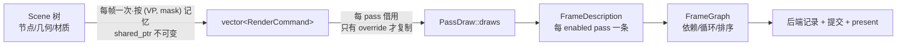

# graphics 抽象 / 概念 / API / 数据流复核（2026-10-20 第二轮）

> 上一轮（`graphics-abstraction-review-2026-10-19.md`）问的是"契约对不对"，骨架那两轮问的是"谁拥有谁"。
> 这一轮问三件事：**一个事实是不是只有一个概念、这个概念有没有一个不会被记混的名字；一帧的数据每一跳
> 谁拥有、借多久、复制几次；公开面上还有哪些名字不是这个名字该有的样子。**
> 结构性的洞（S1/S2/S3、SK0–SK3）已经在同一天全部落地，所以这一轮**没有新的结构性切片**，只有命名/概念收敛
> 和一批带触发条件的成本登记。

## 0. 本轮加的口径

1. **名字相差一个词的两个类型，等于要求读者记住哪一个是哪一个。** `PassDesc` / `PassDescription` 两个类型
   在同一个头文件目录里，只差一个词，含义却是"声明"和"这一帧画什么"——这不是命名风格，是陷阱。
2. **类型名要说出它真正的身份。** `FrameContext` 说自己是"每帧上下文"，实际上它只有一个**不是每帧**的事实
   （表面尺寸）和一个没人读的 `dt`。名字一旦许诺"以后还会加东西"，就会有人往里加东西。
3. **每一跳都说清"谁拥有 / 借多久 / 复制几次"。** 一帧的路径上有 6 跳，任何一跳默默复制整张表，
   都会在 60Hz 下变成每秒几十次分配。

## 1. 概念表：一个事实，一个概念，一个名字

| 概念 | 代表它的类型 | 判断 |
|---|---|---|
| 一条 pass **是什么**（声明） | `PassDesc` | 唯一存储（SK2 之后 `RenderPass` 就是它，`declaration()`/`setDesc()`） |
| 一条 pass **这一帧画什么** | `PassDraw`（**本轮改名**，原 `PassDescription`） | 后端消费的形状；`FrameDescription::Pass::draw` |
| 一次绘制调用 | `DrawDescription` | 场景档（camera+commands+lights）/ 全屏档（source+program+lights） |
| 一整帧（借用） | `FrameDescription` / `singlePassFrame` | 借用快照，有效到下一次编译 |
| 一整帧（拥有） | `OwnedFrame` / `OwnedPass` / `OwnedPassDraw` / `OwnedDraw` | 与借用形式逐层对应 |
| 后端可读的执行计划 | `backend::FrameGraph` / `CompiledFrame` | 依赖解析 + 循环检测 + 排序 |
| 宿主可读的同一份编译 | `FramePlan` / `FrameReport` | 两个投影（2026-10-19 已裁决，不重开） |
| 源图像的三种身份 | `ImageRef`（身份）/ `ImageInput`（声明）/ `ImageSource`（解析） | 三个都是必要的：身份要能持久、声明要能写、解析要带"这帧有没有产出" |
| 一块可被画/被读的图 | `RenderTarget` + `TransientShape` | 声明；管线与附件由后端物化 |
| 一块可呈现表面 | `RenderSurface` | 引擎拥有（SK1），宿主拿句柄 |
| 相机的画面形状 | `Camera::aspect()` | 一个相机一种形状（刻意偏离 three.js/Filament，已裁决） |
| 帧的布局尺寸 | `RenderEngine::surfaceWidth()/surfaceHeight()`（**本轮**，原 `FrameContext`） | 不是每帧事实，是 resize 事实 |

### 1.1 本轮修掉的三个"概念/命名"问题

| 问题 | 证据 | 改成 |
|---|---|---|
| `PassDescription` 与 `PassDesc` 差一个词 | 两个类型都在 `sdk/vine/graphics/`，一个说声明、一个说本帧输出 | `PassDraw`（`FrameDescription::Pass::draw`、`OwnedPassDraw`），并在类注释里明写"与 `PassDesc` 是两个概念" |
| `FrameContext{dt, surface_width, surface_height}` | `dt` 只有一处写（`frame(dt)`），全仓**零个读者**；尺寸不是每帧事实 | 类型与 `frameContext()` 一起删除；引擎给 `surfaceWidth()/surfaceHeight()`；`frame(dt)` → `frame()` |
| `Camera::setProjectionMatrixAsPerspective/Ortho` | OSG 遗留的 "setXxxMatrixAsYyy"；同一个类里的 `ProjectionType{Perspective, Orthographic}` 才是本模块的词汇（上一轮已把 `setViewMatrixAsLookAt` 改成 `lookAt`） | `setPerspective(fovy, near, far)` / `setOrthographic(l, r, b, t, near, far)`，52 处调用点 |

## 2. 数据流：一帧的六跳



| 跳 | 谁拥有 | 借多久 | 每帧成本 |
|---|---|---|---|
| 树 → 命令表 | `Scene` 的 frame-scoped memo（`shared_ptr<const vector<RenderCommand>>`） | 本内容帧（`setContentFrame`） | 命中 0 分配；未命中一次遍历 |
| 命令表 → `PassDraw` | 同一份 `shared_ptr`（引用计数 +1/pass） | 本帧 | 0 复制（除非 pass 有 program override） |
| pass 自身 → `PassDraw` | 调用方（`FrameDescription::Pass::draw`） | 本帧（条目复用） | 灯光列表按 pass 复制（见 F3） |
| 帧 → 后端 | 借用，`executeFrame()` 期间有效 | 一次提交 | 0 |
| 编译器 → `FrameGraph` | 后端 | 本帧 | 表是成员，稳态 0 分配 |
| 后端 → GPU | `RetirementQueue` + `FrameTimeline`（槽位回收即完成证据） | 见 `vsg-pass-lifecycle.md` | 见 `vsg-reimplementation.md` §6 |

### 2.1 数据流上的成本点（本轮收掉一个，登记两个）

| 项 | 事实 | 状态 |
|---|---|---|
| **F1 命令表两个入口** | `Scene::collectRenderCommands()` 每次**复制整张表**，`collectRenderCommandsShared()` 返回记忆化的共享表。生产路径只走后者，**前者 111 处调用点全在测试里** | **已收口（见 §6）**：只剩一个入口 `collectRenderCommands()` 返回共享不可变表；要复制就显式写 `*list` |
| **F2a program override 每帧复制整条命令表** | `RenderPass::describe()` 在 `program_override != nullptr` 时 `make_shared<vector<RenderCommand>>(*commands)`；每个有覆盖的 pass 每帧一次整表复制 | **已收口（见 §7）**：覆盖作为 `PassDraw::program_override` 随 pass 走，后端在**记录**每条命令时解析（`FrameRecorder::render`），命令表一个字节都不改 |
| **F2b 静态场景每帧重走一遍树** | 内容记忆体在**每个帧边界清空**（`Scene::setContentFrame`），所以即使内容没变，下一帧仍是一次完整收集 | **登记，已量化（见 §8）**：调试构建 **200 drawable = 880 µs/帧、2000 = 8.7 ms/帧**；跨帧复用需要一个"内容变更纪元"，两种设计写在 §8 |
| **F3 灯光列表每 pass 每帧复制** | `DrawDescription::lights` 是 `optional<vector<raw_ptr<const Light>>>`，而 `Scene::lights()` 是 `vector<intrusive_ptr<Light>>` | **关闭（见 §8.2）**：代价是 N 个指针（N 个位数），而两种改法一个要复制一份事实、一个要改拥有式的元素类型 |

## 3. 本轮的 API 改动（零行为变化）

| 旧 | 新 | 影响面 |
|---|---|---|
| `Camera::setProjectionMatrixAsPerspective(fovy, near, far)` | `Camera::setPerspective(...)` | 21 处 |
| `Camera::setProjectionMatrixAsOrtho(...)` | `Camera::setOrthographic(...)` | 31 处 |
| `RenderEngine::frame(double dt = 0.0)` + `FrameContext::dt` | `RenderEngine::frame()`（无参数） | 5 处传参调用点 |
| `RenderEngine::frameContext()` → `FrameContext::surface_width/height` | `RenderEngine::surfaceWidth()/surfaceHeight()` | 20 处 |
| `FrameContext`（整个类型，见 `FrameContext.hpp`） | ——（删除） | 头文件下线 <!-- drift-ok --> |
| `PassDescription` / `OwnedPassDescription` | `PassDraw` / `OwnedPassDraw` | 47 处 + 后端 |
| `FrameDescription::Pass::description` / `OwnedPass::description` | `draw` | 30 处 |

## 4. 判据

| 门 | 结果 |
|---|---|
| 全量构建（ninja all） | 0 error |
| `test_graphics` | **394 passed** |
| `test_vsg` | **478 passed** |
| `test_gui` | **259 passed / 1 skipped** |
| 静态门禁 8 条 | 0 finding；公开面基线 `0 new / 0 stale` |

## 5. 明确不做（这一轮核过，别下次再"发现"）

- **`FramePlan` 与 `FrameDescription` 是同一份编译的两个投影**：一个给宿主读（顺序、问题、每个 pass 花了多久），
  一个给后端跑。合并会逼着后端读字符串，或逼着宿主读内部结构（2026-10-19 已裁决）。
- **`ImageRef` / `ImageInput` / `ImageSource` 三个类型**：身份 / 声明 / 解析，三者生命周期不同，合并会让
  "声明了但这一帧没人产出"无处表达。
- **`Camera` 持有画面形状**：刻意偏离（three.js 也在相机上），代价已经被 `collectPictureShapeMismatches` 量化并
  变成一次报诊断（SK3 把它补到了"视图采纳管线"这一侧）。
- **`RenderEngine` 一身多职**（注册/编译/发布/诊断/借用设备/拥有区）：每件事都有独立文件和独立判据，
  再拆只会把"这一帧谁负责"拆散（骨架复核 §3 已逐条审过）。

## 6. 第二轮追加：F1 收口（本轮），F2 的前提被证伪

### 6.1 F1：`Scene` 的收集只剩一个入口

- **之前**：`collectRenderCommands()`（复制）与 `collectRenderCommandsShared()`（共享）两个入口。生产只走共享版，
  复制版 111 处调用点全在测试里——公开面上是一个"每帧复制整张命令表"的陷阱。
- **现在**：只有一个 `collectRenderCommands(camera, layer_mask = kAllLayers)`，返回
  `std::shared_ptr<const std::vector<RenderCommand>>`。要复制就写 `*list`（见 `RenderPass::describe`），
  复制成本从此是一句显式的话，而不是"调错了哪个重载"。
- **测试迁移**：111 处调用点改成 `*scene.collectRenderCommands(...)` / `->size()` / `(*list)[i]`。
  **坑（真踩了）**：`for (x : *temp_shared_ptr)` 是悬空的——`shared_ptr` 临时量在 range-for 的
  init-statement 结束就销毁，循环读到已释放的 vector（在没有内容帧 memento 兜底时立刻出错）。必须先把
  `shared_ptr` 绑到局部变量再 `*`。

### 6.2 F2：先做了缓存，然后被自己的测试打回

第一版的 F2 修法是"在 pass 上缓存改写结果，键为 (源表指针, 程序指针)"。测试立刻证明它**永远不会命中**：
`Scene::setContentFrame()` 在每个帧边界清空记忆体，所以**源表每帧都是一个新对象**，指针键每帧都变。
缓存变成了"只有状态、没有收益"的东西，已整体回退（包括成员与那条用例）。

真正的修法因此有两条，都已登记（§2.1）：

- **F2a**：让 override 随 `PassDraw` 走、后端逐命令解析——复制根本不必发生。这条和 2026-10-19 把
  `polygon_mode` 从"改写命令"改成"随状态走"是同一个动作的下一步。
- **F2b**：让内容记忆体跨帧存活（静态场景每帧重走一遍树是它的代价）。这条不能顺手做，因为记忆体按帧失效
  是**刻意的**：节点被直接改动（transform / 材质 / 属性缓冲）Scene 观察不到，跨帧复用会把这种改动藏起来。

### 6.3 判据

| 门 | 结果 |
|---|---|
| 全量构建 | 0 error |
| `test_graphics` | **394 passed** |
| `test_vsg` | **478 passed** |
| `test_gui` | **259 passed / 1 skipped** |
| 静态门禁 8 条 | 0 finding（`check_ai_docs --strict` 也 0） |

## 7. 第三轮追加：F2a 收口——程序覆盖成为 pass 的事实

### 7.1 形状

| 位置 | 之前 | 现在 |
|---|---|---|
| `PassDraw` | 只有 `state`（深度策略 + 光栅化覆盖） | **`program_override`**：这条 pass 用它画全部内容，null = 每条命令自己的程序 |
| `RenderPass::describe` | `program_override` 非空时 `make_shared` 整表并逐条改 `command.program` | 只是 `fillPassFacts` 里带上这一字段；`draw.commands` 永远是收集来的**共享表** |
| 后端（vsg） | 拿到的是改写后的表 | `collectContentDraw(commands, camera, override)` → `FrameRecorder::render(..., override)` → `snapshotCommands` **在记录时**把 identity 换成生效程序 |
| `OwnedFrame` | —— | `OwnedPassDraw::program_override`（拥有式镜像，`borrowed()` 原位带过去） |

**为什么这是"记录时解析"而不是"再造成一条 wire"**：记录器本来就把每条命令的身份（geometry / material / program / 状态）抄进自己的行，供计划建管线变体。覆盖在**这一抄写**里生效，下游（`ContentSets` / `ContentHalves` / 程序表）读到的仍是"这条命令用哪个程序画"，一行都不用改——覆盖对其他所有东西都是不可见的。

### 7.2 这正是 M1 已经走过的路

2026-10-19 的 M1 把**光栅化覆盖**从"改写命令"改成"随 pass 状态走、后端逐命令解析"，理由是"只有光栅化覆盖的 pass 因此一次复制都不花"。程序覆盖是同一件事的剩余一半，只是它不是 render state，所以有了 `PassDraw::program_override` 这个字段而不是进 `PassRenderState`。`StateNode.hpp` 里那段"程序覆盖是改写命令、所以不在 state 里"的旧解释已同时改正。

### 7.3 判据

| 门 | 结果 |
|---|---|
| 全量构建 | 0 error |
| `test_graphics` | **394 passed**（`PassDrawTest` / `RenderEngineTest` 的两条断言改成"覆盖在 pass 上、共享表未被改写"） |
| `test_vsg` | **479 passed**（新增 `FrameRecorderTest.ThePassProgramOverrideIsResolvedWhenTheDrawIsRecorded`；线框 / unlit 的像素判据全绿） |
| `test_gui` | **259 passed / 1 skipped** |
| 静态门禁 8 条 | 0 finding；公开面基线 `0 new / 0 stale` |

**代价说清**：现在"应用覆盖"是**后端契约**的一部分（和 `PassDraw::state` 一样），SDK 不再替后端改写。两个后端（vsg、测试里的 mock）都已实现；第三个后端要自己实现它——这正是 `state` 契约已有的形状，不是新增的坑。

## 8. 第四轮：把 F2b 量化，把 F3 关掉

### 8.1 F2b 的实测（本轮补的证据）

`MeasureWhatOneCollectionCostsWithAMovingCamera` 这条 recipe 现在多打印一个数：**引擎自己的稳态**（同一台相机、
同一份内容、每帧换一个 content frame token）。调试构建、`test_graphics` 里跑出来：

```
[measure] drawables=200  commands=200  moving=883 us  still=1 us  per_frame=880 us
[measure] drawables=2000 commands=2000 moving=9030 us still=1 us  per_frame=8701 us
```

读法：`still` 是"同一帧内再来一次"（记忆命中，1 µs），`per_frame` 是"这一帧的内容收集"（记忆被新 token
清掉，完整走一遍）；两者的差就是那次遍历。所以**静态场景每帧仍然付一次完整收集**，2000 个 drawable 在调试
构建里是 8.7 ms/帧（Release 会低一个数量级，但这仍是收集本身的上界）。

跨帧复用要回答的问题不是性能，而是**正确性**：节点被直接改动（`MatrixTransform::setMatrix`、材质、属性缓冲）
时**没有任何东西通知到 Scene**——今天的做法是"记忆只活一帧"，所以下一帧一定看见；改成跨帧复用，动画会冻住，
除非：

| 设计 | 做法 | 代价 |
|---|---|---|
| **A. 全局变更纪元** | `Node`/`Geometry`/`StateNode`/`Material` 的所有 setter 都 `++` 一个进程级的 `s_mutation_epoch`；Scene 记下上次收集时的纪元，相同就复用 | 要逐个改动 **几十个 setter**，漏一个就是"改了没反应"的静默画面错误；而且任何场景的改动会作废所有场景的记忆 |
| **B. 节点回指 Scene** | 节点自带一个 `Scene*`，setter 里 `scene->invalidateContent()` | 新增一条 ownership 边（正是骨架复核 §0 第 2 条口径要小心处理的东西），而且一个节点只能属于一棵树 |

两条都是**一个切片**，不是顺手改；它们的方向互相排斥（A 不引入边但要求全体 setter 配合，B 局部但要一条新边）。
**登记，等"静态大场景 + 相机常动"的真实负载来触发**，触发时先测 Release，再用 A/B 中的一个。

### 8.2 F3 关闭

`DrawDescription::lights` 每 pass 每帧复制一次（一个 `optional<vector<raw_ptr<const Light>>>`）。两条改法都
比这份拷贝重：

- **span over `intrusive_ptr<Light>`**：`Scene::lights()` 就是这个类型，所以描述里的 span 元素也得是
  `intrusive_ptr<Light>`；于是拥有式镜像 `OwnedDraw::lights` 的元素类型（现在是 `intrusive_ptr<const Light>`）
  必须跟着改——一个为了省一次分配而扩散到拥有式的类型连锁。
- **span over `LightRef`（`raw_ptr<const Light>`）**：`Scene` 得维护一份 `LightRef` 镜像——**同一份事实两份
  存储**，这正是本模块反复拒绝的形状。

代价是 N 个指针（N 是个位数）每 pass 每帧，而 `intrusive_ptr` 自增自减本来就是这笔账的一部分。**不做**，
理由写在这里，免得下一个 session 再"发现"一次。

## 9. F2b 落地：内容记忆体跨帧存活（"内容纪元"）

### 9.1 形状

| 位置 | 之前 | 现在 |
|---|---|---|
| 变更公告 | 场景级改动 bump `content_revision_`；节点改动**什么都不通知**，靠"记忆只活一帧"兜底 | `Node::announceContentChange()`：进程级 **content epoch**（relaxed atomic）自增一次。`Node::invalidateBounds()` 顺带公告（移动的子树既改包围盒也改命令）；`Node::setVisible/setLayers/clearLayers/setDrawOrder/clearDrawOrder/setOpacity`、`StateNode` 的 15 个 mutator、`Geometry::setMaterial/setProgram/setIndices` 各自公告 |
| 记忆体寿命 | `setContentFrame()` 换 token 就**清空** | 跨帧存活；`collectRenderCommands` 比对 epoch，变了就清空。`setContentFrame()` 只做**老化**：上一帧没人问过的条目删掉（记忆体因此被"实际在画的视图数"界定，而不是帧数） |
| 正确性依据 | "下一帧一定重走" | "改动一定公告"：改图 = 新纪元 = 新列表。Scene 看不见的改动（直接写缓冲、自定义节点）仍由 `Scene::invalidateContent()` 负责，这条契约写进了 `Scene.hpp` |

### 9.2 实测（调试构建，`MeasureWhatOneCollectionCosts*` 的 `per_frame` 列）

| drawables | 之前（每帧重走） | 之后（记忆命中） |
|---|---|---|
| 200 | **880 µs** | **5 µs** |
| 2000 | **8701 µs** | **36 µs** |

`moving` 一列（相机每帧动）不变：那本来就该是一次走树。

### 9.3 判据

| 门 | 结果 |
|---|---|
| 全量构建 | 0 error |
| `test_graphics` | **395 passed**（新增 `SceneContentCacheTest.EveryMutationThatChangesACommandEndsTheMemo`：11 种会改变命令的改动逐个验证"改了就必须换一张表"） |
| `test_vsg` | **479 passed**（像素判据全绿：真实渲染下没有一张旧表） |
| `test_gui` | **259 passed / 1 skipped** |
| 静态门禁 8 条 | 0 finding |

### 9.4 那条用例抓到的两个真缺口

第一次跑 `EveryMutationThatChangesACommandEndsTheMemo`，`Geometry::setMaterial` 与 `setProgram` **没有公告**
——命令里带着材质/程序的指针，换了却是同一张旧表。两条都补上了 `announceContentChange()`（并且先比后写，
"赋同一个值"不花钱）。`setIndices` 同理补了 `invalidateBounds()`。**这就是这条用例存在的理由**：漏一条就是
一幅不动的画面，而它不会报错。
