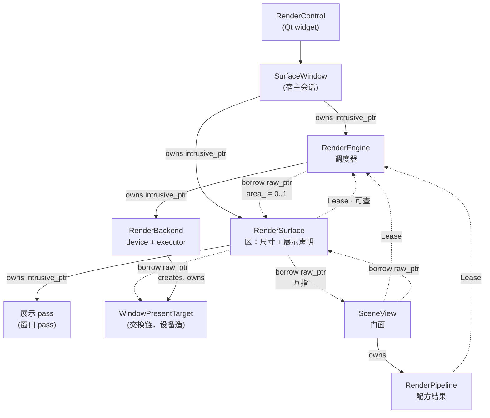
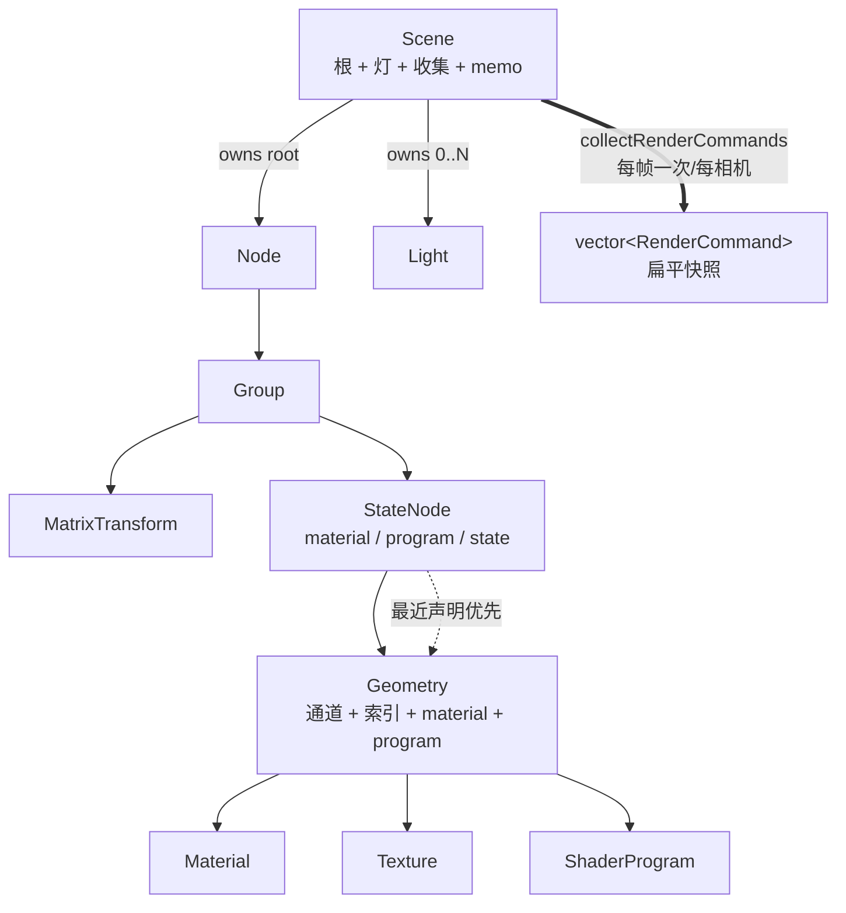
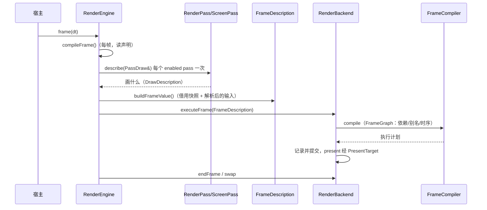

# graphics 骨架复核：对象关系、职责与命名（2026-10-20）

> **这一轮问的是"骨架"**：对象之间谁拥有谁、谁是 1:1、谁在借、一个概念被几个对象同时担着。
> 顺序是**先画图、再逐对象审、最后才改代码**——图不对，改哪里都是猜。
>
> 依据：`graphics-layering.md`（两半与依赖方向）、`graphics-object-model-vs-3d-frameworks.md`
> （逐对象对到 VTK / OSG / three.js / Filament / Qt3D）、`graphics-abstraction-review-2026-10-19.md`
> §0（判断口径）、`graphics-api-simplification-2026-10-20.md`（上一轮瘦身）。
> 本轮**不重开已裁决的题**（§5 逐条列出）。

## 0. 这一轮加的口径

前两轮的口径（一个事实一个权威 / 声明与执行分开 / 缺席与零分开 / 机制在 SDK 策略在应用层 /
同一件事没有第二种写法）+ 本轮两条：

1. **每条借用边要么不可能悬空，要么可查。** `raw_ptr` 只允许出现在"所有者保证活到使用者结束"
   的地方；做不到就必须 `Lease<T>`。一个模块里两种答案并存，等于没有答案。
2. **一条 1:1 关系的 owner 必须是这条边的一端。** 如果 A 与 B 一对一、互相借、由第三方持有，
   那是"三方约定"，不是关系——它会在某个宿主的析构顺序里失效。

## 1. 对象关系图

### 1.1 宿主侧：一扇窗 → 一个区 → 一幅画



**读法**：实线 = 拥有（`intrusive_ptr`），虚线 = 借用。三条看似"互相借"的边里，
`区 → 引擎` 与 `视图 → 引擎` 是可查的租约；`引擎 → 区` 与 `区 ↔ 视图` 是裸借用，
由宿主（实例态 `SurfaceWindow`）的析构顺序保证活着。

### 1.2 内容模型：一棵树 + 两处"最近声明优先"



**读法**：`==>` 是从"结构"到"快照"的唯一一次跃迁；之后的一切都只读 `RenderCommand`
（`FrameDescription` 持 `shared_ptr<const vector<RenderCommand>>`）。材质/程序在
`StateNode` 与 `Geometry` 都能声明、就近者胜，这是 OSG / vsg 的 `StateSet` 语义（刻意保留）。

### 1.3 一帧怎么走：声明 → 编译 → 值 → 后端



**读法**：`FrameDescription` 与 `FramePlan` 是**同一次编译的两个投影**（后端读者 / 宿主读者），
这一点 2026-10-19 已裁定（§5），本轮不重开。

### 1.4 配方层：谁造 pass

```mermaid
graph LR
    OPTS["RenderPipelineOptions"] --> BLD["RenderPipelineBuilder"]
    BLD -->|addPass(PassDesc)| ENG["RenderEngine"]
    BLD -->|产出| PIPE["RenderPipeline<br/>持有 passes/targets/overlays"]
    PIPE -->|注册其 passes| ENG
    VIEW["SceneView::setPipeline"] -->|采纳| PIPE
    SUR["RenderSurface::present(view)"] -->|解析回 view 的窗口 pass| PIPE
```

## 2. 所有权矩阵（照代码核过）

| 边 | 机制 | 基数 | 谁销毁 | 判据/备注 |
|---|---|---|---|---|
| 宿主 → Engine | `intrusive_ptr` | 1 | 宿主 | `SurfaceWindow::Data::engine` |
| 宿主 → RenderSurface | `intrusive_ptr` | 1 | 宿主 | 必须**先于**引擎销毁 |
| Engine → RenderSurface | `raw_ptr` | 0..1 | **不是引擎** | 与"父持有子"的 F5 裁决相反 |
| RenderSurface → Engine | `Lease` | 1 | — | **本轮改的**（原来 `raw_ptr`，析构里解引用） |
| Engine → RenderBackend | `intrusive_ptr` | 0..1 | 引擎（生命周期归创建者） | 借用语义写进注释 |
| RenderBackend → WindowPresentTarget | 设备造 | 1:N | 设备 | 区只借 |
| SceneView → Engine | `Lease` | 1 | — | 2026-10-19 F5 |
| RenderPipeline → Engine | `Lease` | 1 | — | 2026-10-19 F5 |
| SceneView → Surface | `raw_ptr` | 0..1 | 宿主 | 与 `区 → 视图` 互指 |
| SceneView → Camera / Scene / Manipulator / Pipeline | `intrusive_ptr` | 1 / 1 / 1 / 0..1 | 视图 | |
| RenderPipeline → passes / targets / overlays | `intrusive_ptr` | 1:N | 管线 | 引擎注册时另持一份 |
| Scene → root / lights | `intrusive_ptr` | 1 / N | 场景 | |
| RenderPass → camera / outputs / inputs | `intrusive_ptr` | | pass | **与 `PassDesc` 逐字段重复** |
| RenderTarget → Light | `intrusive_ptr` | 0..1 | 目标 | `shadowOf()` |
| FrameDescription → 全部 | `raw_ptr` + 一个 `shared_ptr` | | 生产者（借用） | 见 SK2 |

## 3. 逐对象审核

判据三问：**它担了几件事？业界同位置是谁？这些事会不会因为不同理由而变？**

| 对象 | 担的事（数） | 业界同位置 | 判断 |
|---|---|---|---|
| `RenderEngine` | 注册/排序 pass、每帧编译、诊断路线、发布槽、借用设备、借用区（6） | Filament `Engine`+`Renderer`；O3DE `RPI::Scene`；wgpu `Device`+`Queue` | **保留**。分区清晰（编译在 `EngineCompile.cpp`，图像表在 `FrameResources`）。唯一问题是"区"这条边的方向（SK1） |
| `RenderSurface` | 尺寸唯一 owner、展示声明、窗口目标借用、像素比（4） | wgpu `Surface`；O3DE `WindowContext`；Filament `SwapChain` | **保留名字**：它确实是"可呈现表面"+ 展示声明的主人。但它不拥有自己的引擎却调用它——本轮修掉（SK0） |
| `SceneView` | 相机、场景、操纵器、引擎、管线、尺寸、输入路由、布局参与（8） | O3DE `RPI::View`（只有相机+pipeline）；three.js 无此对象 | **保留为门面**。8 件事里 6 件已经是协作对象（`InputRouter`/`LayoutParticipant`/`CameraManipulator`），它只转发；再拆只会多一层 |
| `RenderPipeline` | 持 8 个角色（window pass / offscreen / composite / gizmo(+pass) / fps(+pass)）+ resize + 模式切换（5） | O3DE Atom `Pipeline`；Unity SRP `RenderPipeline` | **保留**。形状对（构建结果 + 运行时开关）。但 `setShadingMode/setGizmoVisible/setStatsVisible` 返回 `bool` 的 setter 违反仓库口径（setter 返回 void，除链式 builder）——登记 |
| `RenderPass` + `PassDesc` | 同一份声明存两遍，~50 个镜像访问器 | O3DE `RPI::Pass`+`PassData`；wgpu `RenderPassDescriptor`（值）| **结构性缺陷**，见 SK2 |
| `RenderTarget` | 附件、尺寸、深度借用、生产者投影、`shadowOf`、名字（6） | Filament `RenderTarget`；O3DE `RPI::RenderTarget` | **保留**（S10a 已裁决不改名）。6 件事都通向"一张可被画/被读的图"，内聚 |
| `PresentTarget` / `WindowPresentTarget` | 呈递契约 + 窗口面 | Vulkan `VkSwapchainKHR`；Filament `SwapChain` | 名字里 "target" 与 `RenderTarget` 撞车；**建议改 `SwapChain` / `WindowSwapChain`**，独立切片（§6） |
| `Scene` | 根、灯、可见性/不透明度、名字、包围盒、收集+memo（6） | three.js `Scene`（灯是子节点）；Filament `Scene`（实体注册表） | **保留**。灯不在节点树是**能力缺口**（已登记，触发条件=需要灯随节点走） |
| `Node`/`Group`/`MatrixTransform`/`StateNode`/`Geometry` | OSG/vsg 风（1 件事各） | OSG / vsg | **保留**（刻意偏离，`graphics-object-model-vs-3d-frameworks.md` §2） |
| `Camera` | 位置/朝向 + 投影 + **画幅比例**（3） | three.js（aspect 在相机）；Filament（在 viewport） | **保留**（已裁决）。代价已经被框架自己量出来：`collectPictureShapeMismatches` 就是在给"相机的形状"和"pass 的矩形"对账 |
| `Light` / `LightRig` | 场景级光源 + 配方 | three.js `Light`、Filament `LightManager::Builder` | **保留**。`LightRig::addTo` 是配方（它调 `Scene::addLight`），不是第二个门 |
| `FrameDescription` / `OwnedFrame` | 借用快照 / 拥有快照 | wgpu `RenderPassDescriptor`（借用）| **保留**（L1 own 形态已有） |

### 3.1 三条"概念重复"的具体位置

1. **"这一幅画画什么内容"声明了三次**：`SceneView::scene()`、`RenderPipelineBuilder` 收到的内容、
   每个 `PassDesc::content`。三者合法（视图看什么 / 配方给谁建 / 哪个 pass 画什么），但**没有任何
   一处校验它们一致**：一个宿主完全可能建出一条"pass 画 A、视图看 B"的管线，视图的
   `fitToScreen` 就会框住 B 而画面是 A。→ 建议加一条一次报的诊断（SK3，只诊断不改结构）。
2. **"这幅画落地在这里"有两个说法**：`RenderSurface::present(view/pass)`（声明）与
   `RenderEngine` 的 pass 表（事实）。设计上已经用"声明 resolve 到在帧里的 pass"把两者绑住
   （`hasPresentation()` 就是那条绑带），**这一点是对的**，不列待办。
3. **"尺寸"三个入口**：`RenderSurface::resize` / `SceneView::resize` / `RenderPipeline::resize`。
   前两个是同一个公告的两种落点（本轮已经统一成同一签名 + 同一默认），第三个是管线自己的重排
   （离屏目标 + HUD 盒），语义不同，保留。

## 4. 改造切片（按"收益 ÷ 风险"排序）

> 前缀 `SK` 是为了不和 `graphics-followups-2026-10-19.md` §3.9 已有的 S1/S2/S3 混：“SK2”就是那里的 S1（同一件事）。

### SK0（**本轮已落地**）区对引擎的借用改成租约

- **问题**：`引擎 → 区` 与 `区 → 引擎` 都是裸借用，一对一，由宿主当第三方保证顺序；
  `~RenderSurface()` 会调用 `engine_->releaseArea(this)`。宿主若先销毁引擎，这是 use-after-free。
  同一个模块里，视图与管线早就是 `Lease`（F5, 2026-10-19）——**唯独区漏了**。
- **改法**：`RenderSurface::engine_` 从 `raw_ptr<RenderEngine>` 改为 `Lease<RenderEngine>`；
  每个用点取一次 `engine_.get()` 并显式处理"引擎已消失"（不展示、不报诊断——诊断路线随引擎走了）。
- **判据**：`RenderSurfaceTest.AnAreaOutlivingItsEngineAnswersNothingInsteadOfCallingIntoIt`
  （引擎先销毁，区仍可查询/重设尺寸/拒绝展示）；`test_graphics` 392 → **393** 全绿。

### SK1（**2026-10-20 已落地**，见 §10）**区归引擎所有**

- **问题**：这是所有权矩阵里唯一"父不拥有子"的边。一扇窗一个引擎一个区是 1:1，但 owner 是宿主，
  于是"第二个区被拒"只能**在运行期报**，而"区必须先于引擎销毁"只是一句注释。SK0 让它不再 UB，
  但没让它成为关系。
- **目标形**：
  ```cpp
  // 父拥有子，子借父 —— 与 F5 裁决同一条规则
  intrusive_ptr<RenderSurface> RenderEngine::createSurface();   // 第二个返回 null
  // private: intrusive_ptr<RenderSurface> area_;
  ```
  `RenderSurface` 构造转私有（`friend RenderEngine`），宿主 `SurfaceWindow` 改一行。
- **收益**：1:1 由类型保证；"第二个区"从诊断变成构造失败；消灭隐式销毁顺序；与 Filament
  （`Engine` 造并持有交换链）/ O3DE（`WindowContext` 持交换链）同形。
- **成本**：~30 处构造点（多数是测试的 `new RenderSurface(*engine)`）；`~RenderEngine` 要显式
  排顺序（先 `shutdown()` 解绑目标，再析构区，最后放设备）；三条"第二个区"用例判据改。
- **风险**：中（生命周期顺序）。**不要与 SK2 同批做**。

### SK2（最大的一处，单独一轮）`RenderPass` 只存一份声明

- **问题**：`PassDesc`（值）与 `RenderPass`（节点）每个字段各一份，引擎 `addPass` 逐字段抄，
  公开面 ~50 个镜像 getter/setter。漂移风险全压在这张对照表上。
- **目标形**：节点持 `PassDesc desc_` + 一小块编译期事实（`target`/`transient`/解析后的 viewport）；
  公开面 = `desc()` / `setDesc()` / 少量运行期查询。
- **收益**：一个事实一份存储；`RenderPass.hpp` 642 行 → 约 250；"值形式与节点形式不一致"这一类
  缺陷从此不可能。
- **成本**：高（后端与测试的读取点全部改成 `desc().field`）。可分三步：先加 `desc()` 并存，
  再迁移读者，最后删镜像访问器——三步之间每次都要全绿。
- **判据**：`EngineCompile` 里那段逐字段抄的代码消失；`RenderPassTest` 全绿。

### SK3（小）一条"视图看的场景不在管线里"的诊断

`SceneView::setPipeline` 时，若该管线的任何 pass 都不画视图的场景，报一次（诊断类别已有
`PassProtocolViolation`）。**只加诊断，不改结构**——因为"管线画多个场景"是合法的。

## 5. 不重开（已裁决，本轮核过仍然成立）

| 项 | 裁决 | 复核结论 |
|---|---|---|
| `FramePlan` vs `FrameDescription` 两个帧值 | 2026-10-19 关闭：读者不同 | 仍然成立：一个是宿主可读的表（名字/标签/上次耗时），一个是后端消费的借用值 |
| `RenderTarget` 改名 | S10a：它是描述不是资源 | 成立 |
| `Pipeline` 命名（PSO） | K1：公开类已叫 `RenderPipeline` | 成立 |
| `Camera` 带画幅比例 | 刻意偏离 three.js 一侧 | 成立，代价由画幅对账诊断兜底 |
| 多格 / 分屏 | 一块区只画一幅画 | 成立 |
| `Pipeline` 便利入口、零灯自动头灯、`RenderControl::Config` | 否决清单 | 成立 |

## 6. 命名裁定

| 现名 | 业界 | 裁定 | 理由 |
|---|---|---|---|
| 事件/对象 `RenderSurface` | wgpu `Surface`、Filament `SwapChain`、O3DE `WindowContext` | **保留** | 它是"可呈现表面 + 展示声明的主人"，三者里只有 `Surface` 同时指这两件事 |
| `PresentTarget` / `WindowPresentTarget` | Vulkan `VkSwapchainKHR`、Filament `SwapChain` | **建议 `SwapChain` / `WindowSwapChain`** | 与 `RenderTarget` 的 "target" 撞车；业界口径一致 |
| `RenderEngine::device()` 返回 `RenderBackend` | — | **保留，补注释** | "device" 是角色（引擎借用什么来画），`RenderBackend` 是它落在插件上的类型；改名收益小于混淆成本 |
| `RenderPipeline` | O3DE Atom `Pipeline` | **保留** | 与 PSO 已分开（K1） |
| `RenderCommand::program/material` | — | **保留** | 与 `Geometry`/`StateNode` 的"最近声明优先"配套 |

## 7. 判据

| 门 | 结果 |
|---|---|
| 全量构建 | 0 error |
| `test_graphics` | **393 passed**（新增 1 条区/引擎寿命用例） |
| `test_vsg` | **478 passed** |
| 静态门禁 8 条 | 0 finding；公开面基线 `0 new / 0 stale` |

SK0 的"不再解引用已销毁引擎"是**结构上**成立的（租约为空 ⇒ 一个引擎调用都不发生）；
把它变成可复现的变异证据需要 ASan 树（`scripts/asan_check.sh`），本轮未跑，记在下一轮的开场。

## 8. SK2 落地（2026-10-20，本轮）— pass 声明只剩一份存储

> 上一轮把 SK2 排在"最大的一处，单独一轮"。这一轮用户直接把窗口开了，于是
> **S1（`RenderPass` 双份声明）+ S3（相机正名）同批**做完，顺带把两处"每帧分配"收掉。

### 8.1 改了什么

| 位置 | 之前 | 现在 | 为什么 |
|---|---|---|---|
| `RenderPass` | 24 个成员字段（`name_` / `camera_` / `clear_color_` / `layer_mask_` / `input_images_` …）+ 与 `PassDesc` 一一对应的 getter/setter | **一个** `PassDesc desc_`；`declaration()` 读它，`setDesc()` 整体采纳它；访问器全部是它的一行投影（多数内联在头文件里） | 一个字段一份存储 ⇒ "值形式与节点形式不一致"这一类缺陷不再可能 |
| `PassDesc` | 能表达 output name / output target / inputs / input targets / input names，**不能**表达细粒度输出 `ImageRef` | 新增 `intrusive_ptr<ImageRef> output` | 值形式第一次能完整描述一个 pass；`addPass(PassDesc)` 不再悄悄丢掉 `setOutput` 那一条声明 |
| `RenderPass::kind` 的默认值 | `ScreenPass` 的构造函数里 `setClearEnabled(false); setShouldClearDepth(false);` | `desc_.clear_enabled / clear_depth` 为 `unset` 时按 **kind** 回答（Scene 清、Screen 不清） | 默认值从"某个构造函数顺手设的"变成 kind 的定义：一个 pass 不可能被建成"半个 Screen pass" |
| `RenderEngine::Slot` | 9 个字段（pass / content / order / record_micros / tag / writes_image / writes_shape / transient / before_draw） | **4 个**：pass / order / record_micros / transient，且注释写明"这里只放只有帧知道的事实" | 同一份声明原来存了**三份**（`PassDesc` → `RenderPass` 字段 → `Slot`）；content 也回到声明里（`PassDesc::content`），`bindPassContent` 写穿到它 |
| `RenderEngine::addPass(const PassDesc&)` | 25 行逐字段抄写 + 若干 `if (has_value())` | 建节点 → 处理 depth 边的三种裁决 → `node->setDesc(std::move(adopted))` | 抄写表就是漂移源；现在"采纳一份声明"是一次赋值 |
| `ScreenPass` | 自己的 `program_` 成员 | `declaration().program` / `desc_.program` | 同一个程序存过两份 |
| `clearInputs()` / `clearInputNames()` | 两个入口，前者不清名字 | **一个** `clearInputs()`，清 images + targets + names | 同一件事的第二种写法；而且"清一半"是个真陷阱 |
| `Camera::setViewMatrixAsLookAt(eye, center, up)` | 名字说的是"设置矩阵"，收的是三个向量 | `Camera::lookAt(eye, center, up)`（74 处调用点，src / tests / docs 一次改完） | 仓库命名口径；与 S1 同批花掉同一次公开变更窗口 |

### 8.2 顺带收掉的两处每帧分配（"性能"）

模块自己的规矩是"稳态帧不分配"。这一轮找到两处违反它的地方，都按**"表是成员、按帧清空"**收掉：

| 位置 | 之前（每帧） | 现在 |
|---|---|---|
| `collectPlanProblems` | `std::map` ×2 + `std::set` ×1 + `std::map` ×1 + `std::vector` ×1：每帧按 pass 数分配/释放红黑树节点 | 引擎成员 `wiring_filled_ / wiring_claimed_ / wiring_colliding_ / wiring_unbound_ / wiring_promised_images_`，**扁平 vector + 线性查找**（pass 数是个位数，树只会多付分配），`clear()` 保留容量 |
| `buildFrameValue` | `frame_value_.passes.clear()` 后再 `push_back`：每个 pass 的 `inputs` 与描述里的 `draws` 每帧重建 | 按索引**复用**上一帧的 `FrameDescription::Pass`（`inputs.assign` 复用容量、已就位的 `PassDraw` 不销毁，`fillPassFacts` 只 clear `draws`）；只有"这一帧运行的 pass 变少"才 `resize` 收缩 |

`OutputIdentity` 相应补了 `operator==`（扁平表的查找键；原来只有 `operator<` 给 map 用）。

### 8.3 一条被改掉的语义，写在这里免得下一个 session 以为是回归

`setDesc()` 采纳一份声明时，**只在声明里的 depth view 有效时**把它施加到目标上；声明里没有
（或无效）depth view 时**不会**清掉另一个 pass 为同一目标建立的 depth 边。原来 `addPass`
对"无效 view"走的是 `setDepthView(invalid)`（会清），这一轮把"采纳一份声明"和"显式声明一条边"
分开：`setDepthView()`（显式）仍然会清，`setDesc()`（整体替换）不清。判据：
`DepthViewTest.TwoDifferentDepthViewsForOneTargetAreRefusedOnce`（冲突被拒后，先声明的那条边必须还在）。

### 8.4 判据

| 门 | 结果 |
|---|---|
| 全量构建（ninja all） | 0 error |
| `test_graphics` | **393 passed** |
| `test_vsg` | **478 passed**（含全部 `[sdk-pixels]` 证据行） |
| `test_gui` | **259 passed / 1 skipped** |
| 静态门禁 6 条（ai_docs / doc_symbols / include_hygiene / export_annotations / diagnostic_formats / public_docs） | 0 finding，公开面基线 `0 new / 0 stale` |

`RenderPass.cpp` 410 → 250 行；`RenderPass.hpp` 的字数主要花在 Doxygen（每个公开声明都必须有
`@brief` / `@param` / `@return`），所以头文件行数没有跟着掉，但**每个访问器都只剩一行**，
且不再有第二份存储。下一次要动 pass 面时，只需要动 `PassDesc` 一处。

## 9. S2 + SK3 落地（2026-10-20，同一轮）

### 9.1 S2：纹理只有一个编号词汇（`layer`）

| 之前 | 现在 | 为什么 |
|---|---|---|
| `faceCount()`（同一个数） + `layerCount()` | **`layerCount()`** | 一个事实一个名字；`faceCount()` 对 `D2` 毫无意义 |
| `source(int face)` + `layer(int index)`（同一张图） | **`layer(int index)`** | 头文件自己写着 "kind-agnostic spelling"，却留了两种说法 |
| `hasSource(int face)` | **`hasLayer(int layer)`** | 与 `layer()` 同一个词汇，语义仍是"这层有图" |
| `setSource(int face, image)` | **`setLayer(int layer, image)`** | 与 `layerCount()`/`layer()` 成对 |
| `CubeMap::setFaceImage(Face)` / `faceImage(Face)` | **保留**（内部调用 `setLayer`/`layer`） | 立方体的**命名**面是类型自带的糖，不是第二套编号；测试钉住 `Face::NegY` 与 `layer(4)` 是同一格 |

调用点：`src/viz/graphics/src/Texture.cpp`、`src/plugins/gfx_backend_vsg/src/support/VsgSceneRules.cpp`
（`filledFaceCount` 一并改名 `filledLayerCount`）、`tests/test_graphics`、`tests/test_vsg`、
`docs/guides/graphics.md`、`.ai/memory/imaging.md`。原来那条"两种拼法说的是同一张纹理"的用例改成
`TextureLayersTest.OneNumberedSpellingWalksAnyKind`：它判的是**一个**词汇能走完任何 kind、越界是查询、以及命名面与层号同格。

### 9.2 SK3：视图采纳了"画别的内容"的链条时，报一次

- **问题**：`SceneView::setPipeline` 只把链条挂上，不检查它画的是不是这个视图的内容。一条为场景 A 建好的
  管线被持有场景 B 的视图采纳时，每个 pass 都合法、引擎照单编译，结果是"视图有内容但窗口空"——没有任何
  下游能看见。视图是唯一同时持有这两半的对象，所以判断放在那里。
- **形状**：`RenderPipeline::draws(raw_ptr<const Scene>)`（问的是**整条链**，不是窗口 pass：延迟链条在
  G-buffer pass 画场景、窗口 pass 只是呈现目标）+ `SceneView::checkPipelineContent()`（`setPipeline` /
  `setScene` 各调一次，`ReportOnce` 管一次发作）。`setScene` 会把窗口 pass 的内容重绑到新场景，所以
  "绑对了"会 re-arm，下一次错是新的一次发作。
- **不改结构**：一个管线画多个场景是合法的；只有"一个都不画这个视图的场景"才报。判据：
  `SceneViewTest.AChainBuiltForOtherContentIsReportedOnceAndIsANewEpisodeOnceTheWireIsRight`
  （1 条 = 第一次采纳；仍 1 条 = 同一发作；2 条 = 修好后再坏是新发作）。

### 9.3 判据

| 门 | 结果 |
|---|---|
| 全量构建 | 0 error |
| `test_graphics` | **394 passed**（+1 条 SK3 用例，纹理用例改写后总数不变） |
| `test_vsg` | **478 passed** |
| `test_gui` | **259 passed / 1 skipped** |
| 静态门禁 8 条 | 0 finding |

剩余登记只有 **SK1**（区归引擎所有，动的是生命周期，需单独一轮）。

## 10. SK1 落地（2026-10-20）：引擎拥有它的区

> §4 的 SK1 是所有者矩阵里唯一"父不拥有子"的边。这一轮把它变成关系本身——**没有第三方约定，也没有回指协议**。

### 10.1 改了什么

| 位置 | 之前 | 现在 |
|---|---|---|
| 创建 | `new RenderSurface(*engine)`（任何人都能造，第二个由引擎在登记时拒绝） | **`RenderEngine::createSurface()`**，唯一入口；第二次调用回 `nullptr` + 报一次（`UnsupportedRequest`） |
| 所有权 | 宿主持 `intrusive_ptr<RenderSurface>`；引擎持 `raw_ptr` | 引擎持 **`intrusive_ptr<RenderSurface> area_`**；宿主那句赋值变成"要一个句柄"，不再是"造一个对象" |
| 构造 | public `explicit RenderSurface(RenderEngine&)` | **private** + `friend class RenderEngine`（关系由类型保证，不是一句注释） |
| 回指协议 | `~RenderSurface` 调 `engine_->releaseArea(this)`，构造里 `adoptArea(this)` | **两个都删掉**：引擎自己 `area_` 就是那个关系，`~RenderEngine` 在自己还是个对象时把 `area_` move 出去再释放，所以区的析构永远看不到一个半死的引擎 |
| `announceAreaSize` | 只认引擎的区（`from != area_`） | 不变（`area_` 现在是拥有的句柄，比较改成 `area_.get() != from`） |
| `SurfaceWindow` | `d->surface = intrusive_ptr<RenderSurface>(new RenderSurface(*d->engine));` | `d->surface = d->engine->createSurface();` |

宿主侧的成员顺序约束消失了：`~SurfaceWindow` 先销毁引擎也安全（引擎释放它那份引用后，宿主手里的区只是"引擎没了"的区，SK0 的 `Lease` 已经让它逐条回答"没有呈现"）。

### 10.2 对照

Filament：`Engine` 创建并持有 `SwapChain`（每个 surface 一个）；O3DE：`WindowContext` 持 swapchain；
wgpu：`Surface` 由 instance + window 造、由应用持有，但**同一 instance 的 surface 与 device 是分开的**。
这里一个引擎驱动一幅画面、一扇窗，所以"引擎拥有区"是最短的那条边，也正是 §0 第 2 条口径（1:1 的 owner 必须是这条边的一端）。

### 10.3 判据

| 门 | 结果 |
|---|---|
| 全量构建 | 0 error |
| `test_graphics` | **394 passed**（两条"第二个区"用例改写成构造失败的形状，条数不变） |
| `test_vsg` | **478 passed** |
| `test_gui` | **259 passed / 1 skipped** |
| 静态门禁 8 条 | 0 finding |

改写的两条用例：
- `ASecondAreaIsAConstructionFailureNotASecondObject`：第二次/第三次 `createSurface()` 都是 `nullptr`，只报一次，且既有那块区照常呈现；
- `ARefusedSecondAreaCannotFeedTheFrameContext`：被拒的那次创建不改变"谁在喂 frame context"。

`~RenderEngine` 的顺序现在是：`shutdown()`（解绑目标）→ `area` move 出 `area_` → 清租约 → 卸设备诊断路线 → 作用域结束时释放区（此时租约为空，区不会再回指引擎）。
