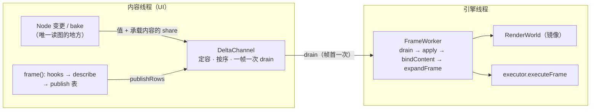

# graphics 的线程模型

> **状态**：已落地（P1/P2/P3 全部在代码里，宿主默认走引擎线程；§9.2 只剩真实缺口，不是计划）
> **最后核对**：2026-11-11
> **范围**：graphics 模块与宿主之间"哪一段工作在哪个线程"的完整契约 —— 内容世界与渲染世界各归谁、
> 场景图/节点状态/相机怎么更新到渲染侧、表面与交换链归谁、并行计算放在哪、关闭怎么收。
> **不含** appfw 的通用异步（`appfw-startup-phases.md`、`async-design.md`）与 Vulkan 同步细节（`vsg-backend.md`）。
> **权威来源**：`src/viz/graphics/src/Scene.cpp`（bake / select）、`src/viz/graphics/src/Node.cpp`（两个公告钩子）、
> `src/plugins/gfx_backend_vsg/src/internal/ContentStore.cpp`（事实行）、
> `src/plugins/gfx_backend_vsg/include/vine/vsg/internal/SessionContent.hpp`（表面重读与交换链重建）。
> **待办**：`../backlog/graphics.md`

## 1. 概要设计

### 1.1 问题与背景

今天一帧的每一段都在 Qt 应用线程的**一次调用栈**里：`SurfaceWindow::renderFrame()` → `RenderEngine::frame()`
→ `compileFrame()`（收集 + 描述）→ `executor().executeFrame()`（上传、记录、提交、呈现）。而应用线程同时是 UI 线程，
所以渲染与交互互斥。实测（Release）：2000 drawables 移动相机 **1597 µs/帧**（0.94 µs/命令，其中逐命令构造/解析 ~1.3 ms = 71%），
后端记录基线 **33 次分配/录制三角形**，会话初始化 ~184 ms，vsg 在"这一帧什么都没录"时还会在调用线程睡 16 ms。
appfw 已经把应用线程占用当预算（启动门禁 150 ms 项）。

难的不是"开线程"，而是**内容归谁写**：后端的"事实行"每帧从**活内容**上读
（`GeometryFacts.cpp:181` 读 primitive 的实例句柄、`ContentStore.cpp:377` 读 `geometry->revision()`），
收集也要走场景图。只要渲染在另一个线程，两边就必须有一种关系：共享（锁）、拷贝（每帧快照）、或移交（一个写者）。

### 1.2 目标

- 一帧的 GPU 面工作（上传、记录、提交、呈现、驻留记账、剔除）跑在**引擎线程**上，应用线程不承担它。
- **内容的编辑 API 不变**：宿主继续在 UI 线程同步读写场景图（这是文档编辑器的核心手感，不能变成异步）。
- 两个世界之间只有**三条通道**（delta / handoff / snapshot），每条都是值或所有权，**没有一处共享可变状态**。
- **漏发**要编译不过，而不是静默画错。
- 渲染侧与内容侧对同一个视图产出**逐位相同**的命令序列（这是镜像正确性的判据，也是并行化的前提）。

### 1.3 非目标

- 不做通用 job system / 任务图（`async` 与 `ThreadPool` 已有）。
- 不给 `Node`/`Geometry`/`Buffer` 加锁（见 §7 D4）。
- 不把内容编辑变成异步（见 §7 D1 —— 这是被否决的第一稿）。
- 不做远程渲染 / 录制（`OwnedFrame` 的消费者，`OwnedFrame.hpp:101-105` 已划出三类场景）。
- 不做按 pass 的并行记录（见 §7 D6）。
- 不为"每帧动画"新增引擎侧 update traversal：更新的写者仍是内容线程（见 §3 F4）。

### 1.4 一句话结论

**两个世界**：内容世界（UI 线程，作者态，API 不变）与渲染世界（引擎线程，渲染态）。
渲染世界是内容的一份**镜像**（世界矩阵、世界盒、折叠状态、顺序 —— 即今天 `SceneBake` 已经在算的东西），
由内容侧的**变更公告**（delta，payload 必填）增量更新；字节内容不靠公告，靠两个**原子 revision** 轮询。
每帧引擎只在镜像上剔除/建计划/记录/提交/呈现；并行只发生在镜像上的纯计算里。

## 2. 设计要点

### 2.1 两个世界，各自一个写者

- **是什么**：**内容世界** = `Scene`/`Node`/`Geometry`/`Buffer`/`Program`/`Material`/`Texture`/`Camera`，只被 UI 线程写；
  **渲染世界** = 镜像节点、几何代理、材质块、驻留表（`ContentStore`/`StreamUploads`/`ContentHalves`/`ContentSets`）、
  vsg 命令图、交换链，只被引擎线程写。任何一侧都不读另一侧的可变字段。
- **为什么**：两个写者共享一个可变图，只能靠锁 —— 而锁会进到每一次读路径，且与"稳态零分配"直接冲突（`G1`/`G10`）。
  各自一个写者 + 值通道，是唯一能让两边都保持零锁的形状。
- **边界**：唯一的跨侧读取是"已发布不可变值"（§2.4）与"镜像节点持有的指针"（只为保地址，不读字段，见 §2.2）。

### 2.2 镜像就是已经存在的 bake，只是换了主人

- **是什么**：镜像节点 = `(节点身份, 局部变换, 世界矩阵, 世界盒, visible/opacity/layers/drawOrder 折叠值, 子节点顺序)`；
  几何代理 = `(通道切片 + 标量数, primitive 切片（索引/实例）, 材质句柄@revision, program 句柄@revision, 拓扑/计数)`。
  这正是 `detail::SceneBake` + `GeometryFacts` 今天算的两样东西，**内容源与算法都不变，只是搬到引擎侧**。
- **为什么**：不新增概念（`G1`），代价最小 —— 今天的 bake 已经按 `contentEpoch` 缓存、按子树重算；镜像只是把它的
  输入从"读活节点"换成"应用 delta 后的值"（`G7`：复杂性吸收在引擎侧，不推给宿主）。
- **边界**：镜像**不持有节点**（`RenderWorld::adopt` 直接把构建时记下的 `SceneBake::nodes` 丢掉）；内容侧的 `ContentStore`
  持有对象 share 只是为把地址钉住（ADR-2026-11-09 的规则），**不读它的任何字段**；读字段就等于回到共享可变状态。
- **不进镜像的**：节点名字、行为/脚本、选择态、撤销栈、宿主的文档状态 —— 没有消费者（`G8`）。把这些也搬过来
  就是"把内容世界整个复制一份"，那是被否决的第一稿。
- **一行 = own + resolved**：own 是节点自己说的（局部矩阵、可见性、透明度、自己的层/顺序声明、自己的状态/材质/程序、
  逐 primitive 的 `DrawFacts`，以及**逐视图放置这个值**）；resolved 是折出来的（世界矩阵、父世界矩阵、折叠值、子树层并集、
  世界盒、`unbounded`、`end`）。镜像的编辑只改 own，再跑**同一次**折 —— 这也是“镜像能自己前进”的全部机制。
- **逐视图放置是函数值**：`ViewPlacement`（`AutoTransform` 是它的唯一实现）= 一个只含数字的不可变对象，
  三个答案 `declaredDependence()` / `dependence(view)` / `localMatrix(parent_world, view)`，外加一个**与视图无关的保守盒**
  `conservativeParentBox(own_box)`（旋转因此被"绕枢轴的正方体"覆盖）与 `isBounded()`（屏幕缩放在没有上限时不存在与视图无关的尺寸，
  该子树的 `unbounded` 沿祖先上爬，谁都不许按盒剔它）。选取拿到的就是**视图值**，所以镜像不需要节点也不需要相机对象。
- **共用一份算法**：行类型与三趟走法（`bakeSubtree` 建 own / `resolveSubtree` 折 / `selectFromBake` 选 / `sortCollected` 排）
  是 `src/viz/graphics/src/DrawListBake.{hpp,cpp}` 里的**同一份**代码，内容侧与镜像侧只是填 own 的人不同 ——
  否则“等价性”会退化成两套实现互相验证。
- **唯一还需要内容线程的一步**：`refreshBoxes`（只对叶子，容器不问）。“写 buffer”不会发 delta，盒子的新鲜度靠问 geometry
  自己的（按通道 revision 与切片键控的）`localBounds()`；这一问是写缓存的，所以它留在拥有内容的那侧，与选取分开。
  镜像没有节点，因此这一步它**不做**：镜像的盒停在握手给的值上，直到有了"盒 delta"（§9.2 的已知缺口）。
- **局部更新只碰它改过的行**（§3.1.4 的 C4/C15 在内容侧已经成立）：盒是并集，所以一次编辑要把**改动的子树**整片重折，
  再把**它上面那条链**逐行重折（每行只用已折好的子行，不再走子行以下的树）。刷新则先比对叶子这次说的和行里存的：
  没变就**一次折都不跑**，变了才折那一片加那条链，多条链去重后按行号降序折（前序里子行永远在后，所以降序即先子后父）。

### 2.3 三条跨线程通道

| 通道 | 方向 | 装载什么 | 顺序 / 失效 | 违反的形态 |
|---|---|---|---|---|
| **delta**（变更公告） | 内容 → 引擎 | **值**：结构变化（attach/detach/换根）、节点 placement（局部矩阵 **+ `ViewPlacement` 值**）/state、几何描述、相机、表面事件、帧请求 | 队列 FIFO；引擎在**帧首一次 drain**，同帧内按序应用 | 漏发（编译期拦，§2.5）、改了不公告 |
| **handoff**（交接） | worker → 任何一侧 | **所有权**：新构造好的 `Buffer`/`Geometry`/纹理，或整帧（`OwnedFrame`） | 交接后发送方不再触碰；必须过带边界的队列 | 用 `intrusive_ptr` 直接跨界（无 happens-before，`RefCounted.hpp:62-83`） |
| **snapshot**（快照） | 引擎 → 内容/UI | 已发布**不可变值**：`FrameCounters`/`RetentionStats`/`FramePlan`（已有）、镜像校验和、帧号 | 读到的一定是完整的某一版，带帧号 | 把"上一帧的答案"当"现在" |

- **为什么是三条**：它们覆盖"改 / 交 / 读"。原来设计里还有一条"请求"（拾取、包围盒），复核后**删掉**了：
  拾取与包围盒都在内容世界侧（`Camera::screenToWorldRay` + geometry 的 BVH + `Scene::boundingBox`），
  UI 自己就能答，不需要往返（`G8`：没有消费者的通道不做）。
- **边界**：delta 没有返回值；需要"以后完成"的只有"第 N 帧上屏了"（截图的拼法），那是完成句柄，不是查询。

### 2.4 字节内容不靠 delta，靠两个原子 revision

- **是什么**：`Buffer::revision()` 与 `Geometry::revision()` 改成 `std::atomic<std::uint64_t>`（relaxed 读），
  其余一切不变。渲染侧的驻留条目本来就在问"我上传的 revision 还是不是现在这个"（`StreamUploads` 的 live 判据），
  这条轮询**继续用**，只是那次读现在是原子的。
- **为什么**：字节可以在任何线程写（加载 worker、流式写入），把每次 `Buffer::edit()` 变成一条 delta 会让
  "编辑"与"帧"强耦合，且 delta 队列要承受每帧上千条；而轮询的代价已经是 O(#驻留条目)、与内容规模无关（现行设计）。
  两个计数器本来就只被**比较**、单调（`Buffer.hpp:169-181`、`Geometry.hpp:766-770`），加原子不改变语义。
- **边界**：这是**唯一**允许的跨侧读；只读这两个计数器，不读它们指向的任何东西。描述变化（通道集合、切片、primitive）
  仍然必须走 delta —— 轮询只能回答"字节换了"，不能回答"在哪读"。

### 2.5 公告的 payload 必填，漏发编译不过

- **是什么**：`Node::invalidateBounds()` / `Node::announceContentChange()`（`Node.cpp:14-36`）是**唯一**的公告入口，
  今天有 52 处调用点（`AutoTransform`/`Geometry`/`Group`/`MatrixTransform`/`Node`/`PositionAttitudeTransform`/`Scene`/`StateNode`）。
  设计上把它们改成**带 payload 的公告**：`announcePlacement(...)`（placement/state 值）与 `announceDescription(...)`
  （几何描述值），payload 是必填参数。
- **为什么**：漏发 delta 的失败形态是"镜像悄悄陈旧" —— 不报错、画错或漏画，而且只在某些编辑序列下出现（`G11`）。
  把 payload 做成必填参数，任何"改了但没给值"的公告**编译不过**；这是这个设计里唯一能把这类缺陷挡在编译期的地方。
- **边界**：新写的 mutator 如果根本不调钩子，编译期拦不住 ⇒ 第二条网是 §8 的等价性用例（镜像 vs 从零重建）
  与 Debug 下的校验和，见 §6.1。

### 2.6 表面归内容侧（UI），交换链归引擎侧

- **是什么**：表面的创建/销毁在拥有原生窗口的线程（Qt 的句柄与 display 属于 Qt）；`acquire / present / 交换链重建`
  跟着设备走，在引擎线程（`Session` 已有"surface 变了就重读并重建"的路径，`SessionContent.hpp:76`、`Session.cpp:699-712`）。
  UI 把窗口事件变成 delta：`surfaceChanged{handle}` / `extentChanged{w,h}` / `visibility{exposed}`。
- **为什么**：present 必须发生在拥有设备的线程（`RenderDevice.hpp:135-138` 只承诺"一个线程驱动"，没承诺永远是同一线程）；
  而平台的窗口状态只属于创建它的线程（`G2`：依赖方向决定谁调谁）。
- **边界**：extent 变化**只在帧边界应用**；应用前那一帧丢弃且**不算错**；重建会 wait device（计数进 `device_waits`，既有语义）。
  UI 永不阻塞在交换链上；"这一帧上屏了"是完成通知（§3 F9）。

### 2.7 并行只在镜像上的纯计算

- **是什么**：唯一候选仍是收集的**选取**一阶段：镜像按行序切成块，每块独立做层剪枝 + 视锥 + 命令构造 + 排序键，
  按块序合并；排序键每命令预算（`Scene.cpp:992-1000`）+ `std::stable_sort`，所以与串行**逐位相同**。
  镜像在引擎侧，所以并行段只碰引擎自己的数据（比在内容侧并行更干净）。
- **为什么**：这是唯一"输入只读 + 输出顺序可复原"的地方（`G7`/`G8`）。
- **边界**：小场景不并行（200 drawables 141 µs，与投递/合并开销同量级）；`AllocationGate` 的窗口状态非原子
  （`AllocationGate.hpp:27-31`、`.cpp:103-158`）⇒ 并行段不进统计窗口或按线程分桶。

### 2.8 空闲时引擎线程等待，UI 不排帧

- **是什么**：连续渲染不再由 UI 线程的 `QTimer` 驱动；引擎线程在"下一个截止时刻 / delta 到达 / 完成通知"上阻塞等待，
  `requestFrame()` 变成"投一个唤醒"，一帧之内的多次请求合并。
- **为什么**：空闲零 CPU 是既有性质；轮询会让空闲查看器占满一个核（`G10`）。
- **边界**：`RetirementQueue` / `FrameTimeline` 的时间语义不变，仍按帧计。

### 2.9 与其它库的对照：为什么是"持久镜像 + delta"，而不是"每帧 extract"

| 库 | 作者态在哪 | 渲染侧的形态 | 与本设计的关系 |
|---|---|---|---|
| Unreal | 游戏线程（`UWorld`/actor） | 渲染线程的 `FScene` + `FPrimitiveSceneProxy`，变更经 `ENQUEUE_RENDER_COMMAND` 投递 | **本设计的形状**（内容留作者线程，渲染侧持久镜像 + 命令） |
| Qt Quick | GUI 线程拥有 `QSGNode` | 渲染线程每帧 `sync()` 重建自己那份 | 同为两世界，但每帧同步 ⇒ 每帧 O(n)（本设计用 delta 避开） |
| Godot | 主线程节点 | `RenderingServer` 经 `CommandQueueMT` + RID（稳定句柄） | 同为命令队列；RID ≈ 本设计的镜像 id |
| Unity | C# `Transform` 只是句柄，原生 `TransformHierarchy` 权威 | 渲染侧剔除结构按**批**处理变换变更（`TransformChangeDispatch`） | 同为“镜像 + 批量变更”，且验证了按批处理的必要性（§3.1.2） |
| O3DE | 主线程的组件 | RPI `Scene` + 各 `FeatureProcessor`，由 `TransformService` 的通知嗂养 | 同为事件嗂养的渲染侧世界 |
| Bevy | 主 world | 每帧 `Extract` 进 render world | 同为两世界，但每帧 extract ⇒ 每帧 O(n) |
| Filament | 单线程 API + job system 并行剔除 | 同线程 | 对应本设计的"帧内并行"（§2.7） |
| three.js / bgfx | 单线程 | 同线程 | 基线：本设计的收益从这里来 |

- **结论**：主流的"作者态在 UI、渲染在别处"引擎（Unreal / Godot / Qt Quick / Bevy）**都保留了作者态的场景图**，
  没有一个是把编辑期的场景搬到渲染线程的 —— 这正是第一稿被否决的原因（§7 D1）。
- **在本仓库为什么选持久镜像而不是每帧 extract**：extract/`sync()` 的形状是每帧 O(drawables) 的拷贝，
  而我们的目标恰恰是把**每帧**的成本从 UI 线程拿走；持久镜像只在**编辑**时付 O(变化的部分)，
  静止场景零成本（`G10`）。
- **批量事务不是我们发明的**：Filament 的 `TransformManager::openLocalTransformTransaction()` /
  `commitLocalTransformTransaction()` 就是“先攒一堆变换变更、提交时只算一次世界变换”；Godot 是 dirty 列表；
  Unreal 每次 `UpdatePrimitiveTransform` 只更新受影响图元与其盒。这就是 §3.1.2 / §3.1.4 的批量与脏集合的外部依据。
- 依据是这些库的公开架构文档与我们自己的测量，不是逐行读它们的源码；落地前不引用它们的内部细节。
### 2.10 帧先是“请求”，展开是一步（`G3` / `G7` / `G10`）

- **是什么**：`DrawDescription` 不再由 pass 自己收集命令，而是陈述**视图**：`camera`（`CameraSnapshot` 值）、
  `collect_viewport`（设备像素矩形）、`layer_mask`、`content`（`DrawListSource`，谁回答这个视图）。
  帧的**展开**（`detail::expandPass` / `expandFrame`）把它变成命令列表；一个已带 `commands` 的手建描述展开时跳过。
- **为什么**：原来 O(drawables) 的收集发生在 pass 的 `describe()` 里，而 `describe()` 又在 UI 线程的帧循环里 ——
  “把一帧交给引擎线程”就没有可搬的边界（要搬只能搬整段 `describe`，连读活场景一起搬）。拆开后是两个具名步骤：
  **O(passes) 的请求**与 **O(drawables) 的展开**，中间的输入全是值（相机四数、矩形、掩码、身份）。
- **边界**：`record_micros` 仍是“describe + expand”一个区间（观测数字不变）；展开只问 `DrawListSource`，
  所以 `Scene`（内容侧）与 `RenderWorldSource`（镜像）可互换，等价性用例 `RenderWorldTest` 钉住。
- **代价**：`DrawDescription` 同时可以“带视图”或“带列表”，这是一个**两段式值**的不变量（展开前/后），
  写在类型注释里；由展开函数唯一填写，宿主手建时直接带列表。

### 2.11 P1 骨架：三样东西，各自一个所有者（`G1` / `G2` / `G5`）

P1 要落的是"两模式 + 镜像 + 通道 + 等价性"，所以先把**骨架**定成一个可以逐块替换的结构，而不是先接线再整理。
三样东西，每样只回答一个问题：

| 单元 | 位置 | 只回答 | 不知道 |
|---|---|---|---|
| `detail::SceneRows` | `src/viz/graphics/src/SceneRows.{hpp,cpp}` | "这张表的版本是什么、值拷一份" | 谁在镜像它、帧、线程 |
| `detail::DeltaChannel` | `src/viz/graphics/src/DeltaChannel.{hpp,cpp}` | "内容线程说了什么，按什么顺序" | delta 的含义、有没有线程、谁在等 |
| `detail::RenderWorld` | `src/viz/graphics/src/RenderWorld.{hpp,cpp}` | "这些值现在是什么" | 内容图、节点、帧 |
| `detail::ContentMirror` | `src/viz/graphics/src/ContentMirror.{hpp,cpp}` | "一段内容的镜像，靠值保持同步" | 帧、绑定、记录 |
| `detail::FrameWorker` | `src/viz/graphics/src/FrameWorker.{hpp,cpp}` | "一帧的头三步按序做完了" | 内容世界的任何指针、哪个线程 |
| `detail::FrameRunner` | `src/viz/graphics/src/FrameRunner.{hpp,cpp}` | "这段跑在哪个线程、什么时候跑完" | 帧里有什么、设备、表面 |

- **`DeltaChannel` 只搬不解释**：`Delta` 是固定大小、trivially copyable 的值（`static_assert`），承载内容的
  share 与它同行（`OwnedDelta::rows`），所以"表换了"永远不会与表本身分开到达。定容、满了**拒收并计数**，
  绝不静默丢弃 —— 而丢一条也不失真，因为最粗的一条 `RowsReplaced` 是其它所有 delta 的超集：生产者看到拒收就
  重发一张表（§9.2 的"可恢复"性质）。
- **`RenderWorld` 已经是那块镜像**：`adopt` 收一张表、`place` 收一处放置，都不持节点（第五步的成果）。它不知道
  帧，所以 inline 与 threaded 共用它，测试也共用它。
- **`SceneRows` 是那张表唯一的门**：`Scene` 的行是 `detail::SceneBake`（公开 SDK 不能命名实现类型），而镜像必须
  从**同一份**行出发（`G1`：一张表、一份算法、两个所有者）。友元访问器是最窄的说法：公开接口不长，耦合就是模块内的
  一个内部类。它只在**内容线程**上调，返回 `Version{epoch, boxes}` —— `epoch` 回答"节点改了没有"，`boxes` 回答
  "有没有哪次刷新真的挪动了盒"；只比 `epoch` 的镜像会永久留着一个陈旧的盒（§2.4 的字节编辑不动 epoch）。
- **`ContentMirror` 是"一段内容的镜像"这个单元**：`RenderWorld` + `RenderWorldSource` + 自己的 `DeltaChannel`。
  `publish` 在内容线程（比版本 → 变了就发一条带表的 `RowsReplaced`），`drain` 在引擎线程（按序应用），两者只在通道里
  相遇、不在成员里相遇。**P1 的发布是粗粒度的**：一次 O(行) 的拷贝，发生在版本变的时候而不是每帧；更细的 delta 一类
  一类替换它，每类自带 applier。
- **`FrameWorker` 是"帧"唯一的归属**：`run()` 一个函数里按序做三件事 —— **drain**（每个镜像按 post 序应用，
  也就是 apply）、**bind**（把请求里的**内容源**换成该内容的**镜像**，见下）、**expand**（`expandFrame`）。两模式的
  差别只有一条：**这段跑在哪个线程**；它自己不持线程、不等待、不检查线程身份，所以 inline 就是调用线程（没有线程、
  没有等待，通道同帧即排空）。顺序写在一处，因为两个错序都是静默的：先展开后 drain 会画上一帧，先展开后 bind 会从
  错的线程问内容。交执行器（`executeFrame`）留给拥有它的引擎 —— 一个长出了"帧"的镜像就是第二个引擎。
- **`bindContent` 是一条明写的规则，不是隐含约定**（`G4`）：`DrawDescription::content` 说的是"这段内容"，
  它只在内容线程有效；引擎侧展开前必须把它换成镜像，否则就是跨线程读内容。P1 用一张
  `const DrawListSource* → DrawListSource*` 的映射，inline 模式下是恒等。
- **模式是一个谓词，不是两套实现**：`FrameMode::Inline`（调用线程 = 内容线程 ⇒ draw 保留它命名的内容，不需要 bind）与
  `Threaded`（另一条线程 ⇒ 每个 draw 改指该内容的镜像）。这条判定恰好等价于"跑在哪"，所以 worker 从不检查线程身份，
  只执行交给它的模式；`unbound()` 因此只在 threaded 下有意义（inline 下它恒为 0，而不是每帧满屏假警报）。
- **worker 的两个原语 = 引擎需要的粒度**：`drain()` 一帧一次（一次采集里的每个 pass 看到同一批值），`runPass()` 一个 pass
  一次（bind + expand）；`run(frame)` 是二者的组合，也就是交给另一条线程的那种"整帧"形式。引擎按 pass 计时，所以它用前
  两个；线程只跑整帧，所以 runner 用后一个 —— 选哪个是"谁在计时"，不是"画什么"。
- **引擎接入（C1）**：`RenderEngine` 现在持有 `detail::FrameWorker`，一帧的装配走**同一个入口**——每 pass 在
  `before_draw` 钩子之后 `publish`（钩子会写内容，所以发布必须在它之后、且**按 pass**：直连路径今天就是"每个 pass
  在自己那一刻采集，看得见它之前的钩子"），然后 `drain`，再 `runPass`。`frame_mode_` 的默认值现在是 `Mirrored`：
  **一帧的 draw 由镜像回答**，`Direct` 仍是同一个入口上的另一条取值（内容自己回答），两条的差别只有"问谁"。
- **每视图的备忘录是两侧共用的一件东西**（`detail::DrawListMemo`）：键是（视图投影、眼点、视口、层掩码），状态一半
  是**表 revision**（镜像 = 应用过 delta 的次数，内容 = 行版本），令牌一半是**帧号**。`Scene` 与
  `RenderWorldSource` 各持一个实例，同一份规则：`beginFrame` 只淘汰上一帧没碰过的键（一帧宽限），帧令牌 0 表示
  "没有帧在开，别记"（自己驱动采集的调用者永远拿到它问的那一次走）。这条共用是**翻默认值的前提**：没有它，
  "一相机两 pass"（G-buffer + lighting）会对同一个视图**剔两遍、选两遍**。
- **中途诞生的镜像属于当帧**：令牌在 `beginFrame` 打开，而一个内容的第一帧里镜像还不存在，所以
  `FrameWorker::publish` 建好镜像后立刻用**当帧令牌**打开它——否则每个新内容的第一帧恰好是最贵的那一帧
  （每个 pass 各走一遍）。这个 bug 只在"默认切到镜像"后才看得见：画面完全正确，只有引擎侧的采集计数不动。
- **采集计数的归属跟着走**：一帧由镜像回答，所以"这个视图采了几次、复用了几次"这个见证要问**引擎**
  （`RenderEngine::contentCollectCount/ReuseCount`，即它的 worker 各镜像之和），而不是问内容 —— 问 `Scene` 在镜像
  模式下恒为 0，那是正确的 0，不是失败。
- **`FrameRunner` 是唯一持线程的东西**：它把 worker 的 `run` 放到调用线程（inline）或自己的引擎线程（threaded），
  并用"一个请求 + 一个完成"的握手把帧值交出去、等这一帧跑完再交回 —— 所以**调用者在两种模式下看到同一个答案**，也不会有
  两帧同时碰一个帧值。空闲时引擎线程阻塞在条件变量上（`2.8`：等待而不是轮询）；从引擎线程自己请求一帧、或在 `stop()`
  之后再请求，都**就地跑**（等待自己会死锁；停下来的 runner 就是一个 inline runner）。
- **通道不含等待**：唤醒、帧号、完成通知都在 runner（`2.8` 的空闲等待）。这条边界让 P1 的 inline 模式**完全不需要
  线程原语**，也让 threaded 模式的多帧在飞（后续）不改通道的契约。
- **为什么还没把整帧搬到引擎线程**：一帧的后半段是 `executeFrame`（取图、记录、提交、呈现），它读设备与表面。
  把这些留在调用线程、只把 expand 搬到线程，是**半个线程**——比不搬更差（多一次握手，没有任何并发收益）；把它也搬过去，
  就要先有 P3 的设备/表面所有权契约。所以今天引擎**接的是同一条路径**（`publish → drain → runPass`），只是
  由 `frame()` 的调用线程就地派发（`RunnerMode::Inline`）：一帧的 draw 已经由镜像回答，而"回答在哪条线程上发生"
  仍是 `FrameRunner` 的一个取值，等 P3 才拨到 `Threaded`。

### 2.12 P3 契约：设备与表面归引擎侧，一帧的两个半段各归一条线程（`G2` / `G4` / `G10`）

P1/P2 把"问谁"（镜像）和"在哪条线程跑"（`FrameRunner`）分开了，但一帧仍然是**一个函数、一条线程**：
`frame()` 从钩子到 present 全在调用线程上。P3 定的是这条缝 —— **内容半段留在内容线程，引擎半段搬到引擎线程**，
两条线程一前一后地跑**不同的帧**。

- **所有权表**（`G1`：一样东西一个定义、一个写者）

| 东西 | 持有者 | 唯一写者 | 跨边界的形态 |
|---|---|---|---|
| 原生窗口句柄 / display | UI（Qt） | UI | 事件值（见下） |
| `RenderSurface`（面积） | 引擎（`createSurface` 给的 share） | 引擎线程 | — |
| `WindowPresentTarget` + 交换链 | 引擎（设备造，`createSurfaceTarget`） | 引擎线程 | — |
| `RenderDevice` / 会话 / 帧值 / 退休队列 | 引擎 | 引擎线程 | — |
| 帧的**内容半段**：帧号、`compileFrame`、`before_draw` 钩子、`publish`、`describe` | 内容线程 | 内容线程 | 帧值交出去 |
| 帧的**引擎半段**：表面事件、`drain`、bind、`runPass`(expand)、`executeFrame`、present | 引擎线程 | 引擎线程 | — |

- **表面：值随帧走，设备动词在帧间做**（`G4` / `G2`）：`RenderSurface::resize` 只写两件内容侧的事（布局尺寸、
  presenting view 的几何），交换链由**帧首**按"这一帧被布局的尺寸"重建；而 `createSurfaceTarget`、
  `setWindowHandle`、`device->initialize` 是**宿主的、帧与帧之间**的操作 —— 它们改的是引擎线程正在记录的会话，
  帧在飞时做属未定义行为，所以宿主先 `waitForFrame()`（`RenderControl` 已经这样做）。
  一个**独立的表面事件通道不需要**（`G8`）：一帧在飞 + 载体已经能把引擎半段要的每个值带过去；`visible` 也不带，
  因为隐藏时宿主不请求帧、引擎线程本来就空闲（§2.8）。
- **一帧两个半段，每侧一帧在飞**（已落地）：内容线程构建帧 N+1 时，引擎线程正在跑帧 N，**所以画面比内容晚一帧**
  （N15）。这是 P3 唯一付的语义代价，换来的是 UI 侧调用只花 O(passes)：不 expand（O(drawables)）、不 present
  （可能等垂直同步）。帧值因此有两份轮换（`frame_slots_`），帧号随帧走（`detail::EngineFrame::number`），
  `frame()` 在构建前**只等上一帧的引擎半段**（`waitIdle`，通常已完成），并把 `frame_completed_` 作为
  `waitForFrame` 的答案。
- **这一帧领先在交互上意味着什么**（写下来，因为它是可以感觉到的）：
  - 相机是内容、`CameraManipulator` 是**事件驱动**的（`OrbitCameraManipulator` 没有惯性、没有 dt），所以
    **操作立刻生效**、不会"拖不动"，也不会越拖越远（延迟恒定一帧，因为每侧一帧在飞）；
  - 画面显示的是**上一帧取下的相机快照**。60 fps 下 16 ms 感觉不到；10 fps 下是 100 ms，观感就是"拖一步跳一格"
    ——低帧率本来就如此，多出来的只是这一帧；
  - **内容查询必须按"用户看到的那一帧"的相机算**（已落地，N17）：`onMousePress` 的 `resolveAnchor` / 选择射线原先用
    当前相机 —— 那会按"还没显示出来"的位姿回答，低帧率下枢轴/选择偏出一个帧位移。现在引擎把**被答完那一帧的相机快照**
    作为值发布（`presentedCamera()`，与 `presentRecord()` 同处），宿主经 `SceneView::setPresentedCamera` 交给
    manipulator；`OrbitCameraManipulator::makeScreenRay` 优先用它，没有就退回当前相机（静止画面、inline、无人呈现）；
  - **UI 只是"不再付展开与 present"，不是"不再被渲染节流"**：每次请求帧会等**上一帧的引擎半段**（含 acquire/
    present），所以帧率低时 UI 的绘制节拍被拉着走；输入事件仍在两次请求之间正常落地（R8 的准确读法）。
- **"等到这一帧"是显式动作**（`G4`）：`FrameRunner::run` 今天"交出去并等它跑完"，那语义保留成
  `waitForFrame(frame_id)` —— 截图、resize 稳定后、退出、测量用；默认路径 `frame()` 只保证"构建完成并交出去了"。
- **完成通知是报告，不是回调**（`C10` / `G10`）：一帧的**呈现结局**是 `PresentOutcome` 的值，与它的帧号一起作为
  `RenderEngine::presentRecord()` 发布（一个原子字打包，任何线程任何时刻可读）；`record_micros` 与
  `RetirementQueue::deviceWaits` 仍在计划/保留统计里。引擎线程**从不**回调 UI、也从不回头读 UI。要"等第 N 帧上屏"
  就 `waitForFrame(N)`，要"这一帧怎么了"就读 `presentRecord()`。
- **尺寸随帧走，交换链在帧首跟随**（已落地）：`RenderSurface::resize` 只做两件事 —— 记录这个面积自己的尺寸（布局在
  内容半段读它）、把几何交给 presenting view —— 而**不碰** target；`frame()` 在装配完之后、执行之前，把"这一帧的尺寸"
  交给 target，且**只在数字变了时**（`applied_width_`/`applied_height_`）。于是：宿主在一次帧中间 resize 也不等设备，
  两帧之间的多次 resize 只付一次交换链重建，一帧绝不会拿着与自己被布局的尺寸不同的表面。
  **因此"extent 变了的帧丢弃"这条不用了**：布局与交换链读的是同一个数（R9 只剩"设备拒绝时跳过这一帧而不计错"）。
- **关闭**（F10）：`stop()` 投"不要再要帧" → 引擎半段跑完手上这一帧（或丢弃）→ 在引擎线程释放 present target、
  会话、设备 → join（有界，超时报错）。析构顺序沿用 N11（线程先于设备与表结束）。UI 此时可以自由销毁自己的窗口，
  因为引擎侧已经没有回头的边。
- **一帧只有一个镜像状态，这是决定不是副作用**：钩子在内容半段跑、`publish` 按 pass 发，但引擎半段**一帧一次 drain**
  （C8）⇒ 该帧所有 pass 都对着同一份镜像展开。也就是说**一个钩子写的内容对该帧所有 pass 可见**，而不是"只对排在它
  后面的 pass 可见"（`Direct` 今天正是后者）。取前者：一帧是一张一致的图（`G3`），帧内一致与将来的帧内并行都要求它；
  若某个 pass 必须看不见某段内容，那是**声明**问题（给它自己的场景），不是调度问题（N16）。
- **否决**：D10（只搬 expand、`executeFrame` 留 UI —— 半个线程）、D11（构建完就地跑完 —— 那就是 inline）、
  D12（流水线深度 > 1）、D13（UI 线程回调 `onPresented`）。理由见 §7。
- **验收**：T9 / T10 见 §3.1.9、§3.1.10，另加"两模式同图"（§8）。

## 3. 功能点

### 3.1 功能索引

| # | 功能 | 行为 | 状态 |
|---|---|---|---|
| F1 | 两个世界与启动握手 | 内容世界由宿主建好 → 引擎侧建一次**全图镜像** → 之后只有增量 | 草案 |
| F2 | delta 协议 | 值 + 必填 payload；帧首一次 drain；同帧按序 | **P1 第一步已落**（`DeltaChannel`，三种 kind） |
| F3 | 场景图结构更新 | attach / detach / 重父化 / 换根；离树在停靠窗口后释放 | **attach / detach 已落**（`RenderWorld::attach/detach` + `Attached`/`Detached` delta）；重父化 = detach + attach、换根用整体重发 |
| F4 | 节点状态更新 | placement（局部变换）/ opacity / layers / drawOrder；子树增量重折。（visible 属结构：隐藏的子树没有行，见 F3） | **placement + state 已落** |
| F5 | 几何描述更新 | 通道集合与切片、primitive（索引/实例）、material/program 句柄@revision | **已落（一行 = 一次 payload 重读）** |
| F6 | 相机更新 | 相机在内容侧；变化发一个相机 delta；`fitToScreen` 留在内容侧 | 草案 |
| F7 | 字节内容与流式 | `Buffer::edit()` 之后只靠原子 revision 轮询；不产生 delta | 草案 |
| F8 | 每帧 | 镜像上剔除 → 建计划 → 记录 → 提交 → 呈现 → 推进时间线 → 发布快照 | 草案 |
| F9 | 表面事件与交换链 | UI 发事件 delta；引擎在帧边界重建；完成通知带帧号 | 草案 |
| F10 | 关闭与拆解 | 停帧 → detach 全图 → 引擎侧释放 → join | 草案 |
| F11 | 并行 select | 镜像分块，按块序合并，与串行逐位相同 | 草案 |
| F12 | `inline` 模式 | 不建线程，"引擎线程"就是调用线程；既有用例与无头路径用它 | 草案 |
| F13 | 违例可诊断与等价判据 | 编译期（payload 必填）+ 运行期（镜像 vs 从零重建的等价比对） | 草案 |

### 3.1.1 F1 两个世界与启动握手

- **行为**：宿主照今天的方式建内容（`view()->scene()`、`Geometry`、材质、链），然后 `start()`：引擎线程建镜像
  （一次全图遍历，等价于今天的第一次 bake），之后进入帧循环；`stop()` 后再写内容才需要重新握手。
- **约束**（C1）：握手之后内容侧**不再**整图遍历给渲染侧看；镜像只靠 delta 前进。
- **要求**（R1）：握手是**一次** O(节点数) 的拷贝，不随帧重复；`inline` 模式下握手是空操作。
- **验收**（T1）：握手后静止场景 N 帧，引擎侧零 delta、零重算。
- **注意**（N1）：握手期间内容侧不得并发改图（握手在同一线程上跑完才启动引擎线程）。

### 3.1.2 F2 delta 协议

- **行为**：`post(Delta)` 接受值：`attach{parent,child}`、`detach{child}`、`reparent{child,parent,index}`、`setRoot{node}`、
  `placement{node, local_matrix}`、`state{node, visible, opacity, layers, draw_order}`、`description{geometry, ContentDescription}`、
  `camera{CameraValues}`、`surfaceChanged{handle}`、`extentChanged{w,h}`、`visibility{exposed}`、`frame{}`、`terminate{}`。
- **成批**：一次仿真步（机器人 28~70 个关节）不是一个关节一条 delta，而是一条
  `pose{root, span<placement>}`。批量同时给三件事：一条队列项、一个原子应用点（同帧不可能看到半个 pose）、
  以及下面那条零分配。
- **约束**（C2）：每个 delta 都是可拷贝的值 + 不持有“还会变的内容”（描述用不可变值，句柄用 `intrusive_ptr` 只保命）。
- **要求**（R2）：MPSC、生产者不阻塞、帧首一次 drain 拿完当时全部；合并是允许的（同一节点多条 placement，后者胜）。
- **要求**（R15）：通道是**定容环**、payload **trivially copyable**、稳态（无 delta / 有 delta 都算）**零堆分配**。
  机器人场景每帧 28~70 条放置变化，如果一条一次 `new`，稳态零分配的门禁（后端基线 12 alloc/pass）当场就没了。
- **验收**（T2）：N 线程并发投递 M 条，总数精确、每线程 FIFO。
- **注意**（N2）：delta 的顺序就是应用的顺序；一个 delta 内的多个字段原子生效。

### 3.1.3 F3 场景图结构更新

- **行为**：`Attached` 把一个子树接入镜像 —— 走的**只有那棵子树的 own 事实**（`buildOwnFacts`，在内容线程建好），
  镜像在自己的表里**拼接 + 重编号**，然后在拼接处折它（那里才知道父的放置）；`Detached` 按 `identity` 摘掉一整段行区间，
  **只重算祖先的盒**（并集少了一个孩子）。`reparent` = 同一批里的 detach + attach。
- **时序（拖拽 ≠ 换父）**：拖拽期间**层级不动**，每帧变的只有 placement（F4）；**释放**才是一次结构变化，摘与挂在
  **同一批** delta 里完成。因此"子树暂时不在"这个中间态**不可被观察**（一批在 expand 之前全部应用，中间没有读者），
  这也是**不为换父单独造一种 delta 的理由**（`G8`）。
- **谁做放置补偿**：换父会换掉继承的父矩阵，但视觉上不该跳，所以**内容侧**在挂接前算
  `new_local = inverse(new_parent.world) * old_world`；镜像不做这个补偿，它只搬行、重折子树、重算两条链的盒。
- **约束**（C3）：镜像**不持有节点**，只持有按地址键的行与内容 share（ADR-2026-11-09 的地址规则在内容侧生效）。
- **要求**（R3）：摘掉的子树**不在镜像里停靠** —— 一条命令命名的是它画的东西（几何 share、矩阵、状态），不是一行，
  所以行可以立刻消失；退役对象能不能被后端立刻释放，是后端自己的 pin/`RetirementQueue` 规则，这里**不新增释放路径**。
- **验收**（T3）：接上/摘掉一棵子树之后，镜像的**命令序列与行数等于对同一张图从零重建的结果**（顺序也一致）——
  `ContentMirrorTest.AConnectedSubtreeIsWhatARebuildOfTheSameGraphProduces` / `ADisconnectedSubtreeLeavesWhatARebuild...`。
- **注意**（N3）：换父会重算整棵子树**继承来的值**（world / opacity / layers / state / material / program），不只是矩阵；
  代价是两次重编号（旧位置一次、新位置一次），低频动作可以接受。若将来出现"拖拽期间就要换父且不能看到消失"的跨帧需求，
  或重编号成为 profile 热点，再考虑单独的 `Reparented`。

### 3.1.4 F4 节点状态更新

- **行为**：placement 变化 ⇒ 镜像里该节点子树的世界矩阵重算（局部矩阵 × 父世界矩阵），并沿祖先重算世界盒；
  visible/opacity/layers/drawOrder 变化 ⇒ 只重折该节点子树的折叠值（不重算盒）。
- **placement 的两半一起走**：`place(RowId, local, ViewPlacementPtr)`。逐视图放置的节点（`AutoTransform`）把自己的数字
  放在那个值里，只发局部矩阵会让镜像停在旧朝向 —— 所以两者是同一条 delta 的两个字段，不是两条。
- **state 只装数字**：`StateValues` = 自身的 opacity / layers / draw_order（`DeltaKind::State` → `RenderWorld::setState`），
  镜像按 `resolveSubtree` 重折**该子树**并把祖先盒一并重算。带句柄的那一半（`StateNode` 的 material / program）**不在这里**：
  它属于描述 delta（R5），否则同一个事实会被拆成两条、还可能只到一半。
- **visible 不是 state**：隐藏的子树在 `bakeSubtree` 里就不建行，所以"显示/隐藏"是一次**结构**变化（detach / attach），
  不是一次值变化。`Row::own_visible` 因此没有任何读者，已删掉（`G8`）。
- **`publish` 是握手与粗粒度兜底，不是每帧调用**：它比较的行版本被**任何**节点编辑推动（包括已经用细粒度 delta 公告过的），
  所以版本分不清"已告诉过"与"还没告诉"——决定发什么是**生产者**的事（`2.5`）；用细粒度 delta 的生产者不得同时每帧 publish。
  验收：`ContentMirrorTest.AStateEditRefoldsItsSubtreeAndNothingIsRepublishe` —— opacity 折到整棵子树、layers 让带掩码的
  采集整棵消失、draw_order 落到每条命令，三者都与从零重建逐命令相同，且 `publishCount` 不变。
- **约束**（C4）：重算范围 = 变化的子树 + 其祖先，不做整图重算（今天的 `bakeSubtree` 是整图，镜像版要按子树）。
- **约束**（C15）：**脏集合合并**：drain 完把脏节点收成一个集合，每条受影响子树重算一次，祖先盒每条链只向上合一 次。
  逐条 delta 直接传播会在机器人（28~70 关节 × 链路深度）上变成数百次重复传播。
- **要求**（R4）：每帧动画（自转、拖拽 gizmo）就是每帧一条 placement delta；引擎侧**没有** update traversal。
- **验收**（T4）：拖拽一个节点 100 帧，镜像世界矩阵与内容侧一致（逐元素相等），引擎侧重算量只与被拖子树成正比。
- **注意**（N4）：dragging 的手感来自"delta 在帧首被应用"，不会被额外推后一帧。

### 3.1.5 F5 几何描述更新

- **行为**：通道集合/切片、primitive（索引与实例切片）、material/program 句柄变化 ⇒ 内容侧构造一个不可变
  `GeometryDescription`（值，`Geometry::description()` 按 revision 缓存）随命令送出；镜像/后端据此建几何代理，
  旧代理停靠后释放。
- **约束**（C5）：`GeometryDescription` 只在**形状编辑**时构造，代价 O(#通道 + #primitive)，与帧无关。
- **要求**（R5）：`setMaterial()`/`setProgram()` 这类"只换句柄"的编辑也走同一条 delta（值小）。
- **验收**（T5）：换通道/换切片/换 primitive 后，渲染侧事实行与从零重建的行逐字段相同。
- **注意**（N5）：描述与字节是两件事 —— 换 buffer 是描述变化（delta），改 buffer 里的字节是 revision 变化（轮询，F7）。

### 3.1.6 F6 相机更新

- **行为**：`Camera` 留在内容侧；UI 的 orbit/pan/zoom 照常同步改它，随后发一个 `camera{CameraValues}`
  （视图矩阵、投影矩阵、eye、up、视口），引擎侧把它存进镜像的相机槽位供本帧剔除/投影使用。
- **约束**（C6）：相机值必须与内容侧"这一帧交给渲染的那个相机"一致（同一份值，不在两处各算一次）。
- **要求**（R6）：`fitToScreen()` 留在内容侧（`Scene::boundingBox()` 是内容侧查询），它改完相机后自然发同一条 delta。
- **验收**（T6）：连续 orbit 时镜像相机与内容侧相机逐元素相等；没有 delta 的帧沿用上一帧的值。
- **注意**（N6）：相机不是"快照回读"的必需品 —— UI 读自己的相机对象即可，不需要引擎回传。

### 3.1.7 F7 字节内容与流式

- **行为**：`Buffer::edit()`（或 worker 建好新 buffer 后 handoff）改变字节与 revision；镜像的驻留条目在每帧的
  live 判据里比较**原子 revision**，不等就当旧条目离场、下帧重传。
- **约束**（C7）：字节变化**不产生 delta**；只有"换 buffer / 换切片"才产生。
- **要求**（R7）：流式写入（点云/蒙皮）走"两个 buffer 轮换 + `setPositions`"，或 `edit()` + revision，二者都不新增机制。
- **验收**（T7）：`ContentStoreTest.AStreamWhoseBufferMovedLeavesWithoutTheGeometryChanging` 同族用例在镜像路径上重现。
- **注意**（N7）：原子 revision 只回答"字节换了"，不回答"在哪读"。

### 3.1.8 F8 每帧

- **行为**：编译出帧请求（pass 的视图、目标、状态 —— O(passes)）→ **展开**（`DrawListSource` 回答每个视图，
  O(drawables)）→ 执行（上传、记录、提交、呈现）→ 推进 `FrameTimeline`/`RetirementQueue` → 发布快照
  （`FrameCounters`/`RetentionStats`/`FramePlan`/帧号）。
- **约束**（C8）：一帧一次 drain；一帧之内不再看队列。
- **要求**（R8）：UI 调用任何入口都不阻塞等待帧结束。
- **验收**（T8）：帧在引擎线程完成（线程 id 断言）；静止场景 CPU ≈ 0。
- **注意**（N8）：`record_micros`（`FramePlan.hpp:77-85`）继续是"这一帧各 pass 花了多少"的观测点，且现在归属引擎线程。

### 3.1.9 F9 表面事件与交换链

- **行为**：尺寸是**帧自己的值**（帧首交给 target，只在变化时）；**设备动词（`createSurfaceTarget` /
  `setWindowHandle` / `device->initialize`）是帧间操作**，宿主先 `waitForFrame()`；每帧的呈现结局是
  `PresentOutcome{Presented, Skipped, Lost}` 的值（`RenderEngine::presentRecord()`）；`Lost` 由**引擎**修 ——
  忘掉已告知的尺寸，下一帧重报，目标据此重建交换链（计一次 device wait）；**宿主**只在句柄真的变了/为空时重 attach，
  且**不**因为一张丢掉的图去改变区域状态（隐藏会让修复帧停掉）。
- **约束**（C9 / C17）：present 与交换链重建只在引擎线程；UI 不持有交换链句柄，也不写引擎侧任何状态。
- **要求**（R9 / R16）：重建只在帧首、只随尺寸变化；设备拒绝时跳过这一帧而不计错；`deviceWaits` 与跳过原因可见；
  UI 调用不因 present 或交换链重建而阻塞。
- **验收**（T9）：连续 resize / 重建窗口后画面正确、无崩溃、UI 无阻塞；同一尺寸的相邻两帧只付一次重建（用例
  `RenderEngineTest.TheAreasSizeAnnouncedBeforeInitializeReachesTheBackend`）；呈现结局按帧可读
  （`RenderEngineTest.TheFramesPictureOutcomeIsAFactOfTheFrame`：`Presented` / 目标答 `Lost` / 无 target 时
  `Skipped`）。
- **注意**（N10）：Wayland"未映射拿不到 extent"的回退仍在 UI 侧决定（`appfw-render-surface.md` F5）；另有 N15（晚一帧）。

### 3.1.10 F10 关闭与拆解

- **行为**：`stop()`：投"不要再要帧" → 引擎半段跑完手上这一帧（或丢弃）→ detach 全图（停靠条目释放）→
  在**引擎线程**释放 present target / 会话 / 设备 → 线程退出 → join（有界，超时报错）。
- **约束**（C10）：引擎线程**不得**同步等 UI 线程（否则与"UI 不得等 worker"互相等死）。
- **要求**（R10）：`stop()` 之后引擎侧分配的一切已释放（ASan 判据）；pending delta 丢弃且可观测。
- **验收**（T10）：`stop()` 无泄漏；重复 `start()`/`stop()` 稳定。
- **注意**（N11）：析构顺序：引擎线程必须在设备与表之前结束。

### 3.1.11 F11 并行 select

- **行为**：镜像行按阈值切成 P 块，块内局部命令 vector + 局部盒缓存，按块序拼接；排序键单线程预算或分块预算 + 稳定归并。
- **约束**（C11）：P=0/1 时与串行**逐位相同**；P 变化不改变输出。
- **要求**（R11）：小场景不并行（阈值以 2000 drawables / 141 µs 为起点）。
- **验收**（T11）：同一镜像同一视图，P=1 与 P=N 的命令序列逐元素相等；`record_micros` 下降。
- **注意**（N12）：并行段不进 `AllocationGate` 窗口（§2.7）。

### 3.1.12 F12 `inline` 模式

- **行为**：不建线程；`post(delta)` 就地应用（或退化为直接调用），`frame()` 与今天完全一致。
- **约束**（C12）：`inline` 下线程断言恒真；`threaded` 下内容写入口不设断言（内容侧本来就是写者），
  但**镜像侧**入口断言引擎线程。
- **要求**（R12）：既有 537 个 vsg 用例与无头路径用 `inline`，不改一行。
- **验收**（T12）：同一套用例两模式行为一致（`inline` 全跑；`threaded` 跑子集）。
- **注意**（N13）：模式是启动参数，两条路径共用同一份帧循环与镜像。

### 3.1.13 F13 违例可诊断与等价判据

- **行为**：（a）编译期 —— 公告 payload 必填（§2.5）；（b）运行期 —— Debug 下引擎发布镜像校验和，
  内容侧在静默时刻（无帧在飞）算同一份校验和并比对；（c）用例 —— §8 的"镜像 vs 从零重建"逐元素比对。
- **约束**（C13）：校验和不进 Release 稳态路径（Debug 或显式开关）。
- **要求**（R13）：新 mutator 漏调钩子时，至少被（c）抓到；漏给 payload 时被（a）挡在编译期。
- **验收**（T13）：故意删掉一处公告，等价性用例失败。
- **注意**（N14）：等价性是本设计的总闸：镜像错了，画面就错了，而它不会崩溃。

## 4. 公开接口

> 本章是**草案**：名字与形状是这一版的提议，落地时以头文件为准。

### 4.1 内容侧（`vn::graphics`，草案）

| 接口 | 契约 | 备注 |
|---|---|---|
| `announcePlacement(...)` / `announceDescription(...)` | 公告的唯一入口，payload 必填 | 取代 `invalidateBounds()`/`announceContentChange()` 的无参形态 |
| `Buffer::revision()` / `Geometry::revision()` | 原子、单调、只被比较 | 唯一允许的跨侧读 |
| `Geometry::description()` | 形状的不可变值（通道切片 + 逐 primitive），按 `revision()` 缓存 | 渲染侧唯一描述来源；缓存写，内容线程 |
| `RenderCommand::row` / `description` | 身份（`RowId`）+ 形状值；后端只从它建事实行 | 手建命令可只给 `geometry`，录制侧按名转换 |
| `CameraSnapshot::of(camera)` | 一帧的视图作为值（projection/view/eye/target/up） | 唯一转换；`DrawDescription::camera` 与 `OwnedDraw::camera` 都是它 |
| `DrawListSource::collectRenderCommands(view, mask)` | 帧问内容的唯一问题 | `Scene` 与 `RenderWorldSource` 两种实现，等价性用例钉住 |
| `detail::expandPass` / `expandFrame` | 把视图变成命令（帧的唯一 O(drawables) 步骤） | 已带 `commands` 的描述跳过；线程模式在这里搬 |
| `Scene::collectRenderCommands(view)` | 仍是内容侧的纯查询（宿主/工具/等价性用例用） | 与镜像的产出必须逐位相同 |
| `Scene::boundingBox()` | 内容侧查询 | `fitToScreen` 用它，不往返引擎 |

### 4.2 引擎侧（appfw/gui 草案）

| 接口 | 契约 | 备注 |
|---|---|---|
| `RenderWorker::start(mode)` | `inline` / `threaded`；握手点 | 之后镜像只靠 delta 前进 |
| `post(Delta)` | 任意线程、不阻塞、帧首一次 drain | 值 + 保命句柄 |
| `handoff(Owned…)` | 所有权转移，过带边界队列 | 新内容/整帧 |
| `setFrameThreading(Inline/EngineThread)` | 引擎半段跑在哪；`frame()` 于是返回 `Ran` 或 `Submitted` | 默认 Inline（已落地） |
| `waitForFrame(id[, timeout])` | 等到第 `id` 帧的引擎半段结束（含 present），可带超时 | 截图/测量/退出（已落地） |
| `frameNumber()` | 最后构建的那一帧的 id | 与 `waitForFrame` 配对 |
| `presentRecord()` | 上一条被答完的帧：帧号 + `PresentOutcome` | `Lost` 是宿主必须处置的那一个 |
| `setFrameThreading` / `frameThreading` | 引擎半段跑在哪（`RenderControl` 只是转发） | 宿主侧的开关 |
| `framePlan()` | 最近一份已发布报告：帧号 + 结局 + 各 pass `record_micros` | 统计/校验和 |
| `stop()` | 有界 join，超时报错 | 引擎自拆 |

### 4.3 不变的部分

| 接口 | 契约 | 备注 |
|---|---|---|
| 内容编辑 API（`Scene`/`Node`/`Geometry`/`Material`/`Camera`） | **不变**，仍在 UI 线程同步调用 | 这是本设计相对第一稿的关键差别 |
| `RenderDevice` / `RenderFrameExecutor` | 一个线程驱动，不并发、不重入 | `RenderDevice.hpp:135-138` |
| `OwnedFrame` | 跨线程帧的唯一形态 | `OwnedFrame.hpp` |

## 5. 约束、要求与不变量

### 5.1 约束（C#）

| # | 约束 |
|---|---|
| C1 | 握手之后内容侧不再整图给渲染侧看；镜像只靠 delta 前进。 |
| C2 | delta 是值 + 保命句柄，不携带"还会变的内容"。 |
| C3 | 镜像保地址、不读字段；行可以随摘随丢（命令命名它画的东西，不命名行）。 |
| C4 | 重算范围 = 变化子树 + 祖先。 |
| C5 | `GeometryDescription` 只在形状编辑时构造。 |
| C6 | 相机值只算一次，两侧用同一份。 |
| C7 | 字节变化不产生 delta。 |
| C8 | 一帧一次 drain。 |
| C9 | present 只在引擎线程。 |
| C10 | 引擎线程不得同步等 UI 线程。 |
| C11 | 并行度 0/1 与串行逐位相同。 |
| C12 | `inline` 模式线程断言恒真；镜像侧入口断言引擎线程。 |
| C13 | 校验和不进 Release 稳态路径。 |
| C14 | 一次仿真步是一个批量 delta（`pose`），不是一关节一条。 |
| C15 | 同一帧的多次变更按脏集合合并，每条子树与每条祖先链只重算一次。 |
| C16 | 一帧的两个半段各归一条线程：内容半段（钩子 / publish / describe）在内容线程，引擎半段（drain / bind / expand / execute / present）在引擎线程；帧值两份轮换，每侧一帧在飞。 |
| C17 | 表面事件只在帧首应用一次；交换链只在引擎线程重建；UI 侧不写任何引擎侧状态。 |
| C18 | 批内版本不推进：`Scene::beginEdit()` 之后、最外层 `endEdit()` 之前，镜像比较的版本停在原处 —— 落进批次中间的帧**不发布任何东西**，画批次开始时的状态；整批在 `endEdit()` 之后那一帧作为**一次**发布（一条 `RowsReplaced`）落地。 |
| C20 | 会话形状（pass 集合、资源表、后端保留态）**只在帧与帧之间**改：帧在飞时 `addPass` / `removePass` / `clearPasses` 一律拒绝（`sessionChangeAllowed`），并按 episode 报**一条** `PassProtocolViolation`；被接受的一次改动会重置 episode。 |
| C19 | 材质以**值**过帧：命令携带 `MaterialDescriptionPtr`（`revision` + 解析后的 `MaterialParameters`），引擎侧只读值，不读 `Material::resolved()`。值的取点在内容侧（`SceneRows::publish` 与 `detail::refreshMaterials`），批内不取 —— 所以材质编辑和节点/几何编辑走同一条批次规则（C18）。 |

### 5.2 要求（R#）

| # | 要求 |
|---|---|
| R1 | 握手一次 O(n)，不随帧重复。 |
| R2 | delta 队列 MPSC、生产者不阻塞、drain 拿完当时全部。 |
| R3 | 摘掉的子树不在镜像里停靠；驻留离场仍按后端现行 pin 规则，不新增释放路径。 |
| R4 | 每帧动画 = 每帧一条 placement delta，引擎侧无 update traversal。 |
| R5 | 只换句柄的编辑也走同一条描述 delta。 |
| R6 | `fitToScreen` 留在内容侧。 |
| R7 | 流式写法不新增机制（双 buffer 轮换 或 `edit()`+revision）。 |
| R8 | UI 调用不阻塞等 present；唯一会等的是"上一帧的引擎半段"（每侧一帧在飞，通常已完成），需要"这一帧上屏了"必须显式 `waitForFrame`。 |
| R9 | 交换链重建只在帧首、只随尺寸变化；设备拒绝时跳过那一帧而不计错。 |
| R10 | `stop()` 后引擎侧无泄漏。 |
| R11 | 小场景不并行。 |
| R12 | 既有用例与无头路径在 `inline` 下不改一行。 |
| R13 | 漏调钩子至少被等价性用例抓到。 |
| R14 | delta 通道定容、payload trivially copyable、稳态零堆分配。 |
| R15 | 机器人 28~70 关节每帧变化时，引擎侧重算量只与链路成正比，且每帧零分配。 |
| R16 | 线程化之后 `frame()` 只花 O(passes)（构建 + 交出）加一次握手；expand 与 present 不在调用者的关键路径上，等待必须显式（`waitForFrame`）。 |
| R17 | 一次仿真步 / 一次装配 = **一个批次 = 一次发布**（机器人 28~70 关节、姿态），不是一关节一条 delta，也不是一关节一次整表。 |

### 5.3 不变量（N#）

| # | 不变量 |
|---|---|
| N1 | 内容世界只被内容线程写；渲染世界只被引擎线程写。 |
| N2 | 渲染世界不读内容对象的字段（两个原子 revision 除外）。 |
| N3 | 镜像的节点集与内容侧一致；换父重算的是整棵子树继承来的值，不只是矩阵。 |
| N4 | 一次 `present` 对应一次 `acquire`，两者同线程。 |
| N5 | 镜像产出与内容侧 `collectRenderCommands` 对同一视图逐位相同。 |
| N6 | 设备与镜像的重建/销毁只在引擎线程。 |
| N7 | 原子 revision 只回答"字节换了"，不回答"在哪读"：流式写法仍是双 buffer 轮换或 `edit()` + revision。 |
| N8 | `record_micros` 是"这一帧各 pass 花了多少"的观测点，线程化之后归属引擎线程。 |
| N9 | 交换链重建会 wait device，次数进 `RetirementQueue::deviceWaits`；UI 永不阻塞在交换链上。 |
| N10 | Wayland"未映射拿不到 extent"的回退仍在 UI 侧决定（`appfw-render-surface.md` F5）。 |
| N11 | 析构顺序：引擎线程必须在设备与表之前结束。 |
| N12 | 并行段不进 `AllocationGate` 的统计窗口。 |
| N13 | 模式（`inline` / `threaded`）是启动参数；两条路径共用同一份帧循环与镜像。 |
| N14 | 等价性是本设计的总闸：镜像错了画面就错，而它不崩、不报错。 |
| N15 | 线程化之后画面比内容晚一帧（引擎半段跑的是上一帧）；`waitForFrame` 是唯一"等到那一帧"的手段。 |
| N16 | 一帧之内镜像只有一个状态：钩子写的内容对该帧所有 pass 可见（一帧一次 drain 的直接后果，见 §2.12）。 |
| N17 | 相机在内容侧、事件即刻生效，画面是上一帧的相机快照。所以**把指针变成世界点的查询（拾取、锚点）用"用户看到的那一帧"的相机**：`RenderEngine::presentedCamera()` 发布它，经 `SceneView::setPresentedCamera` 到达 manipulator；没有发布值时退回当前相机（静止画面 / inline）。 |

## 6. 注意事项与陷阱

### 6.1 漏发 delta：画面悄悄错，程序不崩

- **会怎么错**：新增一个 mutator 改了节点状态却忘了公告；镜像永远停在旧值。
- **怎么判**：等价性用例（镜像 vs 从零重建）失败；Debug 校验和不一致；症状是"某个操作之后画面不变"。
- **怎么防**：payload 必填（编译期）+ 等价性用例（运行期/CI）+ Debug 校验和（现场）。

### 6.2 "读了字段"是隐形的越界

- **会怎么错**：镜像/后端为了省事直接读 `node->worldMatrix()` 或 `geometry->primitives()`，编译期完全合法。
- **怎么判**：TSan 报 race；或偶发读到半更新的值。
- **怎么防**：镜像节点类型不暴露内容指针的读接口（只有 `identity()` 与 `intrusive_ptr` 保命）；review 规则 N2；
  两个例外（原子 revision）写在类型上而不是纪律上。

### 6.3 extract 的诱惑：每帧同步一次最省事

- **会怎么错**：为了快速出画面，先做每帧"内容 → 镜像"的全量拷贝（Qt Quick/Bevy 的形状），然后忘记它。
- **怎么判**：静止场景每帧仍有 O(drawables) 的 UI 线程时间（与今天的 1597 µs 同量级 ⇒ 目标没达成）。
- **怎么防**：§2.9 的对照与 §8 的 T8（静止场景 UI 线程零成本）当判据。

### 6.4 停靠与 detach 的先后

- **会怎么错**：detach 立刻释放镜像节点/驻留条目，而已提交的帧还在引用它们。
- **怎么判**：ASan / 偶发崩在提交路径。
- **怎么防**：detach 走 `RetirementQueue`（`slots + 1` 帧），与驻留表的停车窗口同一套。

### 6.5 描述与字节混为一谈

- **会怎么错**：换 buffer 只调了 `bumpRevision()`（以为"变了"），或改字节却发了描述 delta。
- **怎么判**：前者画面停在旧 buffer（键没变、字节也没变，什么都没发生）；后者每帧重建代理。
- **怎么防**：C5/C7；`Geometry.hpp` 已有的那两条注释（`setInstanceTransforms`、`revision()`）就是同一条规则的两个面。

### 6.6 相机两份、差一帧

- **会怎么错**：镜像自己从相机句柄算视图矩阵，而内容侧也算一次 —— 两次结果差一帧或差一次 setter。
- **怎么判**：拖拽/环绕时画面与拾取射线错开。
- **怎么防**：C6 —— 相机值由内容侧算一次，delta 里带值；镜像不再算。

### 6.7 原子 revision 被当成"内容最新"的通用回答

- **会怎么错**：拿 revision 判断"这个几何要不要重建描述"。
- **怎么判**：换了通道集合但 revision 没动（或动了但描述没重建）⇒ 画错布局。
- **怎么防**：revision 只回答字节（C7）；描述一律走 delta。

### 6.8 `AllocationGate` 与并行段

- **会怎么错**：并行 select 进统计窗口，窗口计数被多线程交错更新（状态非原子）。
- **怎么判**：门禁数字抖动/负数。
- **怎么防**：并行段不进窗口或按线程分桶。

### 6.9 描述是快照：改形状必须 bump revision，并在下一帧重新交出

- **会怎么错**：宿主 `setPrimitive` / `addBuffer` / 换切片之后不 `bumpRevision()`，或者**建好命令之后**再改形状 ——
  `Geometry::description()` 是按 revision 缓存的值，命令拿到的是旧快照，后端照旧快照建行：topology 停在旧值
  （点云画成三角形）、索引/切片停在旧 buffer。程序不崩，只是画错。
- **怎么判**：现象是“改了没生效”，而 `Geometry::revision()` 没动；`ContentPassTest` 与 `PrimitiveDrawTest` 的
  拓扑用例就是这个形状（改 topology ⇒ bump ⇒ 重新给命令/`track`）。
- **怎么防**：形状编辑 = 改 + `bumpRevision()`（§3.1.5 F5）；命令与计划是值，编辑后由下一帧重新收集，
  `ContentStore::track` 再交一次（后端每帧对每个命令做一次，稳态零成本）。

### 6.10 表面事件被当成函数调用

- **会怎么错**：宿主（或我们自己的控件）在线程化之后仍旧直接调 `RenderSurface::resize` / `bindTarget` 并期待
  "下一帧就对了" —— 那把 UI 线程的手伸进了引擎侧对象（交换链、presenting view 的几何），在 Debug 下表现为偶发
  的尺寸错配（布局是新尺寸、交换链是旧尺寸），在 Release 下表现为花屏或崩溃。
- **怎么判**：`N1` 的近亲违反 —— 拿线程 id 断言或 TSan 抓"引擎侧对象被内容线程写"；症状是 resize 之后偶尔一帧
  比例不对，且只在窗口被拖拽时出现。
- **怎么防**：宿主只见值（`SurfaceEvent`），交换链重建只在帧首、只在引擎线程（C17，§2.12）；`resize()` 只记录
  "下一帧布局用多大"，UI 侧一次也不写引擎侧状态。

### 6.11 `*collectRenderCommands(...)` 直接放进 range-for

- **会怎么错**：`for (const RenderCommand& c : *source.collectRenderCommands(view, mask))` 看起来没问题，实际拿到的是
  一个临时 `shared_ptr` 所指 vector 的引用 —— range-for 的初始化把 `*f()` 绑给 `__range`，而**临时 `shared_ptr` 在
  那条初始化语句结束时就销毁了**（只有"绑定到引用上的临时对象"才延长寿命）。于是循环体读的是已经释放的列表：程序多半
  还能跑，输出偶尔是垃圾。
- **怎么判**：TSan 报 `heap-use-after-free`（`vector::begin()` 读已释放内存），ASan 跑同样的用例也会红；不进 sanitizer
  就只在"列表刚被回收"的时机崩。
- **怎么防**：先把返回值**具名持有**，再遍历：`const auto list = ...; for (const auto& c : *list)`。这是调用侧的规矩，
  不是 API 的缺陷：列表的寿命由它的 `shared_ptr` 决定，而 range-for 不会替你持有它。

## 7. 已否决选项

| # | 选项 | 理由 | ADR |
| --- | --- | --- | --- |
| D1 | **内容归引擎线程**（宿主只发意图、读快照） | 第一稿的选择，复核后否决：编辑器要同步读写自己的文档（属性面板、gizmo、拾取），异步化是宿主可见的语义损失；且 Unreal/Qt Quick/Godot/Bevy 都保留作者态场景图。 | `../decisions/ADR-2026-11-10-render-world-mirrors-content.md` |
| D2 | 每帧 extract / `sync()`（Qt Quick / Bevy 形状） | 每帧 O(drawables) 的拷贝落在**内容线程**，正是要拿走的那部分成本。 | 同上 |
| D3 | 双缓冲世界（编辑期克隆场景后原子换） | 每次编辑 O(content)；两份场景 = 两份驻留。 | 同上 |
| D4 | 给 `Node`/`Geometry`/`Buffer` 加锁 | 同一概念两个 owner；锁进每条读路径；与稳态零分配冲突（`G1`/`G10`）。 | 同上 |
| D5 | 每帧起线程 / 每帧 join | 破稳态零分配与 `AllocationGate` 门禁；调度延迟大于收益。 | 同上 |
| D6 | 按 pass 并行记录 | 记录读的 `ContentStore`/`ContentHalves`/`ContentSets`/`StreamUploads`/`MaterialArena` 按 pass 交错写；分区或加锁都与 D4 同罪。 | 同上 |
| D7 | 打开 vsg 的 `Viewer::setupThreading()` | 它并行的是 vsg 的记录任务，而每个任务仍读我们按 pass 交错写的表 —— 不解决分区。 | 同上 |
| D8 | 把整帧序列化成描述再交给后端 | 序列化 O(content)；`FrameDescription` 已是借用快照，多一层没有消费者（`G8`）。 | 同上 |
| D9 | 相机/包围盒/拾取的"请求-应答"通道 | 复核后删掉：这三样在内容侧都能自答（`boundingBox`、BVH、相机对象本身），没有消费者（`G8`）。 | 同上 |
| D10 | 只把 expand 搬到引擎线程、`executeFrame` 留在调用线程 | 半个线程：多一次握手、零并发收益，且 UI 仍然等 present。 | 同上 |
| D11 | 构建完就在同一线程跑完，UI 只等构建 | 那就是 inline 模式（`frame()` 今天的形状）：没有并发收益，present 的等待仍在 UI 上。 | 同上 |
| D12 | 流水线深度 > 1（多帧在飞） | 改的是"这一帧跑完了"的返回契约与报告语义，而 present 本身就是帧尾同步点；每侧一帧在飞已能把 UI 与设备等待切开。深度留到有真实消费者（远程/录制、离线拼法）再开（`G8`）。 | 同上 |
| D13 | UI 线程回调 `onPresented(fn)` | 需要拥有 UI 事件循环的投递能力，本仓库没有；"报告 + 显式 `waitForFrame`"达到同一目的，不多一条我们管不了的边（`G8`）。 | 同上 |

## 8. 测试与验收

| # | 判据 | 用例 / 命令 |
| --- | --- | --- |
| T1 | 握手一次；静止帧零 delta、零重算 | `ContentMirrorTest.TheMirrorCollectsWhatItsSceneCollectsAndOnlyPublishesOnAChange`（"稳态不发布"） |
| T2 | delta 不丢不重、每线程 FIFO、满载拒收可见 | `DeltaChannelTest.PostsFromSeveralThreadsAllArriveOnceAndInEachThreadsOrder` / `AFullChannelRefusesAndCountsInsteadOfDroppingQuietly` |
| T3 | attach/detach 后镜像的行与命令序列等于从零重建（顺序亦然） | `ContentMirrorTest.AConnectedSubtreeIsWhatARebuildOfTheSameGraphProduces` / `ADisconnectedSubtreeLeavesWhatARebuildOfTheSameGraphProduces` |
| T4 | 放置编辑后世界矩阵逐元素相等；重算量只与子树成正比 | `RenderWorldTest.APlacementEditReplacesThatSubtreeAndNothingElse`（重算计数）+ `AMovedSubtreeIsCulledByItsAncestorsNewBox`；**机器人场景（待落）**：一台 6 轴（7 段）+ 4 台 = 28 关节每帧变，N 帧后镜像 ≡ 内容侧逐位相同、每帧分配数 = 0 |
| T5 | 换通道/切片/primitive 后代理与从零重建逐字段相同（待落：今天的描述变化走整体重发） | — |
| T6 | 相机值两侧一致；无 delta 的帧沿用旧值（待落：相机今天随帧值走，没有 delta） | — |
| T7 | 字节变化只靠 revision 离场/重传 | `StreamUploadsTest.AStreamWhoseBufferMovedLeaves…`（镜像路径） |
| T8 | 帧在引擎线程；静止场景 UI 线程零成本 | 线程 id 断言 + `scripts/callgrind_diff.py` |
| T9 | 连续 resize / 重建窗口后画面正确、UI 无阻塞 | `RenderControlTest` 系列 + 新增协议用例 |
| T10 | `stop()` 无泄漏；`start()/stop()` 可重复 | ASan 构建 + `test_appfw` |
| T11 | 并行 select 与串行逐位相同、`record_micros` 下降 | `RenderWorldTest.CollectIsIdenticalAtEveryParallelism` |
| T12 | `inline` 与 `threaded` 行为一致 | 同一子集两模式各跑一次 |
| T13 | 删掉一处公告，等价性用例失败 | 变异验证（手工 + 记录在案） |
| T14 | 无数据竞争 | 新增 `-fsanitize=thread` 构建树跑 `test_vsg` 与 `test_appfw` |
| T15 | 事实行从描述建；几何行键 = `(NodeId, revision)`（计划带同一个 `ContentRef`）、revision = 描述的 revision | `GeometryFactsTest.*`、`FrameRecorderTest.EveryFactOfACommandReachesTheRecord`、`ContentStoreTest.*` |
| T16 | 一帧的构建只花 O(passes)：UI 线程不 expand、不等 present（P3） | 计数断言（帧内 expand 次数 = passes 的展开需求，不含采集）+ `callgrind_diff.py` |
| T17 | 表面事件只在帧首生效：resize 之后的下一帧用新尺寸，期间那一帧被丢弃且不计错 | 新增用例：连续两帧改 extent，断言第一帧丢弃原因可见、第二帧尺寸正确、`deviceWaits` 增长 |
| T18 | `waitForFrame(n)` 只等第 n 帧；不调用它时 `frame()` 不依赖引擎线程进度 | 用例：投 100 帧后立刻返回（时间上界），逐帧 `waitForFrame` 单调完成 |
| T19 | 引擎线程与两条通道无数据竞争；整包无 use-after-free | `scripts/tsan_check.sh`（`-fsanitize=thread` 树 + `test_graphics` 全跑；**0 条警告**才算过） |

## 9. 状态与演进

### 9.1 当前状态

P1/P2/P3 都已落地：镜像、三条通道、每视图备忘录、帧的两个半段、引擎线程、表面事件与交换链归属、present 结果
与丢图修复、编辑批次（C18）、材质以值过帧（C19）、会话形状只在帧间改（C20）。宿主默认
`FrameThreading::EngineThread`（`SurfaceWindow`），`FrameThreading::Inline` 是回退口。

### 9.2 已知缺口 / 待办

- **并行 select 是唯一没做的并行度**：一帧的 select 仍在一条线程上跑完，可扩展点是纯函数
  `detail::selectFromBake`（只读行表）；由 T24 触发，不是线程模型的欠账。
- **管道深度 = 1**：每侧一帧在飞（N15 的一帧滞后就是它换来的）；要 > 1 见 D12（需要一次 ADR，不是一条开关）。
- **引擎不拥有窗口**：窗口/表面仍归宿主，引擎只借（§2.12）；"引擎创建窗口"（`SessionMove` 的方向）没做，
  触发条件是出现真正需要它的宿主。
- **镜像的盒更新是粗粒度的**：写 buffer 不发 delta，内容侧靠 `refreshBoxes`（问叶子自己的、按 revision 键控的
  `localBounds()`，只折真正变了的行与它上面的链）保鲜；镜像没有节点，所以它得到的是"版本变了 ⇒ 重发整张表"
  （`SceneRows::Version` 的 `boxes` 一半，见 `ContentMirrorTest.ABoxThatMovedUnderAByteEditIsPublished...`）。
  正确但不是最省：一条流式 buffer 会付一次 O(行) 的拷贝。要省时加一条 `Box` delta（一条 applier 就够），
  而不是让镜像读节点。
- **身份**：`RenderWorld` 用自己的不透明句柄（`RowId = const void*`，即被镜像对象的地址，见 ADR-2026-11-09）；
  `const Node*` 隐式转成它，所以内容侧写 `world.place(&node, m, placement)`，而渲染世界的**签名里没有任何内容类型**。
  行表不再持有 `node`（`SceneBake::nodes` 只是内容侧的盒刷新记录，`adopt` 时丢掉）。
- 多文档 = 多控件 = 多会话（各自的引擎线程与设备），不做"多窗口共享一份内容"的并发编辑。
- `OwnedFrame` 的真实消费者（远程/录制）仍未出现（T18）。
- **仿真产出的 pose 要不要绕过场景图**：一种更激进的写法是“pose 是每帧的值，场景图只存拓扑”（仿真侧持关节角数组，
  产出 pose 值；UI 拾取用同一份值算世界矩阵）。好处是内容侧每帧零图写、零 epoch 抖动；代价是世界矩阵有两处算法（必须同源共享）。
  **今天不做**：先把镜像与公告钉住；若机器人每帧 28~70 个节点写成为内容侧瓶颈，再拿这条与测量一起重开。

### 9.3 兼容性 / 迁移

- **P1**：`inline`/`threaded` 两模式骨架 + delta 队列 + 公告 payload 必填 + 等价性用例。
  这一步不改任何宿主代码：`inline` 下行为与今天逐位相同，等价性用例先把镜像钉住。
  **第一步已启动**：bake/select 的表类型与两趟走法已抽到 `src/viz/graphics/src/DrawListBake.hpp`（内部头），
  内容侧行为不变（`test_graphics` 506/506），这样镜像侧能填同一张表、走同一份算法 —— 否则“等价性”只是两套实现互相验证。
  **第二步已启动**：`detail::RenderWorld`（`src/viz/graphics/src/RenderWorld.{hpp,cpp}`）= 表 + 行索引 +
  `place()`（只有 placement 这一种 delta）+ `collect()`（复用 `selectFromBake` / `sortCollected`），
  等价性用例 `RenderWorldTest` 四条：镜像的采集与内容侧逐命令相同、placement 只重算受影响子树（计数器）、
  不告诉就不动、答不了就拒（未知节点/逐视图放置/盒只能问节点）。
  **第三步已完成**：行拆成 own/resolved，叶子图元在构建时解析成 `DrawFacts`（材质/程序/实例切片），
  逐 primitive 的读从选取里消失；层并集与盒都是行上的值；`selectFromBake` 只读行（唯一例外是逐视图 run，
  它被显式交给知道相机的那趟走法）。新用例钉住了“一次 pass 不问任何节点要盒”，并用**绝对位移**补上了
  “镜像与内容侧共用同一个折叠”带来的等价性盲区（变异验证：去掉 `* row.local` 后该断言立刻红）。
  **第四步已完成**：渲染世界改为**只吃值** —— `buildRows()` 是内容侧的入口（唯一读图的地方），`RenderWorld::adopt(SceneBake)`
  拿走结果，编辑用 `place(RowId, …)`，签名里不再出现内容类型；`bakeSubtree` 退到实现文件内部。
  **第五步已完成**：行上最后两处“仍要问节点”的地方变成值 —— 逐视图放置抽成 `ViewPlacement` 函数值
  （`Node::viewPlacement()` 是唯一钩子；`localToWorldForView(placement, …)` 是唯一的解析规则，选取与用例共用），
  折叠也**只吃值**（容器由子行并出盒，逐视图子行用 `conservativeParentBox` 并，世界盒由 `parent_world` 折出；
  “只能在世界空间答题”的子类叶子把答案当值放在行上、由折换算回自己的帧）。于是 `selectFromBake` 完全读值：
  一个 run 栈按视图解析、按 `[row, row.end)` 跳过被剔的子树。用例：
  `RenderWorldTest.APerViewRowDrawsTheSameInAMirrorThatOwnsNoNode`（没有节点的镜像画出同一个广告牌，并证明那条规则真在动）、
  `SceneTest.CollectCommandsAsksEachLeafForItsOwnBoxOnly` / `SceneTest.ALeafThatOnlyAnswersInWorldSpaceStillCulls` /
  `SceneTest.TheRowsSurviveCameraMovesAndFollowAnnouncements`。
  **第五步的后续修正**：盒是并集，所以一次编辑必须把改动行**上面那条链**也重折 —— 否则祖先停在旧盒上，把移进视野的内容剔掉，
  物体静默消失（`RenderWorldTest.AMovedSubtreeIsCulledByItsAncestorsNewBox` 先红后绿）。同时把刷新改成“先比对、变了才折”，
  `SceneTest` 实测移动相机 2000 drawables：7628 → 2061 µs（10 次采集，Debug）；用例
  `DrawListBakeTest.ARefreshFoldsOnlyWhatChanged` 钉住“没变就一次折都不跑”，`detail::refreshBoxes` 的返回值也改成
  “真正变了的行数”。
- **P2（第一步已完成）**：**后端的事实行也从描述建**。`Geometry::description()` 给出一个不可变形状
  （通道位置/切片/stride + 逐 primitive：topology、索引段、实例流），`RenderCommand` 带 `row`（身份）与
  `description`（值），`ContentStore::track(identity, description)` / `buildGeometryFacts(description)` 只读值——
  后端里已无 `obj_cast<const Geometry>`，也无任何 `geometry->`。身份仍是内容地址（ADR-2026-11-09），所以
  计划/查找语义与之前一致；`ContentStore` 同时持有该对象的一份 share，**只为把地址钉住**（否则回收地址会让
  新几何读到旧行 —— 用例 `PrimitiveDrawTest` 抓到的就是这个）。验收：`GeometryFactsTest` / `ContentStoreTest` /
  `ContentHalvesTest` / `ContentPassTest` 全部改为喂描述；`test_vsg` 全绿。
- **S3 第一步已完成（2026-11-11）**：帧先是**请求**，展开是**一步**。`DrawDescription` 带视图值
  （`CameraSnapshot` + `collect_viewport` + `layer_mask` + `content`），`RenderPass::describe` / `ScreenPass::describe`
  不再收集；`detail::expandPass` 是唯一的 O(drawables) 步骤（`Scene` 与 `RenderWorldSource` 是同一问题的两个答案）；
  `FrameRecorder` 只收相机**值**（内容侧便利重载仍可给 `Camera*`，即时转换）；`OwnedFrame` 的 draw 也存值。
  验收：`test_graphics` 的 `PassDrawTest` / `RenderEngineTest` / `OwnedFrameTest` 改为先展开再比较，
  `RenderWorldTest.TheMirrorIsADrawListSourceAndAnswersAFramesViewTheSameWay` 钉住两种来源逐命令相同。
- **T31 / P1 已开始（骨架优先）**：先定骨架再接线（§2.11）。**通道已落**：`detail::DeltaChannel`
  （`src/viz/graphics/src/DeltaChannel.{hpp,cpp}`）—— 定容、按序、帧首一次 drain、满载拒收并计数、drain 复用缓冲区
  （稳态零分配），`Delta` 有 `static_assert(trivially_copyable)`；今天三种 kind 且**每种都有 applier**
  （`RowsReplaced` → `RenderWorld::adopt`、`Placement` → `RenderWorld::place`、`Terminate`），更细的 kind 随其 applier
  一起来（`G8`）。验收：`DeltaChannelTest`（顺序/只送一次、表随 delta 同行且不复制、4 线程 × 500 条精确计数与每生产者 FIFO、
  满载拒收可见、复用缓冲区）。
- **P1 第二步已落**：`detail::SceneRows` + `detail::ContentMirror`（§2.11）。`Scene` 的行这一步有了名字（`ensureRows`），
  一个 `box_generation_` 让它把"盒挪了"也算进版本；`ContentMirror` 是"一段内容的镜像"这个单元：`publish`（内容线程，
  比版本，变了才发一条带表的 `RowsReplaced`）、`drain`（引擎线程，按序应用）、`source()`（帧绑定后要问的那张脸）。
  拒收不丢版本，所以下一次调用自动重试。验收：`ContentMirrorTest` 三条 —— 逐命令等价 + "稳态不发布"、字节编辑挪动盒
  也发布（epoch 未动，先证前提再证结果）、被拒后重试仍等价。
- **P1 第三步已落**：`detail::FrameWorker`（`src/viz/graphics/src/FrameWorker.{hpp,cpp}`）—— `publish`（内容线程，
  首次即建镜像）+ `run`（drain → bind → expand，一个函数里的固定顺序，不持线程、不等待）。未镜像的源**照原样展开并计数**
  （inline 正确，换线程就是跨线程读 —— 计数是让宿主发现自己漏发的方式），已被 bind 过的帧再跑一次不会误判、不会重收集。
  验收：`FrameWorkerTest` 三条 —— 经 worker 的帧与经 `Scene` 的帧逐命令相同（含模型矩阵逐元素）、同一帧跑两次、未发布的
  内容被计数而不是静默镜像。
- **P1 第四步已落**：`detail::FrameRunner`（`src/viz/graphics/src/FrameRunner.{hpp,cpp}`）—— `FrameMode::Inline` /
  `Threaded` 两种模式跑**同一条** `FrameWorker::run`；threaded 用"一个请求 + 一个完成"握手，**一帧在飞、严格交替**，
  空闲时阻塞在条件变量上；`stop()` 幂等，停后即成 inline runner；从引擎线程自己请求就地跑（避免等自己）。
  验收：`FrameRunnerTest` 三条 —— 两种模式与"内容自己展开"三者逐命令同图、64 帧过线程每帧等价（`applied()` 证明只应用了
  握手那一条 delta）、`stop()` 之后仍能跑帧且不等待。
- **P1 第五步已落（半）**：`FrameMode` 移到 `FrameWorker` 旁边并成为它执行的**一条谓词**；worker 拆出 `drain()` 与
  `runPass()` 两个原语（引擎按 pass 计时需要它们，一帧只 drain 一次是它们的契约），`run(frame)` 是二者的组合。
  验收：`FrameWorkerTest.TheInlineModeBindsNothingBecauseItIsTheContentsOwnThread`（inline 不改写 draw、`unbound()` 恒 0）
  与 `FrameWorkerTest.PerPassAndWholeFrameFormsGiveTheSamePicture`（两个原语与整帧形式同图，且 pass 不 drain 通道）。
- **P2 第一步已落（结构 delta）**：`detail::buildOwnFacts`（只建 own 事实、不折，`buildRows` 的前半段）与
  `detail::refoldChain`（只重算盒的那半截折）让"结构变化"能作为值走通道；`DeltaKind::Attached`（`identity` = **父**，
  `child_index` + 块随行）与 `Detached`（`identity` = 被摘子树的根）由其 applier `RenderWorld::attach/detach` 接手。
  **attach 是"拼接 + 重编号"**：块插进去后，插入点之后的索引、以及每一个"子树包含插入点"的行的 `end` 都加块大小 ——
  这是 O(行) 的索引修正，一次结构变化付一次，换来的是 select 保持纯索引算术（`end` 跳跃）。块在拼接处才折（那里才知道
  父的放置），随后按 `resolveSubtree` 把祖先盒一并重算；**detach 只动盒**（并集少了一个孩子），所以用 `refoldChain`。
  **不设停靠窗口**：一条命令命名的是它画的东西（几何 share、矩阵、状态），不是一行；退役对象的驻留窗口仍是后端自己的
  `RetirementQueue` 规则。根不能 detach（换根走整体重发）。验收：`ContentMirrorTest` 两条 —— 接上一棵子树后，镜像的
  命令序列与行数**等于**对同一张图从零重建的结果（顺序也一致），摘掉一棵子树同理。
- **P2 第二步已落（state delta）**：`StateValues` + `DeltaKind::State` → `RenderWorld::setState`（`resolveSubtree` 重折该子树、
  祖先盒一并重算），内容侧 `ContentMirror::setState(node)`。带句柄的 material/program 留在描述 delta（R5），visibility 留在结构
  （隐藏的子树没有行）。顺带删掉 `Row::own_visible`（无人读）。验收：`ContentMirrorTest.AStateEditRefoldsItsSubtreeAndNothingIsRepublishe`。
- **P2 第三步已落（description delta）**：`DeltaKind::Description` 带一个**一行块**（`buildOwnFacts` 对一个叶子），
  applier `RenderWorld::setDescription` **保留结构**（identity / parent / end / child_count 来自活行）、换上块里的 own 事实，
  再 `resolveSubtree`。这就是设计 R5 说的"只换句柄的编辑也走同一条描述 delta"：几何的材质/程序/形状/primitive 各自成为一行的一次 payload 重读，
  而不是整表重发。**只对叶子成立**：一个容器（或刚变成可见/不可见的叶子）的子树形状变了，那是 attach/detach；`setDescription` 对非一行块**拒收并计数**。
  StateNode 的 material/program 仍走整体重发（它由整棵子树继承，不是一行的 payload —— 要细粒度就得带句柄再折整棵子树，单独一步再说）。
  验收：`ContentMirrorTest.APayloadEditIsOneRowAndEqualsARebuild`（换材质后与从零重建逐命令相同、命令里是新的那个句柄、
  行数不变、`publishCount` 不变）与 `ADescriptionDeltaRefusesWhatIsNotOneRow`。
- **P1 第五步已完成（引擎接入）**：`RenderEngine` 持有 `FrameWorker`，`buildFrameValue` 的每 pass 变成
  `before_draw → publish(该 pass 的 scene，仅 Mirrored) → drain → runPass(*entry.draw, frame_mode_)`。
- **T31a 已完成：默认值已切到 `Mirrored`**（§2.11）。三步：
  ① `Scene::ContentMemo` 抽成 `detail::DrawListMemo`（`src/viz/graphics/src/DrawListMemo.{hpp,cpp}`），两侧共用同一份
  查找/淘汰/计数规则；② `RenderWorld` 有了 `revision()`（`adopt/place/setState/setDescription/attach/detach` 各 bump 一次）
  和 `collect()` 的"用到视口没有"返回，`RenderWorldSource` 用它们把采集记忆化（`beginFrame` 打开令牌，帧令牌 0 不记）；
  ③ 引擎在 `buildFrameValue` 开头 `worker_->beginFrame(content_frame_)`，`frame_mode_` 默认 `Mirrored`。
  **顺带修掉一个只在翻转后才可见的 bug**：中途诞生的镜像没有当帧令牌，于是每个新内容的第一帧每个 pass 各走一遍
  （画面全对，只有采集计数不动）。验收：`RenderEngineTest.PassesSharingSceneAndCameraCollectOncePerCameraPerFrame`
  （同一相机两 pass = 2 次采集 + 1 次复用；静止帧 0 次采集；一次编辑各视图重采一次）、
  `OneCameraCullsWithItsOwnShapeInEveryRectangle`、`SceneViewTest.SetSceneReachesDefaultWindowPassAndSceneAwareManipulator`
  （换 scene 后由引擎的镜像采一次，两个内容自己的采集计数都是 0 —— 这一条同时钉住"帧不再问内容"）。
- **P3 第一步已落（尺寸随帧走，2026-11-11）**：`RenderSurface::resize` 不再写 target（它只记录尺寸 + 交给 presenting
  view），`RenderEngine::frame()` 在帧首按"数字变了"把布局尺寸交给 target，`initialize()` 的一次性重放随之删除 ——
  交换链的重建从此只有一条路径、一个写者（设计 §2.12）。验收：
  `RenderEngineTest.TheAreasSizeAnnouncedBeforeInitializeReachesTheBackend`（未跑帧不重建、第一帧重建一次、
  同尺寸的下一帧零次、两帧之间两次 resize 只付一次）、`HeadlessBackendTest.ATargetTheHostMadeReachesTheFrameUnreported`、
  `AStoppedEngineUnbindsTheAreasTargetFirst`、`TheDeviceIsAskedForItsOwnTargetOnlyWhenTheAreaHoldsNone`。
- **P3 第二步已落（两个半段分开，2026-11-11）**：`buildFrameValue` 只做内容半段（钩子、解析输入、描述），
  `expandFrameValue` 只做引擎半段（每 pass 一次 drain + 一次 expand），`frame()` 依次做"尺寸 → 展开 → 执行/呈现"。
  这不改画面，但把"线程要跨的那条缝"变成一个函数边界，并让 `Direct` 与 `Mirrored` 对 N16 给出同一个答案
  （钩子写的内容对该帧所有 pass 可见）。验收：`RenderEngineTest.AFrameAnswersOneStateSoEveryPassSeesWhatAnyHookWrote`
  （第二个 pass 的钩子移动节点，第一个 pass 也画在新位置 —— 改回"每 pass 就地展开"立刻红）；
  `record_micros` 仍是"describe + collect"（两半各测一段、相加）。
- **P3 第三步已落（引擎线程，2026-11-11）**：`FrameOutcome::Submitted` + `FrameThreading` +
  `setFrameThreading` / `frameThreading` / `frameNumber` / `waitForFrame`；`detail::FrameRunner` 变成"只搬线程与握手"
  （`submit` / `wait` / `waitIdle` / `run` / `stop`，一帧在飞），引擎持有它、`frame()` 把**引擎半段**作为 job 交过去；
  两块帧值轮换（`frame_slots_`），`detail::EngineFrame` 带 `number` / `engine_order` / `engine_micros`，两个半段因此
  **不共享任何可变状态**（引擎半段的 `record_micros` 经 `report_mutex_` 发布，`framePlan()` 在同锁下读）；
  `shutdown()` 先 `waitIdle + stop` 再解绑 target（F10 / N11）。默认仍是 Inline，539 条用例里只有新增的一条走线程。
  验收：`RenderEngineTest.AFrameThreadedEngineAnswersTheSamePictureAndSaysWhenItLanded`（`Ran` → `Submitted`、
  线程画的与 inline 逐元素同图、`waitForFrame` 正/负两向、切回 Inline 后仍是 `Ran`、每帧只到一次设备，
  另有 8 帧连续加内容的抖动段：内容半段发布时引擎半段正在答上一帧），`--gtest_repeat=60` 稳定；
  `FrameRunnerTest` 三条改为 job 形式（两模式同图、64 帧、`stop()` 后仍就地跑）。
- **P3 第三步的并发收尾（2026-11-11）**：两条真正被两侧共用的状态各自有了规矩 ——
  ① `FrameWorker` 的镜像**列表**（内容半段首次发布时 `push_back`，引擎半段同时在自己 `drain/beginFrame/bind` 里遍历）
  由 `mirrors_mutex_` 保护，且只包住查找/插入与遍历，不包住 publish/drain/expand；
  ② 引擎半段的 `record_micros` 不再直接写 `slots_`（那张表属于内容半段，`addPass` 在两帧之间就能改它）：
  inline 就地发布，线程化则记在 `pending_micros_`、由下一帧在 `waitIdle()` 之后发布。两条都不是"加把锁了事"，
  而是把"谁在什么时候可以写"写清楚（`G1`/`G10`）。
- **P3 第四步已落（呈现结局 + 宿主规则，2026-11-11）**：`PresentOutcome{Presented, Skipped, Lost}` 成为
  `PresentTarget::present()` 与 `RenderFrameExecutor::executeFrame()` 的返回值，引擎把它与帧号一起作为
  `RenderEngine::presentRecord()` 发布（原子字打包，无锁可读）；vsg 把 "提交/呈现没发生" 归成 `Lost`，把
  "没有窗口要呈现"（离屏会话）归成 `Skipped`。宿主侧：`SurfaceWindow::init()`（attach）先 `waitForFrame()` 再碰设备，
  `renderFrame()` 在下一帧帧首处置 `Lost`（回 `Pending` + 重新 attach），`RenderControl::setFrameThreading()` 让宿主
  选择引擎线程（默认 Inline）。验收：`RenderEngineTest.TheFramesPictureOutcomeIsAFactOfTheFrame` 三条（Presented /
  目标答 Lost / 无 target 答 Skipped），`test_vsg` 537/537，`ctest` 30/30。
- **T14 / T19 已落地（TSan 门禁，2026-11-11）**：`scripts/tsan_check.sh` 建 `build-tsan`（`-fsanitize=thread`）、
  编 `test_graphics`、全跑并以"**0 条 TSan 警告**"为判据（测试全绿但有一条警告仍算失败）。首跑 14 条警告，三类：
  ① `RenderEngine::removePass` 在擦掉槽位（可能是该 pass 的最后一个引用）之后还解引用它 —— **引擎真 bug**，已修
  （调用期间持有 `intrusive_ptr`，与 `clearPasses` 同一条规矩）；② 一条用例读了它刚释放的相机；③ 两处把
  `*collectRenderCommands(...)` 直接放进 range-for（临时 `shared_ptr` 在循环开始前就销毁，见 §6.11）。
  修完再跑：**540/540 通过、0 条警告**。这也回答了"线程化到底有没有竞争"：没有 —— 首轮 14 条里**没有一条是 data race**，
  全是寿命问题。
- **宿主默认走引擎线程（2026-11-11）**：`SurfaceWindow` 建好引擎就把 `setFrameThreading(EngineThread)` 打开 —— GUI 线程
  不再付 expand 与 present 的等待，代价是画面比内容晚一帧（N15）。窗口自己绕着一帧做的事已经按这个前提写好：attach
  先 `waitForFrame`、会话首帧等一次再报 `Presenting`、丢图不藏区域；`RenderControl::setFrameThreading(Inline)` 是回退口。
  验收：`RenderControlTest` 25/25（含连续渲染与丢图修复两条时序用例，重复跑稳定）。
- **"最后呈现的相机"已落地（原 T31b）**：`CameraSnapshot::screenRay`（一个像素 → 世界射线，透视与正交、离屏窗口同一套
  算法：两端反投影，谁离眼近谁是原点）、`RenderEngine::presentedCamera()`（答完即发布，锁下拷贝）、
  `SceneView::setPresentedCamera` → `CameraManipulator::setPresentedCamera`、`makeScreenRay` 改用它。验收：
  `CameraSnapshotTest.TheSnapshotsRayIsTheCamerasOwnRay`（与 `Camera::screenToWorldRay` 同方向；正交比"同一条线"）、
  `CameraSnapshotTest.APointerQueryAimsWithThePictureNotTheLiveCamera`（相机移开后按下，锚点落在用户那张画面的射线上；
  换一张画面给另一个答案）、`RenderEngineTest.TheAnsweredFramesCameraIsWhatAPointerQueryShouldAimWith`（帧被答完才发布，
  相机移动后跟下一帧）。
- **编辑批次（C18 / R17，2026-11-11）**：`Scene::beginEdit()` / `endEdit()`（+ `Scene::Edit` 作用域）把"一个版本"
  按住 —— 批内行表照常对查询最新（拾取、`boundingBox`、直接采集都看当前内容），但**镜像比较的版本**停在原处。
  于是落进批次中间的帧什么都不发布、画批次开始时的状态；整批在最外层 `endEdit()` 之后那一帧一次落地。
  这是机器人关节状态的硬要求（半个配置不是"未完成"，是错的），也顺带把 N 次整表发布压成 1 次。验收：
  `ContentMirrorTest.AnEditBatchIsOnePublicationAndTheMirrorKeepsTheOldPictureUntilItEnds`（批中 publish 返回 false、
  镜像仍是旧图、`publishCount` 只 +1、嵌套批次只在最外层释放、批次之后恢复"一改一发"）、
  `RenderEngineTest.AFrameLandedInsideAnEditBatchDrawsTheStateTheBatchStartedFrom`（帧在批次中间两次都画旧状态，
  `endEdit` 之后那一帧到齐）。
- **材质成为值（C19，2026-11-11）**：最后一个"以活对象过帧"的内容事实收口。`MaterialDescription`（值，
  `MaterialBase::description()` 按 revision 缓存，`cachedDescription()` 不会在读者线程上构造）、
  `RenderCommand::material_description` + `materialDescription()`（与 `geometryDescription()` 同一形态：行来的
  命令带发布值，手搓命令退回对象自己的缓存）、行/绘制事实携带它，`ContentStore::ensureMaterial` 从值描述行，
  每帧的活体 touch（`updateMaterial`，读 `revision()`）**删掉**。材质被 `setXxx` 改动时图上一声不响，所以
  取值点有两处：`SceneRows::publish`（发布边界）与 `detail::refreshMaterials`（采集前，内容线程，O(行)指针比较；
  版本动了才清 memo 并抬 `Version::materials`），批内两处都不取（`edit_depth_ == 0` 才取）。验收：
  `ContentMirrorTest.AMaterialEditInsideABatchLandsWithTheBatchAndKeepsTheOldValuesUntilThen`（批中帧仍是旧值、
  批末一次落地、批外下次采集即生效）、`SdkPixelTest.TheAlphaModeDecidesWhatALeafCutsAndWhatItBlends`（像素级：
  改材质 → 下一帧画面变）、`VsgBackendTest.AMaterialEditLandsOnTheNextFrameAndASteadyFrameRebuildsNothing`
  （稳帧零重建）、`RenderEngineTest.AMaterialEditLandsOnTheNextFrameEvenWhileTheEngineThreadRecords`
  （内容线程在引擎线程**录制中**改材质：在飞的帧仍是它发布时的值，下一帧是新值，编辑不丢；`tsan_check.sh` 盯的
  正是这条跨界）。
  **边界（有意不处理）**：宿主直接写材质 buffer / 直接改内存（不经 `setXxx`）不在保证内 —— 那类改动没有值可取，
  和"直接写顶点 buffer 要自己 `invalidateContent`"是同一条规矩。
- **会话形状只在帧间改（C20，2026-11-11）**：`addPass` / `removePass` / `clearPasses` 在引擎线程录制中时**拒绝**
  （返回 null / 什么都不做），并借 `Diagnostics::reportOnce` 按 episode 只报一条 `PassProtocolViolation`；
  帧不在飞时的一次成功改动会 `rearm()`，所以第二次独立的误用还会说话。理由不是"加锁更安全"，而是：给每次读取
  槽表都上锁会让引擎线程排在宿主的编辑后面，而"帧里加 pass"是宿主 bug，不是用例。验收：
  `RenderEngineTest.ASessionsShapeIsEditedBetweenFramesNotDuringOne`（一个卡在 `executeFrame` 里的
  后端把"帧在飞"变成确定事实：两次调用一次报告、会话形状不变、帧答完后同一调用成立且不再报告）。
- **P3 契约的其余部分已定，未落地（§2.12）**：设备与交换链归引擎侧、表面事件走值、一帧两个半段各归一条线程、每侧一帧在飞、
  `waitForFrame` 是唯一的显式等待、完成通知是报告不是回调；并定下"一帧只有一个镜像状态"（N16）。落地要改的是
  `RenderEngine::frame()` 的返回契约（今天同步到 present）、帧值的双缓冲、以及 `RenderSurface::resize/bindTarget`
  的写者（今天在 UI 线程直接写引擎侧对象）。顺带把 §5.3 里被引用却一直没定义的 N7–N14 补齐。
  同时要定下"钩子在交出帧之前还是之后跑"的语义：今天的 per-pass 发布让直连/就地模式是"每个 pass 看见它之前的钩子"，
  而一条交出去线程的帧是**一张快照**；两种都自洽，P3 必须明写取哪一个。
- **P4**：并行 select（可与 P3 解耦）。
- 与 `appfw-render-surface.md` §9.2（"会话 init 仍在应用线程；搬到池上需要重新设计……暂不做"）的关系：
  本文是那个设计。落地后线程契约由本文与 ADR 接管，该文继续管 attach 的时机/次序/可见性。

## 10. 参考

### 10.1 代码

- 两个公告钩子与 52 处调用点：`src/viz/graphics/src/Node.cpp:14-36`、`Node.hpp:324`、`Geometry.cpp:398/412`、`StateNode.cpp`。
- bake / select / 排序键：`src/viz/graphics/src/Scene.cpp:937-1000`。
- 事实行读活内容：`src/plugins/gfx_backend_vsg/src/internal/GeometryFacts.cpp:181`、`ContentStore.cpp:377`。
- 驻留的 live 判据：`src/plugins/gfx_backend_vsg/src/internal/StreamUploads.cpp`（`beginFrame` 的谓词）。
- 表面与交换链：`SessionContent.hpp:76`、`Session.cpp:699-712`。
- revision 与写入口：`src/base/core/sdk/vine/Buffer.hpp:169-181, 368`。
- 引用计数没有 happens-before：`src/base/core/sdk/vine/RefCounted.hpp:62-83`。
- 线程契约：`RenderDevice.hpp:135-138`、`RenderFrameExecutor.hpp:52-55`。
- 宿主席位：`src/fw/appfw/sdk/vine/appfw/gui/RenderControl.hpp`、`src/fw/appfw/src/gui/SurfaceWindow.cpp:832-861`。

### 10.2 文档与 ADR

- `../decisions/ADR-2026-11-10-render-world-mirrors-content.md`（本文的决策、否决与库对照的依据）。
- `graphics-scene.md`（收集与 bake）、`graphics-geometry.md`（通道/revision/拾取树）、`vsg-backend.md`（后端记账成本）、
  `graphics-content-lifecycle.md`（驻留 pin）、`appfw-render-surface.md`（attach 与可见性）、`async-design.md`（协程）。

### 10.3 外部资料

- Unreal Engine：`FScene` / `FPrimitiveSceneProxy` / `ENQUEUE_RENDER_COMMAND` 的公开架构描述。
- Qt Quick：scene graph 的 GUI 线程与渲染线程 + 每帧 sync。
- Godot：`RenderingServer` + `CommandQueueMT` + RID。
- Bevy：render world 的 `Extract` 阶段。
- Filament：单线程 API + job system。
- Vulkan 规范：host access 外部同步（`VkQueue` 与 WSI 的线程规则）。
