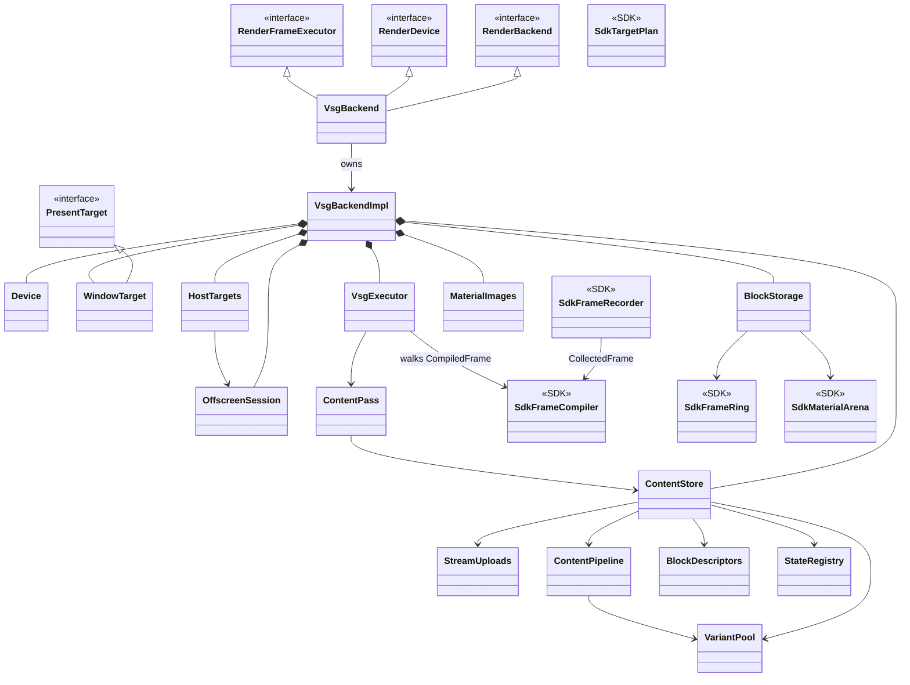

# vsg 后端：架构、契约、坑

> **状态**：现行
> **最后核对**：2026-10-23
> **范围**：vsg 后端如何把编译好的帧值物化成 Vulkan 命令；平台事实与已踩过的坑。
> **权威来源**：`RenderBackend.hpp` / `ShaderAbi.hpp` / `src/viz/graphics/sdk/vine/graphics/backend/**` /
> `src/plugins/gfx_backend_vsg/include/vine/vsg/**`。
> **待办**：`../backlog/graphics.md`

## 1. 概要设计

### 1.1 问题与背景

引擎把一帧编译成值；后端只把这些值物化成 Vulkan 命令。平台事实（1.4 地板、无 dynamic rendering、
每 pass 私有状态表、reverse-Z）不可协商，踩过的坑必须留在这份文件里。

### 1.2 目标

- 三段式：收集 → 编译 → 执行；执行器只做机械落地。
- 调度只在引擎，后端按 `FrameDescription.passes` 的顺序物化。
- 每个 pass 的状态私有；流按 buffer 身份共享；证据三重（验证层/计数器/像素）。

### 1.3 非目标

- 不在后端重排 pass、自建依赖图或报环。
- 不让 SDK `graphics/backend/` include vsg；只有插件 `internal/` 才 include both。
- 不把平台差异写进引擎/应用层。

### 1.4 一句话结论

> 后端只把引擎编译好的帧值物化成 Vulkan 命令；平台事实不可协商，坑都踩过，别重踩。

## 2. 设计要点

2.1 **三段式**：收集（`FrameRecorder`）→ 编译（`FrameCompiler`）→ 执行（`VsgExecutor`）；执行器只做机械落地，不决定排序、重建或缓存。
2.2 **调度在引擎**：`detail::FrameScheduler` 是唯一排序点；后端按 `FrameDescription.passes` 的顺序物化。
2.3 **每 pass 状态私有**：vsg 按 viewID 编管线；状态注册表跨 pass 共享会拿到不兼容 render pass 的 pipeline。
2.4 **目标形状驱动**：`TargetShape` 决定图像、通道、管线兼容性；bootstrap 清所有附件。
2.5 **流按 buffer 身份共享**：`StreamKey` = buffer + 该 buffer 自己的 revision + 段；稳态零重传。
2.6 **反向 Z + CW 正面**：Vulkan NDC z 就是 depth；世界 CCW 到 framebuffer 是 CW。
2.7 **证据三重**：验证层 / 计数器 / 像素；三者缺一都不算“通过”。
2.8 **物理边界**：SDK `graphics/backend/` 不 include vsg；插件 `internal/` 才 include both。

### 2.9 后端架构

#### 2.9.1 分层

| 层 | 位置 | 内容 |
|---|---|---|
| SDK 后端契约 | `src/viz/graphics/sdk/vine/graphics/backend/` | `FrameRecorder` / `FrameCompiler` / `Keys` / `TargetPlan` / `ClearPlan` / `VariantPool` / `StateRegistry` / `RetirementQueue` / `FrameTimeline` / `FrameArena` / `FrameRing` / `MaterialArena` / `Streams` / `SlotProbe` / `Observe` / 证据夹具 |
| 插件内部 | `src/plugins/gfx_backend_vsg/src/internal/` | `VsgBackend`（门面）/ `api::Device` / `api::Session` / `WindowTarget` / `OffscreenSession` / `OffscreenTarget` / `HostTargets` / `VsgExecutor` / `ContentStore` / `StreamUploads` / `ContentPipeline` / `ContentDraw` / `BlockStorage` / `BlockDescriptors` / `StateCommands` / `MaterialImages` |
| 插件支撑 | `src/plugins/gfx_backend_vsg/src/support/` | `VsgHostWindow` / `RenderStateMapper` / `VsgDynamicState` / `VsgSceneRules` / 入口点 |
| 插件外壳 | `src/plugins/gfx_backend_vsg/src/shell/` | 插件注册、`RenderBackendFactory` |

内部类型按 `api::`（设备、会话、目标、内容录制）/ `core::`（SDK 后端契约的别名）/ `support::`（vsg 适配）分组，不是公开接口；公开契约只有 §4.1 的五个 SDK 类型。

#### 2.9.2 类图

`VsgBackendImpl` 就是 `VsgBackend::Impl`（私有实现）；`Sdk*` 是 SDK `backend/` 里的可移植类型，带
`<<SDK>>` 标记。



#### 2.9.3 一帧的生命周期

```
beginFrame()      取交换链图像（槽位逐帧学习）
  render/beginPass/endPass ×N   → FrameRecorder 只记录事实（快照借用参数）
endFrame()        描述定稿
swapBuffers()     FrameCompiler 编译 → VsgExecutor 录制 → 提交 → 呈现（关帧的是这一步）
```

- 收集侧允许重复 / 后设覆盖；编译侧必须每 pass/draw 一个终态、缺省全部解析（viewport / 清屏 / 默认程序）。
- 环（cycle）在引擎调度器处理；后端不再自建依赖图。分量外的 pass 照跑，帧照旧提交。
- 空帧也是帧：照样编译、录制、呈递；空 **pass** 不是 pass。

#### 2.9.4 对象职责

| 对象 | 回答的问题 |
|---|---|
| `VsgBackend` | `RenderBackend` / `RenderDevice` / `RenderFrameExecutor` 的门面；持有 Impl |
| `api::Session` / `WindowTarget` | 窗口、交换链、槽位、present |
| `api::OffscreenSession` | 无窗口的帧源；headless 设备的 device-wide work |
| `HostTargets` | 宿主声明的离屏目标；描述拷贝、对象懒建、resize/借深度的拒绝 |
| `VsgExecutor` | 按 `CompiledFrame` 的顺序把 pass 录进 render graph |
| `ContentStore` | 内容世界：身份、驻留、流、管线、块、材质 |
| `ContentPass` | 一个 pass 的内容录制（命令 → GPU 工作） |
| `SdkFrameRecorder` | 把每次 API 调用变成自包含记录，快照借用参数 |
| `SdkFrameCompiler` | 解析缺省、计划目标/深度、给出执行顺序 |
| `SdkTargetPlan` / `SdkFrameRing` / `SdkMaterialArena` | 目标计划 / 每帧块 / 持久材质块 |

## 3. 功能点

### 3.1 平台与设备

| # | 功能 | 说明 |
|---|---|---|
| F1 | 设备地板 | Vulkan 1.4；7 个必需 feature；EDS2 / EDS3 + 3 个 fn-pointer 入口。 |
| F2 | 设备探测 | `DeviceProbe` + `DeviceRequirements`；探测与策略同一份事实。 |
| F3 | 会话 | 自有窗口或采纳宿主窗口；窗口 ⇒ 交换链 ⇒ `beginFrame` / `commitFrame`。 |
| F4 | 槽数学习 | `probeSlotCount` / `SlotTracker`；学会前不 park。 |
| F5 | 退役 | `RetirementQueue` 窗口 = `slots + 1`；`setSlots()` 原地更新。 |

### 3.2 目标与通道

| # | 功能 | 说明 |
|---|---|---|
| F6 | 目标计划 | `TargetShape`：附件数 / 颜色格式 / 深度格式 / samples / subpass。 |
| F7 | 清屏 | `planClearValues`：bootstrap 清所有附件；深度清 0.0（reverse-Z far）。 |
| F8 | 深度借出/借入 | 借入方不自建深度；`initialLayout` = attachment layout，LOAD。 |
| F9 | 依赖 | `VkSubpassDependency` 的 stage/access mask 是兼容性的一部分；借深度取超集。 |
| F10 | 读回 | 颜色按 attachment；深度 D32 / D16（D24S8 拒绝）；barrier 回 attachment layout。 |

### 3.3 管线与状态

| # | 功能 | 说明 |
|---|---|---|
| F11 | 管线键 | program + revision + layout + topology + render-pass 兼容性 + samples + variant。 |
| F12 | 变体池 | `VariantPool` 按 key 缓存；FIFO 上限 65；id 不复用。 |
| F13 | 状态注册 | 每 pass 私有；`variant_switched` / `dynamic_issued` 分开计数。 |
| F14 | 动态状态 | 块槽位 `detail::kDynamicStateSlot`（15）；viewport / scissor 动态。 |
| F15 | 管线状态 | reverse-Z GREATER；frontFace CLOCKWISE；blend 恒开（单颜色附件内容）。 |

### 3.4 流、块、描述符

| # | 功能 | 说明 |
|---|---|---|
| F16 | 流共享 | `StreamKey` = buffer + 该 buffer 的 revision + 段；index 归一到整段 buffer。 |
| F17 | 自定义属性 | location 3 起，转发 `vine_Attribute{location}`。 |
| F18 | 块存储 | 一个 mapped buffer：view / draw / material 三区；每帧 ring；稳态零写。 |
| F19 | 描述符 | 一个 set，3 个 dynamic uniform binding（0 view / 1 draw / 2 material）。 |
| F20 | 材质 arena | 每槽 `copies` 份；槽满 `Refused`；扩容只换 material 区。 |

### 3.5 纹理、着色器、证据

| # | 功能 | 说明 |
|---|---|---|
| F21 | 纹理上传 | `MaterialImages` 键 `(Texture*, revision)`；D2 / Cube 视图；白 cube 兜底。 |
| F22 | sampler | 按值缓存；`InputSetCache` 键 `(view, sampler)`。 |
| F23 | 着色器文件 | `builtin_<角色>.<阶段>`；构建期嵌入；`vine_` 前缀。 |
| F24 | 变体文本 | `#pragma import_defines` 决定文本；漏写会静默丢弃。 |
| F25 | 证据 | 相位表 + 计数器 + 像素；`vsg_rewrite_gate.sh` 读 VUID / SYNC-HAZARD / 画面。 |

## 4. 公开接口

### 4.1 后端契约

| 接口 | 作用 |
|---|---|
| `RenderBackend` | 设备 / 帧 / 呈现三面聚合 |
| `RenderBackendFactory` | 创建后端 |
| `RenderDevice` | 设备、目标、内容释放、读回 |
| `RenderFrameExecutor` | 执行一帧 |
| `PresentTarget` / `WindowPresentTarget` | 呈递契约 / 窗口面 |

### 4.2 键与状态

| 层 | 当前拼写 | 允许的变化方式 |
|---|---|---|
| identity | `PipelineKey`：kind、program + revision、vertex_layout、compatibility（附件/深度格式、samples、subpass）、depth_sampleable、sampled_color_count、sampled_depth_count、variant、topology（类） | 变了 = 重编管线（唯一允许重编的地方） |
| 交换半边 | `LoadOpVariantKey`：color/depth 的 load/store 与 initial/final layout | 同一管线在多个兼容变体上都能用（bootstrap 变体合法） |
| dynamic | `DynamicState`：depth、cull、polygon、topology（同类内）、blend | 一条 `vkCmdSet*`；永远不许重编 |
| data | 视图块 288 B、光照块 112 B、`VineDrawBlock` 80 B、材质块 64 B、push ≤128 B | 就地字节写 / 描述符 re-point |

**“计数是身份不是状态”**：绑在描述符布局上的东西（采样彩色数、深度数）必须进键；extent / load-op / 布局 /
material 值 / 流字节 / cull 全部**不进**。

## 5. 约束、要求与不变量

### 5.1 约束（C#）

| # | 约束 |
|---|---|
| C1 | SDK `graphics/backend/` 不 include vsg；插件 `internal/` 才 include both。 |
| C2 | 每 pass 状态私有；状态注册表不跨 pass 共享。 |
| C3 | 调度只在引擎；后端按 `FrameDescription.passes` 物化。 |
| C4 | `TargetShape` 决定图像/通道/管线兼容性；bootstrap 清所有附件。 |
| C5 | `StreamKey` = buffer + buffer revision + 段；稳态零重传。 |

### 5.2 要求（R#）

| # | 要求 |
|---|---|
| R1 | 执行器只做机械落地，不决定排序/重建/缓存。 |
| R2 | 反向 Z + CW 正面：世界 CCW 到 framebuffer 是 CW。 |
| R3 | 证据三重：验证层 / 计数器 / 像素，缺一不算通过。 |
| R4 | 平台事实留在后端，不上推到引擎/应用层。 |

### 5.3 不变量（N#）

| # | 不变量 |
|---|---|
| N1 | 后端不重排 pass、不自建依赖图、不报环。 |
| N2 | 物理边界：SDK 后端契约不 include vsg。 |
| N3 | 平台事实（1.4、无 dynamic rendering、reverse-Z）不可协商。 |

## 6. 注意事项与陷阱

坑按风险域分成九组，P1–P82 连同症状与判据在 [`vsg-pitfalls.md`](vsg-pitfalls.md)；改哪块读哪组。

| 域 | 坑号 | 域 | 坑号 |
|---|---|---|---|
| 协议与帧 | P1–P6 | 目标、寿命与设备空闲 | P43–P53 |
| 键与管线 | P7–P12 | WSI 与窗口 | P54–P60 |
| 朝向、裁剪与深度 | P13–P22 | 证据、门禁与构建 | P61–P75 |
| 块与描述符（ABI） | P23–P35 | 引擎侧（场景桥与着色约定） | P76–P82 |
| 流、几何与别名 | P36–P42 | | |

## 7. 已否决选项

| # | 否决 | 理由 |
|---|---|---|
| D1 | dynamic rendering 合并每 pass begin | vsg 记录路径没有 `vkCmdBeginRendering`；被上游阻塞。 |
| D2 | 跨 pass 共享管线状态注册表 | vsg 按 viewID 编管线；共享会拿到不兼容 render pass 的 pipeline。 |
| D3 | 自建管线绕开 vsg | 会与 vsg 的 state 装配 / 记录路径分叉；收益只在冷启动。 |
| D4 | Wayland | 只按 WSI 契约实现；没有真机验证。 |
| D5 | 后端自己再排一次 pass | 调度上移引擎；两套排序 = 两套帧词汇。详见 [ADR](../decisions/ADR-2026-10-22-engine-schedules-passes.md)。 |
| D6 | 超过灯块槽数的灯不做 | 灯块 8 个带类型的槽（位置/方向/范围/锥角），超出的按 episode 报掉落；不做逐对象选灯（见 `graphics-shader-params.md`）。 |

## 8. 测试与验收

| # | 判据 |
|---|---|
| T1 | `test_vsg`：设备无关 + 真实设备电池；`skipped == 0` 才算跑过。 |
| T2 | `scripts/vsg_rewrite_gate.sh`：0 VUID / 0 SYNC-HAZARD、相位行闭合、应用画面百分比。 |
| T3 | `check_ai_docs.py --strict` / `check_doc_symbols.py` / `check_include_hygiene.py` / `check_export_annotations.py` / `check_diagnostic_formats.py` / `check_public_docs.py`。 |

## 9. 状态与演进

### 9.1 当前状态

现行；F1–F6 已落地。

### 9.2 已知缺口 / 待办

见 `../backlog/graphics.md`。

### 9.3 兼容性 / 迁移

新代码按 §4 的接口写；旧名只在 §7 或 git 历史里出现。

## 10. 参考

`graphics-architecture.md` · `graphics-rendering.md` · `graphics-content-lifecycle.md` · `../backlog/graphics.md`
