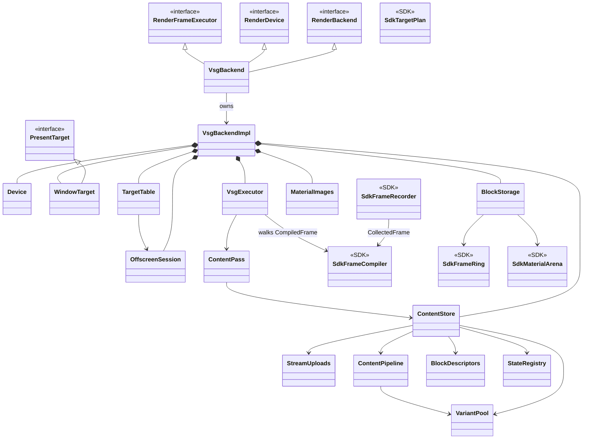

# the vsg backend: architecture, contract, traps

> **Status**: current
> **Last verified**: 2026-11-16
> **Scope**: how the vsg backend materialises a compiled frame value into Vulkan commands; the platform facts and the traps already hit.
> **Sources**: `RenderBackend.hpp` / `ShaderAbi.hpp` / `src/viz/graphics/sdk/vine/graphics/` (the 7 shared mechanisms) /
> `src/plugins/gfx_backend_vsg/include/vine/backend_vsg/**`.
> **Backlog**: `../backlog/graphics.md`

## 1. Overview

### 1.1 Problem and background

The engine compiles a frame into values; the backend only materialises those values into Vulkan commands. The platform facts (the 1.4 floor, no dynamic rendering,
a private state table per pass, Reverse-Z) are not negotiable, and the traps already hit must stay in this file.

### 1.2 Goals

- Three stages: collect → compile → execute; the executor only lands things mechanically.
- Scheduling lives in the engine only; the backend materialises in `FrameDescription.passes` order.
- Every pass' state is private; streams are shared by buffer identity; evidence is threefold (validation layer / counters / pixels).

### 1.3 Non-goals

- The backend does not reorder passes, build its own dependency graph or report cycles.
- The SDK's `graphics/` does not include vsg; only the plugin's `internal/` includes both.
- Platform differences are not written into the engine or the application layer.

### 1.4 One-paragraph conclusion

> The backend only materialises the frame value the engine compiled into Vulkan commands; the platform facts are not negotiable, and every trap has been hit once — do not hit it again.

## 2. Design Points

2.1 **Three stages**: collect (`FrameRecorder`) → compile (`FrameCompiler`) → execute (`VsgExecutor`); the executor only lands things mechanically and decides no order, rebuild or
cache.
2.2 **Scheduling is in the engine**: `detail::FrameScheduler` is the only ordering point; the backend materialises in `FrameDescription.passes` order.
2.3 **Every pass' state is private**: vsg compiles pipelines by viewID; a state registry shared across passes gets a pipeline for an incompatible render pass.
2.4 **The target shape drives**: `TargetShape` decides image, pass and pipeline compatibility; bootstrap clears every attachment.
2.5 **Streams are shared by buffer identity**: `StreamKey` = buffer + that buffer's own revision + segment; zero re-upload in the steady state.
2.6 **Reverse-Z + CW front faces**: Vulkan's NDC z is depth as it is; a world CCW triangle is CW in the framebuffer.
2.7 **Threefold evidence**: validation layer / counters / pixels; without all three it is not "passing".
2.8 **A physical boundary**: the SDK's `graphics/` does not include vsg; only the plugin's `internal/` includes both.
**Inside the plugin there is a narrower seam**: the content-bookkeeping half (`ContentFacts` / `ContentStore` / `CompiledPrograms` / `ContentSources` / `PushRange`) may
not name `::vsg::`; the device is reached only through the adapter layer (`StreamUploads` / `StateCommands` / `ContentPipeline` / `ContentDraw`). Why: 59% of the
plugin's 23.5k lines are content bookkeeping, and that half measures 0 vsg references — it is clean, so a second backend could reuse it directly; once vsg types leak into
it, nothing is left but a rewrite. Checkable: `scripts/check_vsg_content_seam.cmake`, run by CTest's `content_seam` case (not by memory). It satisfies `G2` / `G9`; the
cost is one more layer of pure values in the adapter (which is the shape it already has).

### 2.9 The backend's architecture

#### 2.9.1 The layers

| Layer | Location | Contents |
|---|---|---|
| SDK shared mechanisms (both backends use them) | `src/viz/graphics/sdk/vine/graphics/` | `FrameGate` / `DeviceClock` / `FrameTimeline` / `RetirementQueue` / `Readback` / `DrawState` / `TargetPlan` / `DiagnosticDraft` |
| This backend's portable half (moved out of the SDK by ADR-2026-11-16 §2, now in `vn::backend_vsg::core`) | `include/vine/backend_vsg/internal/` + `src/internal/` | `FrameRecorder` / `FrameCompiler` / `FrameArena` / `FrameRing` / `ClearPlan` / `VariantPool` / `StateRegistry` / `MaterialArena` / `Streams` / `SlotProbe` / `Observe` / `PhaseTable` / `PixelProbe` / `DepthProbe` / `SessionMove` / `AllocationGate` / `PinnedResources` |
| Plugin internals | `src/plugins/gfx_backend_vsg/src/internal/` | `VsgBackend` (the facade) / `VsgExecutor` / `api::WindowSession` / `api::OffscreenSession` / `WindowTarget` / `TargetObjects` / `TargetTable` / `ContentStore` / `StreamUploads` / `ContentPipeline` / `ContentDraw` / `BlockStorage` / `BlockDescriptors` / `StateCommands` / `MaterialImages` |
| Plugin support | `src/plugins/gfx_backend_vsg/src/support/` | `VsgHostWindow` / `RenderStateMapper` / `VsgDynamicState` / `VsgSceneRules` / the entry points |
| Plugin shell | `src/plugins/gfx_backend_vsg/src/shell/` | the plugin registration, `RenderBackendFactory` |

The internal types use **two** namespaces, and **a directory is not a namespace**: `core::` is this backend's own portable half (plus the SDK's shared vocabulary, nominated for lookup by a using-directive: it widens *unqualified and qualified* lookup inside `core`, not ADL, and its measured surface is 31 names - see the directive's note and audit `A3-06`, corrected), `api::` is the device enumeration and the two sessions (`WindowSession` / `OffscreenSession` and their Options, `ProbedDevice` /
`ProbeResult`, plus two device probe functions); everything else — the `VsgBackend` facade, `VsgExecutor`, `TargetObjects` / `TargetTable`, content recording — lives at
the root of `vn::backend_vsg`, and the adapter code under `include/.../support/` and `src/support/` is in `detail::`. None of it is public; the public contract is only
the five SDK types in §4.1.

#### 2.9.2 Class diagram

`VsgBackendImpl` is `VsgBackend::Impl` (the private implementation); `Sdk*` are the portable types that moved into this plugin with ADR-2026-11-16 §2 and carry an
`<<SDK>>` marker.



#### 2.9.3 One frame's lifecycle

```
beginFrame()      acquire the swap-chain image (the slot count is learned per frame)
  render/beginPass/endPass ×N   → FrameRecorder only records facts (the snapshot borrows the arguments)
endFrame()        the description is final
swapBuffers()     FrameCompiler compiles → VsgExecutor records → submit → present (this step closes the frame)
```

- The collection side allows repeats and later overrides; the compile side must reach one final state per pass/draw and resolve every default (viewport / clear / default
  program).
- A cycle is handled by the engine's scheduler; the backend builds no dependency graph. A pass outside a component still runs, and the frame is still submitted.
- An empty frame is a frame: it is compiled, recorded and presented as usual; an empty **pass** is not a pass.

#### 2.9.4 What each object answers

| Object | The question it answers |
|---|---|
| `VsgBackend` | the facade of `RenderBackend` / `RenderDevice` / `RenderFrameExecutor`; holds the Impl |
| `api::WindowSession` / `WindowTarget` | the window, the swap chain, the slots, present |
| `api::OffscreenSession` | a windowless frame source; the headless device's device-wide work |
| `TargetTable` | the offscreen targets the host declares (a description copy, lazy objects, the resize / borrowed-depth refusals) **and** identity resolution (identity → object, tag, the "not applied" episode): one table answers three questions |
| `VsgExecutor` | records the passes into the render graph in `CompiledFrame` order |
| `ContentStore` | the content world: identity, residency, streams, pipelines, blocks, materials |
| `ContentPass` | one pass' content recording (commands → GPU work) |
| `SdkFrameRecorder` | turns each API call into a self-contained record; the snapshot borrows the arguments |
| `SdkFrameCompiler` | resolves defaults, plans targets / depth, and gives the execution order |
| `SdkTargetPlan` / `SdkFrameRing` / `SdkMaterialArena` | the target plan / the per-frame blocks / the persistent material block |

### 2.10 The cost model: every frame compares keys and diffs no content

- What it is: every frame the backend **touches** the objects this frame draws (`track` + `updateMaterial`) and looks them up by (identity pointer, revision); a hit is a
  few hashes / bisections plus integer comparisons, and only a **changed key** pays for "describe / upload / compile". The three kinds of state are `graphics/DrawState.hpp`'s
  IDENTITY (enters the pipeline key) / DYNAMIC STATE (one set command per draw) / DATA (written into a buffer + a material reference), with an audit table pinned by tests.
- Why: it lets "change one material value", "change cull" and "change the vertex bytes" all avoid compiling a pipeline, and each of those three "leak DATA into IDENTITY"
  mistakes happened once in this backend's history (see `vsg-pitfalls.md`). Correctness lives here too: a material edit is announced by nothing on the engine side, so only
  the revision comparison at the per-frame touch can land it.
- Boundary (where the cost grows):
  - **With the number of resources**: the per-command constants (3 `track`s, 1 `updateMaterial`, 3 bisections, one `StreamKey` hash per pass, one
    `(Texture*, revision)` hash per texture slot, one `VariantPool` query), all O(1) / O(log n).
  - **With the number of resource kinds**: the halves and the descriptor sets are each a `PinnedResources` — a lookup is a hash and a sweep is one pin question per resident
    entry (`findProgram`'s bisection + `declaresLayout` / `declaresTexture` hashes), and the counterfactual "walk the geometry facts per half, per pass" scan is gone
    (ADR-2026-11-10 step 5). `ContentStore` always publishes the layout declaration index; hand-built facts that publish nothing fall back to the scan under the optional-index
    rule. Dozens of combinations and hundreds are the same order of magnitude; what really gets heavier is still the two items below.
  - **The bulk of a draw is not bookkeeping but the command nodes vsg creates every frame**: the recording path's baseline is 12 allocations per pass and about 33 per
    recorded triangle, while the plan half (`FrameRecorder` + `FrameCompiler`) is **zero-allocation** and has a gate.
  - Only two things can jump an order of magnitude: **uploads** (geometry / texture revision churn, see F16.2) and **compilation** (program / topology / layout change).
  This is `G10`: cost is settled per layer, each layer has a criterion, and nothing rests on "probably cheap".

### 2.11 Runtime facts: how often a frame calls what, and how updates land

- **Exactly once per frame**: `executeFrame` (open the frame + walk the passes by value + compile), the submission and the present (the executor calls them at the frame tail
  for a window frame).
- **Once per pass**: binding that pass' pipeline variant (only when the variant changed), its dynamic-state block (only when the value changed), its sampled input set (one
  pass, one entry).
- **Once per change, zero in the steady state**: material-block writes (compared per command, skipped when equal), stream uploads after a geometry revision, the push filled
  from the declaration, `vkCmdSet*`. The zero readings are themselves the criterion: `ContentStore::builds()`, `StreamUploads::uploads()`, `VariantPool::created()`,
  `Session::deviceWaits()` (the frame path), `AllocationGate` (two consecutive frames allocate nothing).
- **How updates land**: material = per-frame compare-and-write per command (64 B, with no engine-side announcement); geometry = `bumpRevision()` is the only announcement
  (a new revision = a new row + every stream of that geometry re-uploaded); state = dynamic state, a command only when the diff is non-empty, a new pipeline only across a
  topology **class**; program = identity (program + revision + variant + layout + compatibility + sample count), a new variant compiles once; target = a load operation is
  "swap the half" (not part of the key), and `written()` / `bootstrap` decide who clears.
- **`VSG_MAX_DEVICES` = 4, set explicitly by this repository**: one document view = its own `vsg::Device`, and of vsg 1.1.16's three implementations only the fixed array
  for `<=4` is correct (the dynamic branch above 4 reads out of bounds; measured as an assertion). Two consequences: at most 4 `vsg::Device`s exist at once; and the `<=4`
  branch's `operator[]` does not bounds-check, so a fifth device **must be refused by us** — today there is no guard (§9.2).
- **Diagnostic readings**: `FrameReport::locking` is the per-frame cache-lock delta (from `FrameGate::Counters`); the frame head's and the submission's acquisitions are
  constants and `waits` is 0; `diagnosticCount()` counts the engine + the device only (a host's `reportEngineProblem` is counted separately).

## 3. Features

### 3.1 Platform and device

| # | Feature | Notes |
|---|---|---|
| F1 | Device floor | Vulkan 1.4; 7 required features; EDS2 / EDS3 + 3 fn-pointer entry points. |
| F2 | Device probing | `DeviceProbe` + `DeviceRequirements`; probing and policy are one set of facts. |
| F3 | Sessions | an owned window or an adopted host window; a window ⇒ a swap chain ⇒ `beginFrame` / `commitFrame`. |
| F4 | Learning the slot count | `probeSlotCount` / `SlotTracker`; nothing is parked before it is learned. |
| F5 | Retirement | `RetirementQueue`'s window = `slots + 1`; `setSlots()` updates in place. |

### 3.2 Targets and passes

| # | Feature | Notes |
|---|---|---|
| F6 | Target planning | `TargetShape`: attachment count / colour format / depth format / samples / render-pass key (the device format code is the opaque `DeviceFormat`, the pass structure is the backend-computed `RenderPassKey`). |
| F7 | Clearing | `planClearValues`: bootstrap clears every attachment; depth clears to 0.0 (Reverse-Z far). |
| F8 | Lending / borrowing depth | the borrower builds no depth; `initialLayout` = the attachment layout, LOAD. |
| F9 | Dependencies | `VkSubpassDependency`'s stage / access masks are part of compatibility; borrowing depth takes the superset. |
| F10 | Readback | colour per attachment; depth D32 / D16 (D24S8 refused); the barrier returns to the attachment layout. |

### 3.3 Pipelines and state

| # | Feature | Notes |
|---|---|---|
| F11 | Pipeline key | program + revision + layout + topology + render-pass compatibility + samples + variant. |
| F12 | The variant pool | `VariantPool` caches by key; FIFO capped at 65; ids are never reused. |
| F13 | State registration | private per pass; `variant_switched` / `dynamic_issued` are counted separately. |
| F14 | Dynamic state | the block slot is `detail::kDynamicStateSlot` (15); viewport / scissor are dynamic. |
| F15 | Pipeline state | Reverse-Z GREATER; frontFace CLOCKWISE; blend always on (single colour attachment content). |

### 3.4 Streams, blocks, descriptors

| # | Feature | Notes |
|---|---|---|
| F16 | Stream sharing | `StreamKey` = buffer + that buffer's revision + segment; the index is normalised to the whole buffer. |
| F16.1 | Zero-copy upload | a bound array is a **real vsg array + a `VsgBufferView`** (`vsg::floatArray` / `vsg::uintArray` wrapped around a view of the model's buffer), so the model and the scene graph read the same bytes; the model may die first, because the array holds the view and the view holds the buffer. Only when all that is given is a buffer handle or someone else's span does it fall back to a copy. Note the mapping: a vertex channel aliases its **segment** (from `key.offset`), an index aliases **the whole buffer** (the bind covers everything and the draw states the span); see `VsgBufferView.hpp` and the limit that was measured: binding a `vsg::Data` subclass **directly** does **not** take effect. |
| F16.2 | Upload staging keeps a reusable block and drops a one-off large one | vsg first copies an upload's bytes into `TransferBlock::staging` (`HOST_VISIBLE\|HOST_COHERENT`, sized max(the whole upload, `minimumStagingBufferSize`), **grow-only**, belonging to no pool and unreachable from `releaseUnusedPools()`), and never gives it back — a 704 MB model left 1,228 MB extra resident (exactly `2 × 614 MB`: uploads rotate by `frameIndex`, so each of the two blocks grew once). Implementation: `detail::StagingTask` (derived from `vsg::TransferTask`, installed by `installStagingTask()` when a session starts) empties the `staging` + `buffer_data` of every block whose **fence completed** and whose **`staging->size > minimumStagingBufferSize`** at each frame boundary (the start of `VsgBackend::executeFrame()`) — exactly the state vsg itself handles when it rebuilds a block that is too small; **a block at the minimum is kept**, so a host that uploads every frame reaches zero allocations in the steady state (ADR-2026-11-13). The evidence is that block's own `fence->status()` (one `vkGetFenceStatus`), so **zero waiting, zero park, zero `deviceWaitIdle`**; a copy that has not completed is left for the next frame. There is no entry point, no switch and no environment variable on the host side. |
| F17 | Custom attributes | from location 3 on, forwarded as `vn_Attribute{location}`. |
| F18 | Block storage | one mapped buffer: the view / draw / material regions; a ring per frame; zero writes in the steady state. |
| F19 | Descriptors | one set, 3 dynamic uniform bindings (0 view / 1 draw / 2 material). |
| F20 | The material arena | `copies` slots per material; a full arena answers `Refused`; growing replaces the material region only. A slot's lifetime is a pin: it stays while a live material row declares that identity, and after the last row leaves the frame head's `retireUnpinned` frees it at once (`BlockStorage::retireUnpinnedMaterials`) — no park, because the copy rotation is the window; the `retired` count sits on the `ResidencyKind::Materials` row. |

### 3.5 Textures, shaders, evidence

| # | Feature | Notes |
|---|---|---|
| F21 | Texture upload | `MaterialImages` keyed by `(Texture*, revision)`; D2 / Cube views; a white cube as the fallback. |
| F22 | Samplers | cached by value; `InputSetCache` keyed by `(view, sampler)`. |
| F23 | Shader files | `builtin_<role>.<stage>`; embedded at build time; the `vn_` prefix. |
| F24 | Variant text | `#pragma import_defines` decides the text; a missing line is dropped silently. |
| F25 | Evidence | the phase table + counters + pixels; `vsg_rewrite_gate.sh` reads VUIDs / SYNC-HAZARD / the picture. |

## 4. Public Interface

### 4.1 The backend contract

| Interface | Purpose |
|---|---|
| `RenderBackend` | the device / frame / present faces together |
| `RenderBackendFactory` | creates a backend |
| `RenderDevice` | device, targets, content release, readback |
| `RenderFrameExecutor` | executes one frame |
| `PresentTarget` / `WindowPresentTarget` | the present contract / the window face |

### 4.2 Keys and state

| Layer | Current spelling | How it may change |
|---|---|---|
| identity | `PipelineKey`: kind, program + revision, vertex_layout, compatibility (attachment / depth formats, samples, the backend-computed render-pass key), depth_sampleable, sampled_color_count, sampled_depth_count, variant, topology (class) | a change = recompile the pipeline (the only place recompiling is allowed) |
| the swapped half | `LoadOpVariantKey`: the colour / depth load and store and the initial / final layouts | one pipeline serves several compatible variants (a bootstrap variant is legitimate) |
| dynamic | `DynamicState`: depth, cull, polygon, topology (within a class), blend | one `vkCmdSet*`; a recompile is never allowed |
| data | the view block 288 B, the light block 112 B, `VineDrawBlock` 80 B, the material block 64 B, push ≤128 B | write bytes in place / re-point a descriptor |

**"A count is identity, not state"**: anything bound to the descriptor layout (the sampled colour count, the sampled depth count) must enter the key; extent / load-op / layout / material values / stream bytes / cull all stay **out** of it.

## 5. Constraints, Requirements and Invariants

### 5.1 Constraints (C#)

| # | Constraint |
|---|---|
| C1 | The SDK's `graphics/` does not include vsg; only the plugin's `internal/` includes both. |
| C2 | Every pass' state is private; a state registry is not shared across passes. |
| C3 | Scheduling lives in the engine only; the backend materialises in `FrameDescription.passes` order. |
| C4 | `TargetShape` decides image / pass / pipeline compatibility; bootstrap clears every attachment. |
| C5 | `StreamKey` = buffer + buffer revision + segment; zero re-upload in the steady state. |
| C6 | No new Vulkan spelling enters the SDK's `graphics/`: `VkFormat` values and subpass are gone from the seam (the device format is `DeviceFormat`, the pass structure is the backend-computed `RenderPassKey`); `ImageLayout` is still Vulkan semantics, and the same move retires it when a third backend lands. New device-neutral spellings land in the plugin's `internal/` first. |
| C7 | Every report from this plugin carries a stable `vsg.<family>.<reason>` code (registered in `scripts/diagnostic_codes.txt`); readback's nine refusals are mapped by **one `switch` with no `default`** in `readbackRefusalDiagnostic`, so adding a `HostReadbackRefusal` makes naming its code a compile error — the vocabulary follows the enum instead of memory. Where the rule comes from is in `vk-backend.md` §2.13 / §2.14 (the same gate, the same value semantics). |

### 5.2 Requirements (R#)

| # | Requirement |
|---|---|
| R1 | The executor only lands things mechanically; it decides no order, rebuild or cache. |
| R2 | Reverse-Z + CW front faces: a world CCW triangle is CW in the framebuffer. |
| R3 | Threefold evidence: validation layer / counters / pixels; without all three it is not passing. |
| R4 | Platform facts stay in the backend and are not pushed up into the engine or the application layer. |

### 5.3 Invariants (N#)

| # | Invariant |
|---|---|
| N1 | The backend does not reorder passes, build its own dependency graph or report cycles. |
| N2 | The physical boundary: the SDK's shared mechanisms do not include vsg. |
| N3 | The platform facts (1.4, no dynamic rendering, Reverse-Z) are not negotiable. |
| N4 | A frame's change detection compares only the (identity, revision) key and **never content bytes or values**; material values, stream bytes and dynamic state always travel on the DATA / DYNAMIC channels. A matrix, viewport, opacity, material value, cull, blend or extent appearing in a key is a defect (`DrawState.hpp`'s audit table + tests). |

## 6. Caveats and Traps

The traps are grouped by risk area into nine groups; P1–P82 with their symptoms and criteria are in [`vsg-pitfalls.md`](vsg-pitfalls.md) — read the group you are changing.

| Area | Traps | Area | Traps |
|---|---|---|---|
| protocol and frames | P1–P6 | targets, lifetime and device idleness | P43–P53 |
| keys and pipelines | P7–P12 | WSI and windows | P54–P60 |
| orientation, clipping and depth | P13–P22 | evidence, gates and the build | P61–P75 |
| blocks and descriptors (ABI) | P23–P35 | the engine side (the scene bridge and shading conventions) | P76–P82 |
| streams, geometry and aliasing | P36–P42 | | |

## 7. Rejected Options

| # | Rejected | Reason |
|---|---|---|
| D1 | dynamic rendering to merge the per-pass begin | vsg's recording path has no `vkCmdBeginRendering`; blocked upstream. |
| D2 | a pipeline state registry shared across passes | vsg compiles pipelines by viewID; sharing gets a pipeline for an incompatible render pass. |
| D3 | building pipelines ourselves, around vsg | it would fork vsg's state assembly and recording path; the gain is at cold start only. |
| D4 | Wayland | only the WSI contract is implemented; there is no hardware verification. |
| D5 | ordering passes a second time in the backend | scheduling moved up to the engine; two orderings = two frame vocabularies. See [ADR](../decisions/ADR-2026-10-22-engine-schedules-passes.md). |
| D6 | dropping lights beyond the light block's slot count | the light block has `kMaxLights` (`ShaderAbi.hpp`) typed slots (position / direction / range / cone angle) and the excess is reported as dropped per episode; there is no per-object light selection (see `graphics-shader-params.md`). |
| D7 | uploading around vsg or rewriting `TransferTask` | both would fork vsg's transfer path (the staging allocation, the barriers, the semaphores and the frameIndex rotation all live there), while **replacing the task object** already achieves the same effect without copying or rewriting: the gain is only "one 16 MB reallocation fewer", the cost a copy that must follow upstream for ever. See F16.2. |

## 8. Tests and Acceptance

| # | Criterion |
|---|---|
| T1 | `test_vsg`: the device-independent plus the real-device battery; `skipped == 0` is what counts as having run. |
| T2 | `scripts/vsg_rewrite_gate.sh`: 0 VUID / 0 SYNC-HAZARD, the phase lines closed, and the application's pixel percentage. |
| T3 | `check_ai_docs.py --strict` / `check_doc_symbols.py` / `check_include_hygiene.py` / `check_export_annotations.py` / `check_diagnostic_formats.py` / `check_public_docs.py`. |
| T4 | upload staging keeps a reusable block (F16.2): `UploadScratchTest.TheUploadScratchIsNotRetainedAndTheFramesGiveItBack` — the frame does not idle; every surviving block is a multiple of `minimumStagingBufferSize` (the reusable blocks are kept) and a one-off block above the minimum is given back; redrawing the same content uploads nothing; a new stream uploads again and falls back to the minimum. `FrameUploadsTest.TheReportAnswersWhatThisFrameUploadedAndReleased` — `FrameReport::uploads` is this frame's delta (the first frame uploads > 0, the steady state is all 0, a buffer revision change re-uploads once, and content leaving reports a release). `OffscreenSessionTest.TheUploadScratchIsGivenBackAndALaterUploadStillLands` and `OffscreenSessionTest.AReplacedTransferTaskLeavesTheSessionSubmitting` are unchanged. |
| T5 | the cost of an edit and the steady state (§2.10): `VsgBackendTest.MeasureWhatEachKindOfEditCostsPerFrame` — prints µs per frame and the `builds` / `uploads` / `created` deltas; asserts that the steady state is all 0, a material value change is 0 uploads and 0 compiles, a geometry revision is ≥1 upload and 0 compiles, and a program or topology change is one compile each. The steady-state pins alongside it: `ContentStoreTest.ASteadyFrameBuildsNothing`, `CoreMaterialArenaTest.ASteadyFrameWritesNothing`, and the `CompiledPrograms` / `BindingSets` pin cases. The allocation ceiling: `CoreAllocationGateTest.TheRecordPathsBookkeepingCostsAFewSmallVectorsPerPass` (12 per pass, about 33 per recorded triangle). These recipes need a real window and `GTEST_SKIP` on a headless machine. |

## 9. Status and Evolution

### 9.1 Current status

Current; F1–F6 are landed.

### 9.2 Known gaps / backlog

See `../backlog/graphics.md`. One boundary fact is not in the backlog: `VSG_MAX_DEVICES` is 4, and vsg 1.1.16's `<=4` branch does no bounds check — **a fifth rendering surface has no guard today** (§2.11); to support more windows, refuse it before `createSurfaceTarget` first, and only then consider raising the ceiling.

### 9.3 Compatibility / migration

New code is written against §4's interfaces; old names appear only in §7 or in git history.

## 10. References

`graphics-architecture.md` · `graphics-rendering.md` · `graphics-content-lifecycle.md` · `../backlog/graphics.md`
