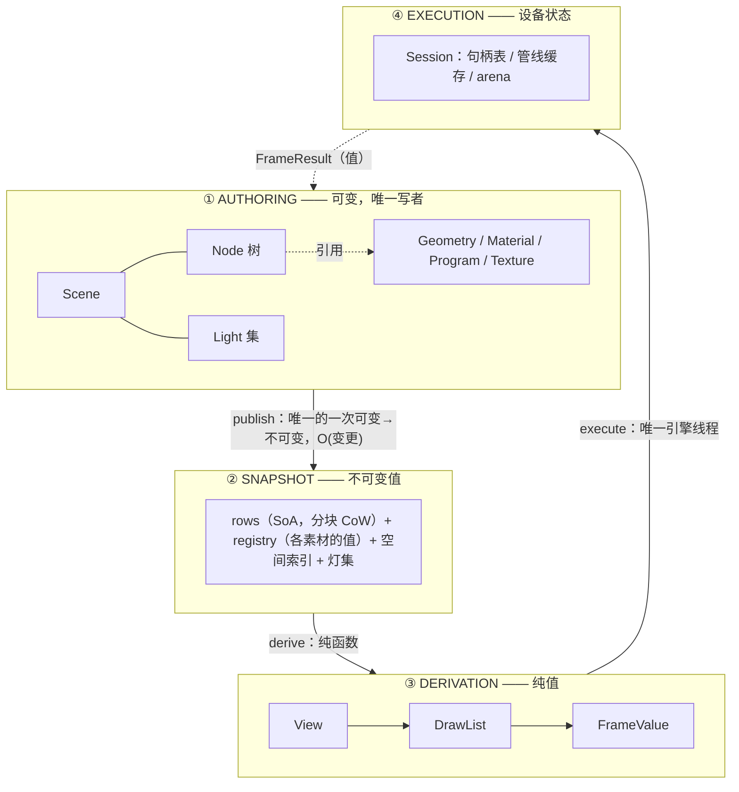

# graphics-next：以场景图为中心的重设计（提案，未采纳）

> **状态**：调研提案（**非现行设计**；未落地、未决策）
> **日期**：2026-11-11
> **范围**：graphics 模块的**整体骨架** —— 内容、发布、派生、执行四层，以及概念、身份、寿命、资源。
> 不含 appfw 的窗口/输入实现细节，也不含 Vulkan 同步（仍归 `vsg-backend.md`）。
> **现状权威**：`../design/graphics-threading.md`（线程与两世界）、`../design/graphics-material.md`（材质）、
> `../design/graphics-scene.md`（场景图）、`../design/vsg-backend.md`（后端）。
> **出口**：采纳 → 写 ADR + 改写 `.ai/design/*`，本文件删除；否决 → 把否决理由记进 ADR，本文件删除。

## 0. 文件组成

| 文件 | 内容 |
|---|---|
| `graphics-2026-11-11-next.md`（本文） | 总纲：问题来源、结论、骨架摘要、判死条件 `K1–K11`、验证计划、否决项 `D1–D9`、与 `G1–G13` 对照 |
| `graphics-2026-11-11-next-requirements.md` | **要什么**：目标 `O1–O7`、功能要求 `R1–R30`、非功能要求 `N1–N10`、硬约束 `C1–C12`、验收 `T1–T16` |
| `graphics-2026-11-11-next-design.md` | **怎么做**：分层、概念表、类型草案、hot/cold 数据布局、publish/fold/select/sort/record/reclaim/plan-diff 算法、线程与内存模型、诊断、后端契约、关闭相位、未决问题 |
| `graphics-2026-11-11-next-benefits.md` | **值不值**：按维度的量化收益与测量方式、代价 `P1–P7`、五步迁移与每步判死、反方论点的详细回应 |
| `graphics-2026-11-11-next-api.md` | **现有 API 集的问题**：`P1–P32` 概念/形状/层次/风格问题（每条带证据与 `G#`）、`M1–M10` 缺失能力、`RenderEngine` 49 个公开方法的去向、命名对照、A–E 分批、风格门禁 `scripts/check_api_style.py` |
| `graphics-2026-11-11-next-hot-paths.md` | **性能、动画、后期与扩展**：实测成本模型与 60 fps 预算、select/fold/sort/record 的手段与门禁、值的热路径三条规则、动画＝帧内 `PoseSet`（不经发布）、后期＝计划即依赖图、受控逃逸口、工程效率、`N11–N18` |
| `graphics-2026-11-11-next-audit.md` | **第二轮审计**：证据口径复核（§2）、跨文档矛盾 `X1–X10`（§3）、设计缺口 `A1–A13`（§4）、补充要求 `R31–R39` / 判死条件 `K7–K11`（§5–§6）、成本再评估与修订后的推进顺序（§7–§8） |

读法：先本文 §1–§2 拿骨架，再按需要跳 `-requirements`（要什么）、`-design`（怎么做）、`-benefits`（值不值）；
**动手前先读 `graphics-2026-11-11-next-audit.md` 的 A1–A4**——其中 A1（内容引用必须带 revision）是“在飞帧不变”能否成立的前提。

---

## 1. 概要

### 1.1 问题：今天的形状是怎么来的

今天的 graphics 是**从可变对象模型一路补出来**的。它的结论大多是对的（内容单写者、引擎线程漏斗、
值过帧、批次发布、单诊断路由），但一半的机器只做一件事：**把两个可变世界缝起来**。

可测的证据（2026-11-11 实测）：

| 量 | 今天 |
|---|---|
| 两世界之间的桥（`ContentMirror` / `DeltaChannel` / `DrawListMemo` / `FrameWorker` / `FrameRunner` / `SceneRows` / `EngineFrame` / `DrawListBake`） | **2519 行** |
| 引擎侧寿命机器（`markUsed` / `release_token` / `release_requested` / `retired` / `kept` / `retirement`） | `ContentStore.cpp`（1016 行）里 **约 72–75 处**（口径见 audit §2） |
| 线程设计的约束表 | **C1–C20（20 条）** |
| TSan 首次运行（2026-11-11） | **14 条警告、0 条数据竞争、4 个 UAF** —— 全在寿命层 |
| 材质这个"活对象过帧"的最后残留 | 本次刚修完（C19）；需要**两处**取值点才不漏帧（`publish` + `refreshMaterials`） |

最后一条最能说明问题：把材质变成值这件事，改完之后**机制只剩"在发布边界取值"**，
而它带来的收益是删掉每帧的活体 touch 与整类竞争。**这正是本文主张的推广，而不是推翻。**

### 1.2 目标

1. 跨层**只有不可变值**；可变对象只活在内容侧。
2. 发布 = **一次指针交换**；版本、镜像、delta、memo 都不再是概念。
3. 身份**稳定且死后可判定**；寿命由"谁还引用"**算**出来，不靠时间窗。
4. 计划**声明式**，误用不可表达；一个轴一个枚举。
5. 派生是**纯函数**：可并行、可复现、可 dump、可 replay。

### 1.3 非目标

- 不改**作者层 API 的形态**（`Node` setter、`Scene` 装配、材质/几何的值对象大体照旧）。
- 不做内容侧多线程写（一个 Scene 一个写者，见 `I3`）。
- 不做 GPU-driven / bindless / 本层 render graph（同步是后端的，`G2`）。
- 不改后端的**录制/同步实现**；但后端表的内容键（`(id, revision)`）、接口形状与驻留键允许改（审计 A1/X6）。
- **作者层保留现有糖类**（`Node` / `Group` / `StateNode` / `MatrixTransform` / `ScreenPass` / `Camera` 的公开形态）；
  变的是快照里的表示（四类事实 + 值），不是“作者必须改写代码”（审计 X5）。

### 1.4 一句话结论

**场景图是唯一可变的东西；它每发布一次就变成一份不可变快照；之后一切都是这份快照的函数值；
设备只被一条线程碰，而它拥有的每样东西的寿命都能由"谁还引用着它"算出来。**

---

## 2. 骨架

### 2.1 四层，一条单向边

四层之间**只有一条边**，每条边的载荷**只有值**。唯一的回边是 `FrameResult`（也是值），
它存在的理由是：查询必须瞄"用户看到的那一帧"。

### 2.2 八个名词

| 名词 | 一个定义 | 归属 | 寿命 |
|---|---|---|---|
| **Scene** | 作者树 + 灯集 + **写者角色与发布点** | 内容侧 | 宿主持有 |
| **Node** | 树里的**位置**：放置 + 子节点 + 状态贡献 + 载荷 | 内容侧 | 原型可外部构造；位置由 `Instance` 表达 |
| **Geometry / Material / Program / Texture** | 可复用的**内容值**，各有 `XxxId` + `revision` | 内容侧 | 引用计数 |
| **Snapshot** | 场景的**这一次发布** | 发布层（值） | 被在飞帧与 Session 引用 |
| **View** | 投影选择：相机值 + 视口 + 层掩码（投影种类是取值） | 派生层（值） | 一次派生内 |
| **DrawList** | (Snapshot, View) 的**有序绘制项**，一切已解析成值 | 派生层（值） | 一次帧内 |
| **Session** | 设备 + 后端 + 句柄表 + 管线缓存 + arena + 唯一引擎线程 | 执行层 | 宿主持有 |
| **FrameResult** | 这一帧的结果：present、耗时、诊断、呈现了哪个 Snapshot/View | 值 | 宿主读 |

**统一的三件套**（`G6`）：每个可复用内容都是 **句柄（身份）· revision（值变了）· 值快照（跨层）**。
一个模式，八处使用。

### 2.3 三个动词

| 动词 | 语义 | 谁调 | 约束 |
|---|---|---|---|
| `publish` | 把可变内容变成新 Snapshot 并原子换指针 | 内容线程 | 唯一的一次转换 |
| `derive` | (Snapshot, View) → DrawList → FrameValue，纯函数 | 任意线程 | 同输入必同输出 |
| `execute` | FrameValue → 设备动作 → FrameResult | 引擎线程 | 唯一碰设备的地方 |

**骨架里没有的**（这是设计的一部分，不是遗漏）：render world 对象、镜像、delta 通道、memo + 版本、
`addPass`/`removePass`、模式枚举、manager、control。

### 2.4 七条不变量（取代二十条约束）

| # | 不变量 | 它杀哪类 bug |
|---|---|---|
| **I1** | 跨层的一切都是不可变值；可变对象只活在 ① 层 | 活对象过帧（材质那一类） |
| **I2** | 每个句柄带 generation；陈旧句柄答"已消失"，永不悬垂 | UAF / 地址复用 |
| **I3** | 一个 Scene 同时只有一个写者；发布是一次指针交换 | 批中泄漏、并发写 |
| **I4** | GPU 资源存活 ⟺ 被 Session 已接受或在飞的 Snapshot 引用它的 `(id, revision)`；宿主自持快照不钉住资源 | 驻留猜、parking、`kept` 兜底；审计 A9 |
| **I5** | 派生是纯的：`(Snapshot, View, caps)` 相同 ⇒ DrawList 逐项相同 | "为什么这两帧不同"、跨后端不一致 |
| **I6** | 只有一条引擎线程碰设备；并行只发生在 ③ 层 | 设备层竞争 |
| **I7** | 看起来像屏幕的查询（拾取、锚点、fit）吃 `FrameResult` 里的 View 值 | 瞄准错（N17 那一类） |

### 2.5 节点：只贡献四类事实

`Node` 是**位置**，不是种类。它只贡献：

1. **放置** —— `Mat4d`，或逐视图的放置值（billboard / 屏幕空间）；
2. **子节点** —— 有序；
3. **状态贡献** —— `DrawState` **值**（材质/程序句柄 + 深度/混合/剔除覆盖）；
4. **载荷** —— `GeometryId` + 图元选择 + 实例源。

折叠规则一条：**子 = 父 + 自己**（放置相乘、状态按文档化规则合并、层取并、顺序可覆盖）。
折叠是**值运算** ⇒ 线程安全、可单测、可 fuzz；`StateNode` / `MatrixTransform` / `ScreenPass`
不再在**快照**里是"种类"，而是同一概念的不同取值（作者层糖类保留，审计 X5）；
隐藏是**快照表示**（不产生行），作者层的 `Node::setVisible` 保留，由发布把它编译成结构（审计 X7）。

### 2.6 身份：注册表、四种 id

| id | 是什么 | 何时产生 | 唯一范围 |
|---|---|---|---|
| `NodeId` | **原型**的身份（可外部构建的那个对象） | **构造时** | 内容域 |
| `InstanceId` | **树里的一个位置**（引用原型 + 本地放置/覆盖） | 插入时 | 内容域 |
| `RowIndex` | 快照内的稠密序号（SoA 下标） | 发布时 | 一份 Snapshot |
| `PassId` / `TargetId` / `SurfaceId` | 会话内部句柄 | 计划对齐时 | 一次 Session |

- **生成**：内容域一个 `ContentRegistry`，**槽分配器**（自由链表 + generation）。**只有注册表能造 id**。
- **布局**：64 位 = `generation:24 | domain:8 | index:32`。跨域误用**可检测**，不是静默命中。
- **唯一性维护**：分配者唯一；释放只有一条路（作者对象析构）；`generation` 回绕即**退休该槽**（防 ABA）；
  注册表线程安全（外部构建可能发生在加载线程）。
- **为什么不是 Session 唯一**：外部构建时还没有 Session；跨窗口共享的必须是同一个 id；关窗 ≠ 关模型。
- **为什么不是 Scene 唯一**：一个原型可被多个 Scene 引用。

**id 是值，注册表是内容侧的账本。** 快照里存的是 id 的拷贝，发布之后它只是键 ——
所以"原型先析构、画面照旧"成立，"之后的 `find` 答 gone"也成立。引擎侧**从不解析 id**。

### 2.7 外部构建与实例：原型折叠算一次

树里存的是 `Instance`（引用原型 + 本地放置/覆盖），不是 `Node` 本身。于是：

| 你做的事 | 骨架里的说法 |
|---|---|
| 构造子树、先放容器里 | `NodeId` 已存在，没有 `Instance` 引用它 ⇒ 不参与任何快照 |
| 插一次 / 插两处 | 一 / 两个 `Instance` 引用同一 `NodeId` |
| 改原型 | 所有实例一起变（同一 revision） |
| 改某处放置 | 只改那个 `Instance` |

折叠：`rows(instance) = Placement(实例链) ∘ PrototypeLocalRows(原型, revision)`。
**原型内部折叠算一次**；v1 物化时，放置成本是 **N × 原型行数** 次矩阵乘 —— 5000 行插 10 次是 **5 万次**，
不是 10 次（审计 A5）。共享 local rows + per-instance 根变换（B 方案）可把静态实例压到 O(rows + N)，
但要等到 `T23` 测量后再选（`Q8`）。
原型层是 DAG，`flatten` 之后是**行树** ⇒ 折叠/select/排序/拾取一行都不用改。
约束：原型包含**必须无环**（插入时检测）；**行预算可观测**（实例数 × 原型行数，超阈值报 episode）。

缓存放哪：**v1 挂在 Snapshot 内**（简单、绝对安全，代价是两个 Scene 各算一份）；
"原型发布自己的本地折叠值"是后续优化，需要测量驱动（`G8`）。

### 2.8 资源：驻留、管线、上传、回收

| 决定 | 为什么 | 替掉什么 |
|---|---|---|
| 引擎表按**句柄 index** 索引（+ generation + **revision** 校验） | 数组、无哈希、无寿命协商；旧帧能读到旧版 | 身份地址 + `markUsed` |
| 引擎表**只存共享资源**，从不存每实例状态 | 表大小 = 原型数 × 版本数，不是实例数；插 10 次不复制资源 | 每命令活体 touch |
| **驻留由会话已知的快照引用决定**（`I4`） | 精确规则，不看时间窗；宿主自持快照不钉住 | `retirement` + `parked` + `kept` |
| 管线缓存键是**值**（program@rev, layout@rev, state, formats, samples） | 可复现、可跨 pass 共享、可单测 | 指针 + variant bits |
| **预热是一等 API**（`plan(snapshot) → 需要什么`） | 编译卡顿可预算；加载期可全预编译 | 录制时才发现编译 |
| **每帧 arena**（三缓冲） | 分配上限从"规则"变"常数" | per-frame `vector`/`shared_ptr` |
| 发布按 **id→revision 表**比对；冷块存 `ContentRef{id,rev}` | O(引用值数)，与行数无关；旧 Snapshot 永远读旧 revision | `refreshMaterials` 扫行；只带 id 的引用（审计 A1） |

### 2.9 计划是声明

`Pass = (name, View, Target, 状态覆盖, order, inputs)`；`Target` 是 `Surface{SurfaceId} | Transient{name,shape} | External{name}`，
临时目标由计划声明生命周期；`inputs` 用稳定名字，`PassId` 只在 Session 内部（审计 X1）。
一个设备 = 一个 Session = 多条 Surface（审计 X4）。
宿主发布"我要的帧图"，Session 在帧边界**按名字差分对齐**。于是：

- `addPass` / `removePass` / `clearPasses` / `releasePass` 不存在的 ⇒ "帧在飞时改会话形状"**不可表达**
  （今天要 C20 在运行时拒绝）；
- `removePass` 的 keep-alive / UAF 修复（TSan 首轮抓到）也不需要 —— 差分是纯数据。

### 2.10 派生是纯函数

`select(snapshot, view) → DrawList` 是纯函数；`record` 发生在后端 `execute` 内部（审计 A13）。
⇒ 多视图并行、可 dump、可 replay、可跨后端比对；后端若并行 record，合并结果的确定性由后端自己证明。
排序键是一个 **64 位值**：`(draw_order, layer, opaque/transparent, depth-quantized)` 全序且文档化（审计 A6）。

---

## 3. 今天 → 骨架（概念对照）

| 今天 | 骨架 | 备注 |
|---|---|---|
| `Scene` / `Node` / `Group` / `StateNode` / `MatrixTransform` | **Scene + Node（四类事实）** | 种类 → 取值 |
| `GeometryDescription` / `MaterialDescription` / `CameraSnapshot` | 三件套的值（**已符合**） | 只需统一句柄与 revision |
| `SceneBake` + `rows` + `ContentMirror` + `DeltaChannel` + `DrawListMemo` + `Version` + `refresh*` | **Snapshot** | 删 ~2000 行 |
| `RenderPass` / `ScreenPass` / `PassRegistry` / `PassChain` | **Plan::Pass（值）** | 差分对齐 |
| `Camera`（活对象）+ 每帧使用 | **Camera 值 + View 值** | 相机是内容，用哪台是视图 |
| `RenderEngine` / `RenderDevice` / `RenderSurface` | **Session + SurfaceId** | 设备唯一，驱动按表面 |
| `FrameDescription` / `EngineFrame` / `PresentOutcome` | **FrameValue + FrameResult** | 模式枚举收成 `PipelineDepth` + `Execution` |
| `RowId = const void*` + `markUsed` + parking | **`{index, domain, generation}` + `revision`** | 寿命从猜变算；旧帧读旧值 |

---

## 4. 论证

### 4.1 主张与证据

| # | 主张 | 证据（今天可测/已发生） |
|---|---|---|
| A1 | 活对象跨线程读是真 bug 源，不是理论风险 | 本次会话修掉的材质正是最后一处：`ensureMaterial` 在录制线程读 `resolved()`，`revision_` 是普通整数。改成值之后删掉每帧 touch，TSan 548/548 零警告 |
| A2 | 版本/镜像/memo 的组合复杂度是**结构**造成的 | 桥 2519 行里约 60% 在答"这份副本什么时候过期"；两次改错（镜像在帧内出生没有帧令牌、`refreshMaterials` 只改 publish 会滞后）都在这一层 |
| A3 | 寿命靠时间窗必然长出兜底分支 | `ContentStore.cpp` 约 72–75 处寿命机器；`parked ? : kept` 兜底；TSan 首轮 14 条警告 **全部**是寿命问题、**0 条**数据竞争 |
| A4 | 顺序/形状靠约定会反复犯错 | `FrameMode`/`RunnerMode`/`FrameThreading` 三者关系靠文档；`addPass` 家族靠 C20 运行时拒绝；pick 用活相机（N17）需要一条专门规则 |
| A5 | 纯函数带来可测性红利（**部分已测**） | 提案时 `test_graphics` 548 条；新增 `SnapshotTest` 5 条 + `ContentRegistryTest`/`ResidencyTableTest` 6 条后 559 条 |

### 4.2 量化对比（今天 vs 骨架目标）

| 量 | 今天 | 骨架目标 | 判据 |
|---|---|---|---|
| 桥接 + 版本逻辑 | 2519 行（.hpp + .cpp；仅 cpp 1212） | ≤ 600（同口径；快照构造 + 结构共享 + 派生） | 代码量 |
| 引擎寿命机器 | 约 72–75 处 | ≤ 20 | 代码量 + TSan |
| 约束 | C1–C20 | **I1–I7（7 条）** | 文档 |
| 会话形状入口 | 4 个 + 1 条运行时拒绝 | 0（计划是值） | API |
| 陈旧身份 | 悬垂/误命中 | 答 gone | 类型 |
| 改一行的发布成本 | 整表或逐条 delta | 一个块 CoW | 实测 |
| 并行 select | 做不了（T24 挂起） | 免费 | 实测 |
| 每次改动的取值点 | 材质要两处才不漏帧 | 一处（publish） | 代码 |

### 4.3 代价（诚实）

1. **快照的持久化成本是真金白银**：结构共享做不好（深拷贝、refcount 抖动）会比今天更差。
   今天内容侧几乎零分配（靠 memo），骨架要付块复制与句柄表。
2. **这是重写不是重构**：2519 行桥 + `ContentStore` 寿命层要重做；迁移期必然两套并存。
3. **声明式差分是新 bug 面**：pass 按名字匹配，写错就是"每帧重建管线"。
4. **注册表是全局状态**（默认域）与一次少见的上锁；测试要显式建域才可复现。
5. **作者层收益有限**：用户代码大体照旧 —— 收益集中在跨层、引擎侧、回收。

### 4.4 反方论点与回应

| 反方 | 回应 |
|---|---|
| "今天约束多，但每条都被测试钉住；换骨架等于丢经验" | `I1–I7` 是那些约束的**收敛形式**（值过帧、单写者、帧边界、瞄准），不是推翻。迁移按 audit §8 的五步，每步都保留等价性用例 |
| "C++ 里结构共享容易写错" | 先用 `shared_ptr<const 块>` + 分块起步，不追求极致；先原型测量（§5），数字不好就在那一步停 |
| "指针身份省了一个注册表" | 注册表只是内容侧的账本，且解决了一整类 UAF；域对象由宿主创建，默认域只是便利 |
| "重写期间维护双份" | 原型只活在 `detail::` 与一个内部开关里，**公开 API 不动**；不发布就不算双份 |
| "并行是卖点？今天 2.16 ms/2000 drawable 还没进关键路径" | 同意 —— 并行**不是**这一版的卖点；卖点是删机器与寿命规则（A2/A3） |

### 4.5 判死条件（什么证据会否决它）

任何一条成立 ⇒ **放弃本提案**，保留今天的设计，并把结论写进 ADR：

| # | 判死条件 | 怎么量 |
|---|---|---|
| K1 | 2000 行场景改 1 行，`publish` > 500 µs（即 CoW 退化成整表） | `SceneTest.Measure*` 扩展 |
| K2 | 快照常驻内存 > 3× 行表字节数 | `alloc_trace.c` / RSS |
| K3 | 相机移动的 collect 成本 > 今天 2160 µs（2000 drawable）的 1.2 倍 | 现有 `MeasureWhatOneCollectionCosts*` |
| K4 | 等价性无法保持：`test_vsg` 537 条里有 > 5% 的**语义断言**需要改才通过（纯改名不计） | 直接数 |
| K5 | 代码量不降反升（桥 + 寿命层 > 今天的 100%；与 2519 同口径） | `wc -l` |
| K6 | TSan 出现任何**新的**数据竞争报告 | `scripts/tsan_check.sh` |
| K7 | 在飞帧的旧内容被新发布改变（材质/几何/程序任一） | `T17` 逐项 diff；任何差异 = 失败 |
| K8 | 两个 Scene 共享原型时出现数据竞争，或跨线程用例无法被拒绝 | `T21` + TSan |
| K9 | pose 后的拾取/剔除与画面不一致 | `T19` / `T27` / `T28` |
| K10 | 多表面必须靠两个 Session / 两条引擎线程才能成立 | `T29`；否则 `I6` 或 `R27` 必须改 |
| K11 | 5000 原型、1 次编辑的 publish 超过预算（元数据整体拷贝暴露） | `N19` ≤ 50 µs 或字节上限 |

阈值是**提案的一部分**：先写下来，测量时不许下调（`G8`：不要让结论倒推指标）。

---

## 5. 验证计划（前置两步 + 原三步 + 实例化实验，每步可独立判死）

> **顺序以 `graphics-2026-11-11-next-audit.md` §8 为准**：前置 0（文档修正）与 1（`Measure*` 阈值 + 证据脚本）
> 已完成；下面的 5.1 / 5.2 / 5.3 对应五步里的第 2 / 3 / 4 步；第 5 步（原型实例化）单独做，不混进快照原型。

### 5.1 第一步：Snapshot + 结构共享 + 纯 select（不变公开 API；不带原型实例化）

- 在 `detail::` 内新增 `Snapshot`（分块 CoW 行 + `id→revision` 表 + **带 revision 的内容引用**），并让 select 变成
  `select(const Snapshot&, const View&) → DrawList` 的纯函数版本；
- **暂不做**原型实例化 / 原型 DAG：先用今天的图语义验证快照、结构共享与纯 select（审计 A5 把实例化列为独立实验）；
- 用例：同一个场景，旧路径与新路径的 DrawList **逐项相等**（`expectSameDrawList` 已有）；旧帧读旧 revision（`T17`）；
- 指标：K1 / K2 / K3 / K7；命令：扩展 `SceneTest.MeasureWhatOneCollectionCosts*` 打印 publish/collect 分离数字。
- 产出：一个数字对照表。**数字不好，到此为止。**

### 5.2 第二步：句柄化 + `I4` 回收

- `ContentRegistry`（槽分配器 + generation）与 `{index, domain, generation}`；
- **内容引用带 revision**：冷块 / `DrawItem` 用 `ContentRef{id,rev}` 或不可变值指针；引擎表按 `(id,rev)` 驻留；
- 引擎表改数组索引；删除 `markUsed` / `parked` / `kept` 路径；
- 用例：一个**陈旧句柄必须答 gone**；旧帧读旧 revision（`T17`）；驻留 = 会话已知快照引用集（可枚举断言）；
- 指标：寿命机器处数、TSan（K6/K8）。

### 5.3 第三步：计划声明式 + 预热 + 多表面

- `Pass`/`Target` 变成值 + 帧边界差分；
- `prepare(snapshot, plan)` 预热入口；一个设备一个 Session 多个 Surface；
- 用例：`addPass` 时代的所有场景等价（含多视图、离屏链、HUD）；多表面 `T29`；
- 指标：会话形状入口数 → 0；`PassProtocolViolation` 中"帧在飞时改形状"的那条消失；预热后 `builds` 增量 0。

### 5.4 第四步（单独实验）：原型实例化

- 先做 A（物化）保证正确性；`T23` 测 5000×10 的发布/select/内存，`K11` 判死；
- 数字不好就停在"原型 DAG 共享"，不把实例化塞进快照主路径。

### 5.5 每步收尾（沿用仓库节奏）

全量构建 → `test_graphics` / `test_vsg` / `ctest` → `scripts/tsan_check.sh`（0 警告）→ 八个文档门禁 → 提交。

---

## 6. 已否决选项

| # | 否决 | 理由 |
|---|---|---|
| D1 | 让内容模型本身不可变（全持久化场景图） | 作者要可变；把复杂度推给每个使用者（`G7`）。不可变只到**边界**为止 |
| D2 | 内容侧多线程写（给场景图加锁） | 已证明收益为零、错误成本极高；`I3` 换成"单写者 + 顺序交接需 happens-before" |
| D3 | 允许 `Node` 多父（OSG 式 DAG） | 状态沿多路径累积、遍历按实例指数扩张、行身份只能靠路径；改用"原型共享 + 位置是值" |
| D4 | 保留"地址即身份" | 省一张注册表，卖掉的是一整类 UAF（A3） |
| D5 | id 由 Session 分配 | 外部构建时还没有 Session；跨窗口共享必须是同一个 id |
| D6 | 默认 bindless / GPU-driven | 没有第二个后端、没有实测瓶颈（`G8`） |
| D7 | 本层做自动 barrier 的 render graph | 同步归后端（`G2`） |
| D8 | 保留 `addPass` 家族 + 运行时拒绝 | 计划是值之后，误用不可表达；拒绝路径本身是复杂度 |
| D9 | 内容引用只带 `id`、不带 revision | 旧帧会按 id 解析到新值，直接破坏 `R9`/`I1`（审计 A1） |

---

## 7. 与全局约束的对照

| 约束 | 本提案如何服务它 |
|---|---|
| `G1` 概念清晰 | 8 个名词 + 3 个动词；镜像/delta/memo/版本从概念中消失 |
| `G2` 层次合理 | 四层单向；后端只被 `execute` 一条边碰到 |
| `G3` 流程清晰 | 一条生命周期链：create → configure → publish → derive → execute → observe → release |
| `G4` 语义明确 | 一个轴一个枚举；名字与寿命一起给出 |
| `G5` 低耦合 | 预期变更（新节点行为/新 pass/新后端）留在各自一层 |
| `G6` 统一一致 | "句柄 · revision · 值"三件套八处同构 |
| `G7` 隐藏复杂性 | 复杂度被吸收进快照与句柄，而不是推给宿主（对比：4 个 add/remove + 一条拒绝） |
| `G8` 避免过度设计 | 原型折叠缓存、并行、bindless 都**留到测量之后**；判死条件先写 |
| `G9` 易于扩展 | 扩展点都是"加一个值"（§2.5 四类事实、§2.9 计划） |
| `G10` 真实成本 | K1–K11 把成本写成阈值；arena/释放规则给出常数上限 |
| `G11` 可维护可调试 | 纯函数 + 可 dump + replay + 逐项相等 |
| `G12` 意图在代码中 | 不可表达的误用（会话形状、陈旧句柄、活相机查询） |
| `G13` 建模归建模 | 作者的 `Node`/`Camera` 只带身份与状态；几何/算法留在值侧 |

---

## 8. 参考

- 现状：`../design/graphics-threading.md`（C1–C20、两个世界）、`../design/graphics-material.md`（2.2 / 2.7）、
  `../design/graphics-scene.md`、`../design/graphics-content-lifecycle.md`、`../design/vsg-backend.md`。
- 决策：`../decisions/ADR-2026-11-09-*.md`（身份即地址）、`../decisions/ADR-2026-11-10-render-world-mirrors-content.md`、
  `../decisions/ADR-2026-11-10-upload-staging-is-not-retained.md`。
- 代码：`src/viz/graphics/src/{Scene,DrawListBake,SceneRows,ContentMirror,DeltaChannel,DrawListMemo,FrameWorker,FrameRunner,RenderEngine}.cpp`、
  `src/plugins/gfx_backend_vsg/src/internal/ContentStore.cpp`。
- 门禁：`scripts/tsan_check.sh`、`scripts/check_design_docs.py`、`scripts/check_ai_docs.py`。
