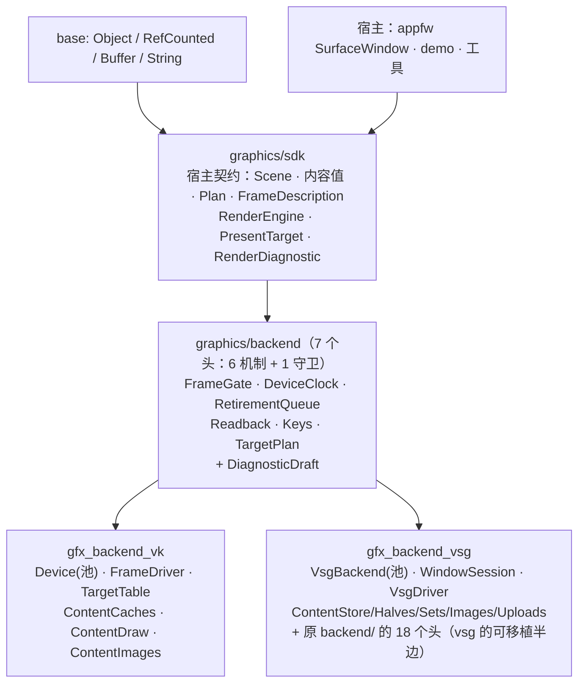

# graphics 与两后端的重新设计（阶段一审核 + 阶段二提案）

> **状态**：非权威提案。阶段一（现状审核）与阶段二（目标设计）已完成，**未改一行代码**，等批准后才进阶段三。
> **日期**：2026-11-16
> **范围**：`src/viz/graphics/{sdk,src}`、`src/plugins/gfx_backend_vk`、`src/plugins/gfx_backend_vsg`、
> 接缝 `sdk/vine/graphics/backend/`、`tests/test_graphics` / `test_vk` / `test_vsg`、`docs/guides/` 的图形页、
> `.ai/design/` 的十二个 graphics 页。**不含** appfw 的 UI 层与 geometry 模块的算法。
> **判据**：仓库级 `G1`–`G13`（`.github/copilot-instructions.md`）+ 本文件的证据三元组规则。
> **做法**：只读代码审计 + 用例名清点 + 文档句与实现逐条对账；没有跑 GPU 用例、没有新基准（引用的数字都标了出处）。
> **产出**：本文（A/B/C/D + 目标设计 + 迁移计划）+ `../decisions/ADR-2026-11-16-redesign-seam-and-vocabulary.md`。
> **批准后才动**：阶段三的每一批都必须满足 §7 的"批次边界能力覆盖 100%"。

---

## 1. 概要

### 1.1 问题与背景

需求（用户原话）：**graphics 与两个后端（`gfx_backend_vk` / `gfx_backend_vsg`）重新设计——概念、抽象、框架、
C++ 结构——功能不减。** 类型、接口、层次、命名、公开 API/ABI 都可以重设计；能力一项都不能丢；
有意改变的行为必须逐条列出并经批准。

现状的规模（本次清点）：SDK 头 84 个 + 接缝 25 个（共 109）、`src/viz/graphics/src` 约 14.8k 行 `.cpp`、
vk 插件 12.0k 行、vsg 插件 17.2k 行、接缝实现 3.2k 行、三套测试 **587 / 137 / 562 = 1286 例**。
在这么厚的存量上做"重设计"，唯一安全的判据不是"新形状更漂亮"，而是**每一条能力都还找得到旧证据与新证据**。

### 1.2 目标

1. 把"今天是什么、哪些地方的名字/边界/职责是错的"写清楚，且每条都能被 file:line 或用例名反驳（阶段一）。
2. 给一份不丢能力的目标形状：概念表、层次、类型清单、公开接口草案、能力覆盖表、行为变更表、成本预期（阶段二）。
3. 给一份可分批、每批可回滚、每批都绿的迁移计划（阶段三的施工图）。
4. 只做**重新划分已有能力**（`G13` 允许，`G8` 不禁止）；不新增没有消费者的扩展点。

### 1.3 非目标

- **不**提"退役 vsg"或"退役 vk"——两个后端全部能力保留（用户已明确：功能不减的默认解释是两个后端都在）。
- **不**借重设计顺手做 backlog 的触发型项（多帧在飞、dynamic rendering、VMA、LOD、点光阴影……）。
- **不**改 `third_party/`，不 reformat，不为"更简单"牺牲 `G10` 的真实成本（锁、上传、内存、加载、编译）。
- **不**在本文里宣布某个设计"已经这样"——`.ai/design/` 的页面在迁移批次落地时改。

### 1.4 一句话结论

> 现在的栈**能力很全、证据很厚**，问题几乎全在**名字与归属**：一个概念被叫成四个名字（`Session`）、
> 一个类型被塞了六个关注点（`Device`）、一个"后端接缝"里 25 个头有 18 个只有 vsg 一个消费者。
> 重设计的核心不是新框架，而是**把已有的能力搬到它该在的那一侧、用一个名字叫它、并让每一处搬迁都有用例跟着走**。

### 1.5 三个最有价值的结论（先读这三条）

| # | 结论 | 依据 | 量级 |
|---|---|---|---|
| 1 | **接缝名不副实**：`sdk/vine/graphics/backend/` 的 25 个头里（含 1 个包含守卫），vk 只 include 6 个；18 个只有 vsg 一个消费者，其实现还编在 `libGraphics` 里、随 `VineGraphicsBackendSdk` 安装 | 本文件 §3.2.1 的 include 计数 | 18 个头 + 18 个 `.cpp` 搬家 |
| 2 | **"会话"是四个东西**：设计名词（= `RenderFrameExecutor`）、vk `Device::Session`（帧机器）、vsg `api::Session`（窗口+交换链）、vsg `VsgDriver`（帧驱动者）；身份类型还分成 `WindowId`(u32) / `ResidenceTable::SessionId`(u64) / `TargetClaims::SessionId`(u32) | `TargetClaims.hpp:48`、`ResidenceTable.hpp:58`、`DeviceClock.hpp:44` | 一个 `FrameDriverId` + 三个内部改名 |
| 3 | **两后端在同一处各自发明同一件东西**：帧首解析出的"每条绘制调用的值"在 vk 叫 `CommandPlan`+`ScreenPlan`+`ResolvedTextures`，在 vsg 叫 `ContentPlan::Call`；两者都对，但词汇对不上，vk 还把同一种东西拆成两半 | `ContentCaches.hpp:149/162/184`、`ContentPlan.hpp:68` | 合并 vk 的两半 + 统一名字（内部） |

---

## 2. 阶段一 A：能力清单（验收基准）

### 2.1 规则

- **能力 = 用户可观察的一句话**，不是函数名。来源：设计页的 `F#`/`C#`/`T#`、**每一条用例名**、
  `docs/guides/` 的用户承诺、ADR 的切换门、memory 里的可跑场景。
- 标记：⬜ 正常（有具名用例）· 🟡 证据只钉实现细节或只有 suite 级 · 🔴 无证据 / 只在环境里成立 ·
  **½** 只在一个后端存在（另一个后端要么答 `Unsupported`，要么根本没有这条路径）。
- 证据列写的是**可执行的用例名或命令**。"suite 级"会写明（例如 `SelectTest` 的全部用例），
  它是弱证据，阶段三替换证据时要升级到具名用例。
- 本表**不做判决**，只登记事实；判决在 §3–§5。

### 2.2 内容与场景（authoring）

| 能力 ID | 能力（用户可观察的一句话） | 今天的承载 | 证据 | 承诺出处 | 备注 |
|---|---|---|---|---|---|
| CAP-01 | 建场景图并增删/重父化/换根，无需通知 | `Scene` / `Node` / `Group` | `NodeTest`、`SceneTest`、`SceneMutationTest`（suite 级） | graphics-scene.md §3.1 | ⬜ |
| CAP-02 | 放置与状态沿树折叠（矩阵/位置姿态/自动朝向/状态节点/不透明度/可见性/层/画序） | `MatrixTransform` / `PositionAttitudeTransform` / `AutoTransform` / `StateNode` / `Node` | `MatrixTransformTest`、`PositionAttitudeTransformTest`、`AutoTransformTest`、`StateNodeTest`、`DrawOrderTest`、`ContentLayersTest` | graphics-scene.md §2.2 | ⬜ |
| CAP-03 | 隐藏/层掩码在收集、包围盒、拾取三处一致 | `Node::setVisible` / `layers` / `Scene::boundingBox` / `RayIntersection` | `SceneTest.HiddenSubtreeContributesNothingToTheSceneBox`、`SceneTest.InvisibleNodeExcludedFromBoundingBox`、`RayIntersectionTest.*` | graphics-scene.md §3.3 | ⬜ |
| CAP-04 | 一次发布回答三态（Posted / Unchanged / InsideBatch），批 = 一次发布 | `Scene::publish` / `ScenePublisher` | `PublicationStoreTest.PublishAnswersPostedUnchangedAndInsideBatch`、`SnapshotSourceTest.AnEditBatchKeepsTheSourceOnTheOldPicture` | frame-pipeline F9 / R11 | ⬜ |
| CAP-05 | 在飞帧不受内容编辑影响（旧帧画旧值） | `SceneSnapshot` + `PublicationStore` | `SnapshotSourceTest.AnOlderSnapshotKeepsTheShapeAndProgramItWasPublishedWith`、`RenderEngineTest.AMaterialEditLandsOnTheNextFrameEvenWhileTheEngineThreadRecords` | frame-pipeline T17 / R9 | ⬜ |
| CAP-06 | 没发布的场景什么也不画，并报一次 | `detail::bindSceneDraws` | `FrameExpandTest.ADrawNoPublicationAnswersDrawsNothing` | threading §2.13 | ⬜ |
| CAP-07 | 快照收集与直接收集逐项相同 | `SnapshotSource` vs `ScenePublisher` | `SnapshotSourceTest.ThePublishedSourceMatchesTheSceneAcrossSixHundredFrames`（600 帧） | frame-pipeline T34 | ⬜ |
| CAP-08 | 选择是纯函数、排序键是全序、剔除按行不按块 | `detail::selectSnapshot` / `detail::SortKey` | `SelectTest.SameInputSameList`（含 8 线程）、`SelectTest.TheSortKeyIsATotalOrder`、`SelectTest.TheKeySortsByTheBoxCentreNotTheNodeOrigin`、`SelectTest.OneChunkCullsEachRowOnItsOwnBox` | frame-pipeline F2 / F11 / T8 / T9 | ⬜ |
| CAP-09 | 内容身份是句柄 + 世代；陈旧句柄答 gone | `ContentId.hpp` / `ContentRegistry` | `ContentRegistryTest.AStaleHandleAnswersGone` | ADR-2026-11-11 | ⬜ |
| CAP-10 | 几何：通道/图元/多条 draw/实例流/缓冲切片 | `Geometry` / `Primitive` / `Buffer` | `GeometryTest`、`AttributeChannelTest`、`PrimitiveInstancingTest`、`MeshTest`、`MeshShapeTest` | graphics-geometry.md | ⬜ |
| CAP-11 | 材质：因子/纹理槽/继承/实例/透明判定 | `Material` / `MaterialBase` / `MaterialInstance` / `MaterialDescription` | `MaterialTest`、`MaterialInheritanceTest`、`MaterialInstanceTest`、`MaterialBlockTest` | ADR-2026-10-24-material-model | ⬜ |
| CAP-12 | 类型化灯槽（1 ambient + 8 槽）+ 掉落报告 | `Light` / `LightRig` / `LightAbi` | `LightTest`、`LightRigTest`、`LightBlockTest` | ADR-2026-10-24-light-block-typed-lights | ⬜ |
| CAP-13 | 纹理：2D/立方体/层数/采样器值/sRGB | `Texture` / `Sampler` | `TextureTest`、`Texture2DTest`、`CubeMapTest`、`TextureLayersTest` | graphics-material.md | ⬜ |
| CAP-14 | 相机/操纵器/相机镜像/相机快照 | `Camera` / `CameraManipulator` / `OrbitCameraManipulator` / `CameraMirror` / `CameraSnapshot` | `CameraTest`、`CameraManipulatorTest`、`CameraMirrorTest`、`CameraSnapshotTest`、`InputRouterTest` | graphics-rendering.md | ⬜ |
| CAP-15 | 射线拾取（层掩码 + 子树并集跳过） | `RayIntersection` | `RayIntersectionTest`（suite 级） | graphics-scene.md §3.3 | 🟡 suite 级 |
| CAP-16 | 资产 → 场景 | `sceneFromModel` | `ModelSceneTest`（suite 级） | docs/guides/graphics.md §3.17 | 🟡 suite 级 |
| CAP-17 | 驻留账（谁还引用、谁可以放） | `ResidencyLedger` / `ResidencyTable`（SDK） | `ResidencyLedgerTest`、`ResidencyTableTest.TheCollectableSetIsEnumerable` | ADR-2026-11-10-gpu-residency | ⬜ |

### 2.3 帧、计划与编译

| 能力 ID | 能力 | 今天的承载 | 证据 | 承诺出处 | 备注 |
|---|---|---|---|---|---|
| CAP-18 | 计划是值：按名字差分、原地更新、稳定 code、三态结果 | `Plan` / `validatePlan` / `RenderEngine::applyPlan` | `PlanTest.APassIsAddedWithoutAnyAddCall`、`PlanTest.AChangedTargetUpdatesTheSameNodeInPlace`、`PlanTest.*IsRefusedWithItsCode`、`PlanTest.TheCodeSpellingsAreStable`、`PlanTest.ABusyEngineRefusesThePlanInsteadOfBlamingItsShape` | frame-pipeline F6 / R38 | ⬜ |
| CAP-19 | 帧表是这一帧真正跑的东西 | `FrameTable` / `RenderEngine::frameTable` | `RenderEngineTest.TheFrameTableIsWhatTheFrameActuallyRan`、`RenderEngineTest.FrameTableDescribesThePassesInTheOrderTheyWillRun` | architecture F14 | ⬜ |
| CAP-20 | 依赖排序 + 借用深度先于借用者 + 环被引擎拿走 | `detail::FrameScheduler` | `FrameScheduleTest`、`PlanTest`（环与重复）、`PassDrawTest` | ADR-2026-10-22-engine-schedules-passes | ⬜ |
| CAP-21 | 接线检查（未生产输入/重复产出/附件冲突/整目标与细图/深度读无深度……） | `RenderEngine::collectPlanProblems` | `RenderEngineTest.UnresolvedDeclaredInputIsReportedOnceAndRearmed` 等 20+ 例（见 `RenderEngineTest` suite） | frame-pipeline §3.6 | ⬜ |
| CAP-22 | 帧值 = 每 pass 每 draw，且每 pass 只描述一次 | `FrameDescription` / `EngineCompile` | `RenderEngineTest.TheFrameValueIsEveryPassAndEveryDrawTheFrameRan`、`RenderEngineTest.TheEngineRunsTheFrameValueAndDescribesEachPassOnce` | architecture §2.2 | ⬜ |
| CAP-23 | transient 目标由编译拥有、按声明建 | `OutputRegistry::transientTarget` | `RenderEngineTest.ATransientTargetIsOnePerDeclaredImageAndTheCompileOwnsIt` | graphics-frame-pipeline §2.8 | ⬜ |
| CAP-24 | 一区一幅画；第二区是构造失败 | `RenderSurface` | `RenderSurfaceTest.ASecondAreaIsAConstructionFailureNotASecondObject`、`RenderSurfaceTest.TheAreaSizeHasOneOwnerAndTheViewReadsIt` | ADR-2026-11-13-one-engine-one-surface | ⬜ |
| CAP-25 | 一个设备服务多个引擎，区/目标不交叉 | `RenderEngine::setDevice` + 引擎自持 driver | `HeadlessBackendTest.OneDeviceServesSeveralAreasWithoutCrossingThem` | ADR-2026-11-15 §背景 | ⬜ |
| CAP-26 | inline 与引擎线程两种位置同图 | `FrameRunner` / `FrameThreading` | `RenderEngineTest.AFrameThreadedEngineAnswersTheSamePictureAndSaysWhenItLanded`、`FrameRunnerTest.ManyFramesThroughTheEngineThreadStayEquivalent` | threading §2.12 | ⬜ |
| CAP-27 | 预热：答案 = 帧要的东西；预热后录帧 builds 增量 0；不提交帧 | `RenderFrameExecutor::prepareFrame` | `VsgBackendTest.PrepareBuildsEveryIdentityAndTheNextFrameThenBuildsNothing`、`VkPrepareUploadTest.APreparedTexturedFrameUploadsNothingWhenItRuns`、`VkPrepareUploadTest.ASecondPrepareSubmitsNothing`、`PrepareUploadTest.*` | frame-pipeline F7 / T33 / T35 | ⬜ |
| CAP-28 | 帧结果与查询（snapshot/view/计数/诊断/present/被答相机） | `FrameResult` / `FrameQuery` / `PresentRecord` / `presentedCamera` | `RenderEngineTest.TheFrameResultIsThePictureThatWasAnswered`、`SceneTest.TheAnsweredFramesCameraIsWhatAPointerQueryShouldAimWith`、`RenderEngineTest.TheFramesPictureOutcomeIsAFactOfTheFrame` | frame-pipeline F12 | ⬜ |
| CAP-29 | 相机形状与 pass 矩形不一致报一次 | `RenderEngine` 编译检查 | `RenderEngineTest.ACameraWhoseShapeIsNotThePassRectangleIsReportedOnce`、`RenderEngineTest.TheRectangleIsThePassViewportAndAScreenPassIsNotMeasured` | architecture N5 | ⬜ |

### 2.4 设备、驱动与会话

| 能力 ID | 能力 | 今天的承载 | 证据 | 承诺出处 | 备注 |
|---|---|---|---|---|---|
| CAP-30 | 设备生命周期幂等；设备丢失 = 会话结束，重建 = shutdown+initialize | `RenderDevice::initialize/shutdown`、vk `noteDeviceLost` | `VkBackendTest.TheDeviceComesUpAndGoesDownCleanly`、`VkMemoryFailureTest.ALostDeviceDuringAnAllocationEndsTheSession`、`VkProbeTest.*` | vk-backend §2.2 / N6 | ⬜ |
| CAP-31 | 能力只报实际启用/支持的位与限制；未答 = 假 | `Capabilities` | `CapabilitiesTest.OneFeatureIsOneBitAndAnUnansweredFeatureIsFalse`、`VkMsaaTest.TheDeviceReportsTheSampleCountItCanBuild` | vk-backend C7 | ⬜ |
| CAP-32 | 每设备多个驱动；每个驱动自己的默认程序 | `createSession` / `setDefaultContentProgram` | `VkMultiSessionTest.TheDeviceHandsOutANewDriverAndKeepsItsOwn`、`VkMultiSessionTest.TwoDriversShadeWithTheirOwnDefaultProgram`、`VsgBackendTest.TwoDriversKeepTheirOwnDefaultProgram` | ADR-2026-11-15 §决定 6 | ⬜ |
| CAP-33 | 不同驱动的帧体真并发；同驱动第二线程等待、重入拒绝 | `DeviceGate`（vsg）/ `body_gate`（vk）/ `FrameGate` | `VkMultiSessionTest.AFrameBodyDoesNotWaitForAnotherDriversFrame`、`VsgBackendTest.ARecordingFrameDoesNotStopAnotherDriversContent`、`FrameGateTest.*`、`VkContentDrawTest.TheOwningThreadIsRefusedInsteadOfWaitingForItself` | threading C21 / sessions F1 | ⬜ |
| CAP-34 | 宿主动词不在帧体里等自己（读回拒绝、内容动词拒绝并报一条） | `FrameBodyDepth`（vk）/ `DeviceGate` 空租约（vsg） | `VkMultiSessionTest.AReadbackFromInsideAFrameIsRefusedInsteadOfWaitingForIt`、`VsgBackendTest.AReadbackFromInsideAFrameBodyAnswersInsideFrame` | sessions F7 | ⬜ |
| CAP-35 | 释放不等在飞帧（park + 水位） | `RetirementQueue` / `DeviceClock` | `VkMultiSessionTest.AReleaseDoesNotWaitForTheFrameInFlightAndDoesNotDestroyWhatItUses`、`VkResidencyTest.AReleaseIsHandedOverParkedAndDestroyedAfterTheFramesThatCouldNameIt` | sessions F6 / R6 | ⬜ |
| CAP-36 | 目标 claim：一帧一持有者；冲突只跳那个 pass 并报一条 | `TargetClaims` | `TargetClaimFrameTest.*`、`TargetClaimsTest.*`（7 例） | sessions F5 | ⬜ |
| CAP-37 | 两驱动首画同一几何：一次上传、至多一份临时副本、失败撤回 | `ResidenceTable` + `ContentCaches::FrameBuilds` | `VkResidenceWireTest.TwoDriversFirstDrawingOneGeometryShareOneEntryAndAtMostOneCopy`、`.ADriverThatSeesAnUploadInFlightBuildsACopyInsteadOfWaiting`、`.ARefusedBuildIsWithdrawnInsteadOfPublished` | sessions F4 | ⬜ |
| CAP-38 | 帧首解析的工作量不随 draw 数增长 | `ContentCaches::Lock` 计数 | `VkFrameHeadTest.AFramesCacheWorkDoesNotGrowWithItsDrawingCalls` | sessions §2.3 / T3 | ⬜ |

### 2.5 目标、窗口与呈现

| 能力 ID | 能力 | 今天的承载 | 证据 | 承诺出处 | 备注 |
|---|---|---|---|---|---|
| CAP-39 | 离屏目标：MRT、逐附件清屏、深度策略、形状规划 | `TargetImages` / `TargetPlan` / `ClearPlan` | `VkContentTargetTest.EveryColourAttachmentIsClearedAndWrittenOnItsOwn`、`MrtTargetTest.*`、`OffscreenTargetTest.*`、`CoreTargetPlanTest`、`CoreClearPlanTest` | vk-backend F4 | ⬜ |
| CAP-40 | MSAA + 颜色/深度 resolve；采样数超限拒绝而不降级 | `TargetImages` / `planTarget` | `VkMsaaTest.*`（含 `AMultisampledTargetResolvesTheSamePicture`、`AnOverLimitRequestIsRefusedNotLowered`、`ACountTheDeviceDoesNotOfferIsRefusedToo`）、`MsaaTargetTest.*` | ADR-2026-11-14-sample-count-refused-not-lowered | ⬜ |
| CAP-41 | 深度借出/借入（借用方不自建；借出即撤销采样） | `TargetImages::depth_borrowed` / `OffscreenTarget` | `SharedDepthTest`、`VkContentTargetTest.ABorrowedDepthRejectsTheFragmentTheLenderAlreadyCovered`、`CoreDepthProbeTest` | rendering §2.1 / vsg-backend F8 | ⬜（两后端拒绝语义不同，见 CAP-45） |
| CAP-42 | resize 只换图像不重编管线；形状变才重建 | `TargetPlan` / 管线键 | `VkContentTargetTest.AResizeKeepsThePipelinesAndAShapeChangeRebuildsThem`、`CoreTargetPlanTest` | vk-backend §2.6 | ⬜ |
| CAP-43 | 窗口目标与交换链：present 结局、重建、1 s acquire 超时 | `WindowTarget` / `api::Session` | `VkWindowPresentTest.AWindowFrameIsDrawnAndPresented`、`VkProbeTest.AProbeDeviceBringsUpItsOwnWindowAndPresents`、`WindowCompositionTest`、`SessionTest` | architecture F2 / F17 | ⬜ |
| CAP-44 | 一个窗口只有一个活动目标（第二次索取 = `WindowOccupied`） | `createSurfaceTarget` | 只有文档 + `SdkPixelFixture` 的诊断（`... a window this device already serves was asked for again`） | vk-backend F3 / RenderDevice | 🟡 没有具名用例 |
| CAP-45 | 宿主窗口采纳/移动（同句柄 Keep、换句柄 Move、重建） | vsg `api::Session::moveTo` / `SessionMove`；vk `WindowTarget::setWindowHandle` | `SessionMoveTest`（vsg，X11）、`VkProbeTest` 的关机后重建 | sessions §2.1 | **½ + 🟡** vk 的 `setWindowHandle` 无具名用例 |
| CAP-46 | 一个窗口只属于一个驱动（foreign target 拒绝） | `createSurfaceTarget` / `WindowOccupied` | `VkProbeTest.AProbeDeviceRefusesAWindowItDidNotMake` | sessions §2.5 | ⬜ |

### 2.6 驻留、上传与缓存

| 能力 ID | 能力 | 今天的承载 | 证据 | 承诺出处 | 备注 |
|---|---|---|---|---|---|
| CAP-47 | 内容键 = 身份 + revision；`releaseContent` 四类对象 + 两个 buffer 重载 | `RenderDevice::releaseContent` / `ContentCaches` / `ContentStore` | `VkResidencyTest.ReleasingAGeometryLowersResidencyAndTheNextFrameUploadsItAgain`、`.ReleasingAProgramLowersTheCompiledHalvesAndKeepsTheStreams`、`.ReleasingATextureLowersTheImageResidency`、`.ReleasingOneBufferLowersOnlyTheStreamsThatReadIt`、`VsgBackendTest.ReleasingContentDropsItsResidencyAndTheNextFrameRebuildsIt` | content-lifecycle F1 | ⬜ |
| CAP-48 | 行级 epoch 回收；裁剪/隐藏不丢驻留；离树才丢 | `ContentStore` / `ContentFacts` | `ContentStoreTest.ACulledGeometryKeepsItsUploadsForAHundredFrames`、`ContentStoreTest.AStreamLeavesWithinTheParkingWindowAfterItsGeometryIsDropped`、`StreamUploadsTest.TwoGeometriesOfOneBufferShareOneUploadUntilBothLeave` | content-lifecycle §2.9 / F27 / F28 | ⬜ |
| CAP-49 | 稳态帧：零上传、零编译、零块写 | 两后端的键与环 | `VkResidencyTest.TheSecondFrameOfTheSameContentBuildsNothing`、`ContentStoreTest.ASteadyFrameBuildsNothing`、`CoreMaterialArenaTest.ASteadyFrameWritesNothing`、`VkUniformRingTest.ASteadyFrameCreatesNoRingAndBuildsNoSet` | content-lifecycle F9 / F10 | ⬜ |
| CAP-50 | 纹理按 revision 上传一次；导入纹理重填即重传 | `ContentImages` / `MaterialImages` | `VsgBackendTest.ARefilledImportedTextureIsReuploadedForTheNextFrame`、`ContentImagesTest`、`MaterialImagesTest`、`VkContentDrawTest.ABaseColorTextureIsUploadedAndSampled` | ADR-2026-10-19 | ⬜ |
| CAP-51 | 上传暂存的寿命 = 一次上传（可复用块保留，大块还回，零 idle） | `StagingTask` / `TransferStaging` | `UploadScratchTest.TheUploadScratchIsNotRetainedAndTheFramesGiveItBack`、`OffscreenSessionTest.TheUploadScratchIsGivenBackAndALaterUploadStillLands` | ADR-2026-11-13-staging-keeps-the-reusable-block | ⬜ |
| CAP-52 | 每帧上传/释放在报告里是增量 | `FrameUploads` | `FrameUploadsTest.TheReportAnswersWhatThisFrameUploadedAndReleased` | content-lifecycle T11 | ⬜ |
| CAP-53 | 实例流由 primitive 声明、按 revision 重传 | `ContentStore` 行 + 实例流 | `ContentStoreTest.AnInstanceStreamIsDeclaredThroughItsPrimitiveAtTheRowsRevision`、`VkBuiltinProgramTest.*`（两实例矩阵 + 释放重传） | ADR-2026-10-23-instancing-per-primitive | ⬜ |
| CAP-54 | 材质 arena：每槽 copies 份、槽满拒绝、稳态零写 | `MaterialArena` / `BlockStorage` | `CoreMaterialArenaTest.*`、`BlockStorageTest.*`、`VsgBackendTest.MeasureWhatEachKindOfEditCostsPerFrame` | content-lifecycle F7 | ⬜ |
| CAP-55 | 每帧块 ring：对齐用设备限制、只加 chunk 不搬旧块 | `FrameRing` / `BlockStorage` | `CoreFrameRingTest`、`BlockStorageTest`、`ContentFactsIndexTest` | content-lifecycle N5 / N6 | ⬜ |
| CAP-56 | 描述符集/常量环：按绑定缓存、稳态不建不毁 | `ContentSets` / `BlockDescriptors` / vk ring | `ContentSetsTest`、`BlockDescriptorsTest`、`VkUniformRingTest.TwoDrawablesWithDifferentMaterialsShareTheRing` | vk-backend F8 / F9 | ⬜ |
| CAP-57 | 管线缓存：会话内 + 跨会话设备键控文件，异设备拒绝 | `VkPipelineCache` / `PipelineCacheFile` | `VkPipelineCacheSessionTest.*`（4）、`VkPipelineCacheFileTest.*`（5，含 `AnotherDevicesFileIsRefused`、`ATruncatedOrTrailingFileIsRefused`） | vk-backend F12 | **½**（vsg 无 `VkPipelineCache`，见 backlog T10） |
| CAP-58 | 设备内存池：块/切片/相邻合并/按类不共页/拒绝分类与数字 | `MemoryAllocator` | `VkMemoryPoolTest.*`（含 `ManyTargetsShareThePoolBlocks`、`ASteadyFrameAllocatesNothing`、`FreeNeighboursMergeSoThePoolIsReused`、`ARefusalSaysHowMuchRoomThePoolStillHas`） | vk-backend F10 / §2.12 | **½**（vsg 无自建显存池） |

### 2.7 绘制能力

| 能力 ID | 能力 | 今天的承载 | 证据 | 承诺出处 | 备注 |
|---|---|---|---|---|---|
| CAP-59 | 引擎状态 → 设备状态（reverse-Z、CW 正面、blend、polygon、topology、深度带） | `StateMapping` / `RenderStateMapper` / `resolveRenderState` | `VkStateMappingTest.*`（5）、`VsgSceneRulesTest`、`RenderStateMapperTest`、`VkStateMappingTest.TheDepthComparisonIsReversedBecauseTheEngineRendersReverseZ` | vk-backend F5 / N2 | ⬜ |
| CAP-60 | 引擎内置程序 + 四个变体开关 + 实例流 | `ProgramVariant` / `BuiltinShaders` | `VkVariantTest.*`（7）、`VkBuiltinProgramTest.*`（4：材质色/纹理/顶点色/两实例）、`ProgramVariantTest`、`BuiltinProgramTest`、`EmbeddedShadersTest` | vk-backend M8 | ⬜ |
| CAP-61 | 全屏绘制：深度强制 Disabled、source 附件按序绑定、阴影绑定 | `recordScreen` / `planScreen` | `VkContentDrawTest.AScreenCopyIsDrawnWhateverThePassDepthPolicySays`、`ScreenDrawTest`、`VkContentDrawTest.AScreenCopySamplesTheSourceTarget` | vk-backend P1 / P2 | ⬜ |
| CAP-62 | 阴影：一张 2D 图、一个投射灯、MSAA 可用、无图 = stand-in + params=0 | `ShadowSource` / `ShadowBlock` | `VkShadowTest.*`（4）、`ShadowPixelTest`（2）、`ShadowBlockTest`、`VsgBackendTest.AMultisampledMapCastsTheSameShadow` | backlog S6 / typed-lights ADR | **½**（点光/第二投射灯不做，backlog S6；两后端都只支持一个） |
| CAP-63 | 延迟链与 MRT G-buffer | `ChainBuilder` / `BuiltinShaders` | `VkDeferredTest.*`、`DeferredTest`、`VkDeferredTest.EveryGbufferAttachmentWasWritten` | graphics-rendering.md | ⬜ |
| CAP-64 | 两后端逐字节对拍 | `BackendParityTest`（在 `test_vsg` 里） | `BackendParityTest.*`（13 例） | vk-backend R2 | ⬜（跨界唯一度量） |
| CAP-65 | 视图开关：wireframe / 线宽 / 点视图 / 着色模式 | `PassRenderState` / `ContentDraw` | `VkContentDrawTest.TheViewSwitchesAreServedInsteadOfRefused`、`RenderEngineTest.ThePassLevelPolygonModeOverridesTheContentAndCanBeClearedBack`、`WireframeIsAnEdgePassWithTheUnlitColourAndNoRebuild` | docs/guides/graphics.md §3.10 | ⬜ |
| CAP-66 | 半透明：按材质 α 模式分两段 + blend | `alphaModeSortsTransparent` / `SortKey` | `VkContentDrawTest.ABlendedDrawFollowsTheEngineOrder`、`MaterialTest`、`SelectTest`（透明段） | graphics-material.md | ⬜ |
| CAP-67 | overlay：role + 内容 + pass；第三种 overlay 不改类 | `PassChain` / `HudPassTest` / `FpsOverlay` | `HudPassTest.*`、`FpsOverlayTest`、`PassChainTest.TheBuildOptionsDecideWhichOverlayPassesExist` | architecture F13 | ⬜ |
| CAP-68 | 链预设与 builder（forward/deferred/shadow/HUD），重建 = 原地更新 | `PassChain` / `ChainBuilder` / `ChainPresets` | `PassChainTest`、`ChainRegistrationTest`、`RenderEngineTest.AnApplicationWindowPassLeavesTheViewWithNothingToDeclare` | architecture F9–F13 | 🟡 suite 级 |

### 2.8 读回

| 能力 ID | 能力 | 今天的承载 | 证据 | 承诺出处 | 备注 |
|---|---|---|---|---|---|
| CAP-69 | 颜色读回（RGBA8、任一颜色附件；未画 ≠ 黑） | `readColorBuffer` + `ReadbackStaging` | `VkOffscreenTest`（`AClearedTargetReadsBackAsThatColour`、`ATargetThatWasNeverDrawnHasNoPixelsRatherThanBlackOnes`）、`VkMemoryPoolTest.AReadbackGivesItsStagingBytesBack` | vk-backend F11 | ⬜ |
| CAP-70 | 深度读回（D16/D32/D32F 行主序归一化、MSAA resolve、拒绝分类） | `readDepthBuffer` + `decodeDepth` | `VkContentTargetTest.TheDepthAttachmentReadsBackAsNormalisedRowMajorValues`、`.AMultisampledTargetsDepthReadsItsResolvePicture`、`.DepthReadbackRefusalsKeepTheirReasonsAndTouchNothing`、`CoreDepthProbeTest` | vk-backend F11 | ⬜ |
| CAP-71 | 读回是设备动词：等一次计一次；帧体内答拒绝；每驱动读自己最后一帧 | `ReadbackStaging` / 体闸 | `VkMultiSessionTest.AReadbackWaitsForTheFrameInFlightAndCountsTheWait`、`.EachDriversTargetReadsBackItsOwnLastCompletedFrame`、`VkResidenceTest` / `CoreReadbackTest` | sessions F7 | ⬜ |
| CAP-72 | 宿主窗口像素（XGetImage） | 测试夹具 | `HostWindowReadTest`、`SdkPixelTest`（无 X 时 SKIP） | vsg-backend §8 | 🟡 环境依赖，WSLg 读黑 |

### 2.9 报告与诊断

| 能力 ID | 能力 | 今天的承载 | 证据 | 承诺出处 | 备注 |
|---|---|---|---|---|---|
| CAP-73 | 每条报告带稳定 code + subject + limit；一次情节一条 | `RenderDiagnostic` + `ReportOnce` | `check_diagnostic_formats.py`（100 个 code：vk 63 / vsg 24 / engine 13）、`VkContentRefusalTest.TheFirstReasonWinsAndOnlyACodeMakesARefusal`、`VkContentTargetTest.ATargetRefusalCarriesItsCodeItsSubjectAndTheLimit` | vk-backend §2.13 / R28 | 🟡 仍有 22 处未编码报告（6 文件）在 baseline 里 |
| CAP-74 | 帧报告：计数/进度/上传/计时/驻留；缺席 ≠ 0 | `FrameReport` | `VkPassTimingTest.TheReportAttributesTheFrameToThePassesThatSpentIt`、`VkDeviceClockTest.AFrameReportsItsDeviceTime`、`VkResidenceTest.WhatThisDeviceDidNotMeasureItDoesNotClaim`、`FrameUploadsTest` | vk-backend §2.8 | **½** per-pass GPU 计时只有 vk（vsg 明写不提供，`Capabilities::features` 的 `GpuTimings`） |
| CAP-75 | 预热报告：问到的形状 + 这次建了什么 | `PrepareReport` | `BackendParityTest.APrepareReportsTheShapeBothBackendsThenRecord`、`VkResidencyTest.PrepareBuildsWhatTheFrameNeedsAndSubmitsNothing` | frame-pipeline F7 | ⬜ |
| CAP-76 | 引擎转发设备报告；每个借用者自己的计数 | `RenderEngine::frameReport` | `HeadlessBackendTest.OneDeviceReportsIntoEveryEngineThatBorrowsIt`、`RenderEngineTest.TheFrameReportCrossesTheEngineWholeAndAbsentPartsStayAbsent` | architecture F8 | ⬜ |
| CAP-77 | 诊断路由：多路、同步、可重入、按情节去重 | `DiagnosticsRoute` / `ReportOnce` | `DiagnosticsTest`、`CoreDiagnosticsTest`、`ReportOnceTest`、`CoreObserveTest` | ADR-2026-11-15 §背景（多路由已成立） | ⬜ |
| CAP-78 | 内存拒绝四类 + 数字 + 注入 | `MemoryRefusalReport` / `MemoryBlockCreator` | `VkMemoryAllocatorTest.ARefusedBlockSaysWhichKindOfFailureItIs`、`VkMemoryFailureTest.AnExhaustedHeapIsOneReportWithItsNumbersAndTheSessionSurvives` | vk-backend §2.12 | **½** vk only |

### 2.10 后端边界、平台与证据装置

| 能力 ID | 能力 | 今天的承载 | 证据 | 承诺出处 | 备注 |
|---|---|---|---|---|---|
| CAP-79 | 暴露边界：SDK 零 `Vk*`、shell 零 `Vk*`、帧路径不走逃生门、低层单元免接缝 | `check_vk_exposure.py` | `ctest -R vk_exposure`、`VkHandlesTest.TheEscapeDoorIsClosedBeforeInitialize` | vk-backend F15 / C4 / C10 | ⬜ |
| CAP-80 | vsg 内容接缝：记账半边零 `::vsg::` | `check_vsg_content_seam.cmake` | `ctest -R content_seam` | vsg-backend §2.8 | ⬜ |
| CAP-81 | 插件注册与 ABI 握手；插件可加载 | `Plugin` / `BackendFactory` / `RenderBackendRegistry` | `VkBackendTest.TheFactoryRegistersItselfByName`、`VsgBackendPluginTest`、`GfxBackendVsgPluginTest`、`RenderBackendRegistryTest` | vk-backend F15 | ⬜ |
| CAP-82 | 缓存目录归宿主（位置 vs 格式分开） | `DeviceDesc::cache_directory` | `VkPipelineCacheFileTest.AFileIsReadOnlyFromTheDirectoryThatHoldsIt`、`ADeviceWithNoDirectoryKeepsNothing` | vk-backend §2.9 | ⬜ |
| CAP-83 | 平台：Linux/X11 交付；Win32 / Wayland 未证 | `WindowSystem`（vk）/ `VsgHostWindow`（vsg） | 没有实机证据（backlog T12 / T13 / T33） | vk-backend §1.3 | **🔴** 已知缺口，不是本次引入 |
| CAP-84 | 证据装置：分配门/相位表/观测/像素探针/延迟探测 | `backend/AllocationGate` 等 | `CoreAllocationGateTest.*`、`CorePhaseTableTest`、`CoreObserveTest`、`CorePixelProbeTest` | vsg-backend §8 T1 | **½** 只有 vsg 用（见 §3.3） |
| CAP-85 | 应用集成：`Vine --open demo` 在两个后端都能跑（0 error） | demo 插件 + appfw | `./build/bin/Vine --open demo`：`[RenderControl] session up` + `Pending -> Presenting`、`[error]` = 0 | docs/guides/graphics.md §4.2 | ⬜（人工命令，不是 ctest） |

### 2.11 标红的行（重设计前必须补 characterization）

| 行 | 缺什么 | 补法（阶段三第 0 批） |
|---|---|---|
| CAP-44 | 同一窗口第二次索取 `WindowOccupied` 没有具名用例（只有文档与一次偶发诊断） | 在两个后端各加一例（窗口夹具已有：`VkProbeTest` / `SdkPixelFixture`） |
| CAP-45 | vk 的 `WindowTarget::setWindowHandle`（宿主换窗口）没有用例；vsg 有 `SessionMoveTest` | vk 一例：同一 target 换句柄后仍能 present、device/pipeline 不重建 |
| CAP-71 / CAP-72 | 窗口读像素只有 vsg、且环境依赖 | 已有 SKIP 规则；把"SKIP 数"写进测试输出，避免"全绿零覆盖" |
| CAP-83 | Win32 / Wayland 无实机 | 保持 backlog，不属重设计；切换门（T35）继续挡着 |
| CAP-73 | 22 处未编码报告（6 文件） | 阶段三第 4 批清零 baseline |
| CAP-15 / CAP-16 / CAP-68 | 只有 suite 级证据 | 不阻塞重设计（这些单元不被本次重塑）；迁移时不改它们 |

---

## 3. 阶段一 B：逐项审核

每个单元一节，格式固定：**判决**（一句话）· **证据**（file:line / 用例名）· **重设计建议**。
十个维度（概念/职责/抽象层次/接口/所有权/诊断/线程/C++ 结构/注释/测试）只写有发现的那几条；
没提的维度 = 本次没找出问题，不等于已经完美。

### 3.1 SDK 宿主契约

#### 3.1.1 `RenderDevice.hpp`（627 行，20 个虚动词）

- **判决**：契约文本是**全仓最好的一份**（五件事逐动词写清、失败分类是枚举、线程段诚实），
  但一个类型回答了五个互不相干的变化原因；`executor()` 的"是属性不是状态"已被
  `createSession()` 部分推翻，两句话同时存在于同一个头里。
- **证据**：`RenderDevice.hpp:231`（`executor()`）与 `:248`（`createSession()`）；
  `renderDevice` 的 20 个动词里 13 个有默认体（A7 的计数）；`createSurfaceTarget` 是窗口工厂，
  `releaseContent` 是驻留，`readColorBuffer` 是读回，`setDiagnosticsRoute` 是诊断——四组不同寿命的东西。
- **重设计建议**：**不拆接口**（见 D3：拆了只是给 5 个测试替身减负，没有第二个 API 家族来逼形状），
  但把**动词分组写进头文件的分节**并把"哪一组可以在帧在飞时调用"做成一张小表（今天散在三段散文里）。
  真正要改的是 `executor()` 的措辞：它是"设备自带的那一个驱动"，不是"设备的属性"。
  满足 `G4` / `G6`；不做 `G8` 不允许的新接缝。

#### 3.1.2 `RenderFrameExecutor.hpp`（201 行，3 个动词）

- **判决**：一帧一个值、一个调用，是本仓最成功的接缝；问题是**两处**：
  (a) 类名与设计名词 `Session` 指同一件事，而 `Session` 在别处指别的东西（§4.2）；
  (b) 线程契约里"多个执行器可以并发"与"`prepareFrame` 也可以提交"各自写对了，但没有一句话把
  **帧体的三相位**（帧首解析 / 无锁录制 / 提交）说成契约，于是两个后端各自发明（§3.4.2 / §3.5.4）。
- **证据**：`RenderFrameExecutor.hpp` 的 "THREADING" 段；`executeFrame` 的 `@details` 第 2 条要求
  "record the value's passes in the order given"；两后端的相位实现见 `ContentCaches::Lock`
  （vk）与 `openFrameHead` / `commitFrameThrough`（vsg）。
- **重设计建议**：把三相位写成契约（不是新类型）：**resolve 一次设备锁 / record 不取设备锁 /
  commit 一次设备锁**，并要求每个后端提供一个计数证人（`FrameReport` 或缓存计数器），
  由跨后端用例断言"每帧常数、不随 draw 变化"。满足 `G4`（契约可判）/ `G10`（成本可量）。

#### 3.1.3 `RenderBackend.hpp`（55 行）

- **判决**：`Object + RefCounted + RenderDevice + RenderFrameExecutor` 的四重继承，是 backlog `T32` 的原文。
  今天没有消费者要求拆分（`G8` 成立），但**聚合把"设备"与"帧"的寿命绑死**：
  设备可以比任一窗口活得久（文档自己说），却被要求同时是一个执行器。
- **证据**：`RenderBackend.hpp:48`；`RenderBackend` 的注释自己写"今天一个对象回答前两个问题"。
- **重设计建议**：**保留**（D4），但把注释里的"今天"换成一条**触发条件**（"第一个只想返回
  `RenderDevice` 的工厂"或"第三个后端"），并把 `RenderBackend` 降级为"一个便利实现，
  不是契约的形状"这句写进头。这样做不新增类型、不改 ABI，且让下一次改动有判据。

#### 3.1.4 `FrameDescription.hpp`（366 行）

- **判决**：借用/拥有逐字段说清（A4 已修）之后，这一份是**好契约**。唯一的结构性疑点是
  `PassDraw::program_override` 与 `DrawDescription::program` 都是 `intrusive_ptr`
  ——它们让"帧值"持有内容对象，与"跨层只有不可变值"有张力，但用来做**身份与寿命**是必要的
  （删了要造内容注册通道）。
- **证据**：`FrameDescription.hpp` 的 owning 三个成员；`graphics-threading.md` §2.14 的边界段。
- **重设计建议**：**不动**（D5：等"需要跨帧持有帧值"的消费者，A4 已给出同一触发器）。
  只在概念表里把"帧值 = 借用 + 三个拥有"登记成一条规则，避免下一次加字段时再犯。

#### 3.1.5 `Plan.hpp`（234 行）/ `RenderPass.hpp`（908 行）/ `PassChain.hpp`（682 行）

- **判决**：**三件不同的东西，边界清楚**：`Plan` 是形状（值）、`RenderPass` 是节点与自述、
  `PassChain` 是配方 + 注册归属。真正的问题是 `RenderPass.hpp` 一个头 908 行，
  装着 pass 基类 + `PassKind` + 状态覆盖 + 内容声明 + 执行入口（`singlePassFrame` 的调用方），
  以及 `PassChain` 一个类 58 个动词（配方 + overlay + 开关 + 尺寸 + 呈现查询）。
- **证据**：`RenderPass.hpp` 908 行；`PassChain.hpp` 682 行；`graphics-architecture.md` §4.3 的接口表。
- **重设计建议**：`RenderPass` 拆出**两个实现文件**（声明 `PassDesc.hpp` 已有；把"自述"与"执行"分开，
  文件名待定），对公开面零变化；
  `PassChain` **不拆**（它是配方，动词多但每个都短，拆了会把"一条链"的知识分散——`G5` 反面）。
  收益可测：`RenderPass.hpp` 的 include 面缩小（`check_include_hygiene.py` 是门禁）。

#### 3.1.6 `Scene.hpp`（481 行）/ `SceneSnapshotRef.hpp`

- **判决**：公开面把"发布"与"查询"分得很干净；`collectRenderCommands` 的两个重载
  是**内容侧查询**，文档明写"不是帧源"。问题在**实现**：查询与帧走两条选择实现（§3.3.4）。
- **证据**：`Scene.hpp:99`（NOT A FRAME SOURCE）、`:295` / `:309`（两个重载）、`:328`（publish）。
- **重设计建议**：接口不动；实现收敛到一条（§3.3.4）。这是 `G13` 的典型：能力在正确的一侧，
  但**第二个实现**在错误的一侧。

#### 3.1.7 `ReportOnce.hpp` / `RenderDiagnostic.hpp` / `Diagnostics*.hpp`

- **判决**：`RenderDiagnostic`（code + subject + limit）与 `ReportOnce`（情节）是**同一条规则的两个正确半边**。
  但"一次拒绝"的值有三个拼写：SDK 的 `RenderDiagnostic`、vk 的 `ContentRefusal`、
  vsg 的 `HostReadbackRefusal`（无 `default` 的 switch 映射）。三者语义相同（category + code + 句），
  形状不同（一个带 subject/limit，一个 first-wins、一个纯枚举映射）。
- **证据**：`ContentRefusal.hpp` 的类注释；`vsg-backend.md` C7；`RenderDiagnostic.hpp:121` 行。
- **重设计建议**：抽一个 `backend/DiagnosticDraft`（category + code + subject + limit + message，
  `refuse()` 唯一写者、先到者胜），`ContentRefusal` 成为它的别名或特化；vsg 的枚举映射
  产出同一个类型。**收益**：第四个后端不再发明第四种。满足 `G1` / `G6`；风险低（都是内部头）。

#### 3.1.8 `Capabilities.hpp`（125 行）

- **判决**：位 + limits 的形状正确（未答 = 假）。唯一问题：**两个后端的"能力"不同集**
  （`GpuTimings` 只有 vk、`presentation` 按创建意图），而 `Capabilities` 没有说"这个位在哪个后端可能是假"。
- **证据**：`VkMsaaTest.TheDeviceReportsTheSampleCountItCanBuild`；vsg `VsgBackend.cpp:2050`
  的注释（"GPU timings is NOT a ..."）。
- **重设计建议**：文档层面：在 `Capabilities.hpp` 的每个位上补一句"哪个后端今天会答假、为什么"。
  这是**承诺的可判定化**（`G4`），零代码。

### 3.2 SDK 后端接缝 `sdk/vine/graphics/backend/`（25 个头 + 3.2k 行实现）

#### 3.2.1 判决：它不是"后端 SDK"，是"vsg 的可移植半边 + 6 个真正共享的机制"

- **证据（本文件实测的 include 计数）**：

| 后端 | 用到的 `backend/` 头 |
|---|---|
| `gfx_backend_vk` | `Keys`、`TargetPlan`、`RetirementQueue`、`Readback`、`FrameGate`、`DeviceClock`（**6 个**） |
| `gfx_backend_vsg` | 21 个（除 `BackendHalfGuard` 外的全部机制头，含 `ClearPlan`） |
| `libGraphics` 自己 | 23 个实现（`src/viz/graphics/src/backend/*.cpp` 各 include 一个） |

  也就是说：**18 个头只有一个消费者**（`FrameRecorder` / `FrameCompiler` / `FrameRing` /
  `MaterialArena` / `Streams` / `StateRegistry` / `VariantPool` / `SlotProbe` / `Observe` /
  `PixelProbe` / `DepthProbe` / `PhaseTable` / `SessionMove` / `AllocationGate` / `FrameArena` /
  `FrameTimeline` / `ResourceTable` / `ClearPlan`）（`BackendHalfGuard.hpp` 是包含守卫，不是机制）。 <!-- drift-ok -->
- **为什么是问题**：`graphics-architecture.md` §2.9 与 `vsg-backend.md` §2.9.1 把这一层叫做"后端契约"，
  并把它单独安装成组件 `VineGraphicsBackendSdk`。它承诺的是"第二个后端消费的形状"，而实际是
  **第一个后端的实现被提升为接缝**。这违反 `G1`（接缝的定义不是"谁用过"）与 `G5`（vsg 的变更被迫穿过 SDK）。
  对第四个后端，它是一份**假地图**：照着它写会得到一个装着 vsg 词汇的后端。
- **重设计建议**（本提案最大的一处搬家，纯移动、零行为）：把 18 个单消费者头 + 它们对应的
  18 个 `.cpp` 移进 `gfx_backend_vsg/{include/vine/backend_vsg/internal,src/internal}`；`backend/` 只留 **6 个共享机制**：
  `FrameGate`（帧闸）、`DeviceClock` + `RetirementQueue`（完成证据与退休）、`Readback`（读回的公共值）、
  `Keys`（格式与兼容性键）、`TargetPlan`（Rebuild/Resize/Repair）——后两者连同 `ClearPlan` 的取舍见 §3.2.2。
  组件 `VineGraphicsBackendSdk` 随之缩小。
  判据：`test_vsg` 与 `test_vk` 全绿、`content_seam` 仍过、`libGraphics` 不再编译任何 vsg 专用机制
  （门禁加一条"libGraphics 的 `backend/*.cpp` 只剩 5 个文件名"）。
  满足 `G13`（能力搬到它该在的一侧，即使没有新功能）。

#### 3.2.2 `Keys.hpp` / `TargetPlan.hpp`：接缝里的 Vulkan 拼写（T15） <!-- drift-ok -->

> `ClearPlan.hpp` 虽然也用 `ImageLayout`，但 vk 不 include 它——它随 §3.2.1 的 18 个 vsg 专用头一起搬家，
> 所以本节的去 Vulkan 拼写只涉及留下的两个。

- **判决**：`Keys.hpp:132` 明写"把它们作为**设备自己的格式码**（一个 `VkFormat` 值）携带"；
  `TargetShape` 带 `subpass`；`RenderPassCompatibility` 带 subpass 索引。这是**对现实的诚实**
  （格式确实无法从枚举反推），但它把"子通道"这个 Vulkan 概念变成接缝名词。
- **证据**：`Keys.hpp:148`（`subpass`）、`TargetPlan.hpp:79`；`vsg-backend.md` C6 的冻结令。
- **重设计建议**：把格式码换成 `DeviceFormat`（`std::uint32_t` 的强类型）+ `RenderPassKey`
  （后端算出的不透明兼容性键），`subpass` 从接缝消失。**不改值、不改行为**，两个后端各自把
  `DeviceFormat` 解释成 `VkFormat`。这样 C6 的"不再新增 Vulkan 拼写"从冻结变成**已清理**，
  第四个后端不必先学 Vulkan 的 subpass。列为可选批次（§7 第 8 批）：收益是形状，成本是两后端 + 测试的机械改动。
  `G9` 的正面；不满足 `G8` 的"今天有消费者"？——`G13` 明确不适用"没有新消费者"的检验：搬一个**错位的能力**不需要消费者。

#### 3.2.3 `FrameGate.hpp` / `DeviceClock.hpp` / `RetirementQueue.hpp`

- **判决**：三个头是**真正的共享机制**，且每个都有一句"NOT thread-safe，调用方提供锁"的诚实契约；
  vk 与 vsg 都用它们，实现只有一份。这是接缝里做得最对的一组。
- **证据**：`FrameGateTest.*`（4 例）；`CoreDeviceClockTest`、`CoreRetirementQueueTest`（vsg）；
  `VkDeviceClockTest`（vk）；`vk-backend.md` §2.15 与 `graphics-sessions.md` §2.6。
- **重设计建议**：只做一处补充——`DeviceClock::WindowId` 改名 `FrameDriverId`（见 §4.2 与 D-01），
  并把"一个 clock window = 一个帧驱动者（不是窗口）"写进类注释（今天靠设计页转述）。

#### 3.2.4 `ResourceTable.hpp`（vsg 用 3 次、vk 0 次）

- **判决**：它是"按 pin 退休"的通用表，命名与语义都不含 vsg，却只有 vsg 用；vk 用的是
  `ResidenceTable`（三态 + claim），所以**同一个问题（何时可以放）在两个后端有两套机制**。
- **证据**：`ResidenceTable.hpp`（vk，186 行 + 8 例）；`ResourceTable.hpp`（SDK，vsg 的
  `ContentHalves` / `ContentSets` / `StreamUploads` 用）；`graphics-content-lifecycle.md` §2.9。
- **重设计建议**：**不合并**（两套机制回答的问题不同：vk 回答"谁可以建这个键"，vsg 回答
  "这份驻留还能不能放"；`vk-backend.md` §2.17 的边界段已经写明），但把 `ResourceTable`
  随 `ContentHalves`/`ContentSets` 一起移进 vsg（它在 vsg 之外没有消费者）。
  **规则**留在 `graphics-content-lifecycle.md`，机制各归各家。这是 `G8`（不预建统一类型）+ `G13`（机制归位）。

#### 3.2.5 测试形状

- **判决**：SDK 后端接缝的测试全是"设备无关"的（`Core*Test` 在 `test_vsg` 里，34 例），
  这很好；但 **vk 从不跑这些用例**（它们编在 `test_vsg`），所以"共享机制在两个后端都成立"没有被对拍过。
- **证据**：`tests/test_vsg/Core*Test` 的 20 个 suite；`test_vk` 里只有 `FrameGateTest`、
  `ResidenceTableTest`、`BarrierPlanTest`、`StateMappingTest` 等自家单元。
- **重建议**：把 `FrameGate` / `DeviceClock` / `RetirementQueue` 的用例**编进两个测试二进制**
  （它们是共享机制，证据也该共享）。成本：改两个 `CMakeLists.txt`，零新代码。`G11`。

### 3.3 引擎实现（`src/viz/graphics/src`）

#### 3.3.1 `RenderEngine.cpp`（1427 行）+ `RenderEngine.hpp`（1504 行）

- **判决**：`RenderEngine` 是**组合根**，这一点设计页已经承认（§2.8 列了 8 类职责、1462 行、56 个签名）。
  作为组合根它是对的；问题是**组合根里住着机制**：帧泵（`FrameRunner` 的 5 个调用点）、
  会话形状（`slots_` / `applyPlanRows`）、表面账（`createSurface` / `announceAreaSize` / `presentRecord`）。
- **证据**：`RenderEngine.hpp` 的公开签名清单（设计页 §2.8 记 56 个公共签名；本次复核头文件为 1504 行）；
  `graphics-architecture.md` §2.8 自己写"线程策略的语义契约外溢到 9 个文件"。
- **重设计建议**：抽三个 `detail` 单元（公开面零变化）：`detail::SessionShape`（pass 声明、plan 差分、
  编译入口）、`detail::FramePump`（帧号、线程模式、等待、present record）、`detail::SurfaceLedger`
  （表面创建、尺寸广播、呈现表）。`RenderEngine` 只剩转发 + 生命周期。
  收益可测：`RenderEngine.hpp` 的非注释行数下降 ≥ 25%，且"改线程策略只动 `FramePump`"。
  满足 `G5` / `G12`；`G8` 的检验是"今天有没有第二个消费者"——有：**两个引擎（inline/thread）
  共用同一帧泵**，以及 `HeadlessBackendTest` 的两引擎场景。列为第 6 批（最后一批结构性改动）。

#### 3.3.2 `EngineCompile.cpp`（972 行）/ `FrameTable.cpp` / `Plan.cpp`

- **判决**：编译（声明 → 帧表 → 帧值）是**单一实现**，没有第二份排序器（`FrameScheduler` 唯一）。
  问题是 972 行里混了三种工作：计划应用、接线检查、逐 pass 描述。**没有发现能力重复**。
- **证据**：`RenderEngineTest` 的 20+ 接线用例；`FrameScheduleTest`；`PlanTest`。
- **重设计建议**：不拆文件（同一变化原因），只把"接线检查"的 20 条规则做成一张**表**
  （code → 条件 → 一句句子），今天它们是 20 段相似代码。收益：`G6`（一次一报、规则可枚举）+
  `G11`（新增一条检查有模板可抄）。零行为。

#### 3.3.3 `PublicationStore` / `FrameExpand` / `FrameRunner`（W3 / W9a / W9b 之后）

- **判决**：三个单元各一个职责，且边界是用例钉住的（`PublicationStoreTest` / `FrameExpandTest` /
  `FrameRunnerTest`）。这是全仓**结构最好**的一处。唯一疑点：`FrameExpand` 里仍有一处
  `draw.content->collectRenderCommands(...)`——它是对的（接口调用），但要保证它只走 `SnapshotSource`
  （生产）或直接收集（宿主自建），不要变成第三条路。
- **证据**：`FrameExpand.cpp:40`；`FrameExpandTest` 6 例；`Threading §2.15`。
- **重设计建议**：不动。在概念表里把这三件登记成"已正确的形状"，避免下一轮重写。

#### 3.3.4 `ScenePublisher` / `SceneRows` / `SceneSnapshot` / `SnapshotSource` / `DrawListBake` / `DrawListMemo`

- **判决**：**选择规则有两份实现**：内容侧（`ScenePublisher::collectRenderCommands` 的
  memo + 行走）与帧侧（`SnapshotSource` → `selectSnapshot`）。它们由 `T34`（600 帧逐项）保持等价，
  这不是巧合而是设计（5a 影子切换的遗产）。代价是：任何选择规则的修改要改两处，且两份都各自有 memo/epoch 记账。
- **证据**：`ScenePublisher.cpp:50` 起的直接行走与 memo；`SnapshotSource.cpp:64` 的 `selectSnapshot`；
  `SnapshotSourceTest.ThePublishedSourceMatchesTheSceneAcrossSixHundredFrames`；`SelectTest.SameInputSameList`。
- **重设计建议**：**收敛成一份**：`ScenePublisher::collectRenderCommands` 变成
  "必要时建/刷新快照 → `selectSnapshot`"，删除直接行走与它自己的 memo。判据：`T34` 与 `SelectTest` 全绿，
  且 `SceneTest.MeasureWhatOneCollectionCostsWithAMovingCamera` 不超过 `K3`（2160 µs × 1.2；今天实测 2.4–2.8 ms 是另一个口径，
  以该用例自己的 budget 7000 µs 为准）。**先量后改**：这是本提案里唯一可能变慢的一批（第 7 批，可整批回滚）。
  满足 `G1` / `G5`；风险已在 `P7` 类（memo 失效）里登记过。

#### 3.3.5 `ChainBuilder` / `PassChain` / `ChainPresets`

- **判决**：`ChainBuilder` 是 `PassChain::build()` 的实现细节（文档明写"recipes, not a public concept"），
  边界正确。`PassChain` 动词多（58），但它是**配方**，不是状态机。没有发现第二份配方实现。
- **证据**：`ChainBuilder.hpp` 的类注释；`ChainRegistrationTest`；`PassChainTest`。
- **重设计建议**：不动。只在 `ChainPresets` 的每个预设上补一句"它声明了哪些 pass"，让宿主不必读源码。

#### 3.3.6 `RenderSurface` / `SceneView`

- **判决**：边界正确（面积尺寸唯一 owner 是 `RenderSurface`；视图是采纳者）。`SceneView::publishContent`
  是内容侧动词，落在正确的一侧。
- **证据**：`RenderSurfaceTest.TheAreaSizeHasOneOwnerAndTheViewReadsIt`；`SceneViewTest`。
- **重设计建议**：不动。

#### 3.3.7 `Geometry.cpp`（780 行）/ 材质与 ABI

- **判决**：TSan 在 S9 抓到 `Geometry::description()` 的惰性缓存竞争并已修（共享锁读者 + 单构建者）。
  形状正确；`LightAbi` / `MaterialAbi` / `DrawAbi` 的打包在 SDK 是**一条正确决定**（两后端同一份 ABI）。
- **证据**：`LightAbi.cpp` / `MaterialAbi.cpp` / `DrawAbi.cpp`；`ShaderAbiTest`、`LightBlockTest`、
  `MaterialBlockTest`、`DrawBlockTest`（`test_vsg` 与 `test_graphics` 各一份）。
- **重设计建议**：不动（这是"内容 ABI = 引擎 ABI"的唯一拼写，`G1`）。

### 3.4 `gfx_backend_vk`（12.0k 行）

#### 3.4.1 `Device.cpp`（4179 行，全仓最大文件）

- **判决**：S1–S9 之后，帧机器、内容缓存、帧暂存都已搬走，剩下的仍是**六件事**：设备身份与队列、
  内存池接线、目标表（map + `ensureTarget`）、窗口表、读回策略、16 个 `ReportOnce` 条件 +
  三个宿主动词的锁语义。A6 已经判过"剩下的 `Targets` / `Report` 两个单元今天没有消费者"（`G8`），
  但那条判决是在"设备只有一个会话"的前提下作的；`TargetClaims` 出现之后，"谁拥有一个目标的哪一段寿命"
  变成三个对象共管：`Impl::targets`（map + 构建）、`TargetClaims`（租约）、`TargetImages`（对象）。
- **证据**：`Device.cpp` 4179 行；`TargetClaims.hpp` 7 例 + `TargetClaimFrameTest` 2 例； <!-- drift-ok -->
  `vk-backend.md` §2.18（"claim 在 `ensure_target` 之前"）。
- **重设计建议**：抽 `TargetTable`（map + 形状缓存 + 构建/重建 + claim 合并 + 释放/park），
  `Device` 只留装配与转发。**收益可测**：`Device.cpp` 降到 ~3000 行；"一个目标谁可以建/改/放"
  只有一处答案（今天要看三个文件）。满足 `G1` / `G5` / `G11`。第 5 批。

#### 3.4.2 `ContentCaches.cpp`（2124 行）+ `FrameScratch.cpp`（685 行）

- **判决**：设备/帧分家是对的（S3），帧首快照的**值语义**也是对的。问题在**词汇**：
  帧首解析的产物被拆成三个类型（`CommandPlan` / `ScreenPlan` / `ResolvedTextures`），
  而 vsg 用一个 `ContentPlan::Call`（带 `screen` 标志）表达同一件事。同一个概念，两种形状（`G6`）。
- **证据**：`ContentCaches.hpp:149/162/184`；`ContentPlan.hpp:68`；两处的 S8c/S6c 设计段
  （`graphics-sessions.md` §2.3 末尾自己写"与 vk 的差别只剩形状"）。
- **重设计建议**：vk 的三件收成一件 `FrameHead`（帧级）+ `FrameHead::DrawPlan`（每调用，带 kind 与
  两种载荷）；`ResolvedTextures` 变成 `FrameHead` 的帧级字段。**零行为**，但两个后端的帧体从此同名同形，
  第三个后端可以照抄。第 2 批。

#### 3.4.3 `ContentDraw.cpp`（525 行）/ `ContentImages.cpp`（883 行）

- **判决**：剩下的是**记录器**（把 `CommandPlan` 变成命令）与纹理缓存，各一个职责，边界干净。
  `ContentDraw` 的注释明确"只借用前两者"（S3 的成果）。**没有发现能力重复**。
- **证据**：`ContentDraw.cpp` 525 行；`VkContentDrawTest` 10 例、`VkUniformRingTest` 2 例。
- **重设计建议**：只改名（`ContentDraw` → `DrawRecorder`？不建议：它与 vsg 的 `ContentDraw` 同名同义，
  保留同名词汇反而有价值——两后端同名同义的三个词是 `ContentDraw`（记录器）、`ContentImages`
  （纹理）、`ContentPipeline`（编译半边）。这三对名字保持一致即可）。

#### 3.4.4 `TargetImages.cpp`（683 行）/ `WindowTarget.cpp`（784 行）/ `WindowSystem.cpp`（426 行） <!-- drift-ok -->

- **判决**：窗口系统是**每设备一个**平台接缝，加 Win32 = 新实现文件 + 选择点（正确的扩展点）。
  `TargetImages` 的三个 load-op 变体共享 framebuffer、依赖也必须一致（P15 的教训）——这是一条
  用 validation 抓到的硬事实，文档已记。**没有发现结构问题**。
- **证据**：`WindowPresentTest`；`VkProbeTest`；`vk-backend.md` P13–P15。
- **重设计建议**：不动。仍缺 Win32 实现（CAP-83，backlog）。

#### 3.4.5 `MemoryAllocator.cpp`（593 行）/ `PipelineCacheFile.cpp`（219 行）/ `ReadbackStaging.cpp`（176 行）

- **判决**：三个"低层单元"完全不 include 接缝（C10 由 `check_vk_exposure.py` 的 E2 检查），
  各自回答一个问题，且共有一种诚实（失败带数字、缓存只信任同设备、读回自带池/栅栏）。**这是本仓库
  质量最高的三个文件**。
- **证据**：`VkMemoryPoolTest`（6）、`VkMemoryAllocatorTest`（4）、`VkMemoryFailureTest`（4）、
  `VkPipelineCacheFileTest`（5）、`VkPipelineCacheSessionTest`（4）、`VkMultiSessionTest` 的读回 3 例。
- **重设计建议**：不动，只把 `MemoryAllocator` 的 `MemoryRefusalReport` 与引擎侧"失败词汇"对齐
  （§4.7 的 D-14：A10 暂缓，不合并枚举）。

#### 3.4.6 `BarrierPlan.cpp`（112 行）/ `StateMapping.hpp` / `ProgramVariant.cpp` / `ShaderCompiler.cpp`

- **判决**：各是一张表/一条规则，单一实现。`BarrierPlan` 覆盖的后端用途缺 `General` /
  `TransferSrc` 之外的用途时是"加一行"（正确的扩展点）。**没有发现结构问题**。
- **证据**：`VkBarrierPlanTest`（5，无设备）、`VkStateMappingTest`（5）、`VkVariantTest`（7）、
  `VkShaderCompilerTest`（2）。
- **重设计建议**：不动。

#### 3.4.7 `ResidenceTable` / `TargetClaims`：身份类型分叉（D7）

- **判决**：`ResidenceTable::SessionId = uint64_t`、`TargetClaims::SessionId = uint32_t`、
  `DeviceClock::WindowId = uint32_t`——**同一个概念三种拼写、两种宽度**，且 `TargetClaims.hpp:48`
  的注释直说"今天叫 `WindowId`，改名推迟到 D7"。这是全仓最便宜、收益最直接的一条 `G1`/`G4` 违反。
- **证据**：三个文件的行号见 §1.5；`DeviceClock::addWindow()` 发的是 u32，`ResidenceTable::admit()`
  收的是 u64（隐式提升，今天不出错，但让"驱动 id 是什么"没有类型可查）。
- **重设计建议**：在 `backend/` 定义 **`FrameDriverId`**（`std::uint32_t`，强类型或 `using`），
  三处统一；`DeviceClock::WindowId` 成为它的别名（`WindowId` 保留一个版本供外部代码，标注 `@deprecated`）。
  第 1 批。

#### 3.4.8 测试形状

- **判决**：137 例 / 35 套，覆盖极厚（每个成本模型都有证人 + 变异记录）。两处不对称：
  (a) 共享机制的 `Core*Test` 不在 `test_vk` 里（§3.2.5）；(b) `ContentCaches` 的 `Lock` 计数证人
  只在一条用例里被读，**vsg 没有对应的数字**（它有"无锁录制"的见证用例，但不是同一个计数）。
- **证据**：`VkFrameHeadTest`；`VsgBackendTest.ARecordingFrameDoesNotStopAnotherDriversContent`。
- **重设计建议**：统一成一个**跨后端**的计数契约（`FrameReport` 或缓存计数器里的
  `device_lock_acquisitions`），两后端各一条用例断言"每帧常数"。第 2 批。

### 3.5 `gfx_backend_vsg`（17.2k 行）

#### 3.5.1 `VsgBackend.cpp`（3010 行）

- **判决**：S8a–S8c 之后，收集暂存与执行器帧状态已归驱动，设备只剩内容表/目标表/窗口表/报告。
  仍是**一个类五个职责**，与 vk 的 `Device.cpp` 同病；但 vsg 已经把"每驱动"的东西分出去了，
  剩下的搬家比 vk 小。
- **证据**：`VsgBackend.cpp` 3010 行；`Data::{store, halves, sets, images, uploads, targets, passes, pool, storage}`。
- **重设计建议**：与 vk 同形的 `TargetTable`（vsg 是 `VsgTargetRegistry` + `HostTargets`，已经接近）；
  把"设备级内容表"的集合命名为一个概念（§4.5），不再散在 `Data` 的字段里。第 5 批（与 vk 同批）。

#### 3.5.2 `ContentPass.cpp`（1492 行）

- **判决**：一个 pass 的内容录制，职责单一但体量大；S8c-2 之后它分成 `resolve` / `record` 两半，
  这是**对的方向**。问题：`ContentPlan`（解析出的值）与 `ContentPass`（消费值的录制）在同一个文件族里
  纠缠，`ContentPlan::record` 又回到 `ContentPass`/`ContentDraw` 去录——边界是"值 vs 行为"，
  今天用命名区分（`ContentPlan` vs `ContentPass`），可以。
- **证据**：`ContentPlan.hpp` 的三相位注释；`ContentPlan.cpp`；`VsgBackendTest.ARecordingFrameDoesNotStopAnotherDriversContent`。 <!-- drift-ok -->
- **重设计建议**：只改名（`ContentPlan` → `FrameHead`、`Call` → `DrawPlan`），与 vk 对齐。第 2 批。

#### 3.5.3 `ContentStore.cpp`（1284 行）+ `ContentFacts` / `ContentHalves` / `ContentSets` / `MaterialImages` / `StreamUploads`

- **判决**：五个表各自回答一个"pin"问题，**规则统一**（"还有活行声明吗"），实现分散但有声明索引
  使每帧 O(#驻留条目)。这是 vk 没有的东西：vk 用一把锁 + 三态表，vsg 用 pin 计数 + 声明索引。
  两者都对，且**都被各自用例钉住**。
- **证据**：`graphics-content-lifecycle.md` §2.9 与 F23–F28；`ContentStoreTest`（含 `ACulledGeometryKeepsItsUploadsForAHundredFrames`）、
  `ContentHalvesTest`、`ContentSetsTest`、`StreamUploadsTest`、`MaterialImagesTest`。
- **重设计建议**：不动机制；把"pin 的判据"与 vk 的"三态"在 `graphics-content-lifecycle.md` 里并排写成
  **一张对照表**（同一 `I4` 的两个实现），并加一条跨后端用例：同一场景"释放后在飞帧仍能读"在两后端都成立
  （vsg 有 pin，vk 有 park）。第 2 批的附带产物。

#### 3.5.4 `ContentAssembly` / `ContentPlan` / `ContentSources` / `ContentPush` / `ProgramAbi`

- **判决**：vsg 的"帧首解析"比 vk 更早成形（三相位 + `Pin`），这套词汇是**第二实现教第一实现的证据**。
  `ProgramAbi` 的扫描器（834 行）是 vsg 特有（因为 vsg 的 ShaderSet 需要绑定信息），不属于共享机制。
- **证据**：`ContentPlan.hpp`；`ProgramAbiTest`；`vsg-backend.md` §2.10。 <!-- drift-ok -->
- **重设计建议**：`ProgramAbi` / `ProgramVariant` 随 18 个头一起搬进插件内部（§3.2.1）。

#### 3.5.5 `Session` / `OffscreenSession` / `VsgDriver` / `VsgExecutor`

- **判决**：**"Session" 在这里指窗口**（`api::Session` 持 `vsg::Viewer` + 交换链），
  而设计页里的 `Session` 指帧驱动者，SDK 里根本没有这个类型。同一个词，两个概念，且 `VsgDriver` 才是
  帧驱动者。这是全仓最容易让新人误解的一处（`G12` 的反面）。
- **证据**：`Session.hpp:13`（一个窗口一个设备一个交换链）；`VsgDriver.hpp`（`RenderFrameExecutor` 的实现）；
  `graphics-sessions.md` §2.1 自己写"vsg 的会话是窗口会话，不是帧驱动者"。
- **重设计建议**：内部改名：`api::Session` → `WindowSession`（或 `SurfaceSession`），
  `VsgExecutor` 保留（它是"把帧录进 vsg"的执行器），`VsgDriver` 保留（帧驱动者）。
  公开面零变化。第 1 批（与 `FrameDriverId` 同批）。

#### 3.5.6 `OffscreenTarget.cpp`（1465 行）/ `HostTargets` / `WindowTarget` / `OffscreenSession` <!-- drift-ok -->

- **判决**：vsg 的目标层比 vk 厚（因为它自己管 render graph / 清屏计划 / 借用深度 / 探测）。
  14 个 `HostReadbackRefusal` 的 code 映射用一个**无 `default` 的 switch**——这是全仓最好的诊断形状。
- **证据**：`OffscreenTargetTest`、`MrtTargetTest`、`MsaaTargetTest`、`SharedDepthTest`；
  `vsg-backend.md` C7；`HostReadback.cpp`。
- **重设计建议**：把这个 switch 的**做法**（枚举 → code，编译期强制命名）推广到 vk 的 `ContentRefusal`
  （今天是一串字符串常量，漏一个不会编译失败）。第 4 批。

#### 3.5.7 `DeviceGate` / `FrameScratch` / `VsgTargetRegistry`

- **判决**：S8c-1/S8b 的产物，各一个职责，且 `DeviceGate` 与 vk 的 `body_gate` 是**同一规则的两份实现**
  （帧体共享 / 宿主动词独占 / 重入拒绝）。它们语义相同但类型不同、计数不同。
- **证据**：`src/viz/graphics/sdk/vine/graphics/backend/FrameGate.hpp`（vsg 私有的 `DeviceGate` 已在 S2 批 2 并入该类型）； <!-- drift-ok -->
  `VsgBackendTest.AReadbackFromInsideAFrameBodyAnswersInsideFrame`；
  vk `VkMultiSessionTest.AReadbackFromInsideAFrameIsRefusedInsteadOfWaitingForIt`。
- **重设计建议**：把"帧体闸"上移到 `backend/FrameGate.hpp`（它已经是一个共享机制，只是两侧化之后
  vk 的 `body_gate` 又写了一遍）。收益：一张规则、两个实现变成一张规则、一个实现 + 两个租用者。
  第 2 批（与锁计数一起）。

#### 3.5.8 测试形状

- **判决**：562 例 / 78 套，证据最厚的一侧（相位/计数/像素三重）。两处问题：
  (a) 窗口类用例环境敏感（WSLg 偶发，backlog T33/T36）；(b) `test_vsg` 要手工列插件源文件
  （两处 CMakeLists），搬家时容易漏。
- **重设计建议**：搬家批次里把 `tests/test_vsg/CMakeLists.txt` 的源清单改成与插件一致的生成方式，
  或至少加一条"清单与目录一致"的测试。`G11`。

### 3.6 两个后端的职责对照（同一张表）

| 问题 | vk 的答案 | vsg 的答案 | 判 |
|---|---|---|---|
| 帧首解析出什么 | `CommandPlan` + `ScreenPlan` + `ResolvedTextures` | `ContentPlan::Call`（+ `FrameHead` 级字段） | 同概念两形状 → 合并（第 2 批） |
| 何时可以销毁一份驻留 | `ResidenceTable` 三态 + park 到水位 | `ResourceTable` pin + 声明索引 + 退休队列 | 两机制，同一 `I4` → 文档对照 + 跨界用例 |
| 谁可以建一个目标 | `TargetClaims` 租约 + `Impl::targets` | 每会话帧主张 + `VsgTargetRegistry` | 同规则两实现 → 各自归位（第 5 批） |
| 帧体互斥 | `std::shared_mutex body_gate` + `FrameGate` | `DeviceGate`（共享/独占，租约） | 同规则两实现 → 上移一个（第 2 批） |
| 读回拒绝 | `ReadbackResult` 四态 + 相位一/二 | `HostReadbackRefusal`（无 default switch） | 各四个值，语义可对照 → 用同一张表 |
| 借深度被借出方释放 | 拒绝（"源不存在"） | 引用计数保活 | **有意不同**，保留并写进用户文档 |
| 内存 | 自建池 + 统计 | 交给 vsg + 分配门（测试） | 能力不同，保留 |
| 管线缓存 | 会话内 + 跨会话文件 | 无（backlog T10） | 能力不同，保留 |
| GPU 计时 | 整帧 + 每 pass | 不提供（`GpuTimings` 假） | 能力不同，保留 |

---

## 4. 阶段一 C：整体审核（横切）

### 4.1 依赖方向与边缘

- **现状**：`base` ← `graphics/sdk` ← `graphics/src` ← 插件，单向且被三道门禁看着
  （`check_include_hygiene.py`、`check_vk_exposure.py` 的 V2/V4/E1/E2、`check_vsg_content_seam.cmake`）。
  SDK 头零 `Vk*` / 零 `vsg::`（机器检查），插件 shell 零 `Vk*`。
- **一处例外**：`libGraphics` 自己编译了后端接缝的实现（`src/viz/graphics/src/backend/*.cpp`），
  所以"SDK 库"里装着"后端机制的实现"。这本身不是回边（没有反向 include），但它让**接缝的代码与
  宿主的库同寿**：后端 ABI 变化要重建宿主库。结合 §3.2.1（18 个头只有 vsg 用），这一层是本次
  重设计的第一刀。
- **判决**：方向正确；**装载位置错**。`G2` 没有被违反，`G13` 有待执行。

### 4.2 跨模块的概念一致性（"会话 / 帧 / 计划 / 驻留 / 退休 / 拒绝 / 诊断"）

| 概念 | SDK | vk | vsg | 判 |
|---|---|---|---|---|
| 帧驱动者 | `RenderFrameExecutor`（设计页叫 `Session`） | `Device::Session` | `VsgDriver` + `api::Session`（窗口） | **一词四义** → 术语表 + 改名 |
| 身份 | 无类型 | `TargetClaims::SessionId`(u32)、`ResidenceTable::SessionId`(u64) | `DeviceClock::WindowId`(u32) | **无统一类型** → `FrameDriverId` |
| 帧 | `FrameDescription` | `FrameDescription` | `CompiledFrame`（内部） | 一致（内部编译产物另有名字，合理） |
| 计划 | `Plan` / `PassDesc` | 消费 | 消费 | 一致 |
| 每调用解析值 | 无 | `CommandPlan` / `ScreenPlan` | `ContentPlan::Call` | 同概念两形状 |
| 驻留 | `ResidencyLedger`（账） | `ResidenceTable`（三态） | pin + 声明索引 | 同规则两机制（可接受，需对照表） |
| 退休 | `RetirementQueue` / `DeviceClock` | 用 | 用 | 一致（共享机制） |
| 拒绝 | `RenderDiagnostic` | `ContentRefusal` | `HostReadbackRefusal` | 三形状 |
| 诊断路由 | `DiagnosticsRoute` | 用 | 用 | 一致（多路已成立） |

### 4.3 重复与并行实现（哪些必须分开、哪些只是历史）

| 重复 | 必须分开？ | 判据 | 处置 |
|---|---|---|---|
| 两个后端的帧首计划类型 | **必须**（名字不同可以，形状应同构） | 它们命名 API 对象（`VkPipeline` vs `vsg::ref_ptr`），统一类型只能靠类型擦除（`G7` 反面） | 统一**形状与名字**，不统一类型 |
| 选择规则两份（publisher 直接 vs snapshot select） | **不必须** | 输出逐项相同（`T34` 600 帧）；第二份没有消费者 | 收敛（第 7 批，先量） |
| 驻留机制两份（三态 vs pin） | **必须**（一个管"谁可以建"，一个管"能不能放"） | `vk-backend.md` §2.17 的边界段 | 保留，写对照表 |
| 帧体闸两份 | **不必须** | 语义相同：帧体共享、宿主动词独占、重入拒绝 | 上移一个（第 2 批） |
| 窗口栈两份 | **必须** | 平台 WSI 实现不同（XCB vs vsg::Window） | 保留 |
| 内容 ABI 打包 | **不必须** | 已在 SDK 唯一（`LightAbi`/`MaterialAbi`/`DrawAbi`） | 已正确 |
| 引擎状态映射两份（`StateMapping` vs `RenderStateMapper`） | **必须** | 两个 API 的枚举不同，但规则同源（reverse-Z / CW） | 保留；用 `VkStateMappingTest` 与 `VsgSceneRulesTest` 各钉一次 |

### 4.4 接缝的形状

- `RenderBackend`（四重继承）：**保留**（D-15），补触发条件。
- `RenderFrameExecutor` 的虚表（3 个动词）：**最小接缝**，保留；补"三相位"契约与计数证人。
- `RenderDevice` 的 20 个动词：**保留**（D-16 触发条件），补"哪一组可在帧在飞时调用"的表。
- 工厂 / 注册表（`RenderBackendFactory` / `RenderBackendRegistry`）：自动注册 + 插件覆盖同名条目
  （`GfxBackendVsgPluginTest` 的坑）。这是**已知且已记录**的行为（对拍必须直接 `new`）；
  建议在 `RenderBackendRegistry` 的头里把它写成契约（今天只在 memory 与对拍注释里）。
- **缺一个接缝名词**：`Submission`（prepare 的提交策略）。今天它只存在于
  `prepareFrame` 的散文里（"MAY record ONE command buffer holding nothing but transfers"），
  没有类型、没有枚举。两后端的实现各自解释这句话。建议在概念表里登记为**动词的模式**，不建类型
  （`G8`：两个消费者，一个参数足够）。

### 4.5 头文件与 ABI 面

- 安装：`VineGraphicsSdk`（宿主头）+ `VineGraphicsBackendSdk`（25 个头，单独组件；重设计后只剩 7 个：6 个机制 + 1 个守卫）。
  接缝缩到 6 个之后，组件随之缩小——这对宿主是**好消息**（更少的东西被装进 include 树）。
- `scripts/public_docs_baseline.txt` 976 条欠文档账。本次重设计**不允许增加**（新写/改写的公开声明必须
  自带 `@param` / `@return`），批次验收里加一条"baseline 不增长"。
- PIMPL：`RenderEngine` 有 `Impl`；两个后端都是 PImpl；`RenderPass` / `PassChain` 不是（值/句柄混合）。
  没有发现 ABI 泄漏（`check_export_annotations.py` 干净）。

### 4.6 大文件与大类的真实原因（按职责，不按行数）

| 文件 | 行 | 真实原因 | 判 |
|---|---|---|---|
| vk `Device.cpp` | 4179 | 设备身份 + 目标表 + 窗口表 + 读回策略 + 16 个情节 + 锁语义 | 目标表可搬（D-06） |
| vsg `VsgBackend.cpp` | 3010 | 同上（目标层更薄，内容表更多） | 同（D-07） |
| vk `ContentCaches.cpp` | 2124 | 四个缓存（program/geometry/pipeline/image）+ 帧首解析 + 驻留接线 | 一个职责"驻留"，可接受 |
| vsg `ContentPass.cpp` | 1492 | 一个 pass 的解析 + 录制（两半） | 可接受（S8c-2 之后已是两段） |
| `RenderEngine.cpp` | 1427 | 组合根 + 帧泵 + 形状 + 表面账 | 可拆（D-08） |
| vsg `OffscreenTarget.cpp` | 1465 | render graph + 清屏计划 + 深度借用 + 探测 | <!-- drift-ok --> 可接受（平台/格式复杂） |
| vsg `ContentStore.cpp` | 1284 | 身份 + 行 + 声明索引 + 五个表的 pin | 可接受 |
| `EngineCompile.cpp` | 972 | 计划应用 + 接线检查 + 描述 | 规则表化（§3.3.2） |

### 4.7 诊断面

- 两个面（`RenderDiagnostic` 公开 / 内部拒绝）**应该分开**：原因在知道它的那一层命名（`G7` 做对了）。
  要统一的是**内部拒绝的形状**（D-09），不是把公开面拉进后端。
- 100 个 code（vk 63 / vsg 24 / engine 13）登记在 `diagnostic_codes.txt`，双向门禁；
  剩余 22 处未编码报告（6 文件：`RenderEngine` 13 / `RenderSurface` 5 / `ChainBuilder` 1 /
  `DiagnosticsRoute` 1 / `SceneView` 1 / appfw `Viewer` 1）在 baseline 里（上限棘轮）。
  **这是能力缺口，不是设计缺陷**：清零即可（第 4 批）。
- `ContentRefusal` 的 code 是一串字符串字面量，漏一个不会编译失败；vsg 的 `HostReadbackRefusal`
  映射是无 `default` 的 switch（漏一个编译失败）。**把后者的做法推广到前者**（§3.5.6）。

### 4.8 文档、记忆与代码的一致性（现行设计页里不再成立的句子）

| 页 | 句子 | 今天的事实 |
|---|---|---|
| `vk-backend.md` §9.2 | "S8（vsg 的收集暂存）仍未做" | vsg 的 S8a/S8b/S8c-1/S8c-2 已落地（`graphics-sessions.md` §3.1.9、memory 2026-11-16） |
| `vk-backend.md` §2.17 | "今天的位置：S4 只交付状态机……S6 传入会话 id 时才接上" | F4 已于 2026-11-16 接线（`ensureGeometry` 问表、`FrameBuilds` 发布） |
| `graphics-threading.md` §2.16 末 | "剩余 `ResidenceTable` 的设备接线" | 同上，已完成 |
| `vk-backend.md` §1.1 | "`test_vk` 89 例 / 23 套" | 同页 §9.1 写 133/34（今天 `--gtest_list_tests` = 137/35） |
| `vsg-backend.md` 页首 | "最后核对 2026-11-02" | 该页的 §2.9 架构图未含 `VsgDriver` / `FrameScratch` / `ContentPlan` / `DeviceGate` |
| `graphics-architecture.md` §2.8 | "1462 行、56 个公共签名" | 头文件今天 1504 行（签名数未复核） |
| `docs/guides/vsg-backend.md` 等三页 | 把 vsg 当作生产后端描述 <!-- drift-ok --> | ADR-2026-11-14：vk 是生产后端、最终替代 vsg（切换门未过） |

- **处置**：不夹在代码批次里，单独做"文档真实性"一批（第 9 批），逐页与本表对账。
  这些不是"文档写得不好"，而是 `G12` 的失败：设计页说的与代码做的不同，下一轮改动会照着错的写。

### 4.9 测试与证据的分布

- 每层测自己该测的：SDK 设备无关（`test_graphics`）、后端单元（`test_vk` / `test_vsg`）、
  逐字节对拍（`BackendParityTest` 13 例）。这是**好的**。
- 缺的跨界证据（按价值排）：
  1. **驻留/释放在两个后端同语义**：没有一条对拍"释放后立刻开帧，在飞帧仍读到旧内容"。vk 有 park 用例、
     vsg 有 pin 用例，但两者**从不在同一个测试里**被要求答同一件事。
  2. **共享机制的用例只编进 `test_vsg`**（§3.2.5）：`FrameGate` / `DeviceClock` / `RetirementQueue` 在
     vk 里没有单元证据（只有间接证据）。
  3. **帧首锁计数只有 vk**（`VkFrameHeadTest`）；vsg 有"无锁录制"的行为见证，但没有同一个数字。
  4. **诊断 code 的跨后端形态**：没有一条用例断言"同一类拒绝在两后端给出同族 code"。
- 这三条都进第 2 批（"一帧三相位"的验收），因为它们的共同前提是**先把相位的词汇统一**。

### 4.10 框架层面的缺口（靠约定而不是靠类型 / 第四个后端会踩的形状）

1. **三相位协议**只在散文里（`Graphics sessions` §2.3 末、两后端的注释），没有契约句、没有计数证人。
2. **驱动身份**没有类型（三个别名），第四个后端会再写一个。
3. **拒绝值**没有共享形状，第四个后端会写第四种。
4. **接缝里的 Vulkan 形状**（`DeviceFormat` / `subpass`）会让非 Vulkan 后端被迫理解 Vulkan。
5. **`prepare` 的提交策略**没有名词（"transfer-only batch"），第四个后端只能从散文里猜。
6. **`RenderBackend` 聚合**强制一个后端同时是设备与执行器（第四个后端若只想实现一半，无路可走）。
7. **`backend/` 的 18 个单消费者头**会让第四个后端以为"接缝要求 FrameCompiler / VariantPool / PhaseTable"。

### 4.11 已知疑点逐条（列出来是为了不漏）

| # | 疑点 | 判决 | 发现 ID |
|---|---|---|---|
| 1 | `RenderBackend` 多重继承（T32） | 保留；补触发条件与"便利实现"定位 | D-15 |
| 2 | `backend/` 的 Vulkan 拼写（T15） | 可清理（可选批次），成本低、收益是第四个后端 | D-12 |
| 3 | 两后端计划类型 | 统一形状与名字，不统一类型 | D-04 |
| 4 | `Device` / `ContentCaches` 大类 | `Device` 抽目标表；`ContentCaches` 只改名 | D-06 / D-07 |
| 5 | vk `ContentCaches` 与 vsg `ContentDraw`/`ContentHalves` 的职责对照 | 对应关系成立（池 vs 表），需一张对照表 | D-20 |
| 6 | `TargetClaims` 与 `ResidenceTable` 的 `SessionId` 别名（D7） | 统一成 `FrameDriverId` | D-01 |
| 7 | 两套诊断面 | 公开面分开是对的；内部拒绝统一 | D-09 |
| 8 | `docs/guides` 与 `.ai/` 的边界 | 用户页按能力组织，设计页按模块；今天按后端分页是历史 | D-18 |
| 9 | `prepareFrame` 的预热批与帧首解析的两条路径 | 解析点已共享（`planCommand` / `resolveContent`）；提交策略不同且合规；缺一个名词 | D-25 |

---

## 5. 阶段一 D：结论表

- 严重度：**A 结构性**（影响接缝/概念，第四个后端会踩）· **B 局部**（一个模块内的名字/归属/形状）·
  **C 触发型**（今天付得起，命中触发条件再做；写进 backlog）。
- "重设计后什么会变清楚/变便宜"答不上来的行已经删掉。
- 归属：`草案`（本文已给目标形状）· `批次 N`（§7）· `backlog`。

| ID | 发现（现在是错的/贵的/难维护的） | 违反 | 严重度 | 证据 | 建议 | 影响能力 | 归属 |
|---|---|---|---|---|---|---|---|
| D-01 | 帧驱动者身份有三种拼写（u32/u64/u32），同一概念无类型 | G1 G4 | A | `TargetClaims.hpp:48`、`ResidenceTable.hpp:58`、`DeviceClock.hpp:44` | 一个 `FrameDriverId`（u32）；`WindowId` 过渡别名 | CAP-32..38 | 批次 1 |
| D-02 | "Session" 指四个东西（设计名词/帧机器/窗口会话/驱动），新人必误解 | G1 G12 | A | `Session.hpp:13`、`VsgDriver.hpp`、`graphics-sessions.md` §2.1 | 术语表 + 内部改名（`api::Session`→`WindowSession`，vk `Session`→`FrameDriver`）；公开类型名不动 | CAP-32/33/43/45 | 批次 1 |
| D-03 | 接缝 25 个头里 18 个只有 vsg 一个消费者，实现还编在 `libGraphics` | G1 G5 G13 | A | §3.2.1 的 include 计数 | 18 个头 + 18 个 `.cpp` 移进 vsg；接缝留 6 个共享机制 | CAP-79/80/84 及 vsg 全部 | 批次 3 |
| D-04 | 帧首解析值：vk 三类型（`CommandPlan`/`ScreenPlan`/`ResolvedTextures`），vsg 一类型 | G6 | A | `ContentCaches.hpp:149/162/184` vs `ContentPlan.hpp:68` | 两边同名同形：`FrameHead` + `DrawPlan`（kind + 载荷） | CAP-38 | 批次 2 |
| D-05 | 选择规则两份实现（publisher 直接行走 + snapshot select），靠 600 帧对拍保持等价 | G1 G5 | A | `ScenePublisher.cpp:50`、`SnapshotSource.cpp:64`、`SnapshotSourceTest` 600 帧 | 收敛为 snapshot + `selectSnapshot`；删除第二份 memo | CAP-07/08 | 批次 7（先量） |
| D-06 | 一个目标寿命三个对象共管（`Impl::targets` / `TargetClaims` / `TargetImages`） | G1 G5 | A | `Device.cpp` targets + `TargetClaims.hpp` + `TargetImages.hpp` | 抽 `TargetTable`（map + 形状 + 构建 + claim + park） | CAP-36/39/42/47 | 批次 5 | <!-- drift-ok -->
| D-07 | `Device.cpp` 4179 行 / `VsgBackend.cpp` 3010 行：设备+目标+窗口+报告 | G5 G12 | B | 行数 + 职责表 §4.6 | 与 D-06 同批；vsg 把内容表集合命名 | CAP-30..38 | 批次 5 |
| D-08 | `RenderEngine` 组合根里住机制（帧泵/形状/表面账），改线程要动 9 个文件 | G5 G12 | B | `RenderEngine.hpp` 56 签名；architecture §2.8 自述 | 抽 `detail::SessionShape` / `FramePump` / `SurfaceLedger`；公开面零变化 | CAP-18..29 | 批次 6 |
| D-09 | 一次拒绝三种形状（`RenderDiagnostic` / `ContentRefusal` / `HostReadbackRefusal`） | G1 G6 | B | `ContentRefusal.hpp`、`vsg-backend.md` C7 | `backend/DiagnosticDraft`（category+code+subject+limit+message，first-wins） | CAP-73 | 批次 4 |
| D-10 | 22 处未编码报告（6 文件） | G4 G11 | B | `scripts/diagnostic_code_baseline.txt`（每文件上限，共 22） | 清零 baseline；门禁上限降到 0 | CAP-73 | 批次 4 |
| D-11 | 帧体闸两份实现（vk `body_gate` + `FrameGate`；vsg `DeviceGate`） | G6 | B | `VsgBackendTest.AReadbackFromInsideAFrameBodyAnswersInsideFrame`、`VkMultiSessionTest.*` | 上移一个帧体闸到 `backend/`，两后端租用 | CAP-33/34 | 批次 2 |
| D-12 | 接缝里仍有 Vulkan 拼写（`VkFormat` 值、`subpass`） | G9 | B | `Keys.hpp:132/148`、`TargetPlan.hpp:79` | `DeviceFormat` 强类型 + `RenderPassKey` 不透明键 | CAP-39/42/79 | 批次 8（可选） |
| D-13 | 共享机制的单元用例只在 `test_vsg` 里 | G11 | B | `tests/test_vsg/Core*Test` 20 套 | 同一批用例编进两个二进制 | CAP-79/84 | 批次 2 |
| D-14 | `RenderPass.hpp` 908 行（声明 + 自述 + 执行入口） | G10 | B | 行数 + include 面 | 拆成两个实现文件；公开面不变 | CAP-18/20 | 批次 6 |
| D-15 | `RenderBackend` 四重继承（T32） | G8（今天无消费者） | C | `RenderBackend.hpp:48` | 保留；补触发条件 + "便利实现"定位 | CAP-30..33 | backlog |
| D-16 | `RenderDevice` 五组职责（20 动词） | G8（今天无消费者） | C | A7 的计数 | 保留；补"帧在飞时哪些动词可调"的表 | CAP-30..35 | backlog（触发：第二个 API 家族） |
| D-17 | `FrameDescription` 借用/拥有混装（已逐字段写明） | G8 | C | A4 | 保留；等"跨帧持有帧值"的消费者 | CAP-22 | backlog |
| D-18 | 用户文档按后端分页（三个 vsg 页、零 vk 页），设计事实与用户承诺混写 | G12 | B | `docs/guides/{vsg-backend,vsg-data-flow,vsg-plugin}.md`；ADR-2026-11-14 | 一页 SDK/引擎 + 一页"后端契约与差异表"（含 vk） | CAP-85/83 | 批次 9 |
| D-19 | 窗口"第二次索取 = WindowOccupied"与 vk 换句柄没有具名用例 | G11 | B | §2.11 | 两后端各补一例（characterization） | CAP-44/45 | 批次 0 |
| D-20 | 两后端的内容层命名对不齐（三个同名同义，其余各自命名） | G6 | C | §3.6 对照表 | 只做一张对照表（设计页），不改名 | — | 批次 9（文档） |
| D-21 | `tests/test_vsg/CMakeLists.txt` 手工列插件源文件，搬家时易漏 | G11 | B | 两处 CMakeLists | 清单与目录一致性检查（或生成） | CAP-80 | 批次 3 |
| D-22 | `ContentRefusal` 的 code 是字符串字面量，漏一个不编译失败 | G11 | B | `ContentRefusal.cpp` | 学 vsg：枚举 → code 的无 `default` switch | CAP-73 | 批次 4 |
| D-23 | 文档/记忆里的 6 处不成立句子（§4.8） | G12 | B | §4.8 表 | 第 9 批逐页对账；不改代码 | — | 批次 9 |
| D-24 | 用户页 `graphics.md` 1540 行里含有会漂移的内部类型说明 | G12 | C | `docs/guides/graphics.md` §3.13/§3.12 | 保留用法、把"设计事实"改成链接 `.ai/design` | — | 批次 9 |
| D-25 | `prepare` 的"只含传输的提交"没有名词，**两后端各自解释** | G4 | C | `RenderFrameExecutor::prepareFrame` 的散文；两后端实现 | 概念表登记 `Submission` 模式；与 D-04 同批写进契约，不建类型 | CAP-27 | 批次 2（文档） |
| D-26 | `RenderBackendRegistry` 的"插件覆盖同名条目"只在 memory/对拍注释里 | G4 | C | `GfxBackendVsgPluginTest` 的坑 | 写进注册表头文件契约 | CAP-81 | 批次 9（文档） |
| D-27 | 设备内存池 / 管线缓存文件 / GPU 计时只有 vk；vsg 的对应能力不存在 | — | C | §3.6 对照表 | **有意不同**，保留；写进用户文档的差异表 | CAP-57/58/74 | 批次 9（文档） |
| D-28 | `test_vk` 无设备即 skip，CI 可能"全绿零覆盖"（A13） | G11 | C | `vk-backend.md` §8 | 保持；把 skip 数打印进测试摘要 | CAP-83 | backlog（CI） |

---

## 6. 阶段二：目标设计

> 原则：**先给概念与归属，再给类型与接口**；每一处"新名字"都对应一个旧名字（保留 / 重塑 / 合并 / 搬家 / 删除）。
> 目标形状的判据是 `G1`（概念唯一）、`G2`（依赖单向）、`G4`（契约可判）、`G5`（变化留在模块内）、
> `G9`（加第四个后端不改核心）、`G13`（能力在正确的一侧）；`G8` 只用来否决"没有消费者的新能力"。

### 6.1 概念表（一个概念一个名字、一个定义、一个拥有者、一条边界）

| 概念 | 定义（一句话） | 拥有者 | 边界（它不做什么） |
|---|---|---|---|
| **Content** | 宿主可编辑的内容对象（场景/节点/几何/材质/程序/纹理/相机） | 宿主，内容线程（唯一写者） | 不跨线程；帧从不读它的可变字段 |
| **Publication** | 一次发布出的不可变快照 + revision | 内容侧（`Scene` 持有句柄） | 不是帧源以外的任何东西；不排队、不拒绝 |
| **Plan** | 有序的 pass 声明（名字即身份） | 引擎的会话形状 | 不是编译产物；不描述"怎么画" |
| **Frame** | `FrameDescription`：每 pass 的 identity/order/inputs/PassDraw | 引擎编译；执行器只借 | 不是命令缓冲；不持有设备状态 |
| **Device** | GPU 资源池：适配器、分配器、驻留、目标、管线缓存、诊断 | 创建它的宿主；多个引擎共享 | 不拥有帧；不拥有窗口（只发窗口目标） |
| **FrameDriver** | 一帧的执行者：命令池/缓冲、栅栏、常量环、描述符池、帧账、默认程序、帧暂存 | 引擎（借自设备） | 不同时跑两帧；不碰别的驱动的状态 |
| **FrameDriverId** | 驱动者的身份（u32，单调） | 设备发放 | 不是线程 id；不随窗口变化（窗口是目标） |
| **WindowSession** | 一个平台表面的交换链会话（surface + swapchain + viewer） | 设备建、驱动借 | 不是帧驱动者；一窗一目标 |
| **Target** | 一组有 layout 的附件 + 形状 + render-pass 兼容性 | 设备建；一帧内一个驱动 claim | 不同时被两个驱动画；重建只由持有者做 |
| **Residency** | 一份内容在 GPU 上的副本，键 = (identity, revision) | 设备 | 上传后不可变；释放只忘键，销毁看水位 |
| **FrameHead** | 一帧在帧首从设备表解析出的**值**（每调用 `DrawPlan` + 帧级纹理/采样器事实） | 驱动，一帧寿命 | 不是缓存；录制只读它，不再问设备 |
| **Diagnostic** | 一条带 severity/category/**code**/subject/limit/message 的值；情节由 `ReportOnce` 去重 | 产生它的那一层命名，路由器分发 | 不是日志；不解析句子 |
| **FrameGate** | "帧体共享 / 宿主动词独占 / 重入拒绝"的一条规则 | 设备（每个后端租用同一实现） | 不是全局设备锁；不等待自己 |

**旧概念 → 新概念**：

| 旧名 | 处置 | 新名 / 去处 | 理由 |
|---|---|---|---|
| 设计名词 `Session` | **删除（作为名词）** | **FrameDriver**（概念）/ `RenderFrameExecutor`（类型） | 一词四义（D-02） |
| vk `Device::Session` | 改名 | `FrameDriver`（内部） | 同上 |
| vsg `api::Session` | 改名 | `WindowSession` | 它是窗口，不是驱动者（`Session.hpp:13`） |
| `DeviceClock::WindowId` | 改名 + 收窄 | `FrameDriverId`（`WindowId` 一版过渡别名） | 一个 clock window 就是一个驱动者 |
| `TargetClaims::SessionId` / `ResidenceTable::SessionId` | 合并 | `FrameDriverId` | 同一概念三拼写（D-01） |
| vk `CommandPlan` / `ScreenPlan` / `ResolvedTextures` | 合并 | `FrameHead` + `FrameHead::DrawPlan` | 同概念两形状（D-04） |
| vsg `ContentPlan` / `ContentPlan::Call` | 改名 | `FrameHead` / `FrameHead::DrawPlan` | 与 vk 对齐（D-04） |
| `backend/` 的 18 个 vsg 专用头 | **搬家** | `gfx_backend_vsg/internal/` | 接缝名不副实（D-03） |
| `ContentCaches`（vk） / `ContentStore`（vsg） | **保留** | 各自原名 | 它们说的是"缓存/表"，改名只有 2k 行 churn（`G8`） |
| `RenderBackend` | **保留** | 聚合（便利实现） | 今天无消费者要求拆（D-15） |
| `ContentRefusal`（vk） / `HostReadbackRefusal`（vsg） | 重塑 | 都产出 `DiagnosticDraft`（`backend/`） | 拒绝只有一种形状（D-09） |
| `ResourceTable` / `ResidenceTable` | **保留两套** | 各归各家 + 文档对照表 | 回答不同问题（§3.6） |

### 6.2 层次与依赖方向



- 依赖**只向下**；`seam` 不 include 任何 `vk*` / `vsg*`（门禁不变）。
- **一处变化**：`libGraphics` 不再编译 `backend/` 里 vsg 专用的 18 个 `.cpp`；它们随头一起进 vsg 插件。
  于是"宿主库"只含宿主契约 + 6 个共享机制（`G2` 更干净，`G13` 到位）。
- 第四个后端（D3D12/Metal）只需要：实现 `RenderDevice` + `RenderFrameExecutor` + `PresentTarget`，
  租 `FrameGate` / `DeviceClock` / `RetirementQueue`，产出 `DiagnosticDraft`；**不再需要读 `FrameCompiler` /
  `VariantPool` / `PhaseTable` 才知道接缝要什么**。

### 6.3 类型清单（拥有者 / 寿命 / 线程 / 一遍读完的流程）

| 类型 | 拥有者 | 寿命 | 线程 | 创建 → 配置 → 执行 → 取结果 → 释放 |
|---|---|---|---|---|
| `RenderDevice`（两后端的 `Device` / `VsgBackend`） | 创建它的宿主 | 进程/会话 | 宿主动词线程不限，内部按资源加锁 | `initialize()` → `setRenderTarget` / `setDefaultContentProgram(driver)` → 由驱动执行帧 → `frameReport()` / `readback` → `shutdown()` |
| `RenderFrameDriver`（`RenderFrameExecutor`） | 设备 | 设备的一个会话 | 一条线程；不同驱动可并发 | `createSession()` → `setDefaultContentProgram` → `executeFrame` / `prepareFrame` → `frameReport()` → `releaseSession()` |
| `WindowSession`（新名，vsg `api::Session`） | 设备 | 窗口 | 引擎线程 | `createSurfaceTarget(handle)` → `initialize` → `resize` → `present`（由驱动帧尾调用） |
| `Target`（`TargetImages` / `HostTargets` 条目） | 设备（`TargetTable`） | 设备 | 持有者驱动的帧内 | `setRenderTarget` / 帧值命名 → `ensureTarget`（Rebuild/Resize/Repair） → 帧内 claim → `releaseRenderTarget`（park） |
| `Residency`（`ContentCaches` / `ContentStore` 表） | 设备 | 键的生命周期 | 帧首解析（锁内）/ 录制（无锁） | 帧首 `admit`/`ensure` → 填充（上传） → 发布（帧栅栏后） → `releaseContent`（忘键 + park） |
| `FrameHead` | 驱动 | 一帧 | 帧首（锁内） | `resolve(frame)` → 录制只读 → 帧尾丢弃（临时副本立即销毁） |
| `FrameDescription` | 引擎编译 | 一次调用 | 内容线程构建、引擎线程执行 | 引擎 `compileFrame()` → `executeFrame(value, target)` → `FrameResult` |
| `Publication` | 内容侧 | 被在飞帧引用 | 内容线程发布 | `Scene::publish()` → 帧 build 取 `publishedSnapshot()` → 帧结束释放 |
| `DiagnosticRoute` | 引擎/设备 | 进程 | 同步调用（sink 不得回调设备） | `setSink` → 报告 → `count()` / `isClean()` |

**一帧能一遍读完**（目标写法，两后端同形）：

```
openFrameHead(value, present_to)      // 1 次设备锁：解析 pass 目标 / 输入 / 内容键 / 上传 → FrameHead
record(frame_head, command_buffer)    // 0 次设备锁：只读 FrameHead
commit(command_buffer, target)        // 1 次设备锁：提交、present、帧账
```
`prepareFrame` = 同一函数，`Submission::TransferOnly`（无帧、无 acquire、无 present）。
**新名词 `Submission`** 是一个参数/枚举，不是新类型（`G8`：两个消费者、一个参数足够）。

### 6.4 公开接口草案

**不改的部分（重要）**：`RenderDevice` / `RenderFrameExecutor` / `RenderBackend` / `PresentTarget` /
`WindowPresentTarget` / `RenderBackendFactory` / `RenderEngine` / `Scene` / `PassChain` / `Plan`
的**所有现有动词与签名保持不变**。这次重设计的目标不是换 API，而是让 API 后面的东西名实相符。

**三处文本改动（无签名改动）**：

1. `RenderFrameExecutor` 的契约段加"三相位 + 计数证人"（§6.3 的伪代码 + 一条 `FrameReport` 可选字段）。
2. `RenderDevice::executor()` / `createSession()` / `releaseSession()` 的文档改成"驱动者"语义，
   并把"哪一组动词可以在帧在飞时调用"写成表。
3. `RenderDevice::setDefaultContentProgram` 的转发说明保留（`RenderFrameExecutor` 是唯一的家）。

**一处可加的公开字段（可选，第 2 批）**：

```cpp
struct FrameLocks {                 // FrameReport 的新可选字段
    std::uint32_t acquisitions{ 0 }; // 本帧取设备级锁的次数（帧首 + 帧尾，常数）
    std::uint32_t waits{ 0 };        // 因别的驱动而在飞而等待的次数（读回/宿主动词）
};
// FrameReport::locking 是 std::optional<FrameLocks>：不测就不报（缺席 ≠ 0）
```

- 为什么加：两个后端的"帧首一次锁"今天是两个私有计数器（vk `contentCacheCounters().cache_lock_acquisitions`、
  vsg 的 `DeviceGate` 观测），**没有共同读数**，所以"记录路径零锁"这条承诺没有跨后端证据（§4.9）。
- 为什么是可选：有的后端不测（缺席），与 `FrameTiming` 的规则一致（`G4`）。
- 兼容性：新增字段 + 默认构造，**additive**；`FrameReport` 是值类型，不动布局约定的部分要写进迁移说明。

**消费方需要改什么**：

| 消费方 | 改动 |
|---|---|
| appfw `SurfaceWindow` / `Viewer` | 零（`createSession` 文档变，语义不变） |
| demo 插件 | 零 |
| `tests/test_graphics` | 零（公开面不变）；若第 7 批改动 `collectRenderCommands` 的返回句柄身份，只改观察身份的那条用例 |
| `tests/test_vk` / `test_vsg` | 内部改名（`Device::Session`→`FrameDriver`、`ContentPlan`→`FrameHead`）+ 第 3 批的 include 路径 |
| 宿主（仓库外） | 只有消费 `VineGraphicsBackendSdk` 的代码受影响（18 个头搬家）；ADR 的迁移说明给新旧路径对照 |

### 6.5 能力覆盖表（A 表每一行在新设计里的承载）

**承载与证据都不变的能力**（本次不碰；迁移批次里它们必须保持绿，这是"能力不减"的分母）：

- CAP-01 ~ CAP-17（内容与场景）、CAP-19 ~ CAP-31（帧/计划/设备基础）、CAP-35、CAP-37、CAP-39 ~ CAP-43、
  CAP-46 ~ CAP-56、CAP-59 ~ CAP-72、CAP-75 ~ CAP-78、CAP-81 ~ CAP-85。
- 这一组的"新证据"就是**同一条用例仍然绿**；批次验收里逐批跑（§7）。

**承载会变、证据要跟着换的行**（三元组：能力 ID + 旧证据 + 新证据）：

| 能力 ID | 旧承载 | 旧证据 | 新承载 | 新证据（替换动作在同一批完成） |
|---|---|---|---|---|
| CAP-32 | `createSession` + 每驱动默认程序（vk `Device::Session` / vsg `VsgDriver`） | `VkMultiSessionTest.TwoDriversShadeWithTheirOwnDefaultProgram`、`VsgBackendTest.TwoDriversKeepTheirOwnDefaultProgram` | 同名动词，类型内部改名 `FrameDriver`；`FrameDriverId` | 同两条用例（改名后仍绿）+ `FrameDriverId` 的类型断言（一条编译期/单元用例） |
| CAP-33 | 两套帧体闸（`body_gate` + `FrameGate`；`DeviceGate`） | `VkMultiSessionTest.AFrameBodyDoesNotWaitForAnotherDriversFrame`、`VsgBackendTest.ARecordingFrameDoesNotStopAnotherDriversContent` | **一个** `backend/FrameGate`（共享/独占/重入拒绝），两后端租用 | 同两条 + `FrameGateTest` 编进**两个**测试二进制（D-13）+ 一条"两后端同答"的 gate 用例 |
| CAP-34 | 帧体内宿主动词的拒绝（`FrameBodyDepth` / 空租约） | `VkMultiSessionTest.AReadbackFromInsideAFrameIsRefusedInsteadOfWaitingForIt`、`VsgBackendTest.AReadbackFromInsideAFrameBodyAnswersInsideFrame` | 同一 gate 的租约语义 | 同两条 + `FrameReport::locking.waits` 的断言（读回答 0 次等待） |
| CAP-36 | `Impl::targets` + `TargetClaims` + `TargetImages` | `TargetClaimFrameTest.*`（2）、`TargetClaimsTest.*`（7） | `TargetTable`（claim 是表的一个属性） | 同 9 条用例（迁到新类型）+ `TargetTableTest` 的"释放与 claim 同源"一例 |
| CAP-38 | vk 私有锁计数 | `VkFrameHeadTest.AFramesCacheWorkDoesNotGrowWithItsDrawingCalls` | `FrameReport.locking`（SDK 可选字段） | 同一条 + vsg 对应用例（同一字段、同一断言形状） |
| CAP-07 / CAP-08 | publisher 直接行走 + snapshot select（两份） | `SnapshotSourceTest.ThePublishedSourceMatchesTheSceneAcrossSixHundredFrames`、`SelectTest.*` | 一份（snapshot + `selectSnapshot`） | 同两条 + `SceneTest.MeasureWhatOneCollectionCostsWithAMovingCamera`（budget 不变）；旧行走/memo 的用例若只钉实现则删并写明由哪条承接 |
| CAP-44 | 文档 | 无（§2.11） | 不变 | 新：两后端各一例 `AWindowAlreadyServedIsRefusedWithItsReason`（batch 0） |
| CAP-45 | vsg `SessionMove`；vk `setWindowHandle` | `SessionMoveTest`（vsg） | 不变（`WindowSession` 改名） | 同一条 + vk 新例 `AWindowHandleMovesWithoutRebuildingTheDevice`（batch 0） |
| CAP-18 ~ CAP-29 | `RenderEngine` 一个类 | `PlanTest` / `RenderEngineTest` / `FrameRunnerTest` 等 | 同一门面 + `detail::SessionShape` / `FramePump` / `SurfaceLedger` | 同全部用例（公开面零变化是验收条件）+ `RenderEngine.hpp` 非注释行数下降 |
| CAP-73 | 三种拒绝形状 + 20 条无 code 的 engine 报告 | `check_diagnostic_formats.py`、`VkContentRefusalTest.*`、`VkContentTargetTest.ATargetRefusalCarriesItsCode...` | 一个 `DiagnosticDraft` + baseline 0 | 同前两条 + `diagnostic_code_baseline.txt` 为空（门禁上限 0）+ 一条"枚举 → code 无 default switch"的编译期证据 |
| CAP-79 / CAP-80 / CAP-84 | 25 个接缝头（含守卫与 vsg 专用 18 个） | `ctest -R vk_exposure`、`content_seam`、`Core*Test` | 6 个共享机制 + vsg 私有的 18 个 | 同三条门禁 + 新门禁"`libGraphics` 的 `backend/*.cpp` 只剩 5 个文件名" + `Core*Test` 编进两个二进制 |
| CAP-57 / CAP-58 / CAP-74（vk 独有半边） | vk 池 / 管线缓存 / GPU 计时 | `VkMemoryPoolTest.*`、`VkPipelineCache*Test.*`、`VkPassTimingTest.*` | 不变 | 同全部用例 + 用户文档差异表写明"vsg 无此能力"（D-27） |

### 6.6 行为变更表（有意改变的行为，逐条批准）

| # | 旧 → 新 | 为什么 | 可观察吗 | 批准 |
|---|---|---|---|---|
| BC-1 | "Session" 词汇 → "FrameDriver"；`WindowId`/两个 `SessionId` → `FrameDriverId` | `G1`/`G12` | 源码级（内部类型），运行时无 | 词汇，随批次 1 批准 |
| BC-2 | `Scene::collectRenderCommands` 的实现改为"快照 + select" | `G5`（一份实现） | **输出不变**（T34 600 帧）；**返回的 `shared_ptr` 身份可能变化** | 批次 7 单独批准；若有用例依赖身份，改写该用例并在批次说明里点名 |
| BC-3 | 18 个 `vine/graphics/backend/*` 头搬到 `vine/backend_vsg/internal/*` | `G13` | 源码级（仓库外消费 `VineGraphicsBackendSdk` 的代码需改 include） | 批次 3 单独批准；`docs/guides` 与 ADR 同批更新 |
| BC-4 | `FrameReport` 新增可选 `locking` 字段 | `G4`/`G10`（跨后端证人） | additive；缺席 = 不测 | 批次 2（additive 不需批准，但记在这里） |
| BC-5 | （可选）`TargetShape` 的 `VkFormat` 值 → `DeviceFormat`；`subpass` → `RenderPassKey` | `G9` | 源码级（后端内部头） | 批次 8 单独批准；不做也不阻塞其它批 |
| BC-6 | 新增 22 条诊断 code（6 文件的未编码报告） | `R28` | additive：句子不变、计数不变、code 新增 | 批次 4 |
| BC-7 | `WindowId` 保留一版 `@deprecated` 别名 | 兼容 | 源码兼容 | 批次 1 |

**明确不改的行为**（写在这里，防止迁移时"顺手"改）：

- 两个后端的**借深度释放语义不同**（vk 拒绝、vsg 保活）——保留（D-27）。
- `FrameCounters` 每帧复位、`prepareFrame` 恢复计数——保留。
- 投影两轴都折（y 取反 + `z' = 0.5-0.5z`）、reverse-Z、CW 正面——保留。
- 一窗一目标、一区一幅画、一引擎一表面——保留。
- `releaseContent` 不销毁宿主对象、只忘驻留——保留。
- 未发布场景不画并报一次——保留。

### 6.7 成本预期（并怎么测）

| 项 | 预期 | 怎么测 |
|---|---|---|
| 帧首设备锁次数 | **不变**（vk 4 / vsg 3，都是常数）；目标是把数字变成跨后端可读 | `FrameReport::locking.acquisitions`；`VkFrameHeadTest`（1 条 vs 6 条 draw 同数） |
| 上传次数 | 不变（两驱动首画 ≤ 2；稳态 0） | `VkResidenceWireTest`、`FrameUploadsTest` |
| 内存 | 不变（搬家不改分配）；`libGraphics` 少 15 个 TU 的目标文件 | 构建产物大小；`VkMemoryPoolTest` 的块数断言 |
| 加载时间 | 不变（同一份工作） | `Vine --open demo` 的首帧时间（人工记录） |
| 宿主库编译时间 | **下降**（少编 18 个 `.cpp`）；插件编译时间上升（同 18 个） | 两个目标的 `cmake --build --target` 墙钟（before/after 各一次，记录在提交正文） |
| 帧时间 | 不变（无热路径改动）；第 7 批若变慢则整批回滚 | `SceneTest.MeasureWhatOneCollectionCostsWithAMovingCamera`、`SelectTest.MeasureWhatOneSelectCosts...`、`Vine --open demo` 的 `VN_BENCH_*` |
| 代码量 | 净减少（删第二份选择、第二套拒绝形状、合并 vk 两个 plan 类型、gate 一份） | `wc -l` 按模块记进提交正文（`K5` 的精神） |

### 6.8 已否决选项

| # | 选项 | 理由 |
|---|---|---|
| D1 | 现在把 `RenderDevice` 拆成 6 个接口 | 只有测试替身受益（它们已经靠默认实现只覆写 5 个纯动词）；第二个 API 家族才有被迫的形状（`G8`） |
| D2 | 两个后端共用一个 `ResolvedDraw` 类型 | 只能靠类型擦除/`void*`，把复杂度推给每个读者（`G7` 反面）；统一**形状**已足够（D-04） |
| D3 | 把 `ResidenceTable` 与 `ResourceTable` 合成一套 | 它们回答不同问题（"谁可以建" vs "能不能放"）；合并会丢掉三态或丢掉 pin（`G1`） |
| D4 | 用一个新类型 `Session` 取代 `RenderFrameExecutor` | 为了一个词改公开类型名，迁移面大、收益为零（`G8`） |
| D5 | 立刻删掉直接收集路径 | 先量后改；`T34` 是等价性证据，不是性能证据（第 7 批可回滚） |
| D6 | 把 `ContentCaches` / `ContentStore` 改成同一个词 | 2k 行 churn，换一个更抽象的名字（`G8`） |
| D7 | 本次顺带退役 vsg | 产品决策，必须单独提出（用户已声明两个后端都保留） |
| D8 | 统一五套失败枚举 | A10 已裁定：它们回答不同问题，统一丢精度（`G8`） |
| D9 | `RenderBackend` 改成"两个指针的值" | 破坏 2 个后端 + 5 个测试替身，今天没有消费者（`G8`）；记为 D-15 的触发条件 |
| D10 | 给 `prepare` 加第二个入口（`uploadNow` / `flush`） | ADR-2026-11-14 已否决（D13 那里）：两个入口回答同一个问题 |
| D11 | 引擎改成通用 job system / 多线程录制 | 设备侧只有一条线程是正确的；没有消费者（`G8`） |
| D12 | 一次性大提交完成全部重设计 | 不可回滚、不可分批验证；违反本次任务的铁律 |
| D13 | 把 `FrameGate` 做成"全局设备锁" | 两引擎互相等一整帧；ADR-2026-11-15 已否决（D13 那里） |

### 6.9 迁移形状

- **默认**：新框架并存 → 逐块迁移消费者 → 删旧框架。
- 但本提案的多数批次是**改名/搬家/合并**，旧路径与新路径**是同一条代码**：因此"并存"在那里体现为
  **一次可回滚的提交**，而不是两套并行实现。
- 只有三处是真正的"两套并存"：
  1. **第 7 批（一份选择）**：新实现先上线与旧实现同帧逐项 diff（`T34` 已在做），绿 N 帧后删旧。
  2. **第 4 批（拒绝形状）**：`DiagnosticDraft` 先与旧 `ContentRefusal` 并存（`ContentRefusal` 变成别名），
     全部调用点迁移后删旧类型。
  3. **第 3 批（头搬家）**：先加新路径的转发头（`vine/backend_vsg/internal/X.hpp` 转发到旧路径）让外部代码编译，
     再删旧路径。**不新增**：仓库内只有 vsg 消费，直接搬家 + 一次重建即可；转发头只在破坏面确认存在时加。

---

## 7. 阶段三：迁移计划（批准后执行）

**每批的共同验收**（不重复写在每行）：

- build：默认目标 + 受影响的测试目标（`test_graphics` / `test_vk` / `test_vsg`）；
- ctest：`test_graphics`、`test_vk`、`test_vsg`（含 `BackendParityTest` 13 例）、`content_seam`、`vk_exposure`、`full ctest`；
- 九道门禁：`check_ai_docs.py --strict`、`check_design_docs.py`、`check_doc_symbols.py`、
  `check_include_hygiene.py`、`check_api_style.py`、`check_diagnostic_formats.py`、`check_public_docs.py`
  （baseline **不增长**）、`check_export_annotations.py`、`check_vk_exposure.py`；
- 触及共享状态/线程：`scripts/tsan_check.sh`（`test_vk` 与 `test_vsg` 子集）与 `scripts/asan_check.sh` 聚焦新路径；
- 触及后端/宿主路径：`cd build/bin && ./Vine --open demo`（`[RenderControl] session up` + `Pending -> Presenting`、
  `[error]` = 0）；
- 一批一个提交（或一组只属于该主题的提交），改名与搬家不混在同一提交；公开 API/ABI 改动单独一批；
- 提交正文按仓库散文体：标题一句话说"结构上做了什么、为什么旧形状是错的"，正文动机、形状、
  `Verified:`、`Honest notes:`。

| 批 | 主题 | 要动的文件 | 能力 ID：旧证据 → 新证据 | 回滚 | 风险 |
|---|---|---|---|---|---|
| **0** | characterization：把标红的两条钉住 | `tests/test_vk/WindowPresentTest.cpp`（或 `ProbeTest.cpp`）、`tests/test_vsg/VsgBackendTest.cpp` | CAP-44 无 → 新两例；CAP-45 vsg 有、vk 无 → 新 vk 一例 | 删新用例 | 无（只加测试） |
| **1** | 词汇与身份：`FrameDriverId`；`api::Session`→`WindowSession`；vk `Session`→`FrameDriver`；`WindowId` 弃用别名 | `sdk/backend/DeviceClock.hpp`、vsg `Session.hpp/.cpp`、vk `Device.hpp/.cpp`、`ContentCaches.hpp`、`TargetClaims.hpp`、`ResidenceTable.hpp`、相关测试 include | CAP-32：三条用例不变（改名后仍绿）；CAP-33/34：同两条 | `git revert` | 低（纯改名 + 一个 using） | <!-- drift-ok -->
| **2** | 一帧三相位：`FrameHead`/`DrawPlan` 统一；帧体闸上移；`FrameReport.locking`；`Core*Test` 编进两个二进制；契约文本 | vk `ContentCaches.{hpp,cpp}`、vsg `ContentPlan.{hpp,cpp}`、`sdk/backend/FrameGate.hpp`、vk `Device.cpp`、vsg `DeviceGate.*`、`sdk/RenderFrameExecutor.hpp`、`sdk/FrameStats.hpp`、两个 `CMakeLists.txt` | CAP-38：`VkFrameHeadTest` → 同一条 + `FrameReport.locking` + vsg 新例；CAP-33/34：同两条 + gate 共享实现；CAP-37：同四条 | revert | **中**（碰线程/锁）——TSan 必跑 |
| **3** | 接缝归位：18 个头 + 18 个 `.cpp` 移进 vsg；`libGraphics` 只剩 5 个 `backend/*.cpp`（机制实现）+ 守卫；安装组件缩小；加一条"文件名集合"门禁 | `sdk/vine/graphics/backend/*`（18 个）、`src/viz/graphics/src/backend/*`（18 个）、vsg include/src、`tests/test_vsg/CMakeLists.txt`、`cmake/VineLibraryHelper.cmake`（若路径写死）、`docs/guides` 若引用 | CAP-79/80/84：三条门禁 + 新门禁；其余 vsg 能力：全部既有用例 | revert | **中**（大搬家，漏一个 `.cpp` = 链接错） |
| **4** | 拒绝只有一种形状：`backend/DiagnosticDraft`；vk `ContentRefusal` 变成它的别名 + 枚举→code 无 `default` switch；engine 的 20 条报告补 code，baseline 清零 | `sdk/backend/DiagnosticDraft.hpp`（新）、vk `ContentRefusal.*`、vsg `HostReadback.*`、`RenderEngine.cpp` / `RenderSurface.cpp` / `Viewer` / `ChainBuilder` <!-- drift-ok -->` / `DiagnosticsRoute` / `SceneView` 的报告点、`scripts/diagnostic_code_baseline.txt` | CAP-73：同两条 + baseline 0 + 编译期证据 | revert | 低–中（code 只增不改；句子不变） |
| **5** | 目标归一：vk `TargetTable`（map + 形状 + 构建 + claim + park）；`Device.cpp` 瘦身；vsg 目标表按同一概念命名 | vk `Device.{hpp,cpp}`、`TargetClaims.*`、`TargetImages.*`、新 `TargetTable.*`；vsg `VsgTargetRegistry.*`、`HostTargets.*`、`VsgBackend.cpp` | CAP-36：9 条迁移后仍绿 + 1 新例；CAP-39/42/47：既有用例 | revert | 中（目标生命周期） |
| **6** | 引擎组合根：`detail::SessionShape` / `FramePump` / `SurfaceLedger`；`RenderPass.hpp` 拆两个实现文件（公开面不变） | `RenderEngine.{hpp,cpp}`、`EngineCompile.cpp`、新三个 `detail` 单元、`RenderPass.hpp`（include 面） | CAP-18..29：**全部**既有用例（公开面零变化是验收条件）+ 头文件行数 | revert | 中（大范围机械移动） |
| **7** | 一份选择：`ScenePublisher::collectRenderCommands` → 快照 + `selectSnapshot`；删第二份行走/memo | `ScenePublisher.{hpp,cpp}`、`DrawListBake.*`（部分）、`Scene.cpp`、相关测试 | CAP-07/08：`T34` + `SelectTest` + 性能用例；旧用例若只钉实现，删除并写明承接 | revert（先量后改） | **中高**（可能变慢） |
| **8**（可选） | 接缝去 Vulkan 拼写：`DeviceFormat` + `RenderPassKey` | `sdk/backend/Keys.hpp`、`TargetPlan.hpp`、两后端映射点、测试 | CAP-39/42/79：既有用例 + 编译期"接缝无 `VkFormat`"门禁 | revert | 低（机械） |
| **9** | 文档真实性：§4.8 的 6 处改写；用户文档按能力重组（新建一页"后端契约与差异表"，含 vk）；`.ai/design` 逐页与实现对齐 | `.ai/design/{vk-backend,vsg-backend,graphics-threading,graphics-sessions,graphics-architecture}.md`、`docs/guides/{graphics,render-views}.md`、新建 `docs/guides/` 后端页（名字待定）、`scripts/public_docs_baseline.txt`（`--update` 只降不升） | 全部：文档句 = 用例名/契约 | revert | 低 |

**批次顺序的理由**：

- 0 先补证据（铁律：任何一刻不允许某能力没有证据）。
- 1–2 先把"名字与协议"定下来，后面所有搬家都按新名字搬，不用搬两次。
- 3 是最大的一刀，但它**不碰语义**（只挪文件），放在语义批次之前，失败时最容易回滚。
- 4–6 各自一个概念（诊断 / 目标 / 引擎），互不依赖。
- 7 是唯一可能改变性能的一批，单独放，可整批放弃而不影响其它。
- 8 是形状的最后一公里，可选。
- 9 收口文档，保证"迁移结束时没有一句假话"。

**每批开始前列的文件清单**已在上表；**每批结束时**在提交正文写"本批让哪些能力 ID 从旧证据切到新证据"
（上表第 4 列就是那份清单）。

---

## 8. 附录：证据、命令与待补项

### 8.1 可执行的证据命令

```bash
# 三套测试（计数值会随批次变化，以 --gtest_list_tests 为准）
./build/bin/test_graphics            # 587
./build/bin/test_vk                  # 137
./build/bin/test_vsg                 # 562
# 跨界对拍（唯一的两后端一致性度量）
./build/bin/test_vsg --gtest_filter='BackendParityTest.*'   # 13
# 门禁
ctest --test-dir build -R 'content_seam|vk_exposure'
python3 scripts/check_ai_docs.py --strict
python3 scripts/check_design_docs.py
python3 scripts/check_doc_symbols.py
python3 scripts/check_include_hygiene.py
python3 scripts/check_api_style.py
python3 scripts/check_diagnostic_formats.py
python3 scripts/check_public_docs.py
python3 scripts/check_export_annotations.py
python3 scripts/check_vk_exposure.py
# sanitizer
VN_TSAN_TARGET=test_vk scripts/tsan_check.sh
scripts/tsan_check.sh                                        # test_graphics
VN_TSAN_TARGET=test_vsg VN_TSAN_FILTER='-*Window*:*Probe*:*Plugin*' scripts/tsan_check.sh
VN_ASAN_TARGET=test_vk VN_ASAN_FILTER='*' VN_ASAN_LEAKS=1 VN_ASAN_LEAK_SCOPE='vn::backend_vk' scripts/asan_check.sh
# 应用集成（两个后端各跑一次）
cd build/bin && ./Vine --open demo
```

### 8.2 本文件用到的量化事实

| 数字 | 值 | 来历 |
|---|---|---|
| 测试用例 | 587 / 137 / 562 | `--gtest_list_tests`（2026-11-16） |
| 对拍用例 | 13 | `BackendParityTest` |
| 诊断 code | 100（vk 63 / vsg 24 / engine 13） | `scripts/diagnostic_codes.txt` 的族前缀计数 |
| 欠文档 baseline | 974 条 | `scripts/public_docs_baseline.txt` |
| 诊断 baseline | 22 处未编码调用（6 文件） | `scripts/diagnostic_code_baseline.txt` |
| 接缝头 | 25 个（含 1 个守卫）；vk 用 6 个；vsg 用 21 个 | §3.2.1 的 include 计数 |
| 最大文件 | vk `Device.cpp` 4179 / vsg `VsgBackend.cpp` 3010 / `EngineCompile.cpp` 972 / `RenderEngine.cpp` 1427 | `wc -l` |
| 帧首锁（vk） | 每帧固定 4 次 | `vk-backend.md` §2.16；`VkFrameHeadTest` |

### 8.3 待补的 characterization（第 0 批）

| 能力 | 用例名（建议） | 钉住什么 |
|---|---|---|
| CAP-44 | `VkWindowPresentTest.AWindowAlreadyServedIsRefusedWithItsReason` / `VsgBackendTest.AWindowAlreadyServedIsRefusedWithItsReason` | 第二次 `createSurfaceTarget` 答 `WindowOccupied` + 一次报告 + 返回 null |
| CAP-45 | `VkWindowPresentTest.AWindowHandleMovesWithoutRebuildingTheDevice` | 同一 target 换句柄后仍能 present；`capabilities`/管线数不变 |

### 8.4 停点

本文与 ADR 是**阶段二的产出**。按任务要求：

> **阶段二结束就停，等批准。** 若阶段二发现某能力应该退役，单独提出来，不要夹带在重设计里。

- 本次**没有**发现"某个能力应该退役"（两后端的能力差异都在 §3.6 被判定为**有意不同**，建议保留）。
- 唯一的可选删除项是 D-05 的"第二份选择实现"，它不是能力，是同一能力的第二份实现。
- 批准后从**第 0 批**开始；每批一个提交，按 §7 的验收走。
