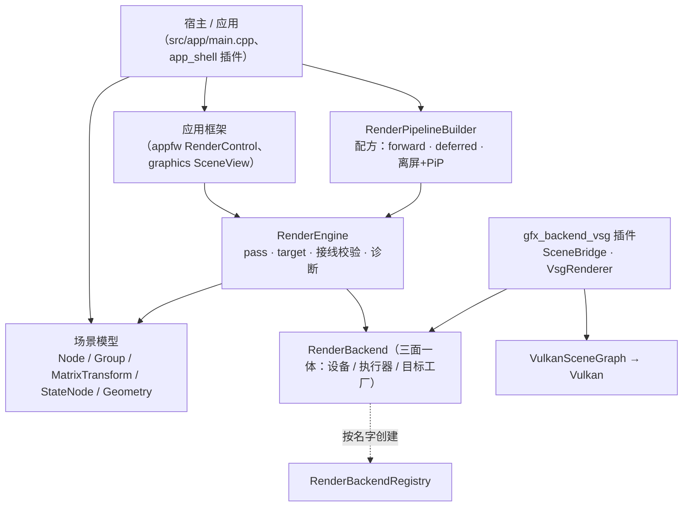

# Vine graphics 模块：架构与使用

graphics 模块是 Vine 的**场景图 + 渲染资源 + 渲染引擎**。它自己**不碰 GPU**：它驱动一个
`RenderBackend`，具体后端是插件（今天即 `src/plugins/gfx_backend_vsg`，后端名 `"vsg"`，经
VulkanSceneGraph 落到 Vulkan）。

- 公开头：`src/viz/graphics/sdk/vine/graphics/`（target `vn::Graphics`）
- 实现：`src/viz/graphics/src/`
- 后端插件与它自己的说明：`src/plugins/gfx_backend_vsg/`

本文写的是**今天的实际行为**；凡属占位（还没实现）的地方都已明确标注。

## 1. 分层



`RenderEngine` 从不直接调用 Vulkan：它把这一帧**编译成一个值**（每条 pass 的目标、状态、绘制与解析好的接线），
再把**整个值一次**交给后端（`RenderFrameExecutor::executeFrame`）。
后端**按名字**创建，因此宿主对后端及其第三方库没有编译期依赖：

```cpp
auto backend = vn::graphics::RenderBackendRegistry::instance().create(u8"vsg");  // 需插件已加载
engine.setDevice(backend);
```

## 2. 场景模型

### 2.1 节点

| 类 | 职责 | 要点 |
| --- | --- | --- |
| `Node` | 所有节点共有的身份：`name()`、`isVisible()`、`opacity()`、`parent()` | `boundingBox()`（世界空间）、`worldMatrix()`、`localTransformMatrix()`（非变换节点恒为单位阵） |
| `Group` | 聚合子节点 | `addChild()` / `removeChild()` 会维护 parent 链 |
| `MatrixTransform` | `Group` + **场景图里唯一持有变换的地方**（`matrix()` / `setMatrix()`） | 嵌套变换沿 root→leaf 相乘 |
| `StateNode` | 给子树施加渲染状态，并可覆盖 material / program | 越深的节点优先 |
| `Geometry` | 叶子：**借用**的属性缓冲 + 可选索引 | `setPositions/setNormals/setTexcoords2/setIndices`、`addBuffer` 加自定义通道、`setRevision()` |
| `Scene` | 根 + 灯光 + 每帧命令收集 | `setRoot()`、`addLight()`、`collectRenderCommands(camera)`（**拥有一份副本**）、`collectRenderCommandsShared(camera)`（**共享不可变表**，引擎自己的 pass 路径用；要改写就自己 fork） |

### 2.2 属性沿树折叠的规则

一次遍历（`Scene.cpp` 的 `collectNodeCommands`）把场景图压平成 `RenderCommand` 列表，各属性沿路径
折叠。规则**故意各不相同**：

| 属性 | 规则 |
| --- | --- |
| 变换 | **相乘**；折好的结果烘焙进 `RenderCommand::modelMatrix` |
| `opacity` | **相乘**：scene × 各层祖先 × 自身，在叶子处夹取到 `[0, 1]`。**它是引擎唯一的透明度通道**：内置前向着色的片元 alpha 就是它，不乘材质/纹理的 alpha（材质是共享的，乘进去会让所有用它的 drawable 一起半透明，而排序用的是这个值） |
| 渲染状态（blend / depth / cull / polygon / topology） | **最深者覆盖**（折叠进 `RenderCommand::authoredState`，**每项 optional**：没有 StateNode 说过某一项，那它在这里就是"没人说"，而不是"设成了默认值"） |
| material / program | 叶子自己的优先，否则取最近的祖先 `StateNode` |
| `isVisible` | **硬门**：不可见子树整棵不收集 |
| 层（`Node::setLayers`） | **最深者覆盖**：最近的声明赢，`clearLayers()` 回到继承；没声明过的节点在 `kDefaultLayer`（bit 0）。判定在**可绘制节点**上（容器是结构，不是内容），所以 `Group` 上的声明管的是它下面的内容 |
| 画序（`Node::setDrawOrder`） | **最深者覆盖**：最近的声明赢，`clearDrawOrder()` 回到继承，默认 0。**高 = 后画**（压在上面）；它是 pass 内那张列表的**外键** —— 同序之内仍是"不透明 前→后、透明 后→前"，所以它能越过透明批次、也能被同序的深度规则保护 |

`cmd.isTransparent` 由有效 opacity 推出，它决定这个 drawable 走管线的透明部分。
整个折叠是**一次自顶向下**的遍历（世界矩阵 / 透明度 / 状态 / material / program 一起往下传），
`StateNode.hpp` 的 `effectiveRenderState/effectiveMaterial/effectiveProgram`（从叶子往上走）是同一规则的
公开拼写，两者由测试钉住一致。

**折叠出来的只是"内容作者写的那份"**：一条命令画出来是什么状态，还要加上**画它的那条 pass** 说的
（depth 策略 + 光栅化覆盖）—— 两者由**一个函数**合并，`resolveRenderState(cmd.authoredState,
pass.stateOverrides())`（`StateNode.hpp`），它按项回答"最终值 + 这一项是谁给的"（`StateOrigin`）。
优先级一句话：**pass 的光栅化覆盖赢过内容，内容的 depth 赢过 pass 的 depth 策略**（pass 给的是"没写过
depth 的那些的默认"），其余没有别的层 —— 视图的模式在**建管线时**就已经变成 pass 级覆盖（那是配方的事）。

### 2.3 资源

- `Material` —— Phong 参数（`ambient/diffuse/specular/shininess`）+ 可选 `Texture`。颜色改动是
  **动态**的：后端逐帧就地刷新，所以改材质不需要任何重建。
- `ShaderProgram` —— 一个或多个 stage，带 `revision()`，所以"同一个对象、改了源码"能被发现。
- `Texture` —— 2D / Cube，按面填充（`setImage()` / `setFaceImage()` / `setSource()`）。每次填充都会
  `revision()++`，后端据此区分"同一张纹理、新像素"与"同一张纹理、同样像素"（只看指针做不到）。
- `Light` —— ambient / directional，带 `castShadow()` 与 `ShadowSettings{resolution, bias, filter}`
  （阴影渲染的现状见 §4.3）。
- `ImageRef` —— **一张图的身份**（某个 target 的某个附件，颜色或深度），pass 接线的对象形式，见 §3.7。

### 2.4 渲染对象

- `RenderEngine` —— 帧泵 + 账本：`initialize()`、`addPass(pass, content, order)`、`frame(dt)`、
  `resize(w, h)`、`publish/resolve`（命名输出）、`validateWiring()`（结构性校验，走诊断通道，
  **只在声明变化时跑**：`RenderPass::wiringRevision()` 或 `publish/unpublish` 推动，见证量 `wiringValidationCount()`）、
  `shutdown()`。
- `RenderPass` —— 相机 + 渲染目标 + 渲染状态 + 清屏/深度策略。**没有 renderTarget 的 pass 画进窗口**，
  order 决定先后。
  - **扩展点有两个，`execute()` 不是其中之一**：这一条 pass 要"发什么"写在 `describe(scene, out)`（引擎编译这一帧时
    调它一次，填 target / viewport / 清屏 / 状态 / 绘制调用）、要"先做什么"（写内容，比如 HUD 自更新）写在声明的
    `before_draw` 钩子里。**引擎不调 `execute()`** —— 它是"宿主自己驱动一条 pass"（或测试）时才用的拼写：内部就是
    "描述 → 把只含这一条 pass 的帧值交给后端"（`singlePassFrame`），与引擎整帧交出去的是**同一个形状**。覆写 `execute()` 想让引擎跑的
    pass 必须把活搬到上面两处，否则它会**静默不跑**。
- `ScreenPass` —— `RenderPass` 子类，全屏 / 画中画。**必须命名 program**（没有隐式着色，也没有
  隐式拷贝）：
  - 把源的**每一张**彩色附件按 binding 0..N-1 绑成采样纹理，用它画一个全屏三角形；想读哪张附件，
    就在 program 里写 `layout(binding = N)`（`screenCopyProgram(N)` 就是这个）；
  - **纯拷贝 = `BuiltinShaders::screenCopyProgram()`**（SDK 的命名程序，不是后端默认）；
  - **必须有相机**（否则什么都不画，引擎在接线期报一次）；**没有 program 也不画**（同样接线期报一次）。
- `Camera` —— 观看（eye / target / up）+ 投影**参数**（fov / near / far、类型、正交盒）**与画面的形状**：
  `setViewMatrixAsLookAt()`、`setProjectionMatrixAsPerspective(fov, near, far)`、`setProjectionMatrixAsOrtho(...)`、
  `setAspect(w / h)` / `aspectRatio()`、`projectionMatrix()`（**每次现算**）、`screenToWorldRay(pos)`。
  **一台相机 = 一张画面**（2026-10-11 定，见 §3.11）：形状是相机自己的状态，投影、剔除、拾取射线读的都是
  同这一个数，于是"矩形变了投影没跟上"这类错在结构上不存在。同一台相机放进**形状不同**的两块矩形不再被
  悄悄拉伸，而是被引擎在编译期**报出来**（`RenderEngine` 的 frame plan 诊断：pass 的矩形 vs 相机的画面形状）；
  想要同一机位两种形状，用两台相机（`SceneView` 按自己窗格的形状 push 给相机，HUD 子视口相机自己声明形状）。
- `RenderTarget` —— 若干彩色附件 + 可选深度：`attachColor(fmt)` / `attachDepth(fmt)` / `setSize(w,h)`，
  以及 `shareDepth(source)`（借用别人的深度）与 `setDepthPromotion(bool)`（深度是否变成可采样）。
- `RenderPipelineBuilder` —— 配方层：`build(const PipelineOptions&)`（结构选择只有一个：
  `ShadingPath::Forward | Deferred`，其余是效果与选项，见 `.ai/design/graphics-pipeline.md`）、
  `addOffscreenToScreen(...)`（离屏 + PiP），并暴露延迟所需的公有件（`defaultGbufferTarget()`、
  `defaultGbufferGeometryProgram()`、`defaultDeferredLightProgram()`）。它装配出来的就是**你手写也会写的
  那些对象**，返回值 `Pipeline` 句柄持有它们（`windowPass()`、`offscreenTarget()`、`resize(w,h)`），
  **并持有它们的注册**：丢掉句柄 = 那些 pass 从帧里撤下来（`RenderEngine::addPass` 自己另持引用，
  只持有引用会让被丢掉的 pass 继续每帧执行）。
- **顺序用阶段说**（`PipelineStage` + `pipelineStageOrder`）：阴影深度、几何、效果、着色、透明、
  呈现、HUD、预览各占一个档位，效果按"我在谁之前"进入，不去抢别人的魔数。
- `RenderBackend` —— **三面一体的聚合**（工厂返回、引擎收、测试双实现，2026-10-11 S10a 起）：整帧 `executeFrame()`
  在 `RenderFrameExecutor` 那面，**窗口是可选的另一半** → `RenderDevice::createSurfaceTarget(handle, why)` 交出一把
  `WindowPresentTarget`（`PresentTarget` + 窗口自己的两个问题：句柄重公告、读回句柄；尺寸跟随与 `present()` 在基类
  `PresentTarget` 上）。**帧只认基类** —— `executeFrame(frame, present_to)` 与 `RenderPass::execute(..., present_to)` 收
  `PresentTarget*`，所以"呈递端"不必是窗口（编码器 / 网络出口是另一个实现）；只画离屏的设备**继承默认答案**
  （`NoPresentation`，一个呈现端都不实现）；`RenderDevice` 还有能力（`capabilities()`，含 `presentation`）、资源公告与诊断。
  `RenderBackendRegistry` / `RenderBackendFactory` 让插件自注册、宿主按名字创建。

### 2.5 每帧数据流

1. 宿主调 `RenderEngine::frame(dt)`。
2. **先编译这一帧**（`compileFrame`）：按声明算出"谁先谁后、每条 pass 声明的输入解析到什么、这一组声明有什么问题"，
   并**顺手产出这一帧的值**（`FrameDescription`：每条启用的 pass 的身份 / order / 解析后的输入 + 它自己描述出来的
   绘制），`RenderEngine::frameDescription()` 可以读它。**帧跑的是这个值**，不是"逐条 pass 再问一遍"。
   编译期跑每条 pass 的 `before_draw` 钩子（HUD 自更新那类"先写内容"的活），再请它描述自己 ——
   于是**内容收集**发生在编译里，`Scene::collectRenderCommands(camera)` 对 **(scene, camera)** 每帧只走一次树，
   结果记忆到帧末（规则见 §2.2）。相机自带画面的形状（见 §2.1 的 `Camera` 段），剔除用的视锥与画面用的投影是从
   **同一个数**推出来的：改相机的形状就是改整个视图（memo 以 view-projection 为键，天然区分两种形状，
   不会拿一个形状的走树结果去回答另一个）。返回的是**视锥剔除后**的列表：
   `isVisible()` 是硬门，包围盒完全在视锥外（p-vertex 测试）的节点**整棵子树**被剪掉，被剔除的几何体
   根本不在列表里；后端的保留节点则从根上摘下但不销毁，回来时直接复用 —— 离开多久都不会被回收
   （只有宿主自己放手才算删除，细节见 `vsg-backend.md` §5.5）。
   > **一条 pass 每帧只被描述一次**，而且**引擎不会调它的 `execute()`**：想让引擎跑自己的活，就把"发什么"
   > 放进 `RenderPass::describe()`、把"先做什么"放进声明的 `before_draw` 钩子（见 §2.4 的 `RenderPass` 段）。
3. 然后把这个值**整帧交给后端**（`RenderFrameExecutor::executeFrame(frame, present_to)`，`present_to` = 本区那把目标）：后端拿到的就是全部 —— 每条 pass 的身份、
   order、解析好的输入，以及它发出的 target / viewport / 清屏 / 状态与每一条绘制调用。**没有 per-call 的平坦入口、
   也没有"没开 scope 时设置是惰性"这套顺序规则**：值的形状就是帧的形状，宣告不出岔子。
   后端把每个 `RenderCommand` 物化成后端对象。在 vsg 后端里就是每个 drawable 一条保留的
   `MatrixTransform` → `StateGroup` → bind/draw 命令链，只在其输入（`geometry->revision()`、
   material、texture、resolved state、program）变化时重建。
4. 顶点数据是**别名，不是拷贝**：真的 `vsg::vec3Array` 等直接读 geometry 自己的 buffer，于是模型与
   渲染侧每个通道只占一份分配（位置 / 法线 / UV / 作者颜色 / 自定义通道 / 索引都是）。完整来龙去脉
   （包括让这件事成立的 vsg 约束和踩过的坑）见
   [`docs/guides/vsg-data-flow.md`](vsg-data-flow.md)，
   后端的运行时总览（生命周期 / 调用次数 / 更新策略）见
   [`docs/guides/vsg-backend.md`](vsg-backend.md)。

### 2.6 生命周期与变更契约

- Vine 对象全部引用计数（`intrusive_ptr`）：节点由父节点持有，target 由渲染它的 pass 持有，buffer 由
  geometry 持有。
- `RenderCommand` 是**每帧的值**：它借用 geometry、material、program、camera。后端想留什么，就自己
  取一份引用（见 `RenderBackend.hpp` 的 "WHAT MAY BE RETAINED"）。
- geometry **借用**别人交给它的顶点字节（mesh 把自己的 buffer 交过来），所以：**先建模型、再接线**，
  之后每次改数据都要用 `Geometry::setRevision()` 公告。revision 是渲染侧唯一的重建闸门 ——
  **写 setter 不会推进它**，因为 geometry 分不出"还没读过的新字节"和"上次读过的旧字节"。

### 2.7 顶点数据：整块缓冲，或者缓冲里的一段（arena）

一个通道可以只读缓冲的**一段**（`AttributeChannel::offset` / `scalarCount`，都按**标量**计）——"一个大缓冲、
每个 geometry 一段"。顶点因此只存在一份，不重打包：

| 想要 | 写法 |
| --- | --- |
| 整块缓冲就是通道 | `setPositions / setNormals / setTexcoords2`（= `AttributeChannel::shared(values, components)`） |
| 缓冲里的一段 | `addBuffer(0, AttributeChannel::slice(arena, 3, first_vertex, vertex_count))`（自定义通道、法线、UV 同理） |
| 索引也是缓冲的一段 | `setIndices(index_arena, first_index, index_count)`（`index_count == 0` 表示"到缓冲末尾"） |

规则与后果：

- **单位**：`slice()` 用**顶点**说（`first_vertex` / `vertex_count`），`shared(...)` 用**标量**说
  （`offset` / `scalarCount`，`components` 就是步长）；`0` 长度表示"从起点到缓冲末尾"，所以没有固定长度的通道
  会**跟着缓冲增长**。
- **索引是段内相对的**：索引 0 指这一段自己的第一个顶点；越界检查按**这一段的顶点数**判 ——
  一段的索引读不到邻居的数据。
- **包围盒 / 拾取 / 视锥剔除只覆盖这一段**（它们都经 `AttributeChannel` 的访问器）。
- **一段就是一条流**：共享绑定缓存按 `缓冲地址 + Buffer::revision() + offset + 长度` 分辨，同缓冲的相邻两段
  绝不互借设备缓冲；索引侧相反 —— 索引绑定别名**整段缓冲**，切片写在 draw 命令里（`firstIndex` / `indexCount`），
  所以一个索引 arena 的所有 geometry 共享一次索引上传。
- **改这一段要公告**：`buffer->setRevision(buffer->revision() + 1)`（重新填了字节）+ `geometry->setRevision(...)`
  （渲染侧才知道要重建）。只挪 `offset`（同缓冲换一段）同样要公告。
- **边界**：`offset` 越过缓冲末尾、或段长超过剩余长度 ⇒ 访问器一律当**空**处理（不会读越界）。

## 3. 使用

### 3.1 最小可跑：一个三角形 + forward

```cpp
using namespace vn::graphics;

// ① 模型：一个三角形。packAttribute 把 Vec3f 打成 Buffer<float>，geometry 借它（不拷贝）。
vn::geometry::Vec3fArray positions = {
    vn::math::Vec3f(0.0f, 0.0f, 0.0f),
    vn::math::Vec3f(1.0f, 0.0f, 0.0f),
    vn::math::Vec3f(0.0f, 1.0f, 0.0f),
};
GeometryPtr geometry(new Geometry());
geometry->setPositions(packAttribute(positions));

MaterialPtr material(new Material());
material->setDiffuse(vn::Colorf(0.8f, 0.4f, 0.2f, 1.0f));

// ② 场景图：transform → state → geometry（三层是惯例：位置 / 状态 / 叶子）。
auto state = StateNodePtr(new StateNode());
state->setMaterial(material);
state->addChild(geometry);

auto transform = MatrixTransformPtr(new MatrixTransform());
transform->setMatrix(Mat4d());          // 默认构造 = 单位阵
transform->addChild(state);

auto scene(new Scene());
scene->setRoot(transform);
scene->addLight(Light::createAmbient());                   // 环境光
scene->addLight(Light::createDirectional({ 0.0, 0.0, -1.0 }));  // 一盏方向光

// ③ 相机。
CameraPtr camera(new Camera());
camera->setViewMatrixAsLookAt({ 0.0, 0.0, 3.0 }, { 0.0, 0.0, 0.0 }, { 0.0, 1.0, 0.0 });
camera->setProjectionMatrixAsPerspective(45.0, 0.1, 100.0);
camera->setAspect(16.0 / 9.0);                               // 投影的**形状**就在这里：它是相机自己的状态
                                                             // （一台相机 = 一张画面，see Camera）

// ④ 引擎 + 后端 + 预设管线。
// 引擎是**引用计数**对象，管线**强持**它（`Pipeline` 的构造参数就是 `intrusive_ptr<RenderEngine>`）：栈上的引擎会被
// "最后放手的那条管线"删掉 —— `delete` 的是别人的栈/成员内存，症状不在这一刻，而是**之后某次无关的 free 报堆损坏**。
// 所以它和别的 SDK 对象一样由 `intrusive_ptr` 持有（`test_vsg/SdkPixelFixture.hpp` 是同一个形态）。
auto engine = make_intrusive<RenderEngine>();
engine->setDevice(RenderBackendRegistry::instance().create(u8"vsg"));  // 需插件已加载

// 窗口与尺寸归**区**（一块表面的表）：窗口那一半由**设备**造（S10a），尺寸在这里报一次 —— 引擎不收裸句柄。
auto area = make_intrusive<RenderSurface>(engine.get());
vn::graphics::SurfaceTargetResult why = vn::graphics::SurfaceTargetResult::Ok;
vn::raw_ptr<vn::graphics::WindowPresentTarget> target = engine->device()->createSurfaceTarget(window_handle, &why);
if (target == nullptr) { return false; }  // 无呈现能力 / 服务不了这块 surface / 窗口已被占用（见 @p why）
area->bindTarget(target);                 // 区持有目标对象；平台重建窗口 = target->setWindowHandle(new)
area->resize(width, height, dpr);         // 帧上下文 + 目标（窗口那一半）+ 每个呈现的视图，一次说清
if (!engine->initialize()) { return false; }

RenderPipelineBuilder builder(engine.get());
builder.setContent(scene).setCamera(camera.get());
PipelineOptions options;                      // 默认 = forward 路径
auto pipeline = builder.build(options);      // 或 options.path = ShadingPath::Deferred
if (pipeline == nullptr) { return false; }

// ⑤ 帧循环。
pipeline->resize(width, height, dpr);   // 离屏/合成 target 按 device 像素，HUD 叠加按逻辑像素（ratio 一次说清）
engine->frame(dt);                  // 收集 → 录制 → 提交 → present

engine->shutdown();
```

### 3.2 改数据（唯一需要公告的地方）

```cpp
geometry->setPositions(packAttribute(new_positions));   // 换掉 geometry 读的那块 buffer
geometry->setRevision(geometry->revision() + 1);        // 公告：重建数据节点 + 重新上传
```

首次渲染不受影响（那是从零建）。材质颜色**不需要**公告（动态）；重新填过的 `Texture` 自己会通过
`Texture::revision()` 公告。

### 3.3 例：纯手动 2 pass —— 离屏渲染 + 全屏合成到窗口

不写任何 shader：`ScreenPass` 配 `BuiltinShaders::screenCopyProgram()` 就是"把一张彩色图拷到目标
子视口"——**要显式命名**它（没有隐式拷贝），并且这条 pass 需要有相机。

```cpp
// ① 离屏目标：一张 RGBA8 彩色 + D24 深度。
auto scene_rt = make_intrusive<RenderTarget>();
scene_rt->setName(u8"scene_rt");
scene_rt->attachColor(RenderTarget::ColorFormat::RGBA8);
scene_rt->attachDepth(RenderTarget::DepthFormat::D24);
scene_rt->setSize(surface_w, surface_h);

// ② 场景 pass：画进 scene_rt。order < 0 ⇒ 先于主 pass 执行。
auto scene_pass = make_intrusive<RenderPass>();
scene_pass->setName(u8"scene_into_rt");
scene_pass->setCamera(camera);
scene_pass->setRenderTarget(scene_rt);
scene_pass->setClearEnabled(true);                     // 自己是第一笔，清屏
scene_pass->setClearColor(vn::Color(26, 26, 31));    // vn::Color 是 0..255 的 uint8 构造
scene_pass->setShouldClearDepth(true);
scene_pass->setDepthMode(DepthMode::TestAndWrite);     // 不透明内容：测 + 写
scene_pass->setOutputName(u8"SceneColor");             // 命名输出（每帧进名字表）
scene_pass->setOutputTarget(scene_rt);                 // 对象级承诺：它是这张 target 的唯一写者
engine.addPass(scene_pass, scene, -1);                 // -1 < 0：排在主 pass 之前

// ③ 合成 pass：作为**窗口 pass**（没有 renderTarget ⇒ 画进窗口），order 0。
auto compose = make_intrusive<ScreenPass>();
compose->setName(u8"compose_to_window");
compose->setCamera(camera);                      // 窗口 pass 的相机决定窗口视角
compose->setProgram(screenCopyProgram());              // 画面是**命名**的：纯拷贝用 SDK 的这个程序
compose->addInputName(u8"SceneColor");                 // 名字形式
compose->addInputTarget(scene_rt);                     // 对象形式（两层在地址上汇合）
compose->setSourceAttachment(0);                       // 采第 0 张彩色图
engine.addPass(compose, scene, 0);
```

想把它变成**右下角画中画**（而不是全屏），给合成 pass 一个子视口即可：

```cpp
compose->setViewport(surface_w - 320 - 8, 8, 320, 180);
```

这条子视口只决定"画在哪"：画面的**形状**是相机自己的（一台相机 = 一张画面，见 `Camera`），所以给这条 pass
一个子视口时，也把它的相机设成那块矩形的形状（`compose_camera->setAspect(320.0 / 180.0)`）—— 否则引擎会在
编译期报"pass 的矩形与相机的画面形状不一致 = 画面被拉伸"。同一台相机要同时全屏呈现 + 画中画，就用两台相机
（各自一个形状），或者两条 pass 各画进与相机同形的一块矩形。

| pass | 相机 | renderTarget | order | 清屏 | 深度 | 输出/输入 |
| --- | --- | --- | --- | --- | --- | --- |
| `scene_into_rt` | `camera` | `scene_rt` | -1 | 是（清色+深） | `TestAndWrite` | 输出 `SceneColor` + 承诺 `scene_rt` |
| `compose_to_window` | `camera` | 无（= 窗口） | 0 | 否（默认） | 默认（只清/画覆盖层） | 输入 `SceneColor` / `scene_rt` |

### 3.4 例：纯手动 4 pass —— 手搭一条延迟管线

这条管线用的三件"公有件"正是 `RenderPipelineBuilder::build(Deferred)` 内部用的东西，所以手搭出来
与预设**完全等价**：它演示了手写延迟管线的三个要点 —— **MRT target**、**带 program 的 ScreenPass**、
以及**借用深度**。

```cpp
// ① 规范 G-buffer：告警里说的 4 张彩色附件（albedo / view normal+shininess / specular / view position）
//    + D24 深度。几何 program 必须写这 4 个输出。
//    specular 附件装的是**颜色 × 强度**（`Material::specular()` 的 alpha）：光照侧直接乘它，
//    所以前向与延迟两条路的高光强度一致（2026-09-25 接线）。
//    位置的 w 是**契约的一半**：写过的像素写 1（清除留下的透明黑是 0），光照 program 用它区分
//    "背景" 与 "几何"；距离判据做不到——相机贴住的像素视图位置就是 ~0（2026-09-25 修）。
auto gbuffer = RenderPipelineBuilder::defaultGbufferTarget(width, height);

// ② G-buffer pass（order < 0）：一个场景遍历写 MRT。
auto gbuffer_program = RenderPipelineBuilder::defaultGbufferGeometryProgram();
auto gbuf_pass = make_intrusive<RenderPass>();
gbuf_pass->setName(u8"gbuffer");
gbuf_pass->setCamera(camera);
gbuf_pass->setRenderTarget(gbuffer);
gbuf_pass->setProgramOverride(gbuffer_program);   // 场景 pass 也可以带自己的 program
gbuf_pass->setOutputName(u8"GBuffer");
gbuf_pass->setOutputTarget(gbuffer);              // 唯一写者 ⇒ 承诺整张 target
engine.addPass(gbuf_pass, scene, -3);

// ③ 延迟光照 + 前向透明的共同落点：一张离屏 composite，它**借** G-buffer 的深度，
//    于是不透明场景只光栅化一次，前向内容能正确地被不透明物体遮挡。
gbuffer->setDepthPromotion(false);               // 不把深度提升为可采样（省一次布局往返）
auto composite = make_intrusive<RenderTarget>();
composite->setName(u8"composite");
composite->setSize(width, height);
composite->attachColor(RenderTarget::ColorFormat::RGBA8);
composite->shareDepth(gbuffer);                  // 借深度

// ④ 全屏延迟光照（带 program）：读 G-buffer 的全部彩色附件，写进 composite。
auto light_program = RenderPipelineBuilder::defaultDeferredLightProgram();
auto light = make_intrusive<ScreenPass>();
light->setName(u8"deferred_lighting");
light->setCamera(camera);                  // program 路径**必须**有相机
light->setRenderTarget(composite);
light->addInputName(u8"GBuffer");
light->addInputTarget(gbuffer);                  // 读整捆：program 按 binding 自己挑
light->setProgram(light_program);
engine.addPass(light, scene, 0);

// ⑤ 前向透明：不清屏（压在光照结果上），只测深度不写。
auto forward = make_intrusive<RenderPass>();
forward->setName(u8"forward_transparent");
forward->setCamera(camera);
forward->setRenderTarget(composite);
forward->setClearEnabled(false);
forward->setDepthMode(DepthMode::TestOnly);
forward->setOutputName(u8"Composite");
forward->setOutputTarget(composite);
engine.addPass(forward, transparent_scene, 1);

// ⑥ 呈现：把烘好的 composite 拷到窗口（窗口 pass，无 renderTarget）。
auto present = make_intrusive<ScreenPass>();
present->setName(u8"present");
present->setCamera(camera);
present->addInputName(u8"Composite");
present->addInputTarget(composite);
engine.addPass(present, 2);
```

| # | pass | renderTarget | order | 清屏 | 深度 | 输出 → 输入 |
| --- | --- | --- | --- | --- | --- | --- |
| ① | `gbuffer`（场景，program override） | `gbuffer`（MRT 4 色 + D24） | -3 | 是 | `TestAndWrite` | `GBuffer` |
| ② | `deferred_lighting`（ScreenPass + program） | `composite` | 0 | 是 | 默认 | 读 `GBuffer`（整捆） |
| ③ | `forward_transparent`（场景） | `composite`（借 gbuffer 深度） | 1 | **否** | `TestOnly` | `Composite` |
| ④ | `present`（ScreenPass + `screenCopyProgram()`） | 无（窗口） | 2 | 否 | 默认 | 读 `Composite`（整捆） |

要点：

- **顺序**：负数在窗口 pass 之前。G-buffer 必须在光照之前 ⇒ `-3`。
- **谁清屏**：每个 target 的**第一笔**清屏（`gbuffer` 清自己、`composite` 由①的 light 清），后面压上去的
  必须 `setClearEnabled(false)`。
- **深度**：不透明 `TestAndWrite`；压在不透明结果上的半透明 `TestOnly`；HUD/覆盖层 `Disabled`。这是 pass 的
  **策略**：内容自己用 `StateNode::setDepth` 写过 depth 的命令不吃它（见 §2.2 的合并规则与
  `resolveRenderState`）。
- **MRT**：目标侧 `attachColor()` 调四次；程序侧输出按附件序号写；`ScreenPass` 的 program 会把源的每张
  彩色附件绑成纹理 0..N-1。
- **借深度**：`shareDepth()` 之后**只有当两边尺寸一致**才是同一张图；源 target 重建（换尺寸）会让借用方
  继续测旧深度 —— 引擎会检测并重建（见 §3.7）。

### 3.5 例：同样的东西用 builder 写

builder 只是把 §3.3 / §3.4 的装配收起来，配上默认 program；它不会替你省掉"相机、内容、尺寸"这三个前提。

```cpp
RenderPipelineBuilder builder(&engine);
builder.setContent(scene).setCamera(camera.get());

// 结构只有两选：forward / deferred。阴影不是预设——它由"投影的那盏灯"提出请求
// （Light::castShadow），当前还没有阴影 pass，所以 builder 会报一条"画面无影"。
PipelineOptions options;
options.path = ShadingPath::Deferred;
options.offscreen_width  = 0;          // 0 = 用当前 surface 尺寸，未知时回退 640x360
options.offscreen_height = 0;
options.gbuffer_program  = nullptr;    // 空 = 用内置的临时 G-buffer 几何 program
options.lighting_program = nullptr;    // 空 = 用内置的临时延迟光照 program
auto pipeline = builder.build(options);
pipeline->resize(surface_w, surface_h, device_pixel_ratio);  // 同时管离屏 / 合成 target（device 像素）与 HUD 叠加（逻辑像素）

// 内容着色：必须**显式指定**程序。没有 shader preset 枚举，也没有兜底——
// 引擎默认用的是命名的 forward 程序（flat 是它的同一对 stage + `#define VINE_FLAT 1`）：
engine.setDefaultContentProgram(flatForwardProgram());   // 会话默认：没写 program 的 drawable 用它
engine.setDefaultContentProgram(forwardProgram());       // 回到默认前向着色

// 离屏 + 画中画（内部就是 §3.3 的两个 pass）。注意最后那个矩形是 VIEWPORT ⇒ **device 像素**
// （surface_w 是逻辑像素，所以高 DPI 下要各自乘 dpr；见 RenderPass::setViewport）：
builder.addOffscreenToScreen(u8"preview", 512, 288,
                             RenderTarget::ColorFormat::RGBA8,
                             RenderTarget::DepthFormat::D24,
                             viewport_x, viewport_y, 320, 180);

// 也可以自己加 HUD：叠层是**内容对象**（自己带 scene + 取景相机 + 盒子），画的是一条普通 pass 声明。
auto gizmo = make_intrusive<AxisGizmo>();
gizmo->setSourceCamera(camera.get());
gizmo->onSurfaceResized(surface_w, surface_h);
PassDesc hud;
hud.name = u8"axis_gizmo"; hud.tag = u8"Hud"; hud.stage = PipelineStage::Overlay; hud.order = 10;
hud.camera = intrusive_ptr<Camera>(gizmo->camera());
hud.content = intrusive_ptr<Scene>(gizmo->content());
hud.viewport = gizmo->boxViewport(); hud.clear_enabled = false; hud.depth_mode = DepthMode::Disabled;
hud.before_draw = [gizmo] { gizmo->update(); };   // 每帧镜像源相机朝向
engine.addPass(hud);
```

**手动 vs builder 对照**

| 你要做的事 | 手写 | builder |
| --- | --- | --- |
| 主窗口 forward | 一个无 target、order 0 的 `RenderPass` + 相机 + 内容 | `build(Forward)` |
| 延迟管线 | §3.4 的 6 步（target / 4 个 pass / program / 借深度） | `build(Deferred)` |
| G-buffer 布局与 program | 自己 `attachColor` × 4 + 写 MRT program | `defaultGbufferTarget()` / `defaultGbufferGeometryProgram()` |
| 离屏 + PiP | §3.3 + `setViewport()` | `addOffscreenToScreen(...)` |
| 尺寸跟随窗口 | 逐个 `setSize()` | `Pipeline::resize(w, h)` |
| 任意自定义 pass | `engine.addPass(pass, order)` | `builder.addPass(pass, order)` |

### 3.6 例：HUD 叠加与"叠加场景"

- **HUD**：`AxisGizmo` / `FpsOverlay` 是**内容对象**（自带 scene、取景相机与盒子），画它们的是一条 HUD 档的
  pass 声明（`tag = "Hud"`、`stage = Overlay`、不洗屏、`depth_mode = Disabled`、`before_draw` 调对象的
  `update()`）—— 配方自己就这么声明（`PipelineOptions::gizmo` / `fps`）。句柄分两个：`Pipeline::gizmo()` /
  `fpsOverlay()` 拿对象（摆位、尺寸、内容），`Pipeline::gizmoPass()` / `fpsOverlayPass()` 拿 pass（可见性开关
  读的就是它的 `enabled`）；`resize()` 会顺带通知它们窗口尺寸并重述盒子。
- **半透明叠加场景**：`builder.setTransparentContent(overlay_scene)`。forward 下它是在主 pass 之后、
  同一窗口 pass 里**带深度**的一笔；deferred 下它先与不透明结果在离屏 composite 里合成再呈现 ——
  于是"半透明物体被不透明物体挡住"是正确的，而不是无深度地画在最上面。

### 3.7 pass 接线：名字与对象

pass 之间传图有两种写法，**可以并用**（两层在地址上汇合）：

- **名字**：生产者 `setOutputName("X")`，消费者 `addInputName("X")`。每帧把 `X → 该 pass 的
  renderTarget()` 注册进名字表。
- **对象**（`ImageRef`）：生产者 `setOutput(image)` / `setOutputTarget(target)`，消费者
  `addInput(image)` / `addInputTarget(target)`。粒度可到**某一张附件**（`ImageRef` 带颜色/深度与附件号），
  也可粗到**整捆**（整张 target）—— 带 program 的 `ScreenPass` 读的是整捆。

`RenderEngine::validateWiring()` 每帧校验结构，并把每个问题**只报一次**（消失后重新武装）：

| 检查 | 什么时候报 |
| --- | --- |
| 同一张图被两个 pass 声明为输出 | 两个不同 pass 声明同一 (target, 附件)；同名不同 target 走名字侧 |
| 消费者声明了输入，但本帧没人产出 | 该图没有生产者/生产者排在其后/生产者禁用 |
| `ScreenPass` 完全没有可用输入 | 没声明任何输入（图像 / target / 名字都没有，它没有东西可采样） |
| `ScreenPass` 没有 program | 它的画面是**命名**的（没有隐式拷贝），所以没有 program 就永远不画 ⇒ 报一次 |
| `ScreenPass` 有 program 但没有相机 | 全屏路径必须先建 view（光源也按这个 view 空间推），否则一个像素都不画 |
| 承诺的是"这个 pass 并不画进去的 target" | 声明与 `renderTarget()` 对不上（报在真实的那条线上） |

### 3.8 自己写 shader：location 契约与绑定顺序

**单 pass 还是多 pass 与这件事无关**：只看这个 pass 有没有 program —— 场景 pass 用
`RenderPass::setProgramOverride()`，全屏 / 后处理用 `ScreenPass::setProgram()`。

**先分清三个数字**（后文只用这三个词）：

| 词 | 是什么 | 谁决定 |
| --- | --- | --- |
| **通道 location** | 你在 Geometry 里填的编号，也就是 `Geometry::attributes_` 的键 | **你**：`setPositions` 0、`setNormals` 1、`setTexcoords2`/`setTexcoords3` 8（**同一个槽的两种宽度**）；自定义通道 `addBuffer(L, …)`，L ≥ 3 且 ≠ 8 |
| **shader location** | shader 里的 `layout(location = N)` —— 下表比的就是它 | **写 shader 的人**：内建路径用 vsg 的编号，自定义 program 用模块契约 |
| **数组下标 = Vulkan binding** | 喂入列表里的位置（`VkVertexInputBindingDescription.binding`） | **后端**；你既不写、也看不到，GLSL 里没有这个概念 |

**走哪条路径由 pass 决定，不由 geometry 决定** —— 同一个 geometry 可以在 A pass 走内建、在 B pass 走自定义：

| | 内建路径 | 自定义 program 路径 |
| --- | --- | --- |
| 触发条件 | 该 draw 的 program 为空 | `RenderPass::setProgramOverride()` / `ScreenPass::setProgram()` 给了 program |
| ShaderSet 谁提供 | 内容的**默认 program**（`RenderEngine::setDefaultContentProgram`，默认 `forwardProgram()`；后端把它编译成 set） | 后端按**这个 geometry 的通道布局**现建（`assembleProgramShaderSet`） |
| shader location 从哪来 | **vsg 自己的编号** | **通道 location 一一对应**（canonical 的 0/1/2/8 也是常量） |
| 顶点数据从哪取 | 固定 `buffer(0)` / `buffer(1)` / `buffer(2)` / `buffer(8)` + 自定义通道 | **完全相同**（两条路径取的是同一批数据） |
| 换路径时重建 | 只重建 state wrapper，数据节点复用 | 同左（唯一例外见下面的边角表） |
| 同一份 program、布局不同 | —— | **两个不同的 ShaderSet**（cache key = program + layout hash） |

两条路径的 **shader location 是两套编号**，这是最容易踩的地方（逐通道对照；binding 那列是后端排的）：

| 通道 | 通道 location（你在 Geometry 填的） | 内建路径 `layout(location=…)` | 自定义 program `layout(location=…)` | 数组下标/binding |
| --- | --- | --- | --- | --- |
| 位置 | 0 | **0** | **0** | 0 |
| 法线 | 1 | **1** | **1** | 1 |
| 颜色 | 2 | **6** | **2** | 3 |
| texcoord | **8** | **2** | **8** | 2 |
| 自定义 | L ≥ 3 且 ≠ 8 | ——（内建 set 不声明它，喂了也不被读） | **L** | 4+i |

> texcoord 槽在 SDK 侧只陈述**宽度**，**用途属于采样器**（`Geometry` 从不下结论）：`setTexcoords2`（2 分量）、`setTexcoords3`（3 分量）、`texcoordComponents()` 查宽度。唯一的解释者是**引擎自己的 forward 程序**（`forwardProgram()`）：
>
> | 槽宽度 | 内建 forward 程序的读法 | 采样器 |
> | --- | --- | --- |
> | 2 | UV 对 | `sampler2D`（材质纹理必须是 2D；否则**报一次** + 绑白色 2D） |
> | 3 | cube **方向** | `samplerCube`（材质纹理必须是 cube；否则**报一次** + 绑白色 cube） |
>
> 所以"同一个 3 分量通道"配自定义 program 完全可以读成体积坐标（`sampler3D`）——引擎不拦；将来真加 volume，内建 forward 程序要改成**按纹理种类**选变体（宽度名照样成立）。

> **一套编号（2026-09-13 起）**：引擎自己的 location 就是唯一的 location 契约（0 位置 / 1 法线 / 2 颜色 / 8 texcoord）。
> 以前内建路径用的是 vsg 内建 set 的密集编号（texcoord 在 2、颜色在 **6**），所以按 vsg 习惯写的 shader 在自定义
> program 路径上会**静默读错**——那条路已经删掉了：现在没有任何一条路径按 vsg 的编号绑定。

自定义通道**沿用自己的源 location**（转发范围 `L ≥ 3 且 L ≠ 8`）—— 当初避开 vsg 那套 0..11 密集编号就是为了
不撞号；即使现在只剩一套编号，这个保留规则也不变（`L == 8` 的通道不转发）。

> 另一个常见误记：`enableArray("vine_TexCoord0", …, 8)` 里的 **8 是数组下标（喂入顺序里的位置，= Vulkan binding）**，不是 `layout(location=)`。vsg 自己的这两套编号就是分开的。

**四个 canonical location 为什么是 0 / 1 / 2 / 8**：自定义路径下“通道 location = shader location”，而自定义通道的转发范围是
`L ≥ 3 且 L ≠ 8` —— 所以 canonical 只有 `0/1/2` 三个位置能用，texcoord 必须去 `≥ 3` 区里占一个**保留号**：

| 位置 | 给谁 | 为什么是这个号 |
| --- | --- | --- |
| 0 / 1 | 位置、法线 | 与 vsg 一致 ⇒ 只读位置/法线的 shader 两条路径通用 |
| 2 | 颜色 | `< 3` 的最后一个空位（vsg 内建 set 里颜色在 **6**，2..6 被它自己的 `vsg_TexCoord0..3`(2..5) 与 `vsg_Color`(6) 占满；我们的 set 用 `vine_Color`(2) / `vine_TexCoord0`(8)，见 §3.8 的表） |
| 8 | texcoord | `≥ 3` 里由模块**显式保留**：通道 location == 8 的通道**不转发**，用户占不掉它（`Geometry::kTexCoordLocation`） |
| 3..7、9.. | 自定义通道 | 全留给你（vsg 的 8 是 `vsg_Rotation`；两套 set 永不同时存在，撞号无害） |

**怎么写**（Geometry 侧只选 location，其余全自动）：

```cpp
// 自定义通道：L >= 3 且 != 8，分量数决定数组类型/格式（1→float 2→vec2 3→vec3 4→vec4）
geometry->addBuffer(5u, AttributeChannel::packed(tangent_scalars, 3u));
geometry->addBuffer(9u, AttributeChannel::packed(tint_scalars,    4u));
```

```glsl
layout(location = 0) in vec3 inPosition;   // 位置（固定）
layout(location = 1) in vec3 inNormal;     // 法线（固定；缺失时由位置推导）
layout(location = 2) in vec4 inColor;      // 颜色（固定）
layout(location = 8) in vec2 inUV;         // texcoords（固定；模块保留的 location）
layout(location = 5) in vec3 inTangent;    // 自定义：就是 Geometry 的 loc 5
layout(location = 9) in vec4 inTint;       // 自定义：就是 Geometry 的 loc 9

layout(set = 0, binding = 0) uniform PhongMaterial { /* 与内建路径同一个材质值 */ };
layout(set = 0, binding = 1) uniform sampler2D diffuseMap;
layout(push_constant) uniform PC { /* 顶点阶段 128 字节 */ };
```

**四件要自己对齐的事**（多数错了是静默的）：

| 事项 | 规则 | 错了会怎样 |
| --- | --- | --- |
| location 覆盖 | shader 只能声明 geometry 真有数据的 location | 声明了没有的 ⇒ 不喂数据：Vulkan 合法、读到未定义值、**无任何诊断** |
| 分量数 | geometry 的 3 分量 ↔ shader 的 `vec3` | 两边都能接受，只在绘制时表现为“属性读错/缺失” |
| 反方向 | 数组喂了、但管线不声明那个名字 | 报一条 `ContentSkipped` 的 Warning（`vertex binding '%s' (array %zu, %s) was not matched by the pipeline…`） |
| 绑定顺序 | **不用管、也改不了**：后端按**几何自己的通道顺序**（location 升序）排 binding；你能控的只有 location | 机制与理由见后端文档（`vsg-data-flow.md` §6） |

**边角**：

**后端侧的事**（绑定下标怎么算、变体与缓存怎么组织、切路径要不要重建、编译失败怎么答）不在这里重复——
唯一权威是后端文档：

> [`.ai/design/vsg-reimplementation.md`](../../.ai/design/vsg-reimplementation.md) §5.4（ABI 与坑）、
> [`vsg-data-flow.md`](vsg-data-flow.md) §6（名字即绑定）、
> [`vsg-backend.md`](vsg-backend.md) §2（服务与拒绝）。

**内建 program 的 GLSL 从哪来**（自己写 shader 时想对照/改写它们）：

| 内容 | 位置 |
| --- | --- |
| 内建前向着色（引擎默认内容程序，`forwardProgram()`；同一段文本 + 一个 `#define` 出 `flatForwardProgram()` / `unlitForwardProgram()` / `normalsForwardProgram()` 三种查看模式，见 `vn::graphics::ShadingMode`，线框 = 无光照 + `RenderPass::setPolygonModeOverride(Line)`） | `src/viz/graphics/shaders/builtin_forward.*` |
| 延迟管线的 G-buffer 几何 / 全屏光照 | `src/viz/graphics/shaders/builtin_gbuffer.*` / `builtin_deferred_lighting.frag` |
| 天空盒（`skyboxProgram()`，无光照 cube map 方向采样） | `src/viz/graphics/shaders/builtin_skybox.*` |
| 全屏三角形顶点段 / 纯拷贝（`fullscreenVertexProgram()` / `screenCopyProgram()`） | `src/viz/graphics/shaders/builtin_fullscreen.vert` / `builtin_screen_copy.frag` |

**命名规则**：`builtin_<角色>.<阶段>`，例如 `builtin_deferred_lighting.frag`。`builtin_` 前缀是"这段文本归引擎"
（宿主自己的 shader 永远不会出现在这个目录里），角色是**渲染器**的词（`forward` / `gbuffer` / `deferred_lighting` /
`skybox` / `screen_copy` / `fullscreen`，也是别的引擎里同一个位置会有的词），阶段就是后缀 —— 角色里不重复阶段或
目标（`gbuffer` 已经说了它写 G-buffer，不必再写 `_geometry`），也不带产品名或 C++ 的词（`vine_` / `vsg_` /
`std_forward` 都试过并改掉了：后者读起来是 `std::forward`）。生成常量按同一条规则推导
（`builtin_forward.vert` → `kBuiltinForwardVert`），**内建 program 也叫这个名字**（`builtin_forward`，同一份文件
出多个 program 时加后缀：`builtin_forward_flat`、`builtin_forward_unlit`、`builtin_forward_normals`、
`builtin_deferred_lighting_shadowed`），所以一条报出 program
名的 diagnostic 直接告诉你去读哪个文件。默认管线的 pass 用**角色词**（`gbuffer` / `deferred_lighting`，见
`RenderPipelineBuilder`）而不带前缀：一个 pass 画的是**宿主给它的** program，管它叫"内建"是错的。

**所有 GLSL 都归 SDK**：后端**没有**自己的 shader 目录（曾经有，2026-09-13 收回来了），它只决定怎么编译和绑。
| 文件怎么进二进制、怎么加一个、有哪些门禁 | [`.ai/design/vsg-custom-shader.md`](../../.ai/design/vsg-custom-shader.md) §10 |

> 这些 shader 是**真文件**（不是 C++ 字符串）：改了 `.glsl` 直接重编，`bash scripts/vine_shader_check.sh`
> 会先把每个 shader（含各 define 变体）过一遍 glslangValidator，再核对嵌入副本与文件是否逐字节一致。

### 3.9 颜色空间：内部一律线性，编码只发生在两头

引擎**整条管线都在线性光里**：`vn::core::Colorf` 的通道是线性值，材质、灯光和 shader 里每一次乘加都发生在
线性值上，G-buffer 与离屏 target 存的也是线性值（`RGBA16F`/`RGBA32F`，或者 `*_UNORM` 的 8 位）。
**没有任何一个内建 program 自己套 gamma**（`builtin_*` 里没有"输出前 pow(1/2.2)"这种代码）——
编码和解码只发生在管线的**两头**，而且两头都在硬件里：

| 编码发生在哪 | 谁做 | 宿主怎么参与 |
| --- | --- | --- |
| 纹理读入（sRGB → 线性） | 采样器（硬件） | 把颜色贴图的 `vn::imaging::PixelFormat` 声明成 `*Srgb` 拼写 |
| 窗口写出（线性 → sRGB） | 输出的 surface 格式（硬件） | 不用做事：窗口 target 的格式由后端按 surface 的实际格式决定（本机是 `B8G8R8A8_SRGB`） |
| 离屏 target | ——（不编码） | `RenderTarget::ColorFormat` 取线性拼写：`RGBA8` 在后端投影成 `R8G8B8A8_UNORM`；浮点格式没有 sRGB 拼写 |

于是宿主只有一个问题要回答：**这条路里的字节是"颜色"还是"数据"**。

* 是颜色（albedo、emissive、天空盒、环境贴图 —— PNG/JPG 的字节本来就是 sRGB 编码的）⇒ 声明成 `*Srgb`。
* 是数据（法线、粗糙度、金属度、遮罩 —— 它们不是"给人看的亮度"，不能被解码）⇒ 声明成 `*Unorm`。

说错的两个方向都是**静默**的，症状都是"整体差一个 gamma"：

| 说错的方向 | 症状 | 为什么 |
| --- | --- | --- |
| sRGB 颜色图声明成 `*Unorm` | 画面**偏亮、发灰** | 编码过的字节被当成线性值（线性 0.2 ≈ 编码 0.48） |
| 线性数据图声明成 `*Srgb` | 画面**偏暗** | 采样器把数据当颜色解码了一遍 |

**这个声明不是注释，是真起作用的**：后端把 `Rgba8Srgb` 映射成 `VK_FORMAT_R8G8B8A8_SRGB` 上传
（`vkFormatFor` 在 `tests/test_vsg/SceneRulesTest.cpp` 里有 pin），采样器因此会解码。引擎**没有**运行时兜底 ——
它看不到文件名，只能看你给的格式。

| 契约 | 写在哪 |
| --- | --- |
| 浮点颜色是线性值 | `vn::core::Colorf` 的类注释 |
| 颜色图 `*Srgb`、数据图 `*Unorm` | `vn::imaging::PixelFormat` 的文件注释 |
| target 格式是"投影"，离屏取线性拼写 | `vn::graphics::RenderTarget::ColorFormat` 的枚举注释 |
| 内建 program 不自己套 gamma | `vn::graphics::forwardProgram` 等工厂所在的 `sdk/vine/graphics/BuiltinShaders.hpp` 文件注释 |

仓库里**第一个按契约改过来的读者是 demo 自己**：`test_data/images` 的六张 JPG 天空面是颜色图，声明从
`Rgba8Unorm` 改成 `Rgba8Srgb` 后天空回到正确亮度（视口带 mean 122.7 → 80.8，门禁判据一行未动）——
读数与变异证明见 [`.ai/design/vsg-reimplementation.md`](../../.ai/design/vsg-reimplementation.md) §11.16cp。

### 3.10 省事的视图：`Pipeline` 是配方，视图只采纳（appfw 的 `ViewerOptions` 是宿主那一层）

上面几节都是"自己搭管线"。**图形层把"配方"收进 `Pipeline`**：一条链就是它的选项建出来的（`PipelineOptions`），
宿主**建**它、**采纳**它（`SceneView::setPipeline`），视图从此画的就是它 —— 视图自己不记配方，也没有"默认管线"
这回事（不采纳就不画）。

> **名字的坑**：这个 `Pipeline` **不是**图形 API 的 pipeline state（Vulkan 的 `VkPipeline`，通常叫 PSO）——它是**一条
> pass 链条的编译产物**（帧图编译的结果：谁画、按什么顺序、读谁写谁），一个视图/一块区一份。后端那种"管线状态"在本仓另
> 有一套：`core::VariantPool` 按 `core::PipelineKey`（程序与其 revision、拓扑、采样颜色/深度数…，键里还带
> `ProgramVariant` 着色器变体）缓存 `VkPipeline`。两个名字像，层次完全不同。

> 这一层往上的一整套（`Viewer` 管什么、一个视图的 surface 是谁、多窗口怎么办、基数关系）见
> [`render-views.md`](render-views.md) —— 那份是**模块说明**（架构图 / 类关系图 / 简单 demo），本文是逐个入口的参考。

```cpp
// 这个视图怎么画：选项 → 建 → 采纳（结构变了才有第二次建链）
vn::graphics::PipelineOptions options;
options.path = vn::graphics::ShadingPath::Forward;               // 或 Deferred
options.mode = vn::graphics::ShadingMode::Lit;                   // 见下："档"是选项也是运行期开关
options.gizmo.source_camera = view->camera();                    // 有源相机 = 有这个档
options.fps.enabled = true;                                      // 帧率读数档
vn::graphics::RenderPipelineBuilder builder(engine);
builder.setCamera(view->camera());
builder.setContent(view->scene());
view->setPipeline(builder.build(options));

// 运行期：都是**那条链**上的开关/覆盖，零重建、零重新注册
vn::graphics::Pipeline* pipeline = view->pipeline();
pipeline->setStatsVisible(false);        // pass->setEnabled(false) —— 没有这一档时如实拒绝 + 报一次
pipeline->setGizmoVisible(true);
pipeline->setShadingMode(vn::graphics::ShadingMode::Wireframe);  // 见下

// 几何（改它**不重建**）：视图的画面就是它呈现的那块区 —— 尺寸归区（`RenderSurface::resize` 一次扇出），
// 相机宽高比与管线尺寸都从它推；**不设** pass 的设备像素视口 ⇒ 全幅（要多幅画面自己给 pass 设子视口）
view->onSurfaceResized(w, h, dpr);        // 只喂**表面**尺寸 + 比例；"这一块"是视图自己算的
                                          // （视图挂在表面上时这句转发给 RenderSurface::resize，见 §3.11）
```

- **建链的选项 vs 链上的开关**：`PipelineOptions` 回答"这条链**有没有**这个档、走哪条链"（变更 = 一次建链），
  `setStatsVisible()` / `setShadingMode()` 回答"现在画成什么样"（永不重建）。**"有没有"与"看不看得见"是两件事**：
  一条链没有读数档时 `setStatsVisible(true)` 返回 false 并报出来（静默的开关最坏）。
- **档（`ShadingMode`）是 pass 属性，不是重建**：`Lit` 用内容自己的 program，`Flat/Unlit/Normals` 是同一段
  fragment 文本的另一个 `#define`（`setProgramOverride`），`Wireframe` 再加
  `RenderPass::setPolygonModeOverride(PolygonMode::Line)`。**档作用在几何阶段**：延迟的请求配非 Lit 档时，
  `RenderPipelineBuilder::effectivePath()` 把链建成**前向**（选项字段不动，`Pipeline::shadingPath()` 记的是**实际建成**的那条），
  于是四档在两条请求上都能画出来；同一条链上换档零重建，而"延迟请求 + 非 Lit 档"期间选回 `Lit` 是一次建链
  （回到延迟链 —— 这就是那句 `effectivePath()` 公开成静态的用途）。
- **重建之后谁把运行期选择搬过去**：重建的那一方（appfw 的 `Viewer`：读活着的链、在新链上重新落一遍 ——
  `isGizmoVisible()` / `isStatsVisible()`；档由请求记着）。链自己只知道选项说了什么。
- **灯是场景的，不是面的**：`scene->addLighting(vn::graphics::LightRig::studio())`（零灯只有后端
  `ambient=0.15` 的常量填充 ⇒ 一片平色，看起来像"没装灯"）。
- **谁呈现这块表面是声明的**（`RenderSurface`，见 §3.11）：表只**解析**声明（视图的声明 → 它采纳的那条链的窗口
  pass），它不建任何东西。宿主自建主 pass 时声明自己那条，视图那条就一句都不建（**不采纳就没有默认链**：
  "没有任何声明就建默认链"这条兜底归 appfw 的 `Viewer::takeArea()`）。
- **宿主那一层（appfw）**：`RenderControl::viewer()`（`vn::appfw::gui::Viewer`）管**这块区画成什么样** ——
  一条请求（`vn::appfw::gui::ViewerOptions`：链 / 档 / 两个档在不在 / 离屏尺寸）+ 建链时补上的上下文字段
  （gizmo 的源相机 = 视图的相机、两个 HUD 的像素比 = 区比例）；`setViewerOptions(options)` = 建链 + 采纳 +
  在区上声明（**一块区只画一幅画**：第二条呈现会被拒并报一次），`setShadingMode(mode)` 先试链上的开关、
  链表达不了才带档重建，`release(view)` 把视图还给宿主。`isActive()` / `view()` 读的是**区**
  （`presentedView()`），查看器自己不存第二份答案。
  `RenderControl` 上的三条同名入口（`viewerOptions()/setViewerOptions()/setShadingMode()`）就是它的转发。
- 配方/几何/开关三层与"两处同名 vs 一处覆盖"的完整理由见
  [`.ai/design/appfw-render-view.md`](../../.ai/design/appfw-render-view.md) §4.1、§7、§12，落地记录见
  [`.ai/design/graphics-redesign.md`](../../.ai/design/graphics-redesign.md) S7 与
  [`.ai/design/graphics-window-device-viewer.md`](../../.ai/design/graphics-window-device-viewer.md) S8。

### 3.11 一块窗口由谁画：`RenderSurface`

`SceneView` 回答"**怎么画**"，`RenderSurface` 回答"**这块窗口由哪条 pass 画、多大、挂在哪个窗口上**"
（一块区 = 一个交换链 / 宿主的一个原生窗口）。它**不是** framebuffer，一个像素都不持有（窗口的图像属于目标，
离屏的属于 `RenderTarget`）。它记三件事：

1. **一条呈现**：哪条 pass 画这块窗口 —— 视图版的 `present(*view)`（解析成它采纳那条链的窗口 pass）或宿主
   自己那条 pass 的 `present(pass)`；**一块区只画一幅画**，第二条会被拒并报一次；
2. **尺寸与像素比**（`resize`）：唯一的 owner，一次公告扇出给视图、帧上下文与窗口那半；
3. **窗口**（`bindTarget`/`target`）：设备为这个原生窗口造的那把目标，借用。

```cpp
// 默认呈现：控件自己的视图（appfw 的 Viewer::takeArea() 在每次 attach 时这么兜底 —— 有宿主自建的 pass 就让位）
auto* surface = control->surface();
if (!surface->hasPresentation()) {
    surface->present(*control->view());   // 先建链、先采纳，才有东西可指
}

// 窗口那一半由**设备**造（S10a）：句柄是造目标时的输入，区收的是那把目标对象（借用）；设备"不呈现"就答
// NoPresentation，窗口已被占用就答 WindowOccupied（各有一句话），宿主照着 failAttach。
vn::graphics::SurfaceTargetResult why = vn::graphics::SurfaceTargetResult::Ok;
if (vn::raw_ptr<vn::graphics::WindowPresentTarget> target = device->createSurfaceTarget(handle, &why)) {
    surface->bindTarget(target);
}
// 平台重建窗口：在**同一把目标**上重公告（设备、缓存与已编译管线都留），不是第二把目标
surface->target()->setWindowHandle(new_handle);

// 接管这块窗口：宿主自建主 pass 时声明自己的那条（attach 之前声明，默认链一条都不建；已经上线的先让查看器
// release(view)，再声明 —— 一块区一次只画一幅画）
auto pipeline = builder.build(options);
surface->present(pipeline->windowPass());
```

```cpp
// 读回来：哪条 pass、哪个视图（宿主自建的 pass 没有视图，所以 presentedView() 为 null）
vn::raw_ptr<vn::graphics::RenderPass> which = surface->presentingPass();   // 视图重建后自动跟上（每次读都重解析）
vn::raw_ptr<vn::graphics::SceneView> who    = surface->presentedView();

// 撤掉呈现（视图的管线仍然是视图的，pass 仍然归引擎）
surface->dismiss(surface->presentedView());
```

- **为什么要有它**：以前"谁呈现"是**推断**出来的（视图问引擎"有没有哪条 pass 携带我这台相机且没有 render target"），
  推断是全局的、顺序敏感的，而且会**静默跳过**共用一台相机的第二个视图（HUD 那种没 target 的 pass 也分不出来）。
  现在它是宿主的一句话，写在唯一有资格回答的对象上。
- **一块区只画一幅画**：一帧里两条都画默认帧缓冲的 pass 会互相擦，而"谁第一、谁清屏"只有**静默**的默认行为
  （后端只认每个附件的第一条清屏公告）。所以第二条呈现被拒 + 报一次；**要多幅画面**（分屏 / PiP / 叠加）由应用
  自己说清接线：自己算矩形、给 pass 子视口（`pass->setViewport(Viewport{...})`，设备像素）、自己决定哪条清屏
  （`setClearEnabled(false)` 关掉其余）。见 `render-views.md` §6。
- **顺序的真相在引擎**：`RenderEngine::passOrder(pass)` 返回某条已注册 pass 的执行序（同时回答了"它还在不在"）。
- **尺寸与窗口也归它**：一块区只有一个尺寸，报一次就够，其余是扇出（`SceneView::onSurfaceResized` 只是转发）。
  挂上之前视图用自己的公告，摘下来时区把尺寸**交还**给视图（`setSurface(nullptr)` 快照）。设备像素那一层仍是视图
  算的（按区的尺寸 × 比例），而**形状**是视图相机的（`SceneView::applySurfaceGeometry` 把区的形状 push 给相机）。
  宿主自建的 pass **没有**视图可喂：它自己给 `pass->setViewport()` 设备像素（它本来就知道尺寸）。
- **输入只有一个去处**：这块区的那条呈现有视图时就是它（`SurfaceWindow::routedView()`）；没有视图（宿主自建 pass）
  时 input 什么也不做。按下**总是**捕获（拖出控件不断线），松手之前那次拖拽一直是同一个视图 —— 见
  `RenderControlTest.TheViewReceivesInputAndADragKeepsSteeringIt`。
- **清屏不归它管**：区不碰呈现者的清屏策略（一条呈现没有"谁第一"的歧义）。清成什么颜色、要不要清深度由那条 pass
  说；换背景色改 `pass->setClearColor()` 就行。
- **生命周期**：视图与区互相**借用**（都不是对方的所有者）—— 视图先死就自己从区上退出去（区回到"还没有呈现"），
  区先死就把视图那一侧指回清掉（并把尺寸交回视图）。所以扔掉视图 = 撤掉它的呈现，`dismiss()` 是显式写法。
- **被拒的声明**（记一条 `PassProtocolViolation`，不静默）：视图挂在**别的引擎**上（它的 pass 注册在另一帧上，
  永远画不到这块区）；区上**已经有**别的呈现（一块区只画一幅画）；视图已经服务着**另一块**区。

### 3.12 看一眼这一帧：`RenderEngine::framePlan()`

"这个管线到底画了什么、按什么序、清在哪"以前只能靠数 `passCount()` 或者翻日志猜。现在引擎能把它交出来：

```cpp
// 结构：按执行序的一组 PassPlan（order / name / content / camera / target / enabled / clear /
// viewport / inputs / output / record_micros）
for (const vn::graphics::PassPlan& pass : engine->framePlan().passes) { ... }

// 文本：一行一 pass 的表，直接丢进日志
VN_LOGI("{}", engine->framePlan().describe().as_std_str());
```

```
frame plan: 11 pass(es)
  [0] order=-100 name='shadow' target=0x2815952fe20 camera=0x281550ad220 content=0x281550b0270 clear=rgba(51,51,51,255,depth) viewport=full inputs=- output='-' last=436us
  [1] order=-40  name='gbuffer' target=0x2815952ff60 camera=0x281550ada60 content=0x281550b0270 clear=rgba(51,51,51,255,depth) viewport=full inputs=- output='GBuffer' last=376us
  ...
  [4] order=40   name='present' target=window     camera=0x281550ada60 content=-               clear=- viewport=full inputs=Composite output='-' last=7us
```

- `target=window` = 画到窗口（没有离屏目标）；`clear=-` = 这条 pass 不清屏；`viewport=full` = 铺满目标。
- `layers=` 只在 pass 说了非默认的层掩码时出现（`layers=0x2`）：这是这条 pass 画的**内容选择**（见 §3.14）。
- `last=` 是**上一帧**这条 pass 的记录耗时（微秒）：计划讲的是下一帧会发生什么，只有这个数讲过去，所以它单独标出来；
  没跑的 pass 是 0。
- 自 M7 起这张表是**编译出来的那一帧**（`RenderEngine::compileFrame`）：帧循环执行的就是它，所以"表里写的"与"这一帧画的"
  是同一个答案，而不是事后的观察。
- demo 有现成开关：`VINE_FRAME_PLAN=1` 会在 attach 那一帧之后把它打进日志（见 §4.2）。

### 3.13 一条描述符声明一个 pass：`PassDesc`（含 transient 目标）

一条 pass 的声明是**一个值**：填 `PassDesc` 交给引擎，不必派生类、不必按顺序调十几个 setter——

```cpp
vn::graphics::PassDesc desc;
desc.name          = u8"compose";              // 诊断与计划表里的名字
desc.tag           = u8"Compositing";          // 给人看的标签（"这条 pass 是干什么的"）
desc.stage         = PipelineStage::Transparent;// 位置由意图决定：pipelineStageOrder() 变成 order
desc.kind          = PassKind::Screen;         // 怎么执行：Scene（画一个内容场景）/ Screen（全屏三角形 + program）
desc.camera        = camera.get();
desc.program       = vn::graphics::screenCopyProgram();
desc.input_names   = { vn::String(u8"Composite") };   // 声明的输入（名字／ImageRef／target 三种写法与 RenderPass 相同）
desc.output_name   = u8"Presented";
desc.before_draw   = [&hud] { hud.update(); };  // 每帧跑一次的内容更新钩子（不需要钩子就留空）
engine->addPass(desc);
```

- **位置**由 `stage` 决定；要精确插到某个数就用 `desc.order`（逃生口，见 `PipelineStage` 的刻度）。
- **`before_draw`** 是"内容每帧自己更新"的唯一钩子（FPS 读数、镜像的坐标轴）：它写**内容**，所以在 pass 记录任何状态之前跑，
  禁用的 pass 不跑。
- **transient 目标**：不写 `desc.writes` 而是声明你需要哪张图、什么形状，帧的编译就替你分配、复用、并在没人再声明时释放：

```cpp
desc.writes_image      = u8"gbuffer";                  // 身份：同身份同形状 = **同一张**目标
desc.writes_shape.colors = { RenderTarget::ColorFormat::RGBA8 };
desc.writes_shape.depth  = RenderTarget::DepthFormat::D24;
// 宽高留 0 ⇒ 跟着这一帧呈现的表面尺寸（engine->resize() 报的那个）
```

  计数/复用可以用 `RenderEngine::transientTargetCount()` 直接断言（一张声明一张目标；稳态帧不重建；形状变则**替换**而不是新增）。
  **要拿回自己声明的那张图**（做预览、回读，或自己组一条声明表达不了的接线）：`engine->transientTarget(u8"gbuffer")`
  —— 它回答**此刻活着**的那一张；形状一变实例就被替换，所以跨 resize 留着的句柄是作废的，要重新问。
  这就是"机制在底层、组合在应用层"的分界：SDK 给声明、按身份取回、`RenderTarget::shareDepth`、
  `RenderPass` 的输入解析这些**机制**；像"composite 借 G-buffer 的深度"这种**组合**由你自己的配方搭
  （在自己那口 `before_draw` 里把借用重述到当前实例，或干脆自己持有那些 target）。
- **clear 三件套不写就跟随 kind**：`clear_enabled` / `clear_color` / `clear_depth` 都是 `optional` —— 不写时用那种 kind 自己的策略
  （`Screen` 是叠在已有内容上的全屏档，从不洗、也不洗深度；`Scene` 档洗，默认洗到 `51,51,51,255`）。要覆盖就在声明里写出来。
- **返回的是结点**：`addPass` 的三个重载都交回**已注册的那个执行结点**（重复注册则返回 null），于是"我声明了什么"与
  "我接下来要调什么"是同一个对象：present 那一类配方把它记下来交给 `Pipeline::setWindowPass` 就行。builder 内部正是这样写的 ——
  它的普通 pass（shadow / gbuffer / lighting / transparent / present / preview）全是描述符，order 一律由 `stage` 决定。
- 逃生口不变：`engine->addPass(pass, content, order)` 仍然收一个手搭的 pass（需要结点本身时用它），描述符只是把"声明"
  变成数据。


### 3.14 分层：让一条 pass 只画它要的内容

**两个值，一条 AND**：内容声明自己在哪一层（`Node::setLayers`），pass 说它要哪几层（`RenderPass::setLayerMask`）。
一条命令被收集的条件是 `节点可见 && (层集合 & 掩码) != 0`。

```cpp
// 内容侧：标出少数"另属一层"的东西（子树继承，最近的声明赢）
caster->setLayers(1u << 1);        // 这根子树归 layer 1
group->clearLayers();              // 撤掉声明，改回继承祖先

// pass 侧：这条 pass 只要 layer 1
shadow_pass->setLayerMask(1u << 1);

// 配方侧：整条链一次给（builder 会盖在这条链的每个内容 pass 上；HUD / 全屏灯照不盖）
vn::graphics::PipelineOptions options;
options.layer_mask = 1u << 1;                       // appfw 里就是 ViewerOptions::layer_mask
```

- **默认什么都不用管**：节点不声明 ⇒ 在 `kDefaultLayer`（bit 0）；pass 不声明 ⇒ 掩码是 `kAllLayers`。
  两者相乘，今天的行为**逐位不变**，所以分层是"需要时才声明少数节点"的能力，而不是给每个物体贴标签。
- **为什么要两层**：一行内容要被两条 pass 用不同方式画（阴影只画 caster、主 pass 画全部），
  掩码就是**这条 pass 的内容选择**；只想要一幅画的投影，用 `setVisible` 就够。
- **掩码进收集的记忆化键**：同一相机同一帧、两条不同掩码的 pass 各自走一次树（同掩码才复用）——
  自己驱动收集时（`Scene::collectRenderCommands(camera, mask)`）注意这一点：掩码是参数，也是键。
- **写 0 会空画**：掩码 0（或整棵树的层集合与掩码不相交）⇒ 这条 pass 一条命令都不发出。那是合法声明，
  但内容 pass 的掩码 0 会被引擎**报一次**（帧计划问题，`ContentSkipped`），因为那几乎总是笔误。
- **判定在可绘制节点上**：`Group` 上的声明管的是它下面的内容，掩码**不会**在某个"没声明层的组"上把子树剪掉 ——
  否则声明了层的子内容就再也画不出来了（这条是落地时被用例抓到的）。
- 看一眼结果：`engine->framePlan()` 里 `PassPlan::layer_mask` 是这条 pass 的选择，`describe()` 只在非默认时打 `layers=0x..`。


### 3.15 同一 pass 内的画序：`Node::setDrawOrder`（描边 / 贴花 / 高亮）

一条 pass 的列表默认按"内容作者写的形状"排：不透明 前→后，然后透明 后→前（透明要画家序）。要让某件东西**压在已经画好的
上面**（选中描边、贴花、高亮遮罩），给它一个更**高**的画序就够了，不必为它单开一条 pass：

```cpp
outline->setDrawOrder(1);   // 高 = 后画 = 压在上面（子树继承；clearDrawOrder() 回到继承；默认 0）
```

- **它是 pass 内那张列表的外键**：画序先分档，档内还是老画面。所以一个**不透明**的描边可以越过**透明**批次画在最后 ——
  这正是"同一 pass 内覆盖式绘制"能做到、而"为它多加一条 pass"又要重开清屏 / 深度的地方。
- **与 pass 的顺序无关**：谁先谁后是配方的事（`PassDesc::order` / `PipelineStage`），这个值不会把内容搬到别的 pass 里。
- **要不要关深度看目的**：想"永远压在上面"就给那条 pass `DepthMode::Disabled`（或给几何一点偏移）；想"被挡住就不该看见"
  就让它照常测深度。**共面**的两件东西若开着深度，后画的那件会被深度拒绝（同深度 `LESS` 不成立）—— 那时量到的是深度，不是画序。
- 自己驱动收集 / 后处理命令表时，`RenderCommand::drawOrder` 就是这个命令的档。
- 默认 0 ⇒ 不声明就与老画面逐位相同；判据是 `test_graphics` 的 `DrawOrderTest` 四条（外键 / 越过透明批次 / 继承 / 叶子声明）
  加真设备像素用例 `SdkPixelTest.ADrawOrderDecidesWhichOfTwoCoplanarQuadsIsOnTop`。


## 4. 现成例子：怎么构建、怎么跑

### 4.1 构建

```bash
cmake -S . -B build -G Ninja            # 第三方依赖走 FetchContent（VINE_USE_FETCHCONTENT=ON，默认）
cmake --build build                     # 性能跑用 -DCMAKE_BUILD_TYPE=Release
cmake --build build --target Vine       # 只建 demo 应用
```

要求：C++20 编译器（本仓库用 `clang++-22` 开发）、CMake ≥ 3.21、Qt 6（应用与 appfw），运行需要
Vulkan loader + ICD。`scripts/gfx_lavapipe_check.sh` 可以无头跑在 **lavapipe**（软件 Vulkan）上，也可以用
真 GPU；门禁会打开 Khronos 校验层。

### 4.2 demo 应用的开关

`./build/bin/Vine` 启动应用；`app_shell` 插件搭外壳（窗口、停靠布局、控制台），`demo_plugin` 插件负责注册 demo 场景与管线。
**demo 是启动后打开的一份文档**：`Vine --open demo` 在启动时打开它，或者启动后在控制台跑 `open_demo` 命令
（`app_shell` 的唯一命令行参数就是 `--open <文档类型>`）—— 不打开就只有一个空外壳：没有场景、没有管线，也就没有画面。
下面每个开关都是**环境变量**（除 `--open` 外应用不接受其它命令行参数）：

| 环境变量 | 取值 | 作用 |
| --- | --- | --- |
| `VINE_PIPELINE` | `forward` / `deferred` / `forward_shadowed` / `deferred_shadowed` | 选主窗口**路径**（`forward` / `deferred`）。**默认 `deferred`**；`*_shadowed` 两个取值只为兼容旧脚本保留，选的是与**同名无后缀**完全相同的那条路径 —— 阴影现在两条路径都会建（`addDemoLighting` 给主方向光设了 `castShadow`），后缀不再代表"另一条管线" |
| `VINE_SHADER_PRESET` | 任意值 | 把内容程序换成 `flatForwardProgram()`（验证平直着色通路） |
| `VINE_FRAME_PLAN` | 任意值 | attach 那一帧之后把**帧计划**打进日志：一行一 pass（顺序、目标、相机、清屏、视口、输入输出、**上一帧各自的记录耗时**）—— 见 §3.12 |
| `VINE_VSG_GBUFFER` | 任意值 | 加一个 G-buffer 彩色附件（albedo / normal / specular / view position）的 PiP 预览 |
| `VINE_VSG_DEFERRED` | 任意值 | 加一条独立的"全屏延迟光照"pass（读 G-buffer 显示光照结果），用于 A/B 对照 |
| `VINE_VSG_OFFSCREEN_MULTISLOT` | 任意值 | 把一个离屏 target 烘成两个内容槽（主场景 + 顶层叠加）并以 PiP 显示 |
| `VINE_VSG_SLOT_DEMO` | 任意值 | 在主相机上再叠一个 (相机, 内容槽) 的 overlay pass，验证同视角多槽绘制 |
| `VINE_VSG_OWN_WINDOW` | 任意值 | **临时逃生口**：后端自建窗口而非用宿主窗口（仅测试用；会忽略公告的表面尺寸） |
| `VINE_TEST_DATA_DIR` | 目录 | demo 与各测试共用的**资产根目录**。不给时的查找顺序是 `<exe>/test_data` → `<exe>/../test_data`（源码树、build 树、安装树三种布局都覆盖）；demo 的 cube map 就从这里读，找不到时**跳过那只盒子并报一行**，而不是贴一张白图 |

默认 demo（不给任何环境变量）的画面：不透明堆叠 + 主方向光投在 6×6 地面上的**阴影** + 一只**贴 cube map 的盒子** `env_box`。
它的材质纹理按**方向**采样（texcoord 通道是 3 分量，引擎据此编译 `samplerCube` 变体，见 `Geometry::setTexcoords3()`），六张面图是
`test_data/images/posx.jpg … negz.jpg`，读入后盒式滤波到 256²/面、再交给 `CubeMap::setFaceImage()` 的**具名**面（`posx` → `+X` … `negz` → `-Z`，
不靠目录排序：六个名字排出来是 -X 在 +X 前面）。盒子放在**不透明场景**里：G-buffer 的几何阶段现在和
前向阶段一样**采样材质的纹理**（2D 或 cube，按 texcoord 通道宽度选 sampler kind，见 `builtin_gbuffer.frag`），
所以带贴图的盒子可以画在**写深度**的那一趟里、自己遮挡住背面。**纹理采样由 `VINE_DIFFUSE_MAP` 门控，而后端只在该材质
真有可用纹理时才发这个 define** ⇒ 无纹理的不透明内容（demo 整堆盒子）连 sampler 都不声明、也没有纹理取样，
和加这个能力之前一样便宜。

那只盒子是**立方体探针（cube probe）**的样子，**不是**镜面反射：texcoord 通道里装的是"盒心 → 该片元"的**向量**（在面图
自己的坐标系里），逐片元插值后由 `samplerCube` 归一化 —— 于是每个面都是正确的探针投影，环境看起来像"贴/投在盒子上"（也
就是容易被读成"看到盒子里面"的那种观感）。这是 cube probe 的定义，不是缺陷；想要 `reflect(view_dir, n)` 的镜面观感需要
另一条着色规则，即给这只盒子自己的 `ShaderProgram`（引擎的 set 只有"按顶点给的方向采样"这一条规则，见 `addCubeMappedBox`
的注释）。另外 cube map 在这里当 albedo 用、照片本身的天空是白的，所以太阳的明暗在它身上很淡。

延迟（默认）路径还在左上角画**四格 G-buffer 预览**：按顺序是 albedo、视图法线+光泽（法线装在 rgb、`shininess/256` 装在
alpha）、specular、视图位置。每格是一次全屏复制（`screenCopyProgram(n)`，n 就是**附件下标**），源是那条管线自己的
G-buffer。判"有没有画"的看法线格和 albedo 格：法线格应是场景的法线（夹具那只 `(0,0,1)` 的四边形复制回来是**纯蓝**），
albedo 格应是场景的颜色。位置格**天生就暗**——视图位置的 z 是负的（视图朝向的那根轴），复制进 8 位窗口时钳成 0 ——
那不是"没画"。后三格**停在透明黑**（`(0,0,0,0)`，即附件的清屏值）才是接线断了：G-buffer 那道几何 pass 必须带
`program_override`（见 §3 的"配方与 pass 属性"一节），否则每个物体用自己的/前向的程序画，只写 albedo 一张附件，其余
三张就停在清屏值上（2026-10-11 修掉的那个：默认 demo 的后三格全黑）。

叠加场景（延迟路径 `DemoScene::buildScene()` 的覆盖层）现在只放**会混合**的内容：半透明盒子和星点 sprite。它的那趟**不写深度**
（`DepthMode::TestOnly`，半透明内容的规则），因此 pass 内的 drawable **无法自遮挡** —— 一只不透明的封闭盒子放进去会
透出自己的背面（看起来像挖了个洞、能看穿进去）。需要不透明封闭体就放进不透明场景（写深度）。

**天空盒**（`skyboxProgram()` + 第二组 cube map）。默认 demo 的背景是一个**天空盒**：一个**相机站在里面**的大盒子
（`kSkyRadius = 400`），材质纹理是**另一组** cube map（`test_data/images/right/left/top/bottom/front/back.jpg`，
月夜海面与群山），程序是 SDK 的内建 `skyboxProgram()`（**无光照**，就是 `texture(samplerCube, dir)`：天空不是被太阳
照的表面，太阳在它里面）。方向仍然走那唯一的规则 —— texcoord 通道装"盒心 → 该片元"的向量，`samplerCube` 归一化
（`makeDirectionBox`，与 `env_box` 同一段代码）。

两个面向使用者的要点：

- **画在哪**：`PipelineStage::Transparent` 那趟（叠加场景），也就是**不透明结果之后**、测深度但不写深度的 pass。
  天空的片元都很远 ⇒ 只在"还没人画过"的背景像素上通过深度测试，别处全部失败 —— 这正是"天空在所有东西后面"。
  它也顺带避开两件事：pass 级 program override（延迟 G-buffer）会盖掉它自己的程序；阴影 pass 的光相机按内容
  包围盒取景，这么大的盒子会把 shadow map 分辨率摊薄成几百个单位一格。**前向预设**同样把它放在自己的
  sky-only 叠加场景里（前向路径的覆盖层只装天空），理由相同。
- **尺寸是静态的**：盒子固定在原点。跟随相机需要每帧回调（demo 没有），按**视方向**采样需要 view 旋转
  （内容 push constant ABI 不带），所以飞得离原点很远时会看到盒子的外面。demo 的轨道相机从 ~10 单位的距离
  乘性缩放，要飞出去得很远。

shader 本身是**真文件**（`src/viz/graphics/shaders/builtin_skybox.vert/.frag`，构建期嵌入，`vine_shader_check.sh` 逐 define
组合编译），`BuiltinShaders::skyboxProgram()` 只是它的命名入口 —— 和 `forwardProgram()` / `gbufferGeometryProgram()`
同一条路。

### 4.3 两条路径各装配什么（阴影不是路径）

| 路径 | 装配内容 |
| --- | --- |
| `ShadingPath::Forward` | 一个 `PipelineStage::Shading` 的窗口场景 pass 画内容（可选叠加场景是同一窗口 pass 里带深度的第二笔，`PipelineStage::Transparent`）。 |
| `ShadingPath::Deferred` | `PipelineStage::Geometry` 的 pass 把内容画进**规范 G-buffer**（4 张彩色：albedo RGBA8、view normal+shininess RGBA16F、specular RGBA8、view position RGBA16F，加 D24 深度；发布为 `"GBuffer"`），再用一个 `Shading` 阶段的全屏光照 `ScreenPass` 作为窗口 pass。有叠加场景时，光照结果先与离屏 composite 合成再呈现（`Transparent` → `Present`）。 |

**demo 的内容是一套词汇表、两条装配线。** 两个示例（forward / deferred）画同一批**切片**，各自只加自己确实画得对的
那些（规则写在 `DemoScene::buildScene()` 一处，见 `src/plugins/demo_plugin/src/DemoScene.hpp`）：

| 切片 | forward | deferred |
| --- | --- | --- |
| 不透明底（地面 + 绿盒 + `env_box`） | 主场景 | 主场景 |
| 额外不透明盒子（颜色/深度/遮挡样本） | —— | 主场景 |
| 特性展示（线框 / 背面剔除 / 自写程序 / 点云 / 嵌套变换） | 主场景 | —— |
| 会混合的一对（半透明盒 + 星点云） | 主场景 | 叠加场景 |
| 天空盒 | 叠加场景 | 叠加场景 |

延迟路径画不了会混合的一对（G-buffer 那趟没有可混合的目标，它写的是 albedo/normal/…，不是合成结果），也画不了特性展示
（几何阶段会替换每个 drawable 自己的程序），所以那对走叠加场景；前向路径则在一个场景里画完，只要一个 sky-only 的覆盖层。
结论：**一个 `Scene` 对象无法同时服务两条路径，但“词汇表”可以** —— 共享的部分只写一次，路径差异只有一处表达。

**阴影由投影的那盏灯提出请求**（`Light::castShadow()` + `ShadowSettings{resolution, bias, filter}` /
`ShadowFilter::{None, Hard, PCF}`），**两条路径都会**为它建一条 depth-only 的阴影 pass
（`PipelineStage::Depth`，默认 1024²，`RenderPipelineBuilder::directionalShadowMatrix()` 从光那一侧框住内容）。
内容集合**无条件**声明阴影 ABI（set 0：map 在 3、块在 4；全屏的延迟光照程序用 5 / 6），`shadow.params.x` 是开关 ——
没有可用阴影时程序一次都不采那张图。宿主自己的程序声明了 `shadow_map` 却没带上它时，会**按 drawable** 报一条
`DiagnosticCategory::UnsupportedRequest`，而不是画出一张"没有阴影的阴影"。两个约定不同、且都写在 ABI 里：矩阵是
**SDK 裁剪约定**（y 向上、z 0 近 → 1 远），纹理是**后端约定**（reverse-Z、near = 1 → far = 0、v = 0 是世界的"上"），
着色器里各转一次。判据（三次像素断言 + 逐项变异）见 `.ai/design/graphics-pipeline.md` §8.2 / §8.3 / §9。内容着色侧
**没有保留项**：程序就是唯一入口（见 §3），未实现的着色需要宿主自己写一个 `ShaderProgram`。

```bash
./build/bin/Vine --open demo                                # deferred（默认）
VINE_PIPELINE=forward  ./build/bin/Vine --open demo         # forward
VINE_VSG_GBUFFER=1     ./build/bin/Vine --open demo         # + G-buffer 预览
VINE_VSG_DEFERRED=1    ./build/bin/Vine --open demo         # + 独立延迟光照 pass
VINE_VSG_OFFSCREEN_MULTISLOT=1 ./build/bin/Vine --open demo # 离屏 + PiP
VINE_PIPELINE=forward_shadowed ./build/bin/Vine --open demo # 接受；与 forward 完全相同（阴影已是默认）
```

### 4.4 无头验证（仓库门禁跑的就是这些）

```bash
./build/bin/test_graphics            # 设备无关的模块契约
./build/bin/test_vsg                 # 后端契约（桥 / pass / 查表）
./build/bin/test_vsg --gtest_filter=SdkPixelTest.*   # SDK 级**像素**判据（真设备；见下）
./build/bin/test_core                # buffer、math、io

bash scripts/gfx_lavapipe_check.sh    # 真帧 + lavapipe：0 VUID / 0 validation error，**并且** app 阶段要看到 demo
                                      # 自己的证据行（app_shell 加载 / cube map 从素材装载 / shadow_map 建立）——
                                      # "没报错"不算过：demo 没建起来、或素材不在，这条门禁必须红
bash scripts/vsg_selftest_evidence.sh           # 后端自检，与基线逐字节比对（自写前向着色 = 唯一路径）
bash scripts/vine_shader_check.sh     # 每个 shader × define 变体过 glslangValidator + 嵌入副本同步
ctest --test-dir build                # CTest 视角
```

**SDK 级像素判据**（`test_vsg/SdkPixelFixture.hpp` + `SdkPixelTest.cpp`）：用 SDK 自己的入口（引擎 + 视图 + 管线 +
一 pass 配方）在**真设备**上画一帧到离屏 `RenderTarget`，再用 `readColorBuffer` + `PixelProbe` 读回来判。它补的
是"结构对了、像素不一定对"的那一段：`test_graphics` 能证"该画的 pass 在画"，这里证"画出来的像素对"——
今天两条：①延迟配方 + 线框档 ⇒ 画面里真的有边，且边落在同一批几何的实体版覆盖的那块轮廓上（同一视图、同一相机、
同一条 pass，只换光栅化模式）；②夹具本身带一条**没有视图**的最小用例（手搭一条 pass 画同一批内容），证明它不是
为某一条用例特制的。门禁问的是"有没有一个满足后端下限的设备 / 会话起得起得来 / 离屏像素给不给得回来"，起不来就
`SKIP` 并说出原因（不假装通过）；不靠 `getenv("DISPLAY")` 判"有没有窗口系统"——那在 Windows 上是"没有"，而那里
离屏像素照常可读。这一份探测是**共享入口**（`SdkPixelFixture::available()`，一次进程内只答一次）：套件里其余那些
只需要设备的用例也问它（`BlockStorageTest` / `BlockDescriptorsTest` / `SessionTest` / `VsgBackendTest`），
只有真正需要 X11 宿主窗口的用例才另外自己 `xcb_connect` 一次并据此 `SKIP`。

后端自检（`./build/bin/vsg_backend_selftest`，上面两个脚本都会跑它）会驱动整条管线 —— forward、
deferred、离屏、深度共享、overlay —— 并打印 `[selftest]` 证据行。
`scripts/vsg_selftest_evidence.sh` 是渲染改动的主要回归门禁：**逐字节相同否则失败**（`--update` 重设
基线）。用 `VINE_SELFTEST_FRAMES` 可以加大每个相位的帧数做压力跑。

本环境里有三个套件是**既有失败**、与本模块无关（`test_cppstd` / `test_runtime` / `test_system`）；上面
列的 graphics / vsg 套件才是它的门禁。

## 5. 延伸阅读

| 内容 | 位置 |
| --- | --- |
| 渲染视图模块说明（架构图 / 类关系图 / 简单 demo） | [`render-views.md`](render-views.md) |
| 后端数据流、每帧时序、已知坑 | [`vsg-data-flow.md`](vsg-data-flow.md) |
| 后端运行时总览（生命周期 / 调用次数 / 更新策略） | [`vsg-backend.md`](vsg-backend.md) |
| 设计文档（渲染管线 / 状态 / 阴影 / 延迟 / overlay） | `.ai/design/*.md` |
| 简明模块笔记（坑清单、实测结论、变异证据） | `.ai/memory/graphics.md` |
| 可执行的契约 | `tests/test_graphics/`、`tests/test_vsg/` |
| 后端自己的设备无关规则 | `src/plugins/gfx_backend_vsg/include/vine/vsg/support/VsgSceneRules.hpp` |
