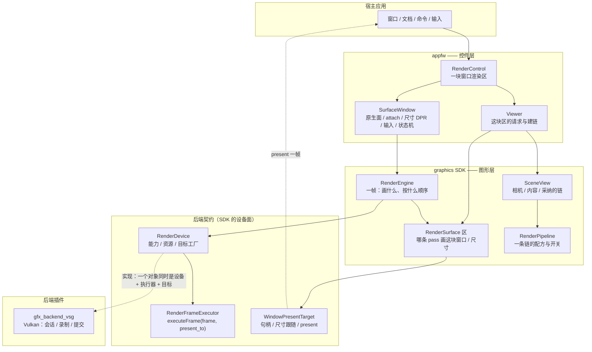
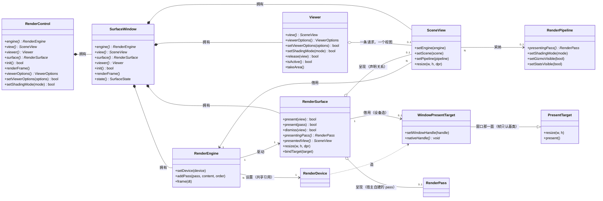

# 渲染视图模块说明：`Viewer` / 引擎 / 视图 / 区

> 模块说明：**架构图 · 类关系图 · 简单 demo**，外加"要多幅画面怎么办"与常见问题。
> 逐个入口的参考手册在同目录的 [`graphics.md`](graphics.md) §3.10 / §3.11 / §4.2；设计依据（为什么这样切、否决过什么）在
> `.ai/design/graphics-window-device-viewer.md` §2/§3/§6/§8；落地记录与判据在 `.ai/memory/graphics.md` /
> `.ai/memory/appfw.md` 顶部的 S8 / S9 / S10a 条与"多格下线"那条。

## 1. 这个模块管什么

一块**窗口渲染区**：窗口 → 目标（交换链）→ 区 → 引擎 → **一个视图**。`Viewer` 是"这块区画成什么样"的**请求半边**：
一条请求（`ViewerOptions`）= 一条链，建好、采纳、声明（区上），全部落在同一个设备上。

| 角色 | 代码位置 | 回答的问题 | 拥有的东西 |
| --- | --- | --- | --- |
| `RenderControl` | [RenderControl.hpp](../../src/fw/appfw/sdk/vine/appfw/gui/RenderControl.hpp) | "一块窗口渲染区"（宿主把它交给 Qt 布局） | 原生窗口（`SurfaceWindow`）——引擎/区/视图/`Viewer` 都在它里面 |
| `SurfaceWindow` | [SurfaceWindow.hpp](../../src/fw/appfw/src/gui/SurfaceWindow.hpp) | 原生面 + attach + 尺寸/DPR + 输入 | 引擎、区、视图、`Viewer` |
| `Viewer` | [Viewer.hpp](../../src/fw/appfw/sdk/vine/appfw/gui/Viewer.hpp) | "这块区怎么画"（appfw 层的请求与建链） | 一条请求（[ViewerOptions.hpp](../../src/fw/appfw/sdk/vine/appfw/gui/ViewerOptions.hpp)） |
| `SceneView` | [SceneView.hpp](../../src/viz/graphics/sdk/vine/graphics/SceneView.hpp) | "一台相机看什么" | 相机、内容场景、操纵器、采纳的那条链 |
| `RenderEngine` | [RenderEngine.hpp](../../src/viz/graphics/sdk/vine/graphics/RenderEngine.hpp) | "这一帧画什么、按什么顺序" | pass 注册表、帧上下文 |
| `RenderSurface` | [RenderSurface.hpp](../../src/viz/graphics/sdk/vine/graphics/RenderSurface.hpp) | "**哪条 pass 画这块窗口**、多大" | 呈现（一条）、尺寸与比例、目标（借用） |
| `RenderPipeline` | [RenderPipeline.hpp](../../src/viz/graphics/sdk/vine/graphics/RenderPipeline.hpp) | "一个视图怎么画"（一条链的配方与运行期开关） | 一条链的 pass、档、离屏目标 |

**一块区只画一幅画**（多格已下线）。这不是省事：一帧里两条都画默认帧缓冲的 pass 会互相擦，而"点归谁、谁有焦点、谁清屏"
这些事实没有一个 owner 时，踩过的坑是**静默**的（第二条清屏公告被后端丢掉、第二个共用相机的视图被静默吞掉）。
需要两幅画面时，正确做法是**你自己说清接线**（见 §6）。

## 2. 架构图



分层读法（自上而下，每层只依赖下一层的契约）：

- **appfw**：把"窗口"这一件平台的事收进 `RenderControl` / `SurfaceWindow`（attach、尺寸、输入、失败状态机），把"这块区怎么画"收进 `Viewer`。
- **graphics SDK**：帧的单位是引擎（`RenderEngine`）；视图只采纳链（`SceneView` + `RenderPipeline`）；"谁画这块窗口"是区自己的呈现（`RenderSurface`）。
- **后端契约**：设备（`RenderDevice`）造目标（`WindowPresentTarget`，即 `PresentTarget` 的窗口实现）、跑帧（`RenderFrameExecutor`）；三者今天由插件的一个对象同时实现（`RenderBackend` 是那个聚合）。**帧只认 `PresentTarget`**（`resize` + `present`）：窗口那两条动词（`setWindowHandle` / `nativeHandle`）只属于拥有窗口的宿主。
- **插件**：Vulkan 的会话、录制与提交，宿主不直接碰。

## 3. 类关系图



关系上的四条要点：

1. **拥有 vs 借用**：`RenderControl`/`SurfaceWindow` 拥有引擎、区、视图与 `Viewer`；视图是**借**引擎的（`SceneView::setEngine`）；**区是引擎自己的**（`RenderEngine::createSurface()` 造出来并由引擎持有，宿主拿的只是一个句柄）。
2. **`Viewer` 不拥有"呈现"**：`isActive()` / `view()` 读的是区（`presentedView()`），`Viewer` 只存那条请求与为建链持有的视图引用。
3. **一个视图同时只呈现在一块区上**：呈现在别处的视图会被区**拒绝 + 报一次**（它从"自己呈现的那块区"读尺寸，两处就说不清画哪）。
4. **目标由设备造、区借用**：`RenderDevice::createSurfaceTarget(...)` 交出的目标归设备；`RenderSurface::bindTarget(target)` 只是借来用（重建窗口是**在旧目标上重公告**，不是第二把目标）。

## 4. 简单使用 demo：一块窗口，一幅画面

```cpp
#include <QApplication>
#include <QVBoxLayout>
#include <QWidget>

#include <vine/appfw/gui/RenderControl.hpp>   // 一块窗口渲染区
#include <vine/appfw/gui/Viewer.hpp>          // 这条请求与建链
#include <vine/graphics/Scene.hpp>
#include <vine/graphics/SceneView.hpp>
#include <vine/intrusive_ptr.hpp>

int main(int argc, char** argv)
{
    QApplication app(argc, argv);

    QWidget window;
    auto*   layout = new QVBoxLayout(&window);

    // ① 一块窗口渲染区：构造只组装（引擎 / 区 / 视图 / Viewer 都在里面，还没有会话）
    auto* control = new vn::appfw::gui::RenderControl();
    layout->addWidget(control->impl<QWidget>());

    // ② 配置（放在 new 之后的同步代码里，赶在 attach 之前）：设备不装就用注册表里第一个（插件加载后是 "vsg"）
    auto scene = vn::intrusive_ptr<vn::graphics::Scene>(new vn::graphics::Scene());
    control->view()->setScene(scene);          // 内容（相机是视图自带的）

    // ③ 一条请求 = 一条链：建好、采纳、在区上声明，一次做完（默认路径本来就有它，这一步只是改要求）
    vn::appfw::gui::ViewerOptions request;     // 链 / 档 / HUD / 离屏尺寸 / 内容分层
    request.path  = vn::graphics::ShadingPath::Deferred;   // 默认就是它
    request.gizmo = true;                      // 左下角坐标轴
    // request.layer_mask = 1u << 1;           // 这块区只画 layer 1 的内容（见 §6 的分层一条）
    control->setViewerOptions(request);        // 控件的老入口 = 作用于它那个视图

    // ④ 显示：第一拍兜底自动 attach（"配置窗口"：构造之后的同步代码都赶得上）
    window.show();
    return app.exec();
}
```

跑起来之后能直接用的：`control->renderFrame()`（按需出帧）、`control->setContinuousRendering(true)`（连续帧）、
`control->setShadingMode(...)`（换档：链表达得了就零重建）、`control->fitToScreen()`。

## 5. `setViewerOptions(options)`：三步，以及"这个 View 的 surface 是什么"

`Viewer::setViewerOptions` 把一条请求需要的顺序**一次做完**：

1. **建链**：`RenderPipelineBuilder` 按 `options` 建（相机与内容取自这个视图，HUD 的像素比取自区）；
2. **采纳**：`view->setPipeline(...)` —— 视图从此画的就是这条链；
3. **声明**：`surface->present(view)` —— 区记下"这块窗口由这条链的窗口 pass 画"，并把 `view.setSurface(区)`。

**这个 View 的 surface 就是它声明的那块区**（对控件来说 = `control->surface()`），绑定发生在第 3 步里。所以：

- "View 的 surface"不是构造参数，而是**声明关系**：谁声明了它，谁就是它现在的 surface（`presentedView()` 是读法）。
- 同一时刻一个视图最多呈现在一块区上：已经呈现在别处的视图会被区**拒绝 + 报一次**。
- 前提：视图必须已绑定**这个引擎**（`view->setEngine(control->engine())`）。
- 建链失败不会留下半个状态：请求与链都停在调用前（`Viewer` 只在建链成功后才改记住的请求）。
- 解除：`viewer->release(view)` —— 区里撤掉声明、`view.setSurface(nullptr)`，视图回到独立形态；链仍**采纳**在视图上（采纳是单向的），宿主换画法用 `setPipeline`。

```cpp
// 区这一侧的读法（控件把区交出来：control->surface()）
vn::raw_ptr<vn::graphics::SceneView> who = control->surface()->presentedView();   // 谁在画这块窗口（宿主自建 pass 时为 null）
vn::raw_ptr<vn::graphics::RenderPass> which = control->surface()->presentingPass();  // 哪条 pass 在画
```

## 6. 要多幅画面（分屏 / PiP / 叠加）怎么办

**自己说清接线**，SDK 不替你猜：

- **一条 pass 只画一部分内容**：内容分层（`Node::setLayers`）＋ pass 的掩码（`RenderPass::setLayerMask`，或用配方
  `RenderPipelineOptions::layer_mask` / `ViewerOptions::layer_mask` 一次给整条链）。一条命令是否被收集 = `isVisible()`
  且它的层与掩码按位与非 0；没声明层的节点在 `kDefaultLayer`，掩码默认 `kAllLayers`（⇒ 不说就一切照旧）。例：
  阴影 caster 标 `caster->setLayers(1u << 1)`，阴影 pass 掩码 `1u << 1`，其余内容一个字都不用改。细节见
  `docs/guides/graphics.md` §3.14。
- **PiP / 画中画**：给那条 pass 一个子矩形（`pass->setViewport(Viewport{...})`，设备像素）、并让它的输入是另一张**离屏目标**
  （`RenderTarget`，作为 pass 的输入声明）。`VINE_VSG_*` 那几个 demo 开关走的就是这条路。
- **两块并排**：两支 pass，各自一个子矩形、各自读自己的离屏目标；**清屏只有一条**（`setClearEnabled(false)` 关掉其余的，
  或者只让第一条清）—— 否则第二条会把第一条画的擦掉。位置与尺寸由你的布局算（`resize` 的一次公告 + 你的矩形）。
- **叠加 HUD**：在默认画面那条 pass 之后加一条不做深度、不清屏的 pass（`PipelineStage::Overlay` 就是给它的档位）。
- **要第二个"相机 + 内容"**：那就是第二个视图，得配第二个窗口（第二个 `RenderControl`）——一个区只画一幅画。

## 7. 多窗口

**一个 `RenderControl` = 一块窗口渲染区 = 一个引擎 = 一个区 = 一个 `Viewer` = 一把目标。**
所以多窗口就是**多个控件**（多文档窗口走的就是这条路）：

```cpp
// 第二个窗口：自己的一整套（引擎 / 区 / 目标 / Viewer）
auto* second = new vn::appfw::gui::RenderControl();
second->view()->setScene(control->view()->scene());   // 内容可以共享：同一个 Scene 交给两条链
```

- **能不能用一个 `Viewer` 管两块窗口？不能，且刻意如此**：`Viewer` 构造时就绑死一个引擎 + 一块区，`view()` / `isActive()` 都是**按区**的读。
- **同一份内容进两个窗口**：内容场景（`Scene`，以及它下面那些后端无关的 Node）**可以共享** —— 把它交给两个窗口各自的链即可；**相机是每个视图自带的**，要两个窗口看同一个角度，就在应用层同步两台相机的状态。
- **代价（今天）**：GPU 副本与编译按**后端设备**算 —— 两个窗口 = 两份显存、两遍编译。
- **上限是 4（本 build）**：同时存在的渲染设备数由 vsg 的 `VSG_MAX_DEVICES` 决定（见 `gfx_backend_vsg/CMakeLists.txt`），
  而一块窗口渲染区 = 一个设备 ⇒ 第 5 块窗口会在 attach 时**以理由失败**（控件进 `Failed`，`failureReason()` 说明"本 build
  至多 4 个同时设备、先关一个"），不是把异常丢进你的事件循环。被判据钉住的是
  `VsgBackendTest.ADeviceCapThatIsReachedIsAReasonAndNotAnException`。
- **设备共享（以后）**：`Device : Engine = 1 : N` 落地（S10b：插件的会话提升成设备）后，两个窗口可以共享一个设备（一份显存、一次编译），但仍然是**两个区、两个引擎、两个 `Viewer`** —— `Viewer : 区 = 1 : 1` 不动。
- **一帧跨多窗口**（同一场画面铺满两块屏）= S11，登记不做。

## 8. 常见问题

| 问题 | 答案 |
| --- | --- |
| 一个 `SceneView` 几个引擎？ | 至多一个（`setEngine` 借来的，N 个视图可以共享一个引擎）。 |
| 一个 `Viewer` 几个引擎？ | 恰好一个（构造时绑定）；它管的就是"这块区的那条请求"。 |
| 一个窗口几幅画面？ | **一幅**（一块区一条呈现）。第二幅要么自己接管（先把 `viewer()->release(view)`），要么另开一个窗口。 |
| 一个窗口几个区/目标？ | 一个区、一把目标（一块窗口一条在场上交换链）。 |
| 多个窗口几个引擎/设备？ | 今天：每窗口一个引擎、一个设备；S10b 后：引擎仍是每窗口一个，**设备可由多窗口共享**。 |
| 一个视图能同时画在两块窗口里吗？ | 不能（它从自己呈现的那块区读尺寸）。要两处都画就两个视图、共享内容 Scene。 |
| 相机 / 内容能共享吗？ | 内容（`Scene`）可以（`setScene`）；相机不共享，是每个视图自带的。 |
| 宿主自建了主 pass，默认画面去哪了？ | 让位：`viewer->isActive() == false`，`takeArea()` 什么都不建；已经上线的要先 `viewer->release(view)` 再声明（一块区一次只画一幅画，第二条呈现会被拒并说出来）。 |
| 怎么知道"谁在画这块窗口"？ | `surface->presentingPass()`（哪条 pass）与 `surface->presentedView()`（哪个视图，宿主自建 pass 时为 null）。 |
| 点击选中 / 高亮怎么接？ | 输入只到**操纵器**（`SceneView::setManipulator`）：换一个操纵器，把点击变成 `Camera::screenToWorldRay` + `RayIntersection::intersectScene` 的拾取。**选中态与高亮是业务**（框架里没有这个概念），参考实现见 `model_viewer`；用法与坑见 `graphics.md` §3.16。 |
