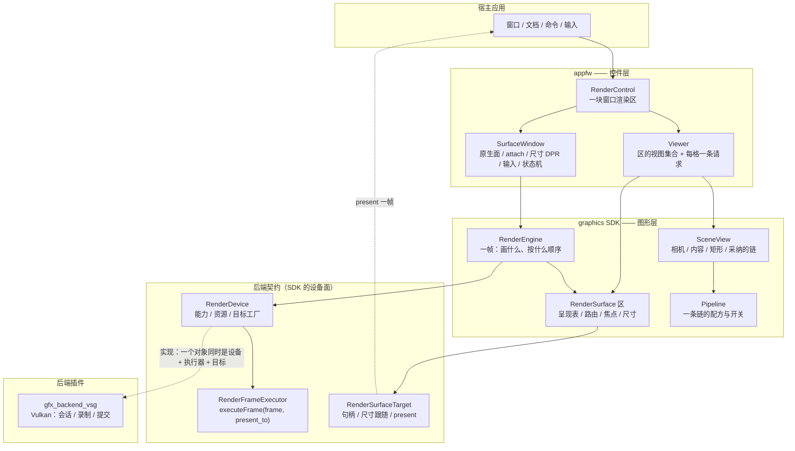
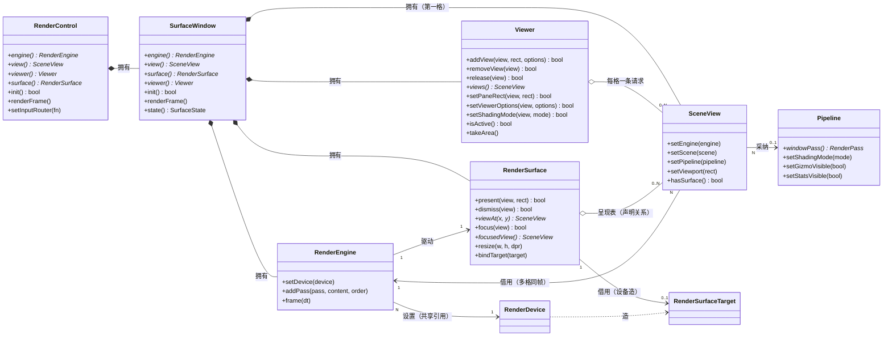

# 渲染视图模块说明：`Viewer` / 引擎 / 视图 / 区

> 模块说明：**架构图 · 类关系图 · 简单 demo**，外加多格、多窗口的用法与常见问题。
> 逐个入口的参考手册在同目录的 [`graphics.md`](graphics.md) §3.10 / §3.11；设计依据（为什么这样切、否决过什么）在
> `.ai/design/graphics-window-device-viewer.md` §3 Q3/Q5、§6 基数表、§8 否决清单；落地记录与判据在
> `.ai/memory/graphics.md` / `.ai/memory/appfw.md` 顶部的 S8 / S9 / S10a 条。

## 1. 这个模块管什么

一块**窗口渲染区**里的"多格"（一个窗口里并排的 N 个视图）与"多窗口"（N 块各自的区）。
一句话链条：**窗口 → 目标 → 区 → 引擎 → N 个视图**；`Viewer` 挂在"区"上，管"这个区里有哪几格、每格怎么画"。

| 角色 | 代码位置 | 回答的问题 | 拥有的东西 |
| --- | --- | --- | --- |
| `RenderControl` | [RenderControl.hpp](../../src/fw/appfw/sdk/vine/appfw/gui/RenderControl.hpp) | "一块窗口渲染区"（宿主把它交给 Qt 布局） | 原生窗口（`SurfaceWindow`）——引擎/区/视图/`Viewer` 都在它里面 |
| `SurfaceWindow` | [SurfaceWindow.hpp](../../src/fw/appfw/src/gui/SurfaceWindow.hpp) | 原生面 + attach + 尺寸/DPR + 输入 | 引擎、区、第一格视图、`Viewer` |
| `Viewer` | [Viewer.hpp](../../src/fw/appfw/sdk/vine/appfw/gui/Viewer.hpp) | "这个区里有哪几格、每格怎么画"（appfw 层） | 每格一条请求（[ViewerOptions.hpp](../../src/fw/appfw/sdk/vine/appfw/gui/ViewerOptions.hpp)） |
| `SceneView` | [SceneView.hpp](../../src/viz/graphics/sdk/vine/graphics/SceneView.hpp) | "一台相机看什么、画在哪个矩形" | 相机、内容场景、操纵器、采纳的那条链、矩形 |
| `RenderEngine` | [RenderEngine.hpp](../../src/viz/graphics/sdk/vine/graphics/RenderEngine.hpp) | "这一帧画什么、按什么顺序" | pass 注册表、帧上下文 |
| `RenderSurface` | [RenderSurface.hpp](../../src/viz/graphics/sdk/vine/graphics/RenderSurface.hpp) | "谁画这块、画在哪、谁清屏、多大" + 路由/焦点 | 呈现表、尺寸与比例、目标（借用） |
| `Pipeline` | [RenderPipeline.hpp](../../src/viz/graphics/sdk/vine/graphics/RenderPipeline.hpp) | "一个视图怎么画"（一条链的配方与运行期开关） | 一条链的 pass、档、离屏目标 |

## 2. 架构图



分层读法（自上而下，每层只依赖下一层的契约）：

- **appfw**：把"窗口"这一件平台的事收进 `RenderControl` / `SurfaceWindow`（attach、尺寸、输入路由、失败状态机），并把"多格"收进 `Viewer`。
- **graphics SDK**：帧的单位是引擎（`RenderEngine`）；视图只采纳链（`SceneView` + `Pipeline`）；"谁画这块区"是区自己的呈现表（`RenderSurface`）。
- **后端契约**：设备（`RenderDevice`）造目标（`RenderSurfaceTarget`）、跑帧（`RenderFrameExecutor`）；三者今天由插件的一个对象同时实现（`RenderBackend` 是那个聚合）。
- **插件**：Vulkan 的会话、录制与提交，宿主不直接碰。

## 3. 类关系图



关系上的四条要点：

1. **拥有 vs 借用**：`RenderControl`/`SurfaceWindow` 拥有引擎、区、第一格视图与 `Viewer`；视图是**借**引擎的（`SceneView::setEngine`，一个引擎可以有几格）；区与引擎是**互相指认**的（`RenderSurface` 构造时登记到引擎，`adoptArea`）。
2. **`Viewer` 不拥有视图集合**：`viewer->views()` / `isActive()` 都是**读区的呈现表**；`Viewer` 只存"每格一条请求"（`ViewerOptions`）与为建链持有的视图引用。
3. **一个视图同时只属于一块区**：呈现在别处的视图会被表拒绝（报一次）；`SceneView::hasSurface()` 是"我是不是某块区的呈现"。
4. **目标由设备造、区借用**：`RenderDevice::createSurfaceTarget(...)` 交出的目标归设备；`RenderSurface::bindTarget(target)` 只是借来用（重建窗口是**在旧目标上重公告**，不是第二把目标）。

## 4. 简单使用 demo：一块窗口，两格分屏

```cpp
#include <QApplication>
#include <QVBoxLayout>
#include <QWidget>

#include <vine/appfw/gui/RenderControl.hpp>   // 一块窗口渲染区
#include <vine/appfw/gui/Viewer.hpp>          // 多格
#include <vine/graphics/Scene.hpp>
#include <vine/graphics/SceneView.hpp>
#include <vine/intrusive_ptr.hpp>

int main(int argc, char** argv)
{
    QApplication app(argc, argv);

    QWidget window;
    auto*   layout = new QVBoxLayout(&window);

    // ① 一块窗口渲染区：构造只组装（引擎 / 区 / Viewer 都在里面，还没有会话）
    auto* control = new vn::appfw::gui::RenderControl();
    layout->addWidget(control->impl<QWidget>());

    // ② 配置（放在 new 之后的同步代码里，赶在 attach 之前）：
    //    设备不装就用注册表里第一个（插件加载后是 "vsg"）；第一格 = 控件自己的视图
    auto scene = vn::intrusive_ptr<vn::graphics::Scene>(new vn::graphics::Scene());
    control->view()->setScene(scene);          // 第一格的内容（相机是它自带的）

    // ③ 右格：建链 -> 采纳 -> 在区上声明，一次做完
    vn::appfw::gui::ViewerOptions request;     // 每格的请求：链 / 档 / HUD / 离屏尺寸
    request.path = vn::graphics::ShadingPath::Deferred;

    auto right = vn::intrusive_ptr<vn::graphics::SceneView>(new vn::graphics::SceneView());
    right->setEngine(control->engine());       // 必须同引擎：两格同帧
    right->setScene(scene);                    // 内容可以两格共享（相机各自一台）
    control->viewer()->addView(right, vn::graphics::NormalizedViewport{ 0.5, 0.0, 0.5, 1.0 }, request);

    // ④ 显示：第一拍兜底自动 attach（"配置窗口"：构造之后的同步代码都赶得上）
    window.show();
    return app.exec();
}
```

跑起来之后能直接用的：`control->renderFrame()`（按需出帧）、`control->setContinuousRendering(true)`（连续帧）、
`control->setInputRouter(...)`（自定义输入路由）、`control->surface()->viewAt(x, y)` / `focus(view)`（多格的路由与焦点）。

## 5. `addView(view, rect, options)`：三步，以及"这个 View 的 surface 是什么"

`Viewer::addView` 把一格需要的顺序**一次做完**：

1. **建链**：`RenderPipelineBuilder` 按 `options` 建（相机与内容取自这个视图，HUD 的像素比取自区）；
2. **采纳**：`view->setPipeline(...)` —— 视图从此画的就是这条链；
3. **声明**：`surface->present(view, rect)` —— 区在自己的呈现表里加一条，并把 `rect` 记在那里。

**这个 View 的 surface 就是"Viewer 绑的那块区"**（对控件来说 = `RenderControl::surface()`），绑定发生在第 3 步里：
表加了条目之后 `view.setSurface(区)`。所以：

- "View 的 surface"不是构造参数，而是**声明关系**：谁声明了它，谁就是它现在的 surface；`SceneView::hasSurface()` 是这个问题的读法。
- 同一时刻一个视图最多呈现在一块区上：已经呈现在别处的视图会被表**拒绝 + 报一次**；要同时画在第二块窗口，就新建一个视图（内容可以共享，见 §7）。
- 前提：视图必须已绑定**同一个引擎**（`view->setEngine(control->engine())`）；`addView` 自己建链，所以宿主只需要 bind engine。
- 任何一步失败都会**回滚**：新格不留下（引用丢掉）、老格的链与请求还原到调用前，失败后不必手动收拾。
- 解除：`removeView(view)` / `release(view)` 是同一个动作 —— 表里撤掉声明、`view.setSurface(nullptr)`、矩形**退回视图自己**（视图回到"独立形态"，自己带矩形）。链仍**采纳**在这个视图上（采纳是单向的），宿主换画法用 `setPipeline`。

```cpp
// 区这一侧的读法（控件把区交出来：control->surface()）
for (vn::raw_ptr<vn::graphics::SceneView> view : control->viewer()->views()) { /* 读的是区的呈现表 */ }
vn::raw_ptr<vn::graphics::SceneView> under = control->surface()->viewAt(0.75, 0.25);  // 点归哪一格
control->surface()->focus(right.get());                                              // 焦点（命令里的"当前视图"）
control->viewer()->setPaneRect(right.get(), vn::graphics::NormalizedViewport{ 0.0, 0.0, 1.0, 0.5 }); // 改矩形：几何，不重建
```

## 6. 一块区里的 N 格（运行期）

- **控件自己的视图是第一格**（`control->view()`）。控件上的老三条 —— `viewerOptions()` / `setViewerOptions()` / `setShadingMode()` —— 是**作用于第一格**的转发（S8 保留的公开面）；其余格用 `Viewer` 上带 `view` 参数的那组入口。
- **每格一条请求**：`viewer->setViewerOptions(view, options)` 是**建链**（结构变了才用）；`viewer->setShadingMode(view, mode)` 是**换档**（链表达得了就零重建，表达不了就按当前请求重建并搬运行期选择）。"有没有这一档"是请求（`options.gizmo/stats`），"看不看得见"是链上的开关（`Pipeline::setGizmoVisible/setStatsVisible`）。
- **清屏归区**：表里**第一条**呈现清屏，后面的不清 —— 多格拼起来才是整块画面。
- **接管（宿主自建主 pass）**：宿主在区上声明自己的主 pass（`surface->present(pipeline->windowPass())`）时 `viewer->isActive()` 变 `false`，`takeArea()` 什么都不做（让位）—— 默认链一条都不会建。单格接管用 `viewer->release(view)`。
- **输入**：默认按矩形路由（`surface()->viewAt`）；`control->setInputRouter(...)` 是**覆盖**（返回 `nullptr` 交回矩形），不是替代。

## 7. 多窗口

**一个 `RenderControl` = 一块窗口渲染区 = 一个 `Viewer` = 一个引擎 = 一个区 = 一把目标。**
所以多窗口就是**多个控件**（多文档窗口走的就是这条路）：

```cpp
// 第二个窗口：自己的一整套（引擎 / 区 / 目标 / Viewer）
auto* second = new vn::appfw::gui::RenderControl();
second->view()->setScene(control->view()->scene());   // 内容可以共享：同一个 Scene 交给两条链
```

- **能不能用一个 `Viewer` 管两块窗口？不能，且刻意如此**：`Viewer` 构造时就绑死一个引擎 + 一块区，`views()` / `isActive()` / 路由 / 焦点都是**按区**的读。要它管多窗口就得存多份视图集合/矩形（"表是唯一 owner"被否决），或引入窗口布局树（"布局归应用层"被否决）。
- **同一份内容进两个窗口**：内容场景（`Scene`，以及它下面那些后端无关的 Node）**可以共享** —— 把它交给两个窗口各自的链即可；**相机是每个视图自带的**（没有"换成别的相机"的入口），要两个窗口看同一个角度，就在应用层同步两台相机的状态。
- **代价（今天）**：GPU 副本与编译按**后端设备**算 —— 两个窗口 = 两份显存、两遍编译。
- **设备共享（以后）**：`Device : Engine = 1 : N` 落地（S10b：插件的会话提升成设备）后，两个窗口可以共享一个设备（一份显存、一次编译），但仍然是**两个区、两个引擎、两个 `Viewer`** —— `Viewer : 区 = 1 : 1` 不动。
- **一帧跨多窗口**（同一场画面铺满两块屏）= S11，登记不做。

## 8. 常见问题

| 问题 | 答案 |
| --- | --- |
| 一个 `SceneView` 几个引擎？ | 至多一个（`setEngine` 借来的，N 个视图可以共享一个引擎）。 |
| 一个 `Viewer` 几个引擎？ | 恰好一个（构造时绑定）；它就是"这个区"的视图集合与每格请求。 |
| 一个窗口几个区/目标？ | 一个区、一把目标（一块窗口一条在场上交换链）。 |
| 多个窗口几个引擎/设备？ | 今天：每窗口一个引擎、一个设备；S10b 后：引擎仍是每窗口一个，**设备可由多窗口共享**。 |
| 一个视图能同时画在两块窗口里吗？ | 不能（`View : 区 ≤ 1`）。要两处都画就两个视图、共享内容 Scene。 |
| 一个 `Viewer` 能管多窗口吗？ | 不能（见 §7）。多窗口 = 多 `Viewer`，应用层自己持有。 |
| 相机 / 内容能共享吗？ | 内容（`Scene`）可以（`setScene`）；相机不共享，是每个视图自带的。 |
| 控件上的 `viewerOptions/setViewerOptions/setShadingMode` 作用于哪一格？ | 第一格（控件自己的视图）；其余格用 `Viewer` 上带 `view` 参数的那组入口。 |
| 宿主自建了主 pass，默认画面去哪了？ | 让位：`viewer->isActive() == false`，`takeArea()` 什么都不建（只让出一格则用 `viewer->release(view)`）。 |
